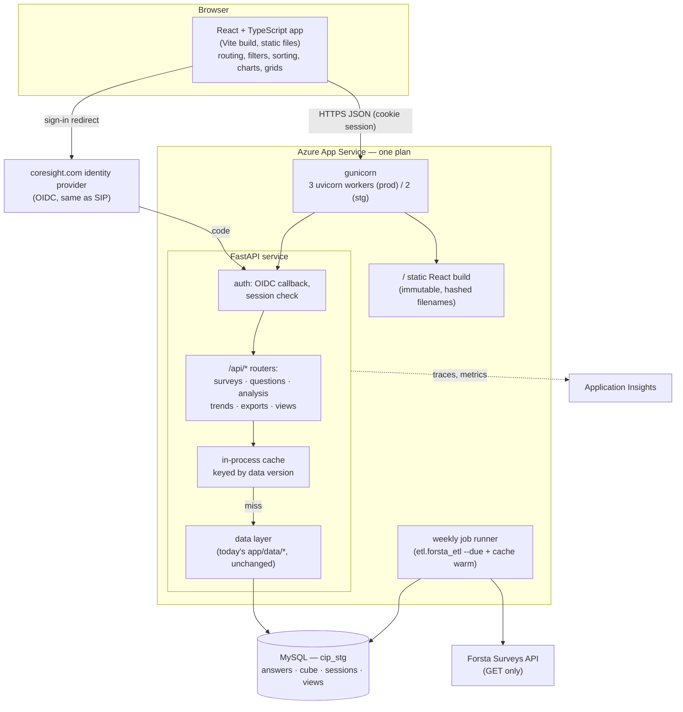
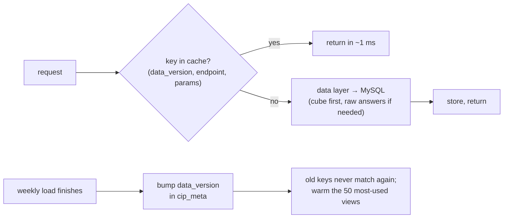
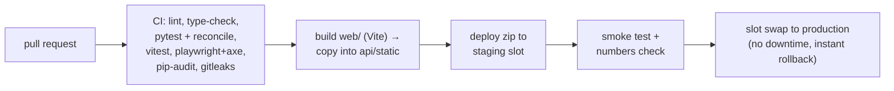
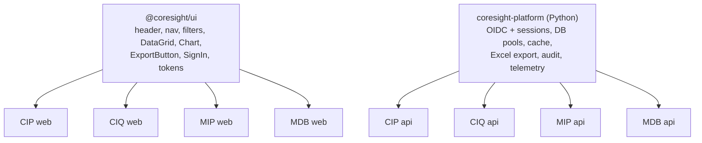

# CIP UI — System Design

How the Coresight Insight Platform's screens are built and served on the
infrastructure we already have: **one Azure App Service plan and one MySQL
database**. The reasoning behind each technology choice, with the evidence, is
in [12-ui-technology-decision.md](12-ui-technology-decision.md). This document
is the blueprint.

Status: proposed · 18 October 2026

---

## 1. Goals and constraints

| | |
|---|---|
| **Users** | Coresight analysts first, then paying clients signed in with their coresight.com account |
| **Jobs** | Wave overview · question browser · cross-tab / analysis builder with groups (cohorts) and breaks · trends across waves · Excel/PNG export · saved views |
| **Data** | `cip_stg` MySQL: 144 waves, 71,474 qualified respondents, 10.4 M answer rows, pre-computed cube; one new wave a week from Forsta |
| **Hard constraints** | One App Service (staging P0v3 1 vCPU / 4 GB, production P1v3 2 vCPU / 8 GB). One MySQL. No new paid licences |
| **Targets** | Click → result < 100 ms when cached, < 1 s uncached · first page < 2 s · 300 people active at once on production · numbers identical to publications · WCAG 2.2 AA |
| **Reuse** | The same design carries CIQ, MIP and MDB |

Non-goals for release 1: mobile-first layouts, real-time data, self-serve
sign-up, multi-region failover.

---

## 2. Architecture



**One process type, one deploy.** The FastAPI service serves the React build
as static files *and* the JSON API on the same origin. That avoids CORS,
cross-site cookies and a second runtime (no Node server on the box).

**Stateless service.** No per-user state lives in a worker; the session row
lives in MySQL, the view state lives in the browser URL. Any worker can answer
any request, so memory does not grow with users, and a second instance later
needs no code change.

---

## 3. Components

### 3.1 Front end (`web/`)

| Concern | Choice | Notes |
|---|---|---|
| Framework | React 19 + TypeScript, built with Vite as a static single-page app | No server rendering: the portal is behind a login, so search indexing is irrelevant, and it removes the Server Components vulnerability class (CVE-2025-55182) |
| Routing | React Router; **all view state in the URL** (`/cross-tab?wave=144&q=Q12&by=age&group=beauty`) | Bookmarks, share links, Back button all work — impossible to do cleanly in Streamlit |
| Data fetching | TanStack Query | Caches responses in the browser, deduplicates, retries, shows stale data while refreshing |
| Tables | AG Grid Community (MIT) | Frozen columns, virtual scrolling, column sort/resize |
| Charts | Apache ECharts (Apache-2.0) | Canvas rendering, heatmaps for cross-tabs, PNG export built in |
| Components | Tailwind + shadcn/ui (same kit as EMS) | Accessible primitives; Coresight tokens |
| API types | Generated from the service's OpenAPI with `openapi-typescript` (as SMS does) | Front and back cannot drift |
| Tests | Vitest (components), Playwright + axe (journeys, accessibility) | |

Screens for release 1: **Overview · Questions · Cross-tab builder · Trends ·
Saved views**. Internal pages (Mappings, Data Health, Publications) stay on the
existing Streamlit app until they are worth moving — they have a handful of
users, which is exactly what Streamlit is good at.

### 3.2 Service (`api/`)

```
api/
  main.py            FastAPI app, middleware, static mount
  auth.py            OIDC login/callback/logout, session dependency
  routers/
    surveys.py       GET /api/surveys, /api/surveys/{id}
    questions.py     GET /api/surveys/{id}/questions, /api/search
    analysis.py      POST /api/analysis  (cross-tab from a definition)
    trends.py        GET /api/concepts/{id}/trend
    exports.py       POST /api/exports/xlsx
    views.py         GET/POST/DELETE /api/views
  cache.py           version-keyed TTL cache
```

The data layer is **today's `app/data/` modules** (`repository.py`, `cube.py`,
`cohorts.py`, `harmonise.py`, `publications.py`). They already return pandas
frames and already reproduce every published cell (667/667 and 788/788,
`scripts/reconcile.py`). The routers call them and serialise the result; the
only change is replacing `@st.cache_data` with the service cache.

### 3.3 API contract (release 1)

| Method | Path | Returns | Cache |
|---|---|---|---|
| GET | `/api/me` | user, plan, roles | none |
| GET | `/api/surveys` | waves with dates, n | data version |
| GET | `/api/surveys/{id}/overview` | sample composition, headline tiles | data version |
| GET | `/api/surveys/{id}/questions` | question catalogue | data version |
| GET | `/api/search?q=` | matching questions/concepts | data version |
| POST | `/api/analysis` | cross-tab cells, bases, significance flags | data version + definition hash |
| GET | `/api/concepts/{id}/trend?group=` | series across waves | data version |
| POST | `/api/exports/xlsx` | Excel file with footnotes | none (streamed) |
| GET/POST/DELETE | `/api/views` | saved views for the user | none |
| GET | `/healthz` | DB reachable, data version | none |

Every response carries `ETag: <data_version>-<hash>`; the browser revalidates
with `If-None-Match` and gets `304 Not Modified` for free when nothing changed.

### 3.4 Caching

Survey data changes once a week, so caching is the main speed lever and it is
simple to make correct.



- `data_version` = id of the latest successful load, read from MySQL once a
  minute. A new wave changes it; stale entries are simply never asked for again
  and age out.
- Per-worker LRU, capped at about 300 MB per worker on production. No Redis:
  it would be a second service to run and only pays off with several instances.
- Three levels in total: browser (TanStack Query + ETag), service memory,
  MySQL cube. A repeat view never reaches MySQL.

### 3.5 Database use

| Item | Setting |
|---|---|
| Accounts | `cip_portal_ro` (SELECT only on `cip_*`/`v_cip_*`) for the API; `cip_portal_rw` limited to `cip_session`, `cip_saved_view`, `cip_audit` |
| Pool | 5 per worker + 5 overflow → at most 30 connections on production (B2s default max_connections is 341) |
| Queries | Bound parameters only; column names from allow-lists (as `profile_counts` already does) |
| New tables | `cip_session` (id, user, expires, plan), `cip_audit` (who exported what, when) |
| Timeouts | `MAX_EXECUTION_TIME` 10 s on ad-hoc analysis queries |

### 3.6 Weekly job

Today `scripts/weekly_forsta.py` runs from launchd on a laptop. On the server it
runs as a second process started by the App Service startup script, guarded by
a MySQL `GET_LOCK('cip_weekly', 0)` so only one copy ever runs. After a load it
bumps `data_version` and calls the warm-up endpoint. (Alternative if IT
prefers: an Azure Functions timer trigger on the consumption plan — pennies a
month. Open question for IT.)

---

## 4. Request flows

### 4.1 Sign-in

```mermaid
sequenceDiagram
    participant B as Browser
    participant S as CIP service
    participant I as coresight.com IdP
    participant D as MySQL
    B->>S: GET /api/me (no session)
    S-->>B: 401
    B->>S: GET /auth/login
    S->>S: create state, nonce, PKCE verifier (S256), store server-side
    S-->>B: 302 to IdP /authorize
    B->>I: sign in
    I-->>B: 302 /auth/callback?code&state
    B->>S: GET /auth/callback
    S->>S: check state matches, exchange code + verifier
    S->>I: POST /token, GET /userinfo (membership)
    S->>D: INSERT cip_session (random id, user, plan, expires)
    S-->>B: Set-Cookie: cip_sid=…; HttpOnly; Secure; SameSite=Lax
    B->>S: GET /api/me
    S->>D: look up session
    S-->>B: user, plan
```

The browser never sees an access token. A forged or stale cookie finds no
session row and gets 401. Membership is re-checked hourly; **if the check
fails, access stops** (the opposite of SIP today).

### 4.2 A cross-tab

```mermaid
sequenceDiagram
    participant U as User
    participant B as React app
    participant S as Service
    participant C as Cache
    participant D as MySQL
    U->>B: choose question, break by age, group = Beauty shoppers
    B->>B: update URL, show previous result dimmed
    B->>S: POST /api/analysis {wave, question, by, group}
    S->>S: session check (1 indexed lookup)
    S->>C: get(version, hash(definition))
    alt cached
        C-->>S: cells
    else not cached
        S->>D: cube query (or raw answers for an ad-hoc group)
        D-->>S: rows
        S->>C: put
    end
    S-->>B: JSON cells + bases + footnote
    B->>B: render grid + chart; sorting and toggles need no server
```

Compare Streamlit: the same click re-runs the whole page script on the server,
re-serialises every widget, chart and table, and sends them down the websocket.

---

## 5. Security design

| Threat | Control |
|---|---|
| Session theft by script | Session id cookie is HttpOnly + Secure + SameSite=Lax; tokens never reach JS |
| Forged session | Session looked up server-side on every call; random 256-bit id |
| Login CSRF / code interception | OIDC state + nonce checked; PKCE S256 |
| Cross-site request forgery | SameSite cookie + `X-CSRF-Token` header on every POST/DELETE |
| XSS | React escapes output; no `dangerouslySetInnerHTML`; CSP `default-src 'self'` with no inline script |
| SQL injection | Bound parameters; allow-listed identifiers; read-only DB account |
| Data overreach | Plan/role checked in a FastAPI dependency on every router; exports capped and audited |
| Brute force / scraping | Per-user and per-IP rate limits on `/api/*` and `/auth/*` |
| Secrets | App Service settings with Key Vault references; `gitleaks` in CI; nothing in the repo |
| Vulnerable dependencies | Lock files (`uv.lock`, `pnpm-lock.yaml`); `pip-audit`, `pnpm audit`, Dependabot weekly |
| Diagnostics exposure | No debug/admin pages in the client app; logs to Application Insights only |

Before client launch: external penetration test and OWASP ASVS level 2 checklist.

---

## 6. Deployment and operations



| Item | Setting |
|---|---|
| Startup command | `gunicorn api.main:app -k uvicorn.workers.UvicornWorker -w 3 --timeout 60 --max-requests 2000 --max-requests-jitter 200` (`-w 2` on staging) |
| `--max-requests` | Recycles a worker after 2,000 requests: caps any slow memory creep without a restart of the site |
| Health check | App Service health check on `/healthz` |
| ARR affinity | Off (stateless) |
| WebSockets | Off (not needed) |
| Logs and metrics | OpenTelemetry → Application Insights: p50/p95 per route, error rate, cache hit rate, DB time |
| Alerts | p95 > 1 s for 10 min · error rate > 1 % · memory > 75 % · weekly job not finished by Tuesday 09:00 |

---

## 7. Capacity

Measured on a copy of CIP (details and scripts in
[12-ui-technology-decision.md §4](12-ui-technology-decision.md#4-what-we-measured)),
then scaled to Azure assuming one Azure vCPU ≈ ⅓ of the test core and real
payloads 10× the test payload.

| | Staging P0v3 | Production P1v3 |
|---|---|---|
| Workers | 2 | 3 |
| Service memory | ~0.3 GB + ≤ 0.6 GB cache | ~0.45 GB + ≤ 0.9 GB cache |
| Cached throughput | ~190 req/s | ~380 req/s |
| People active at the same moment (comfortable) | ~100 | ~300 |
| Bursts absorbed | ~300 | ~1,000 |
| Registered users supported (5–10 % concurrency) | 1,000–2,000 | 3,000–6,000 |

The limit after that is MySQL on cache misses, not the web tier. Before client
launch: a k6 or Locust run on staging with 300 virtual users replaying real
click paths.

---

## 8. Reuse across CIQ, MIP and MDB



Each product keeps its own repo, its own App Service and its own data layer;
it imports the two shared packages instead of copying them. Fixing sign-in or
the export button once fixes it in all four.

---

## 9. Long-run cost

See [12-ui-technology-decision.md §7](12-ui-technology-decision.md#7-long-run-cost).

---

## 10. Migration

1. **Design (2 wks, est.)** — design guide, Figma for Overview / Cross-tab / Trends, analyst review. Gate: business sign-off.
2. **Foundation (3 wks)** — `api/` around `app/data`, OIDC + sessions, UI kit, CI, staging slot, telemetry. Gate: security review.
3. **First release (4 wks)** — the five screens, Excel export, saved views; analyst beta in parallel with the Streamlit portal. Gate: pen test, 300-user load test, reconcile 100 %.
4. **Client launch (2 wks)** — pilot clients, production swap, retire the client-facing Streamlit pages.

Durations assume one developer plus design support and are estimates.

## 11. Open questions

- Production database for CIP: `cip_stg` sits on the burstable B2s server, which Microsoft does not recommend for production and which already peaks at 100 % CPU. Move CIP's schema to the production MySQL before client launch?
- Weekly job host: startup-script process with a MySQL lock, or an Azure Functions timer?
- Client plans: which plans see which waves/questions? Needed for the authorisation rules.
