**Forsta ETL, data storage and operations for the Consumer Insight Portal.** Version 1.0 · 13 October 2026 · Owner: Data Automation (Coresight Research)

Built from the section files in `docs/technical/` (00–08); the data dictionary is generated from the live database.

# 0. Overview

**Consumer Insight Portal (CIP) — Technical Specification.** How survey data is retrieved from Forsta, transformed,
loaded into `cip_stg`, verified and prepared for reporting. Version 1.0 · 13 October 2026.

## 0.1 Scope

| In scope | Out of scope (for now) |
|---|---|
| Forsta API extraction, every survey the key can see | Reactivating hibernated surveys (manual in Forsta) |
| Transformation, loading, verification, derived tables | The new portal UI (designs only) |
| History from Qualtrics and SurveyMonkey (`dwh_sm*`) | Azure Blob archive of raw payloads (deferred) |
| Scheduling, monitoring, reconciliation | Weighting (columns reserved; waves are unweighted) |

## 0.2 Document map

| Section | Content |
|---|---|
| 1 | Connection and API: endpoints, authentication, responses, status codes, configuration |
| 2 | Extract: discovery, due selection, fetching, wave identity, legacy sources |
| 3 | Transform: question shapes, labels, bipolar grids, other-specify, flags, personal data, profiles, concepts |
| 4 | Load and verify: write order, transactions, verification, visibility, idempotency, reconciliation |
| 5 | Derived data, storage design, indexes, partitioning, performance |
| 6 | Data dictionary: every table, view and column |
| 7 | Survey patterns: cadence, rotation, modules, codes, how to apply |
| 8 | Operations runbook: schedule, exit codes, commands, monitoring, incidents, security |

## 0.3 Architecture

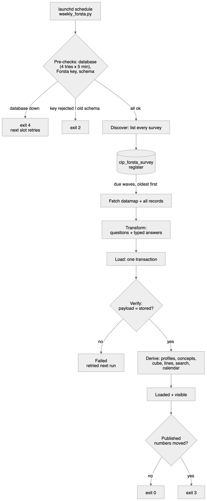{width=51%}

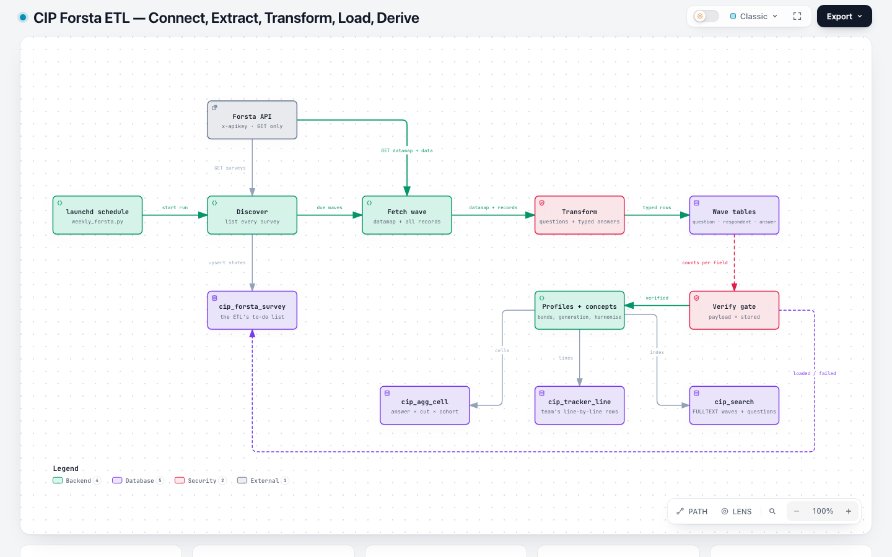{page=landscape}

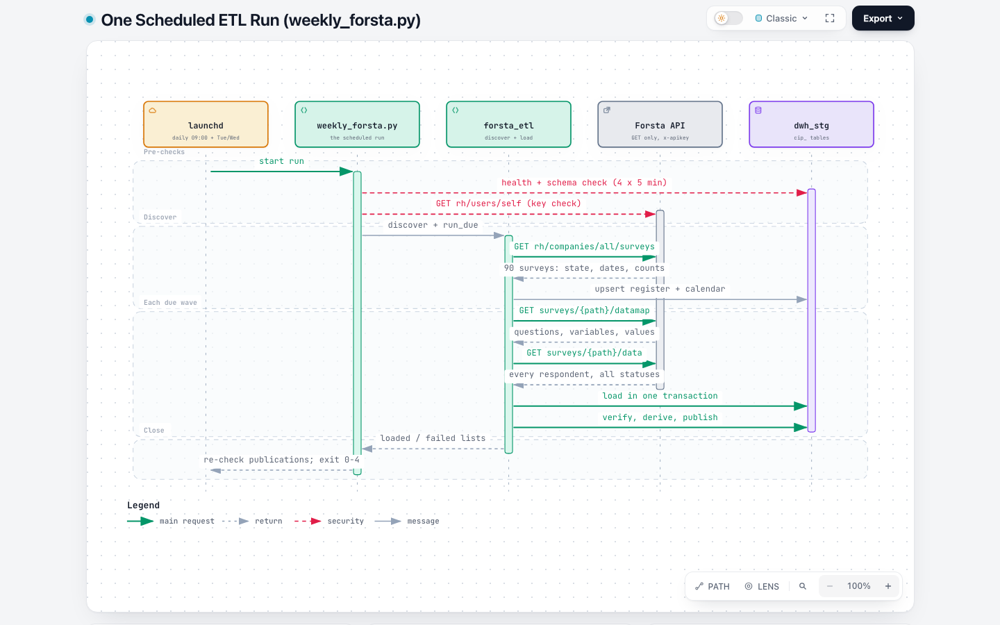{page=landscape}

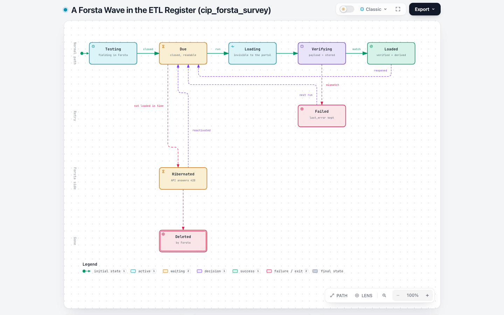{page=landscape}

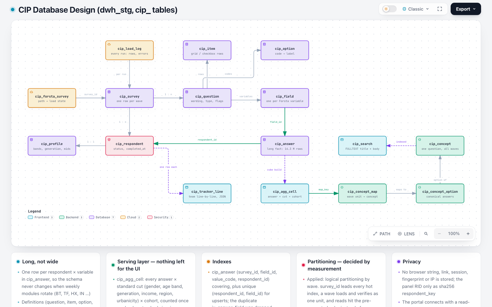{page=landscape}

## 0.4 Components

| Component | File | Responsibility |
|---|---|---|
| Scheduled run | `scripts/weekly_forsta.py` | health, key and schema checks; discover; load due; drift; exit code |
| Forsta client | `etl/forsta_client.py` | authenticated GET with retries |
| Datamap adapter | `etl/forsta_api.py` | Forsta JSON → questions (shapes, labels, bipolar, other-specify, flags, personal-field denylist) |
| Pipeline | `etl/forsta_etl.py` | register, load, verify, reconcile, reindex |
| Loaders | `etl/loaders.py` | survey and definition upserts, load log, search index |
| Shared loader steps | `etl/run_pipeline.py` | profiles, question bases, wave label |
| Demographics | `etl/survey_map.py` + `config/survey_map.yml` | topics, profile mapping, age/income bands, regions |
| Harmoniser | `app/data/harmonise.py` | concepts across waves and platforms |
| Cohorts and cube | `app/data/cohorts.py`, `app/data/cube.py` | segment membership, pre-computed cells |
| Line-by-line | `etl/tracker_line.py` + `config/tracker_line.yml` | the data team's weekly table |
| Survey calendar | `etl/survey_calendar.py` + `config/survey_calendar.yml` | cadence, modules, season wave numbers |
| History | `etl/legacy_dwh.py`, `etl/qualtrics_export.py` | Qualtrics and SurveyMonkey |
| Schema | `sql/001_schema.sql`, `sql/002_views.sql`, `app/core/schema_upgrade.py`, `scripts/init_db.py` | DDL, views, upgrades |
| Checks | `scripts/reconcile.py`, `scripts/perf_check.py`, `tests/` | correctness, speed, 227 tests |

# 1. Connection and API

## 1.1 Systems involved

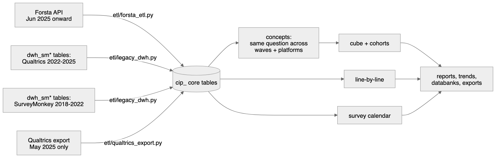

| System | Role | Access |
|---|---|---|
| Forsta Surveys (Decipher) `se1.decipherinc.com` | Live survey source | HTTPS REST API v1, **GET only** |
| Azure Database for MySQL 8.0 `csr-mysql8-flex-stg.mysql.database.azure.com`, schema `cip_stg` (all `cip_` tables and views) | Warehouse | TLS 1.2+, PyMySQL via SQLAlchemy 2 |
| `dwh_sm*` tables in `dwh_stg` | Qualtrics + SurveyMonkey history (read) | same server; read through `dwh_sm*` views in `cip_stg` |
| macOS launchd (`com.coresight.cip-forsta-etl`) | Scheduler | user agent on the ETL host |

## 1.2 Forsta API

| Setting | Value |
|---|---|
| Base URL | `https://se1.decipherinc.com/api/v1/` |
| Authentication | header `x-apikey: <64-character key>`; key in `.env` as `FORSTA_API_KEY` (never logged or printed) |
| Other headers | `Accept: application/json`, `User-Agent: coresight-cip/1.0` |
| Account | user 879, company 86, directory "Coresight Research" (`58f`) |
| Timeout | 120 s per request (`FORSTA_TIMEOUT_SECONDS`) |
| Retries | up to 4 attempts, exponential back-off 2 → 60 s, on connection errors, timeouts, **429** and **5xx** |
| Usage header | `x-usage-today` logged at debug level |
| Client | `etl/forsta_client.py` (`ForstaClient`) |

### Endpoints used (all GET)

| Endpoint | Purpose | Called |
|---|---|---|
| `rh/users/self` | Proves the key works | Start of every scheduled run |
| `rh/companies/all/surveys` | Every survey the key can see: `path`, `title`, `state`, `hibernated`, `tags`, `createdOn`, `dateLaunched`, `closedDate`, `qualified`, `total`, `sampleSources` | Once per run (discovery) and reused for the run's loads |
| `surveys/{path}/datamap?format=json` | Questionnaire definition | Once per wave loaded |
| `surveys/{path}/data?format=json` | Every respondent record; **no `cond` filter**, so terminates, over-quota and partials are included | Once per wave loaded and per reconciliation |

Nothing else is called. `data/edit`, reactivation, survey edits and datafeed acknowledgements are not used; the
client has no POST/PUT/DELETE method.

### Response shapes

**Survey list item**

```json
{"path": "selfserve/58f/260908", "title": "Shopping and Spending - inc Home Furnishings + Holiday Tracker + GenAI",
 "state": "closed", "hibernated": false, "tags": ["Coresight Research", "Weekly consumer tracker"],
 "createdOn": "2026-09-22T15:57:00Z", "dateLaunched": "2026-10-05T12:22:25Z", "closedDate": "2026-10-06T14:19:55Z",
 "qualified": 401, "total": 823, "sampleSources": ["114"]}
```

**Datamap** — `questions[]`, each with `qlabel`, `qtitle`, `type` (single / multiple / float / number / text),
`grouping` (rows / cols), optional `flags` (`t` technical, `v` virtual), `values[]` (`value`, `title`) on the
question *or* on each variable, and `variables[]` (`label`, `row`, `rowTitle`, `colTitle`, `type`, `values`).

**Data** — a JSON array, one object per respondent, **every value a string**: `"status": "3"`,
checkbox `"0"`/`"1"`, single choice `"1"`…`"n"`, numbers as text, verbatims as text,
`"date": "09/28/2026 10:56"`, plus `record`, `uuid`, `RID`, `markers`, `userAgent`, `url`, `session`, `dcua`.

### Status codes and what the pipeline does

| Code | Meaning | Handling |
|---|---|---|
| 200 | OK | continue |
| 401 | Key missing, wrong, revoked or user disabled | run stops, exit 2 |
| 403 | Key valid, no rights on the survey | wave fails, recorded |
| 428 | Survey hibernated | never loaded; reconciliation skips it with a warning |
| 429 / 5xx | Busy / server error | retried (4 attempts) then the wave fails and is retried next run |

## 1.3 Warehouse connection

| Setting | Value |
|---|---|
| Driver | `mysql+pymysql`, SQLAlchemy 2 engine, pooled (`DB_POOL_SIZE`, `DB_MAX_OVERFLOW`) |
| ETL account | `STG_DB_USER` (`mohdsaeedafri`) — ALL PRIVILEGES on `cip_stg`, SELECT on `dwh_stg` |
| Portal account | read-only grants (`sql/004_grants.sql`, applied by the DBA) |
| TLS | required; CA bundle `STG_DB_SSL_CA` (DigiCert Global Root G2) |
| Latency | ≈250 ms round trip from the India office — every loader step is batched to a constant number of statements per wave |
| Health check | `SELECT VERSION()`; the scheduled run tries 4 times, 5 minutes apart, before exiting 4 |

## 1.4 Configuration (`.env`)

| Variable | Use |
|---|---|
| `APP_ENV` | `LOCAL` / `STAGING` / `PRODUCTION` |
| `STG_DB_HOST`, `STG_DB_PORT`, `STG_DB_NAME`, `STG_DB_USER`, `STG_DB_PASSWORD`, `STG_DB_SSL_CA` | Warehouse |
| `FORSTA_HOST` (default `se1.decipherinc.com`), `FORSTA_API_KEY` | Forsta |
| `FORSTA_TIMEOUT_SECONDS` (120), `FORSTA_MAX_RETRIES` (4) | Client |
| `LOCAL_SQLITE_PATH` | Offline SQLite copy for development |

# 2. Extract

Code: `etl/forsta_etl.py` (`discover`, `run_due`, `load_survey`), `etl/forsta_client.py`.

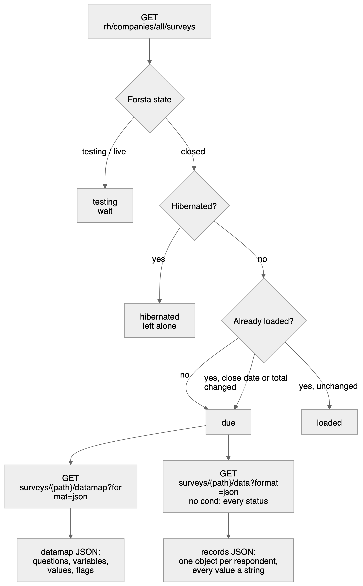{width=76%}

## 2.1 Discovery (every run)

`discover(client)` calls `rh/companies/all/surveys` once and upserts one row per survey into `cip_forsta_survey`
(key `forsta_path`). The **load state** is decided as follows:

| Condition (in order) | `load_state` |
|---|---|
| previously `loaded` and neither `closedDate` nor `total` changed | `loaded` |
| Forsta `state` ≠ `closed` (testing, live) | `testing` |
| closed and `hibernated = true` | `hibernated` |
| closed, readable, previously `failed` | `failed` (retried) |
| closed, readable, otherwise | `due` |

A loaded survey whose close date or total respondents changed (reopened in Forsta) becomes `due` again.
The same transaction rebuilds the survey calendar (`cip_wave_module`, section 5.6).

Columns written: `title`, `state`, `hibernated`, `tags` (comma list), `study_type`
(`tracker` if tagged "Weekly consumer tracker" or titled "Shopping and spending…", `annual` if tagged
"annual tracker", else `adhoc`), `created_on`, `launched_at`, `closed_at`, `qualified_n`, `total_n`,
`last_seen` (UTC), `load_state`.

## 2.2 Choosing what to load

`run_due(client)` selects `load_state IN ('due','failed')` ordered by `closed_at, forsta_path` (oldest first) and
loads them one at a time. The survey list from discovery is reused, so a run makes **one** list call however many
waves it loads. A failure is recorded (`load_state = failed`, `last_error`) and the run continues with the next
wave.

## 2.3 Fetching a wave

For each due survey:

1. `GET surveys/{path}/datamap?format=json` — the questionnaire (≈0.5 MB).
2. `GET surveys/{path}/data?format=json` — all records (≈2 MB for 500 respondents), **without** `cond`, so every
   status is present: 1 terminated · 2 over quota · 3 qualified · 4 partial.
3. Records without a `uuid` are discarded (Forsta system rows).

## 2.4 Wave identity

| Field | Rule |
|---|---|
| Forsta path | `selfserve/58f/YYMMNN` — one survey = one wave |
| `wave_label` / `wave_date` | Monday of the earliest completion date among **qualified** records (all records if none qualified) |
| Reload | A survey already loaded by this pipeline (load log `source_ref = forsta:{path}`) keeps its wave label and `survey_id`, even if its first date moves |
| Family | `CSI-US` for the weekly tracker; for other studies the title without the year, upper-cased (`HOLIDAY_SHOPPING`) |

## 2.5 Legacy extraction (history)

| Source | Module | Notes |
|---|---|---|
| Qualtrics 2022–2025 in `dwh_sm*` | `python -m etl.legacy_dwh --all` | 142 waves, completes only, matched to the original responses |
| SurveyMonkey 2018–2022 in `dwh_sm*` | `python -m etl.legacy_dwh --all --era surveymonkey` | 145 waves; matrix questions as grids; SurveyMonkey Audience demographics fill profiles |
| Qualtrics Excel export, May 2025 | `python -m etl.qualtrics_export --wave 2025-05-12 --file …` | The only wave missing from `dwh_sm*` |

# 3. Transform

Code: `etl/forsta_api.py` (`questions_from_datamap`), `etl/forsta_etl.py` (`_answer`, `_respondent`),
`etl/records.py` (`ParsedQuestion`, `clean_text`), `etl/survey_map.py` (profiles), `etl/loaders.py`
(topics, short labels).

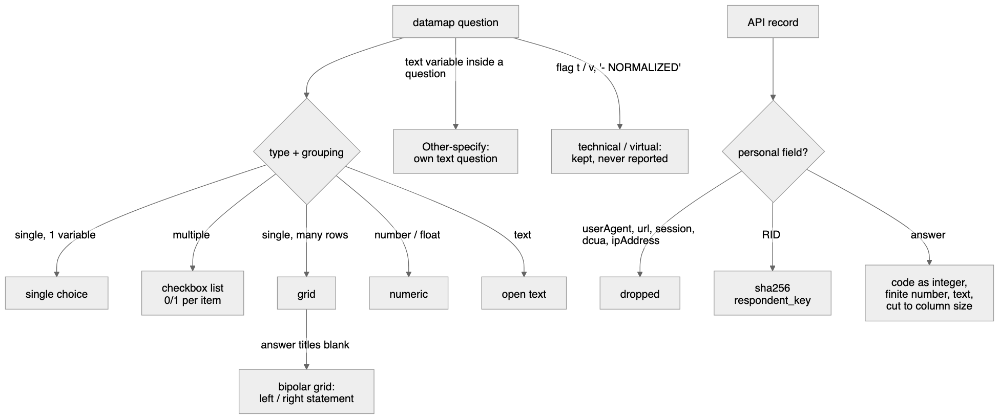

## 3.1 Datamap → questions (one `ParsedQuestion` per Forsta question)

| Forsta shape | Measured frequency (1,416 questions) | Stored as `qtype` | Fields created |
|---|---|---|---|
| `single`, 1 variable | 693 | `single` | one field = the question code |
| `multiple`, many variables | 491 | `multi` (0/1 per item) | one field per item (`q1r1`, `q1r2` …) |
| `single`, `rows`, many variables | 73 | `grid_single` | one field per row |
| `single`, `cols`, + a text variable | 53 | `single` + separate `text` question for the "Other (specify)" variable | |
| `single`, `rows`, 1 variable | 43 | `single` (or `grid_single` when the variable is named apart) | |
| `float` / `number` | 32 | `numeric` | |
| `text` / `textarea` | 23 | `text` | |
| `date` | — | `datetime` | |

Rules, in order:

1. **Text** — titles are HTML-unescaped and whitespace-normalised (`clean_text`); `qtext_short` is a ≤ 80-character
   label.
2. **Answer labels** — taken from the question's `values[]`; when empty (about a third of datamaps) from the first
   variable that has `values[]`. Only integer codes are kept.
3. **Grid** — a single-choice question whose variables are "named apart" (more than one row, or the one row's code
   differs from the question code). Row label = `rowTitle — colTitle`.
4. **Bipolar grid** — a grid whose answer titles are all blank (e.g. HX6): options become
   `1 = Left statement`, `2 = Right statement`; each row stores its left statement (its own title) and its right
   statement (the `{question}_norm{row}_r` variable of Forsta's NORMALIZED copy) in `cip_item.left_label /
   right_label`.
5. **Other (specify)** — a `text` variable inside a non-text question becomes its own `text` question, code = the
   variable label (`vosr15oe`, `q1r2oe`), wording "<question> — <row> (please specify)".
6. **Flags** — `t` → `is_technical = 1` (conditions, qtime, start_date, status…); `v` → `is_virtual = 1`
   (vlist, vos, vbrowser…); a title ending "- NORMALIZED" is virtual. Technical and virtual questions are stored
   but never reported, harmonised or cubed.
7. **Personal variables** — `RID`, `userAgent`, `url`, `session`, `dcua`, `ipAddress` never become questions or
   fields, even if a datamap lists them.
8. **Topic** — each question is placed in an editorial topic (`cip_topic`) from its code and wording
   (`config/survey_map.yml`); technical topics also set `is_technical`.
9. **Answer attributes** — an option whose label contains "don't know", "not sure" or "prefer not to say" is
   `is_nonresponse`; an item starting "None of these" is `is_exclusive`; an item code ending `oe` is `is_other`.

## 3.2 Records → respondent rows

| Column | Source | Rule |
|---|---|---|
| `record_no` | `record` | integer |
| `forsta_uuid` | `uuid` | ≤ 64 chars, the upsert key with `survey_id` |
| `status_code` / `status_label` | `status` | 1 Terminated · 2 Overquota · 3 Qualified · 4 Partial |
| `is_qualified` | | `status = 3` |
| `completed_at` | `date` | `MM/DD/YYYY HH:MM` → datetime |
| `interview_secs` | `qtime` | integer seconds |
| `markers` | `markers` | ≤ 1,000 chars |
| `device`, `os`, `browser`, `dropout_qcode` | `vmobiledevice`, `vos`, `vbrowser`, `vdropout` | ≤ 50 chars |
| `panel_source` | `vlist` / `list` | ≤ 100 chars |
| `respondent_key` | `RID` | **sha256 hex** — the panel id itself is never stored |
| `sample_rid` | | always NULL |

## 3.3 Records → answer rows

Each `(record, field)` with a non-empty value becomes one `cip_answer` row:

| Field kind | Stored |
|---|---|
| `code` (single, grid row, checkbox item) | `value_code` integer (`"3"`, `"3.0"` → 3); `value_label` = the option label (single/grid) or the item label (checkbox) |
| `code` but not a whole number | `value_label` = the raw text, no code invented |
| `numeric` | `value_number`, only if finite and \|x\| < 10¹⁴ (column is DECIMAL(18,4)); otherwise not stored |
| `text` | `value_text` verbatim |

Empty strings and nulls are not stored, so "no answer" is the absence of a row. Checkbox `0` **is** stored (item
shown, not chosen), which gives every multi-select question its "answered" base.

## 3.4 Derived transformations (after load)

| Output | Rule | Code |
|---|---|---|
| Profile per respondent (`cip_profile`) | Demographic questions found per wave from `config/survey_map.yml` (CSI-US: D1 gender, D2 age, D3 relationship, D4 ethnicity, D5 income, D6 urbanicity, D7 political, D8 state, CS1/CS2 outlook) or by wording; mapping recorded in `cip_profile_map` | `run_pipeline._rebuild_profiles` |
| Age band | 18-29 · 30-44 · 45-60 · Over 60 (from a single year, or a band that fits one band); "Under 18" unbanded | `survey_map.classify_age` |
| Generation | GenZ 18-28 · Millennial 29-44 · GenX 45-60 · Boomer 61+ | same |
| Age midpoint | the year itself; bands: the analysts' midpoints (over 60 = 67) | same |
| Income midpoint ($000) | under $25k = 13 · $25-49.9k = 37.4995 · $50-99.9k = 74.9995 · $100-149.9k = 124.9995 · $150-199.9k = 174.9995 · $200k+ = 225 | `survey_map.income_mid_k` |
| Census region | State → Northeast / Midwest / South / West (SurveyMonkey: Census division → region) | `survey_map.census_region` |
| Question base | qualified respondents who reached the question | `_rebuild_question_bases` |
| Concepts | exact (same normalised wording and options) → confirmed; changed options → proposed; wording ≥ 0.85 similar → proposed; else new concept | `app/data/harmonise.py` |
| Line-by-line row | the data team's format, see 5.4 | `etl/tracker_line.py` |
| Calendar | lead sector, topics, seasonal tracker, events; season wave numbers | `etl/survey_calendar.py` |

# 4. Load and verify

Code: `etl/forsta_etl.py` (`load_survey`, `_write`, `verify`), `etl/loaders.py` (`upsert_survey`,
`load_definitions`, `start_run`, `finish_run`).

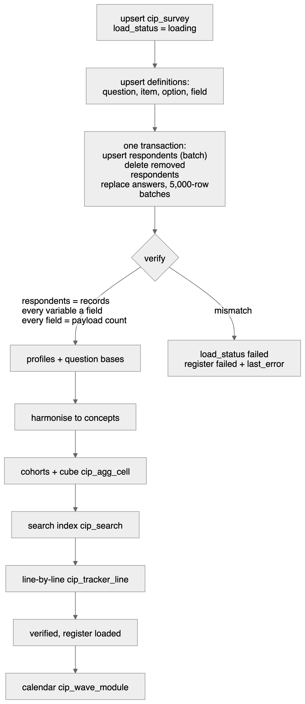{width=53%}

## 4.1 Order of writes

| Step | Table(s) | Statement | Transaction |
|---|---|---|---|
| 1 | `cip_survey` | `INSERT … ON DUPLICATE KEY UPDATE` keyed `(platform, source_ref, wave_label)`; then `load_status = 'loading'`, `sample_source`, `total_n`, `tags`, `field_start`, `field_end` | own |
| 2 | `cip_load_log` | new run row: `source_type = api`, `object_type = data`, `source_ref = forsta:{path}` | own |
| 3 | `cip_topic`, `cip_question`, `cip_option`, `cip_item`, `cip_field` | batched upserts (one statement per table), `INSERT IGNORE` for fields | own |
| 4 | `cip_respondent` | one batched upsert keyed `(survey_id, record_no)` | **A** |
| 4b | `cip_answer`, `cip_respondent_cohort`, `cip_profile`, `cip_respondent` | respondents no longer in Forsta's payload are deleted | **A** |
| 4c | `cip_answer` | `DELETE … WHERE survey_id`, then inserts in batches of 5,000 rows (all placeholders, so PyMySQL batches them) | **A** |
| 5 | — | verify (reads only) | |
| 6 | `cip_profile_map`, `cip_profile` | profiles rebuilt | own |
| 7 | `cip_question.base_n` | question bases | own |
| 8 | `cip_concept*`, `cip_concept_map` | harmonise | own |
| 9 | `cip_respondent_cohort`, `cip_agg_cell` | cohorts derived, cube rebuilt (old cells removed first) | own |
| 10 | `cip_search` | the wave's survey + question rows; concept rows | own |
| 11 | `cip_tracker_line` | the wave's lines (tracker family only) | own |
| 12 | `cip_load_log` | run finished: rows read / loaded, status | own |
| 13 | `cip_survey`, `cip_forsta_survey` | `load_status = 'verified'`; register `loaded`, `survey_id`, `loaded_at` | own |
| 14 | `cip_wave_module` | calendar rebuilt (questions now known) | own |

Transaction **A** is all-or-nothing: if it fails, the previous answers are untouched.

## 4.2 Verification (before anything is visible)

`verify(survey_id, datamap, records)` must return no problems:

1. **Respondents** — stored respondents for the wave = records sent.
2. **Fields** — every datamap variable (except personal ones) has a `cip_field`.
3. **Answers** — for every field, stored answer count = the number of records with a non-empty value.

Any mismatch raises `"{path} does not match its payload"`, the wave is marked `failed`, and its error is kept in
`cip_load_log.error_text` and `cip_forsta_survey.last_error`.

## 4.3 Visibility and status

| `cip_survey.load_status` | Meaning | Visible in reports |
|---|---|---|
| `loading` | being written | no |
| `verified` | proven equal to Forsta and derived | **yes** |
| `failed` | did not match, or a later step failed | no |

If a reload fails **before** transaction A commits, a previously verified wave keeps `verified` (its data did not
change). If it fails after, the wave becomes `failed` and the next run retries it.

## 4.4 Idempotency

* Every write is an upsert or a replace keyed on Forsta's own identifiers (`forsta_path`, `uuid`, `record`,
  variable label), so re-running a load never duplicates anything.
* A reload of the same Forsta survey reuses its `survey_id` and wave label — but only a wave that this pipeline
  loaded from the API (load log `forsta:{path}`); a wave loaded another way on the same path is never overwritten.

## 4.5 Reconciliation (independent check)

`python scripts/reconcile.py` (or `python -m etl.forsta_etl --reconcile`) re-reads every loaded wave from Forsta
and compares **every stored answer**: codes exactly, numbers at the stored 4-decimal precision, texts exactly.
Hibernated surveys are skipped with a warning. Last run (8 Oct 2026): **31 waves, 4,476,153 answers, 0
differences**. Legacy waves are compared with their `dwh_sm*` source the same way.

# 5. Derived data, storage design and performance

Everything a report needs is computed in the warehouse when a wave loads, so the portal and exports only read
pre-computed rows.

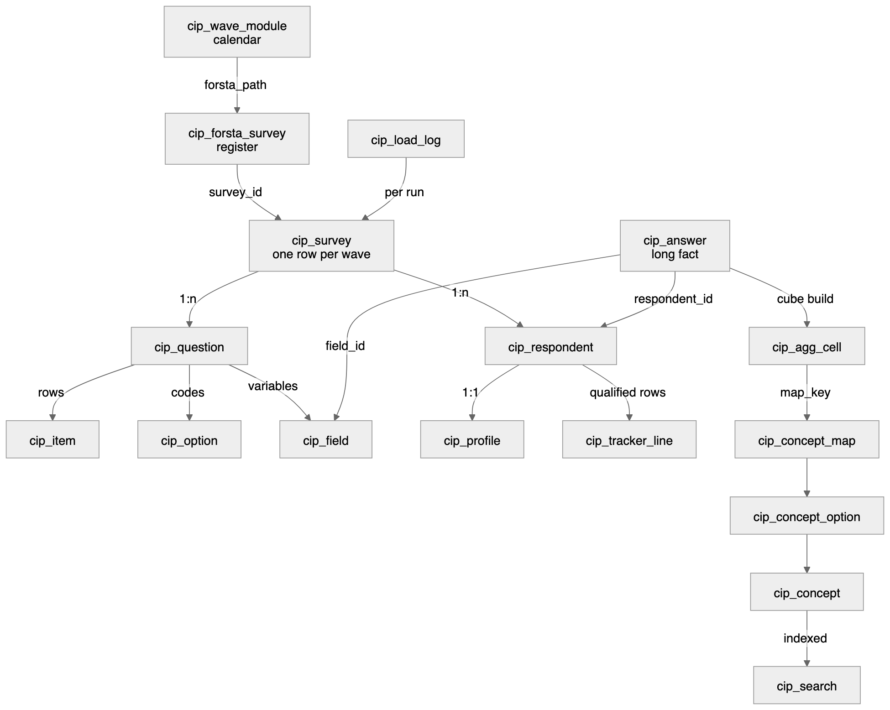

## 5.1 Design principles

* **Long, not wide.** `cip_answer` holds one row per respondent × variable, so the schema never changes when weekly
  modules rotate. (A wide table — one column per variable — would break every week.)
* **Definitions per wave.** Forsta codes are not stable (`D2`, `BT14`, `DS1`–`DS7` changed meaning across waves),
  so questions are linked across waves by wording through **concepts**, never by code.
* **Conformed dimensions.** Concept + concept option are the shared "question" dimension across Forsta, Qualtrics
  and SurveyMonkey.
* **Pre-aggregated cube.** `cip_agg_cell` counts every answer once per standard cut and cohort.
* **Prefix `cip_`** (views `v_cip_`) so nothing collides with other tables on the server (history in `dwh_stg` keeps its `dwh_sm` names).

## 5.2 Cube — `cip_agg_cell`

| Aspect | Rule |
|---|---|
| Rows | every answer of every reportable question (single, grid row, checkbox item) × cut × cohort, **qualified respondents only** |
| Cuts (`dim`) | total, gender, age_band, generation, income_band, census_region, urbanicity |
| Cohorts | everyone (`cohort_id NULL`) and each current cohort (`config/cohorts.yml`, e.g. Beauty shoppers) |
| Measures | `n`, `base_n`, `sum_age_mid`, `n_age_mid`, `sum_income_mid_k`, `n_income_mid` (averages without raw rows) |
| Bases | single/grid: who answered that row; checkbox: everyone who answered the question ("Total answering") |
| Concept link | `map_key = question:item:option`, joined to `cip_concept_map` at read time, so confirming a mapping needs no rebuild |
| Build | answers read once into a temporary table with every cut; each cut × cohort is an aggregate over it |

## 5.3 Search — `cip_search`

One row per wave (title, family, tags, path), per non-technical question (wording, code) and per concept (name,
code, number of waves). MySQL FULLTEXT on `(title, body)`; queries use boolean mode with required, prefix-matched
words, skipping InnoDB stop-words; LIKE fallback for words under 3 characters (e.g. "D5"). Only verified waves are
returned.

## 5.4 Line-by-line — `cip_tracker_line`

The data team's "Weekly Line-By-Line Survey Data" rebuilt per tracker wave (`config/tracker_line.yml`): one JSON
row per **qualified** respondent, keys in the team's column order.

| Column(s) | Rule |
|---|---|
| Month | first day of the wave's month |
| date | completion `MM/DD/YYYY HH:MM` |
| Activities: … / Purchased In-store: … / Purchased Online: … / Food: … / Non-food: … | q1–q5, one column per item: the label when chosen, blank when not |
| Household Situation, Economic Situation | CS1, CS2 |
| Gender, Age, Relationship Status, Ethnicity, Household Income, Primary Residence, State | D1–D6, D8 (Age a number when a single year) |
| start_date | survey start time |
| Age Range, Generation | profile bands in the team's spelling ("over 60", "Millenial") |

Not carried: D7 (the team omits it) and the panel `session` id (personal data). Check against the team's file:
`python -m etl.tracker_line --compare "Weekly Line-By-Line Survey Data.xlsx"`.

## 5.5 Concepts — harmonisation

| Decision | Condition | Status |
|---|---|---|
| exact | same normalised wording and type; every answer already a concept option | confirmed |
| changed | same wording, new answers | proposed |
| similar | wording ≥ 0.85 alike (the highest unrelated pair measured 0.796) | proposed |
| new | nothing close | new concept, confirmed |

A grid is harmonised row by row. Proposals wait on the Mappings page; answers trend only once confirmed.

## 5.6 Survey calendar — `cip_wave_module`

Rebuilt after every discovery and load from `config/survey_calendar.yml`: each Forsta survey × module with
`kind` (sector · topic · seasonal · event · annual · adhoc), `is_lead`, `launched_on`, `season` (July–June),
`series_wave_no`, `detected_by` (title or questions). A seasonal tracker is detected from its own question (XM3
"current status of your holiday shopping") once loaded. `python -m etl.survey_calendar` prints the calendar and the
next 12 expected lead sectors.

## 5.7 Indexes

| Index | Serves |
|---|---|
| `cip_answer (survey_id, field_id, value_code, respondent_id)` covering | item incidence, cube build |
| `cip_answer (respondent_id, field_id)` unique | upserts, cohort rules |
| `cip_agg_cell (survey_id, map_key, cohort_id, dim)`, `(survey_id, question_id, dim)` | concept trends, standard views |
| `cip_survey (load_status, study_type, wave_date)` | wave pickers |
| `cip_forsta_survey (load_state, closed_at)` | the due list |
| `cip_search` FULLTEXT `(title, body)` | search |
| `cip_wave_module (module_code, season, series_wave_no)` | "wave N vs last year's wave N" |
| `cip_tracker_line (wave_date, survey_id)` | line-by-line exports |

## 5.8 Partitioning decision

Measured 8 Oct 2026: `cip_answer` 14.3 M rows, 1.3 GB data + 2.9 GB index (≈23 M rows after the SurveyMonkey
reload). It is **not** physically partitioned:

* InnoDB cannot partition a table that has foreign keys or a FULLTEXT index; `cip_answer` has both
  (referential integrity and verbatim search).
* Every hot read already starts with `survey_id` on a covering index; reports read the cube, not raw answers.

Applied instead: **logical partitioning by wave** — `survey_id` leads every hot index, a wave loads, verifies and
is replaced as one unit, and reads go to the pre-computed cube and line tables. Trigger to revisit: `cip_answer`
above 100 M rows → `PARTITION BY HASH(survey_id)` with integrity moved to the loader's verify step and verbatim
search to `cip_search`.

## 5.9 Measured performance (over the VPN, P95)

| Read | P95 |
|---|---|
| Search (FULLTEXT) | 0.26 s |
| Whole wave report (catalogue + cube + numbers + verbatims) | 1.05 s |
| Standard view (cube, one cut) | 0.25 s |
| Ad-hoc cohort, one wave | 0.76 s |
| Five-wave pooled concept | 0.27 s |

Load time: 1.5–3 minutes per weekly wave (dominated by ~250 ms round trips; every step is batched).

# 6. Data dictionary — `cip_` tables and views in `cip_stg`

Generated from the live database by `scripts/data_dictionary.py`; row counts are InnoDB estimates.

| Object | Kind | Rows (approx.) | Purpose |
|---|---|---:|---|
| [`cip_agg_cell`](#cip-agg-cell) | table | 2,081,530 | Pre-computed counts per wave x answer x cut x cohort. |
| [`cip_answer`](#cip-answer) | table | 23,345,651 | Every answer, long format. ~151k rows per wave. |
| [`cip_auth_session`](#cip-auth-session) | table | 2 | Sign-in audit and revocation. |
| [`cip_banner`](#cip-banner) | table | 0 | Cross-tab column groups. |
| [`cip_cohort_def`](#cip-cohort-def) | table | 2 | Named, versioned respondent rules. |
| [`cip_concept`](#cip-concept) | table | 1,769 | Canonical questions, stable across waves and platforms. |
| [`cip_concept_map`](#cip-concept-map) | table | 66,766 | Wave question/item/option -> canonical concept, proposed or confirmed. |
| [`cip_concept_option`](#cip-concept-option) | table | 11,670 | Canonical answers, with band midpoints. |
| [`cip_crosstab`](#cip-crosstab) | table | 0 | Cross-tab cells: percentage, count, true base, significance. |
| [`cip_crosstab_run`](#cip-crosstab-run) | table | 0 | One row per cross-tab export, with its base and filter settings. |
| [`cip_field`](#cip-field) | table | 56,452 | Export column -> question/item map. |
| [`cip_forsta_survey`](#cip-forsta-survey) | table | 91 | Register of every Forsta survey the key can see, and what the ETL did with it. |
| [`cip_item`](#cip-item) | table | 50,335 | List items and grid rows. |
| [`cip_load_error`](#cip-load-error) | table | 0 | Rows that failed validation, kept for review. |
| [`cip_load_log`](#cip-load-log) | table | 408 | Audit trail. Nothing enters CSI without a row here. |
| [`cip_load_state`](#cip-load-state) | table | 0 | Watermarks so incremental pulls never re-read a whole survey. |
| [`cip_option`](#cip-option) | table | 28,967 | Answer codes and their labels. |
| [`cip_profile`](#cip-profile) | table | 151,465 | Demographic cuts, one row per respondent. |
| [`cip_profile_map`](#cip-profile-map) | table | 1,325 | Which question feeds each demographic cut, per wave. Auditable and editable. |
| [`cip_publication`](#cip-publication) | table | 3 | A delivered chart or table, frozen at a version. |
| [`cip_publication_cell`](#cip-publication-cell) | table | 198 | The frozen numbers of a publication. |
| [`cip_question`](#cip-question) | table | 8,256 | Questions, with their own answering base. |
| [`cip_respondent`](#cip-respondent) | table | 176,470 | One row per interview. |
| [`cip_respondent_cohort`](#cip-respondent-cohort) | table | 6,517 | Materialised cohort membership. |
| [`cip_saved_view`](#cip-saved-view) | table | 0 | Saved filter + question sets, re-run against current data. |
| [`cip_search`](#cip-search) | table | 9,829 | Search index: one row per wave, question and concept (FULLTEXT). |
| [`cip_segment`](#cip-segment) | table | 0 | Cross-tab columns with their Forsta definitions. |
| [`cip_survey`](#cip-survey) | table | 319 | Survey waves. |
| [`cip_topic`](#cip-topic) | table | 16 | Editorial grouping of questions. |
| [`cip_tracker_line`](#cip-tracker-line) | table | 5,076 | The data team's line-by-line rows: one per qualified tracker respondent, JSON in their column order. |
| [`cip_wave_module`](#cip-wave-module) | table | 245 | Survey calendar: every Forsta survey x module (lead sector, topic, seasonal, event, annual, ad hoc). |
| [`cip_weight`](#cip-weight) | table | 0 | One weight per respondent per scheme. |
| [`cip_weight_scheme`](#cip-weight-scheme) | table | 0 | Named weighting schemes, per wave. |
| [`v_cip_answers`](#v-cip-answers) | view |  | VIEW |
| [`v_cip_crosstab`](#v-cip-crosstab) | view |  | VIEW |
| [`v_cip_grid`](#v-cip-grid) | view |  | VIEW |
| [`v_cip_item_incidence`](#v-cip-item-incidence) | view |  | VIEW |
| [`v_cip_mapping_queue`](#v-cip-mapping-queue) | view |  | VIEW |
| [`v_cip_question_base`](#v-cip-question-base) | view |  | VIEW |
| [`v_cip_single_distribution`](#v-cip-single-distribution) | view |  | VIEW |
| [`v_cip_survey_health`](#v-cip-survey-health) | view |  | VIEW |
| [`v_cip_trend`](#v-cip-trend) | view |  | VIEW |

## cip_agg_cell

*Table* — Pre-computed counts per wave x answer x cut x cohort.

| Column | Type | Null | Key | Default | Meaning |
|---|---|---|---|---|---|
| `cell_id` | bigint unsigned | NO | PRI |  |  |
| `survey_id` | int unsigned | NO | MUL |  | → cip_survey.survey_id (cascade) |
| `cell_key` | varchar(200) | NO |  |  | question:item:option:cohort:scheme:dim:value |
| `question_id` | int unsigned | NO | MUL |  | → cip_question.question_id (cascade) |
| `item_id` | int unsigned | YES |  |  |  |
| `option_id` | int unsigned | YES |  |  |  |
| `concept_option_id` | int unsigned | YES | MUL |  |  |
| `cohort_id` | int unsigned | YES |  |  | NULL = all qualified respondents |
| `scheme_id` | int unsigned | YES |  |  | NULL = unweighted |
| `dim` | varchar(30) | NO |  |  | total, gender, age_band, … |
| `dim_value` | varchar(120) | NO |  |  |  |
| `n` | int | NO |  |  |  |
| `base_n` | int | NO |  |  |  |
| `n_weighted` | decimal(14,4) | YES |  |  |  |
| `base_weighted` | decimal(14,4) | YES |  |  |  |
| `sum_age_mid` | decimal(14,4) | YES |  |  |  |
| `sum_income_mid_k` | decimal(16,4) | YES |  |  |  |
| `built_at` | timestamp | NO |  | CURRENT_TIMESTAMP |  |
| `map_key` | varchar(40) | YES |  |  |  |
| `n_age_mid` | int | YES |  |  |  |
| `n_income_mid` | int | YES |  |  |  |

Indexes: `fk_agg_question` (btree: question_id); `ix_agg_concept` (btree: concept_option_id, cohort_id, dim, survey_id); `ix_agg_map` (btree: survey_id, map_key, cohort_id, dim); `ix_agg_question` (btree: survey_id, question_id, dim); `PRIMARY` (btree: cell_id); `uq_agg_cell` (unique btree: survey_id, cell_key)

## cip_answer

*Table* — Every answer, long format. ~151k rows per wave.

| Column | Type | Null | Key | Default | Meaning |
|---|---|---|---|---|---|
| `answer_id` | bigint unsigned | NO | PRI |  |  |
| `respondent_id` | bigint unsigned | NO | MUL |  | → cip_respondent.respondent_id (cascade) |
| `survey_id` | int unsigned | NO | MUL |  | denormalised for filter speed |
| `field_id` | int unsigned | NO | MUL |  | → cip_field.field_id (cascade) |
| `value_code` | int | YES |  |  | 0/1, 1-5, 1-54 |
| `value_label` | varchar(500) | YES |  |  | resolved label, denormalised for display |
| `value_number` | decimal(18,4) | YES |  |  | open numeric |
| `value_text` | text | YES | MUL |  | open-ended verbatim |

Indexes: `fk_answer_field` (btree: field_id); `ft_answer_text` (fulltext: value_text); `ix_answer_cover` (btree: survey_id, field_id, value_code, respondent_id); `ix_answer_respondent` (btree: respondent_id); `PRIMARY` (btree: answer_id); `uq_answer` (unique btree: respondent_id, field_id)

## cip_auth_session

*Table* — Sign-in audit and revocation.

| Column | Type | Null | Key | Default | Meaning |
|---|---|---|---|---|---|
| `session_id` | varchar(64) | NO | PRI |  |  |
| `user_email` | varchar(200) | NO | MUL |  |  |
| `user_name` | varchar(200) | YES |  |  |  |
| `provider` | varchar(20) | NO |  | local |  |
| `created_at` | timestamp | NO |  | CURRENT_TIMESTAMP |  |
| `expires_at` | datetime | YES |  |  |  |
| `revoked_at` | datetime | YES |  |  |  |
| `request_meta` | varchar(500) | YES |  |  | host and user agent at sign-in |

Indexes: `ix_auth_user` (btree: user_email, created_at); `PRIMARY` (btree: session_id)

## cip_banner

*Table* — Cross-tab column groups.

| Column | Type | Null | Key | Default | Meaning |
|---|---|---|---|---|---|
| `banner_id` | int unsigned | NO | PRI |  |  |
| `survey_id` | int unsigned | NO | MUL |  | → cip_survey.survey_id (cascade) |
| `banner_code` | varchar(50) | NO |  |  | AGE, GENDER, INCOME |
| `banner_name` | varchar(500) | NO |  |  | header text as printed |
| `source_q` | varchar(50) | YES |  |  | question the banner is built from |
| `sort_order` | smallint | NO |  | 0 |  |

Indexes: `PRIMARY` (btree: banner_id); `uq_banner` (unique btree: survey_id, banner_code)

## cip_cohort_def

*Table* — Named, versioned respondent rules.

| Column | Type | Null | Key | Default | Meaning |
|---|---|---|---|---|---|
| `cohort_id` | int unsigned | NO | PRI |  |  |
| `cohort_code` | varchar(60) | NO | MUL |  | BEAUTY_SHOPPER |
| `version` | smallint unsigned | NO |  | 1 |  |
| `cohort_name` | varchar(200) | NO |  |  |  |
| `rule_json` | json | NO |  |  | any/all over concepts; see the spec §5.4 |
| `base_note` | varchar(500) | YES |  |  |  |
| `owner_email` | varchar(200) | YES |  |  |  |
| `is_current` | tinyint(1) | NO |  | 1 |  |
| `created_at` | timestamp | NO |  | CURRENT_TIMESTAMP |  |

Indexes: `PRIMARY` (btree: cohort_id); `uq_cohort_def` (unique btree: cohort_code, version)

## cip_concept

*Table* — Canonical questions, stable across waves and platforms.

| Column | Type | Null | Key | Default | Meaning |
|---|---|---|---|---|---|
| `concept_id` | int unsigned | NO | PRI |  |  |
| `concept_code` | varchar(80) | NO | UNI |  | BEAUTY_RETAILER_3M |
| `concept_name` | varchar(255) | NO |  |  |  |
| `concept_group` | varchar(80) | YES | MUL |  | rows of one grid share a group |
| `topic_id` | smallint unsigned | YES | MUL |  | → cip_topic.topic_id (set null) |
| `qtype` | enum('single','multi','grid_single','grid_multi','numeric','text','datetime') | NO |  |  |  |
| `description` | varchar(1000) | YES |  |  |  |
| `created_at` | timestamp | NO |  | CURRENT_TIMESTAMP |  |
| `match_text` | varchar(2000) | YES |  |  |  |

Indexes: `fk_concept_topic` (btree: topic_id); `ix_concept_group` (btree: concept_group); `PRIMARY` (btree: concept_id); `uq_concept` (unique btree: concept_code)

## cip_concept_map

*Table* — Wave question/item/option -> canonical concept, proposed or confirmed.

| Column | Type | Null | Key | Default | Meaning |
|---|---|---|---|---|---|
| `map_id` | bigint unsigned | NO | PRI |  |  |
| `survey_id` | int unsigned | NO | MUL |  | → cip_survey.survey_id (cascade) |
| `map_key` | varchar(80) | NO |  |  | question_id:item_id:option_id, 0 when absent |
| `question_id` | int unsigned | NO | MUL |  | → cip_question.question_id (cascade) |
| `item_id` | int unsigned | YES | MUL |  | → cip_item.item_id (cascade) |
| `option_id` | int unsigned | YES | MUL |  | → cip_option.option_id (cascade) |
| `concept_id` | int unsigned | NO | MUL |  | → cip_concept.concept_id (cascade) |
| `concept_option_id` | int unsigned | YES | MUL |  | → cip_concept_option.concept_option_id (cascade) |
| `status` | enum('proposed','confirmed','rejected') | NO | MUL | proposed |  |
| `method` | enum('exact_text','similar_text','manual') | NO |  |  |  |
| `confidence` | decimal(5,4) | YES |  |  |  |
| `evidence` | varchar(1000) | YES |  |  | why the harmoniser proposed it |
| `reviewed_by` | varchar(200) | YES |  |  |  |
| `reviewed_at` | datetime | YES |  |  |  |
| `created_at` | timestamp | NO |  | CURRENT_TIMESTAMP |  |

Indexes: `fk_map_concept` (btree: concept_id); `fk_map_item` (btree: item_id); `fk_map_option` (btree: option_id); `fk_map_question` (btree: question_id); `ix_map_concept_option` (btree: concept_option_id); `ix_map_question` (btree: survey_id, question_id); `ix_map_status` (btree: status); `PRIMARY` (btree: map_id); `uq_concept_map` (unique btree: survey_id, map_key)

## cip_concept_option

*Table* — Canonical answers, with band midpoints.

| Column | Type | Null | Key | Default | Meaning |
|---|---|---|---|---|---|
| `concept_option_id` | int unsigned | NO | PRI |  |  |
| `concept_id` | int unsigned | NO | MUL |  | → cip_concept.concept_id (cascade) |
| `option_code` | varchar(80) | NO |  |  | amazon |
| `option_label` | varchar(500) | NO |  |  | Amazon.com |
| `sort_order` | smallint | NO |  | 0 |  |
| `midpoint` | decimal(12,4) | YES |  |  | numeric midpoint of a band: 23.5, 74.9995 |
| `net_group` | varchar(50) | YES |  |  | TOP2, ANY_DRUGSTORE |
| `is_nonresponse` | tinyint(1) | NO |  | 0 |  |

Indexes: `PRIMARY` (btree: concept_option_id); `uq_concept_option` (unique btree: concept_id, option_code)

## cip_crosstab

*Table* — Cross-tab cells: percentage, count, true base, significance.

| Column | Type | Null | Key | Default | Meaning |
|---|---|---|---|---|---|
| `crosstab_id` | bigint unsigned | NO | PRI |  |  |
| `run_id` | int unsigned | NO | MUL |  | → cip_crosstab_run.run_id (cascade) |
| `survey_id` | int unsigned | NO | MUL |  |  |
| `question_id` | int unsigned | NO | MUL |  | → cip_question.question_id (cascade) |
| `item_id` | int unsigned | YES | MUL |  |  |
| `option_id` | int unsigned | YES |  |  |  |
| `segment_id` | int unsigned | NO | MUL |  | → cip_segment.segment_id (cascade) |
| `item_label` | varchar(500) | YES |  |  | grid sub-item, e.g. the retailer being rated in DP7 |
| `stub_label` | varchar(1000) | NO |  |  | row label as printed |
| `stub_key` | varchar(600) | NO |  |  | item_label|stub_label — unique within a table |
| `stub_type` | enum('item','net','mean','count','base') | NO |  | item |  |
| `pct` | decimal(9,6) | YES |  |  | 0.527228 = 52.7% |
| `count_n` | int | YES |  |  |  |
| `answer_base_n` | int | YES |  |  | the true denominator: count_n / pct |
| `sig_letters` | varchar(40) | YES |  |  | segments this cell significantly beats |

Indexes: `fk_crosstab_question` (btree: question_id); `fk_crosstab_segment` (btree: segment_id); `ix_crosstab_item` (btree: item_id); `ix_crosstab_lookup` (btree: survey_id, question_id, segment_id); `PRIMARY` (btree: crosstab_id); `uq_crosstab` (unique btree: run_id, question_id, stub_key, segment_id)

## cip_crosstab_run

*Table* — One row per cross-tab export, with its base and filter settings.

| Column | Type | Null | Key | Default | Meaning |
|---|---|---|---|---|---|
| `run_id` | int unsigned | NO | PRI |  |  |
| `survey_id` | int unsigned | NO | MUL |  | → cip_survey.survey_id (cascade) |
| `run_label` | varchar(255) | NO |  |  |  |
| `respondent_base` | varchar(100) | YES |  |  | "Qualified Only" |
| `extra_filter` | varchar(500) | YES |  |  |  |
| `table_set` | varchar(100) | YES |  |  |  |
| `pct_base` | varchar(100) | YES |  |  | "Total Answering" — see csi_crosstab.answer_base_n |
| `stat_test` | varchar(100) | YES |  |  |  |
| `date_from` | date | YES |  |  |  |
| `date_to` | date | YES |  |  |  |
| `source_type` | enum('api','excel') | NO |  | excel |  |
| `source_file` | varchar(255) | YES |  |  |  |
| `is_current` | tinyint(1) | NO |  | 1 |  |
| `created_at` | timestamp | NO |  | CURRENT_TIMESTAMP |  |

Indexes: `ix_run_survey` (btree: survey_id, is_current); `PRIMARY` (btree: run_id)

## cip_field

*Table* — Export column -> question/item map.

| Column | Type | Null | Key | Default | Meaning |
|---|---|---|---|---|---|
| `field_id` | int unsigned | NO | PRI |  |  |
| `survey_id` | int unsigned | NO | MUL |  | → cip_survey.survey_id (cascade) |
| `question_id` | int unsigned | YES | MUL |  | → cip_question.question_id (cascade) |
| `item_id` | int unsigned | YES | MUL |  | set when the column is one row of a list/grid → cip_item.item_id (cascade) |
| `field_name` | varchar(100) | NO |  |  | exact export header: q1r1, D2, uuid |
| `value_type` | enum('code','numeric','text','datetime') | NO |  |  |  |
| `col_position` | smallint | YES |  |  |  |

Indexes: `ix_field_item` (btree: item_id); `ix_field_question` (btree: question_id); `PRIMARY` (btree: field_id); `uq_field` (unique btree: survey_id, field_name)

## cip_forsta_survey

*Table* — Register of every Forsta survey the key can see, and what the ETL did with it.

| Column | Type | Null | Key | Default | Meaning |
|---|---|---|---|---|---|
| `forsta_path` | varchar(255) | NO | PRI |  | selfserve/58f/260907 |
| `title` | varchar(500) | NO |  |  |  |
| `state` | varchar(30) | NO |  |  | Forsta state: testing, live, closed |
| `hibernated` | tinyint(1) | NO |  | 0 | 1 = Forsta answers 428 until reactivated |
| `tags` | varchar(500) | YES |  |  |  |
| `study_type` | enum('tracker','annual','adhoc') | NO |  | adhoc |  |
| `created_on` | datetime | YES |  |  |  |
| `launched_at` | datetime | YES |  |  |  |
| `closed_at` | datetime | YES |  |  |  |
| `qualified_n` | int | YES |  |  |  |
| `total_n` | int | YES |  |  |  |
| `last_seen` | datetime | NO |  |  |  |
| `load_state` | enum('new','due','loaded','failed','hibernated','testing') | NO | MUL | new |  |
| `survey_id` | int unsigned | YES |  |  | cip_survey row once loaded |
| `loaded_at` | datetime | YES |  |  |  |
| `last_error` | varchar(1000) | YES |  |  |  |

Indexes: `ix_forsta_due` (btree: load_state, closed_at); `PRIMARY` (btree: forsta_path)

## cip_item

*Table* — List items and grid rows.

| Column | Type | Null | Key | Default | Meaning |
|---|---|---|---|---|---|
| `item_id` | int unsigned | NO | PRI |  |  |
| `question_id` | int unsigned | NO | MUL |  | → cip_question.question_id (cascade) |
| `item_code` | varchar(50) | NO |  |  | q1r1, DP7r3 |
| `item_label` | varchar(1000) | NO |  |  |  |
| `item_short` | varchar(255) | YES |  |  | trimmed for axis ticks |
| `is_exclusive` | tinyint(1) | NO |  | 0 | 1 = "None of these" — drop from rankings |
| `is_other` | tinyint(1) | NO |  | 0 | 1 = Other (please specify) |
| `sort_order` | smallint | NO |  | 0 |  |
| `left_label` | varchar(500) | YES |  |  |  |
| `right_label` | varchar(500) | YES |  |  |  |

Indexes: `PRIMARY` (btree: item_id); `uq_item` (unique btree: question_id, item_code)

## cip_load_error

*Table* — Rows that failed validation, kept for review.

| Column | Type | Null | Key | Default | Meaning |
|---|---|---|---|---|---|
| `error_id` | bigint unsigned | NO | PRI |  |  |
| `load_id` | bigint unsigned | NO | MUL |  | → cip_load_log.load_id (cascade) |
| `record_ref` | varchar(200) | YES |  |  | record number or sheet!cell |
| `reason` | varchar(500) | NO |  |  |  |
| `payload` | json | YES |  |  |  |

Indexes: `ix_error_load` (btree: load_id); `PRIMARY` (btree: error_id)

## cip_load_log

*Table* — Audit trail. Nothing enters CSI without a row here.

| Column | Type | Null | Key | Default | Meaning |
|---|---|---|---|---|---|
| `load_id` | bigint unsigned | NO | PRI |  |  |
| `survey_id` | int unsigned | YES | MUL |  |  |
| `source_type` | enum('api','excel','manual') | NO |  |  |  |
| `object_type` | enum('datamap','data','crosstab','profile') | NO |  |  |  |
| `source_ref` | varchar(500) | YES |  |  | endpoint URL or file name |
| `rows_read` | int | NO |  | 0 |  |
| `rows_loaded` | int | NO |  | 0 |  |
| `rows_bad` | int | NO |  | 0 |  |
| `status` | enum('running','success','partial','failed') | NO |  | running |  |
| `error_text` | text | YES |  |  |  |
| `started_at` | datetime | NO |  | CURRENT_TIMESTAMP |  |
| `finished_at` | datetime | YES |  |  |  |
| `archive_uri` | varchar(1000) | YES |  |  |  |
| `archive_sha256` | char(64) | YES |  |  |  |

Indexes: `ix_load_survey` (btree: survey_id, object_type, started_at); `PRIMARY` (btree: load_id)

## cip_load_state

*Table* — Watermarks so incremental pulls never re-read a whole survey.

| Column | Type | Null | Key | Default | Meaning |
|---|---|---|---|---|---|
| `feed_name` | varchar(100) | NO | PRI |  |  |
| `survey_id` | int unsigned | YES |  |  |  |
| `last_record` | int unsigned | YES |  |  |  |
| `last_completed` | datetime | YES |  |  | watermark for incremental pulls |
| `last_ack_at` | datetime | YES |  |  |  |
| `last_status` | varchar(50) | YES |  |  |  |
| `updated_at` | timestamp | NO |  | CURRENT_TIMESTAMP |  |

Indexes: `PRIMARY` (btree: feed_name)

## cip_option

*Table* — Answer codes and their labels.

| Column | Type | Null | Key | Default | Meaning |
|---|---|---|---|---|---|
| `option_id` | int unsigned | NO | PRI |  |  |
| `question_id` | int unsigned | NO | MUL |  | → cip_question.question_id (cascade) |
| `value_code` | int | NO |  |  |  |
| `value_label` | varchar(500) | NO |  |  |  |
| `is_nonresponse` | tinyint(1) | NO |  | 0 | Don't know / Prefer not to say — excluded from Top-2-Box |
| `net_group` | varchar(50) | YES |  |  | TOP2 / BOT2 for net calculations |
| `sort_order` | smallint | NO |  | 0 |  |

Indexes: `PRIMARY` (btree: option_id); `uq_option` (unique btree: question_id, value_code)

## cip_profile

*Table* — Demographic cuts, one row per respondent.

| Column | Type | Null | Key | Default | Meaning |
|---|---|---|---|---|---|
| `respondent_id` | bigint unsigned | NO | PRI |  | → cip_respondent.respondent_id (cascade) |
| `survey_id` | int unsigned | NO | MUL |  | → cip_survey.survey_id (cascade) |
| `gender` | varchar(40) | YES |  |  | D1 |
| `age_years` | smallint | YES |  |  | D2 resolved to a number |
| `age_band` | varchar(20) | YES |  |  | 18-29 / 30-44 / 45-60 / Over 60 |
| `generation` | varchar(20) | YES |  |  | GenZ / Millennial / GenX / Boomer |
| `relationship` | varchar(60) | YES |  |  | D3 |
| `ethnicity` | varchar(60) | YES |  |  | D4 |
| `income_band` | varchar(40) | YES |  |  | D5 |
| `urbanicity` | varchar(20) | YES |  |  | D6 |
| `political` | varchar(120) | YES |  |  | D7 |
| `state_name` | varchar(60) | YES |  |  | D8 |
| `census_region` | varchar(20) | YES |  |  | derived from D8 |
| `outlook_income` | varchar(40) | YES |  |  | CS1 |
| `outlook_economy` | varchar(40) | YES |  |  | CS2 |
| `weight` | decimal(10,6) | NO |  | 1.000000 | reserved; these waves are unweighted |
| `age_mid` | decimal(6,2) | YES |  |  |  |
| `income_mid_k` | decimal(10,4) | YES |  |  |  |

Indexes: `ix_profile_cuts` (btree: survey_id, generation, gender, income_band); `ix_profile_region` (btree: survey_id, census_region); `PRIMARY` (btree: respondent_id)

## cip_profile_map

*Table* — Which question feeds each demographic cut, per wave. Auditable and editable.

| Column | Type | Null | Key | Default | Meaning |
|---|---|---|---|---|---|
| `survey_id` | int unsigned | NO | PRI |  | → cip_survey.survey_id (cascade) |
| `dimension` | varchar(40) | NO | PRI |  | gender, age, income_band, ... |
| `qcode` | varchar(50) | NO |  |  | the question that supplies it |
| `resolved_by` | enum('config','detected','manual') | NO |  | detected |  |
| `updated_at` | timestamp | NO |  | CURRENT_TIMESTAMP |  |

Indexes: `PRIMARY` (btree: survey_id, dimension)

## cip_publication

*Table* — A delivered chart or table, frozen at a version.

| Column | Type | Null | Key | Default | Meaning |
|---|---|---|---|---|---|
| `publication_id` | int unsigned | NO | PRI |  |  |
| `pub_code` | varchar(80) | NO | MUL |  | BEAUTY_RETAILER_PROFILE |
| `version` | smallint unsigned | NO |  | 1 |  |
| `pub_name` | varchar(255) | NO |  |  |  |
| `owner_email` | varchar(200) | YES |  |  |  |
| `definition` | json | NO |  |  | waves, concepts, cohort, break, scheme, min base |
| `footnote` | varchar(2000) | YES |  |  |  |
| `destination` | varchar(1000) | YES |  |  | where it was delivered, e.g. SharePoint URL |
| `status` | enum('draft','published','withdrawn') | NO |  | draft |  |
| `published_at` | datetime | YES |  |  |  |
| `created_at` | timestamp | NO |  | CURRENT_TIMESTAMP |  |

Indexes: `PRIMARY` (btree: publication_id); `uq_publication` (unique btree: pub_code, version)

## cip_publication_cell

*Table* — The frozen numbers of a publication.

| Column | Type | Null | Key | Default | Meaning |
|---|---|---|---|---|---|
| `cell_id` | bigint unsigned | NO | PRI |  |  |
| `publication_id` | int unsigned | NO | MUL |  | → cip_publication.publication_id (cascade) |
| `row_key` | varchar(250) | NO |  |  |  |
| `col_key` | varchar(250) | NO |  |  |  |
| `n` | int | YES |  |  |  |
| `base_n` | int | YES |  |  |  |
| `value` | decimal(18,6) | YES |  |  |  |

Indexes: `PRIMARY` (btree: cell_id); `uq_publication_cell` (unique btree: publication_id, row_key, col_key)

## cip_question

*Table* — Questions, with their own answering base.

| Column | Type | Null | Key | Default | Meaning |
|---|---|---|---|---|---|
| `question_id` | int unsigned | NO | PRI |  |  |
| `survey_id` | int unsigned | NO | MUL |  | → cip_survey.survey_id (cascade) |
| `topic_id` | smallint unsigned | YES | MUL |  | → cip_topic.topic_id (set null) |
| `qcode` | varchar(50) | NO |  |  | q1, DP7, BN3 |
| `qtext` | text | NO |  |  |  |
| `qtext_short` | varchar(255) | YES |  |  | chart title |
| `qtype` | enum('single','multi','grid_single','grid_multi','numeric','text','datetime') | NO |  |  |  |
| `value_min` | int | YES |  |  |  |
| `value_max` | int | YES |  |  |  |
| `is_technical` | tinyint(1) | NO |  | 0 |  |
| `is_multi` | tinyint(1) | NO |  | 0 | 1 = respondent may pick several |
| `base_n` | int | YES |  |  | respondents who reached this question |
| `base_desc` | varchar(255) | YES |  |  | e.g. "Bought from a department store in past 3 months" |
| `asked_if` | varchar(500) | YES |  |  | routing condition, when known |
| `sort_order` | smallint | NO |  | 0 |  |
| `is_virtual` | tinyint(1) | NO |  | 0 |  |

Indexes: `ix_question_topic` (btree: topic_id); `PRIMARY` (btree: question_id); `uq_question` (unique btree: survey_id, qcode)

## cip_respondent

*Table* — One row per interview.

| Column | Type | Null | Key | Default | Meaning |
|---|---|---|---|---|---|
| `respondent_id` | bigint unsigned | NO | PRI |  |  |
| `survey_id` | int unsigned | NO | MUL |  | → cip_survey.survey_id (cascade) |
| `record_no` | int unsigned | NO |  |  | Forsta [record] |
| `forsta_uuid` | varchar(64) | YES |  |  |  |
| `status_code` | tinyint | YES |  |  | 1 Terminated 2 Overquota 3 Qualified 4 Partial |
| `status_label` | varchar(30) | YES |  |  |  |
| `is_qualified` | tinyint(1) | NO |  | 0 | default analysis base |
| `started_at` | datetime | YES |  |  |  |
| `completed_at` | datetime | YES |  |  |  |
| `interview_secs` | int | YES |  |  |  |
| `panel_source` | varchar(100) | YES |  |  |  |
| `sample_rid` | varchar(100) | YES |  |  |  |
| `markers` | varchar(1000) | YES |  |  | quota buckets as Forsta records them |
| `device` | varchar(50) | YES |  |  |  |
| `os` | varchar(100) | YES |  |  |  |
| `browser` | varchar(100) | YES |  |  |  |
| `dropout_qcode` | varchar(50) | YES |  |  |  |
| `load_id` | bigint unsigned | YES |  |  |  |
| `loaded_at` | timestamp | NO |  | CURRENT_TIMESTAMP |  |
| `respondent_key` | char(64) | YES |  |  |  |
| `quality_flag` | varchar(40) | YES |  |  |  |

Indexes: `ix_respondent_completed` (btree: survey_id, completed_at); `ix_respondent_key` (btree: survey_id, respondent_key); `ix_respondent_qualified` (btree: survey_id, is_qualified); `PRIMARY` (btree: respondent_id); `uq_respondent` (unique btree: survey_id, record_no)

## cip_respondent_cohort

*Table* — Materialised cohort membership.

| Column | Type | Null | Key | Default | Meaning |
|---|---|---|---|---|---|
| `cohort_id` | int unsigned | NO | PRI |  | → cip_cohort_def.cohort_id (cascade) |
| `respondent_id` | bigint unsigned | NO | PRI |  | → cip_respondent.respondent_id (cascade) |
| `survey_id` | int unsigned | NO | MUL |  | → cip_survey.survey_id (cascade) |

Indexes: `fk_rcohort_survey` (btree: survey_id); `ix_rcohort_respondent` (btree: respondent_id); `ix_rcohort_survey` (btree: cohort_id, survey_id); `PRIMARY` (btree: cohort_id, respondent_id)

## cip_saved_view

*Table* — Saved filter + question sets, re-run against current data.

| Column | Type | Null | Key | Default | Meaning |
|---|---|---|---|---|---|
| `view_id` | int unsigned | NO | PRI |  |  |
| `survey_id` | int unsigned | NO | MUL |  | → cip_survey.survey_id (cascade) |
| `view_name` | varchar(160) | NO |  |  |  |
| `owner_email` | varchar(200) | NO | MUL |  |  |
| `is_shared` | tinyint(1) | NO |  | 0 | 1 = visible to the whole team |
| `definition` | text | NO |  |  | JSON: criteria, question ids, break |
| `description` | varchar(500) | YES |  |  |  |
| `created_at` | timestamp | NO |  | CURRENT_TIMESTAMP |  |
| `updated_at` | timestamp | NO |  | CURRENT_TIMESTAMP |  |

Indexes: `ix_saved_view_survey` (btree: survey_id, is_shared); `PRIMARY` (btree: view_id); `uq_saved_view` (unique btree: owner_email, view_name)

## cip_search

*Table* — Search index: one row per wave, question and concept (FULLTEXT).

| Column | Type | Null | Key | Default | Meaning |
|---|---|---|---|---|---|
| `search_id` | int unsigned | NO | PRI |  |  |
| `kind` | enum('survey','question','concept') | NO | MUL |  |  |
| `survey_id` | int unsigned | YES |  |  |  |
| `question_id` | int unsigned | YES |  |  |  |
| `concept_id` | int unsigned | YES |  |  |  |
| `wave_label` | varchar(50) | YES |  |  |  |
| `waves` | int | YES |  |  | concept: waves it appears in |
| `title` | varchar(500) | NO | MUL |  |  |
| `body` | text | YES |  |  |  |

Indexes: `ft_search` (fulltext: title, body); `ix_search_kind` (btree: kind, wave_label); `PRIMARY` (btree: search_id)

## cip_segment

*Table* — Cross-tab columns with their Forsta definitions.

| Column | Type | Null | Key | Default | Meaning |
|---|---|---|---|---|---|
| `segment_id` | int unsigned | NO | PRI |  |  |
| `banner_id` | int unsigned | NO | MUL |  | → cip_banner.banner_id (cascade) |
| `survey_id` | int unsigned | NO | MUL |  | → cip_survey.survey_id (cascade) |
| `seg_letter` | varchar(4) | YES |  |  | stat-test letter A..N1 |
| `seg_label` | varchar(255) | NO |  |  | Male, GenZ, $50,000 - $99,999 |
| `seg_definition` | varchar(2000) | YES |  |  | Forsta expression, kept verbatim so a wave is auditable |
| `seg_base_n` | int | YES |  |  | segment size — NOT the denominator of a routed question |
| `is_total` | tinyint(1) | NO |  | 0 |  |
| `low_base` | enum('','*','**') | NO |  |  | * caution, ** too small to report |
| `sort_order` | smallint | NO |  | 0 |  |

Indexes: `ix_segment_survey` (btree: survey_id); `PRIMARY` (btree: segment_id); `uq_segment` (unique btree: banner_id, seg_label)

## cip_survey

*Table* — Survey waves.

| Column | Type | Null | Key | Default | Meaning |
|---|---|---|---|---|---|
| `survey_id` | int unsigned | NO | PRI |  |  |
| `forsta_host` | varchar(100) | NO | MUL |  | se1.decipherinc.com |
| `forsta_path` | varchar(255) | NO |  |  | selfserve/58f/260908 |
| `title` | varchar(500) | NO |  |  |  |
| `survey_family` | varchar(100) | YES | MUL |  | CSI-US — groups waves for trending |
| `wave_label` | varchar(50) | NO |  |  | fielding week, 2026-09-28 |
| `wave_date` | date | YES |  |  |  |
| `field_start` | datetime | YES |  |  |  |
| `field_end` | datetime | YES |  |  |  |
| `country` | char(2) | YES |  | US |  |
| `status` | enum('draft','fielding','closed','archived') | NO |  | closed |  |
| `datamap_hash` | char(64) | YES |  |  | sha256 of the datamap; detects questionnaire change |
| `created_at` | timestamp | NO |  | CURRENT_TIMESTAMP |  |
| `updated_at` | timestamp | NO |  | CURRENT_TIMESTAMP |  |
| `platform` | enum('forsta','qualtrics','surveymonkey') | NO | MUL | forsta |  |
| `source_ref` | varchar(255) | NO |  |  |  |
| `study_type` | enum('tracker','annual','adhoc') | NO |  | tracker |  |
| `load_status` | enum('loading','verified','failed','superseded') | NO | MUL | verified |  |
| `language` | varchar(10) | NO |  | en |  |
| `sample_source` | varchar(50) | YES |  |  |  |
| `total_n` | int | YES |  |  |  |
| `tags` | varchar(500) | YES |  |  |  |

Indexes: `ix_survey_family` (btree: survey_family, wave_date); `ix_survey_pick` (btree: load_status, study_type, wave_date); `PRIMARY` (btree: survey_id); `uq_survey` (unique btree: forsta_host, forsta_path, wave_label); `uq_survey_source` (unique btree: platform, source_ref, wave_label)

## cip_topic

*Table* — Editorial grouping of questions.

| Column | Type | Null | Key | Default | Meaning |
|---|---|---|---|---|---|
| `topic_id` | smallint unsigned | NO | PRI |  |  |
| `topic_code` | varchar(40) | NO | UNI |  | DEPT_STORES |
| `topic_name` | varchar(150) | NO |  |  | Department Stores |
| `is_technical` | tinyint(1) | NO |  | 0 | 1 = paradata/quota, hidden by default |
| `sort_order` | smallint | NO |  | 0 |  |

Indexes: `PRIMARY` (btree: topic_id); `uq_topic` (unique btree: topic_code)

## cip_tracker_line

*Table* — The data team's line-by-line rows: one per qualified tracker respondent, JSON in their column order.

| Column | Type | Null | Key | Default | Meaning |
|---|---|---|---|---|---|
| `respondent_id` | bigint unsigned | NO | PRI |  |  |
| `survey_id` | int unsigned | NO |  |  |  |
| `wave_date` | date | NO | MUL |  |  |
| `line` | json | NO |  |  | header -> value, config/tracker_line.yml order |

Indexes: `ix_line_wave` (btree: wave_date, survey_id); `PRIMARY` (btree: respondent_id)

## cip_wave_module

*Table* — Survey calendar: every Forsta survey x module (lead sector, topic, seasonal, event, annual, ad hoc).

| Column | Type | Null | Key | Default | Meaning |
|---|---|---|---|---|---|
| `forsta_path` | varchar(255) | NO | PRI |  |  |
| `module_code` | varchar(40) | NO | PRI |  |  |
| `module_name` | varchar(120) | NO |  |  |  |
| `kind` | enum('sector','topic','seasonal','event','annual','adhoc') | NO |  |  |  |
| `is_lead` | tinyint(1) | NO |  | 0 | the tracker week's lead sector |
| `launched_on` | date | YES | MUL |  |  |
| `season` | smallint | YES |  |  | seasonal / annual: Jul-Jun season year |
| `series_wave_no` | smallint | YES |  |  | nth wave of this module (in its season) |
| `survey_id` | int unsigned | YES |  |  | set once loaded |
| `detected_by` | enum('title','questions') | NO |  | title |  |

Indexes: `ix_module_day` (btree: launched_on); `ix_module_series` (btree: module_code, season, series_wave_no); `PRIMARY` (btree: forsta_path, module_code)

## cip_weight

*Table* — One weight per respondent per scheme.

| Column | Type | Null | Key | Default | Meaning |
|---|---|---|---|---|---|
| `respondent_id` | bigint unsigned | NO | PRI |  | → cip_respondent.respondent_id (cascade) |
| `scheme_id` | int unsigned | NO | PRI |  | → cip_weight_scheme.scheme_id (cascade) |
| `weight` | decimal(12,6) | NO |  |  |  |

Indexes: `ix_weight_scheme` (btree: scheme_id); `PRIMARY` (btree: respondent_id, scheme_id)

## cip_weight_scheme

*Table* — Named weighting schemes, per wave.

| Column | Type | Null | Key | Default | Meaning |
|---|---|---|---|---|---|
| `scheme_id` | int unsigned | NO | PRI |  |  |
| `survey_id` | int unsigned | NO | MUL |  | → cip_survey.survey_id (cascade) |
| `scheme_code` | varchar(60) | NO |  |  | CENSUS_AGE_GENDER_REGION |
| `method` | varchar(100) | YES |  |  | raking, cell, … |
| `targets` | json | YES |  |  |  |
| `description` | varchar(500) | YES |  |  |  |
| `created_at` | timestamp | NO |  | CURRENT_TIMESTAMP |  |

Indexes: `PRIMARY` (btree: scheme_id); `uq_weight_scheme` (unique btree: survey_id, scheme_code)

## v_cip_answers

*View* — VIEW

| Column | Type | Null | Key | Default | Meaning |
|---|---|---|---|---|---|
| `survey_id` | int unsigned | NO |  |  |  |
| `survey_family` | varchar(100) | YES |  |  | CSI-US — groups waves for trending |
| `wave_label` | varchar(50) | NO |  |  | fielding week, 2026-09-28 |
| `wave_date` | date | YES |  |  |  |
| `respondent_id` | bigint unsigned | NO |  | 0 |  |
| `is_qualified` | tinyint(1) | NO |  | 0 | default analysis base |
| `gender` | varchar(40) | YES |  |  | D1 |
| `age_band` | varchar(20) | YES |  |  | 18-29 / 30-44 / 45-60 / Over 60 |
| `generation` | varchar(20) | YES |  |  | GenZ / Millennial / GenX / Boomer |
| `ethnicity` | varchar(60) | YES |  |  | D4 |
| `income_band` | varchar(40) | YES |  |  | D5 |
| `urbanicity` | varchar(20) | YES |  |  | D6 |
| `census_region` | varchar(20) | YES |  |  | derived from D8 |
| `political` | varchar(120) | YES |  |  | D7 |
| `topic_name` | varchar(150) | YES |  |  | Department Stores |
| `qcode` | varchar(50) | YES |  |  | q1, DP7, BN3 |
| `qtext` | text | YES |  |  |  |
| `qtext_short` | varchar(255) | YES |  |  | chart title |
| `qtype` | enum('single','multi','grid_single','grid_multi','numeric','text','datetime') | YES |  |  |  |
| `question_base_n` | int | YES |  |  | respondents who reached this question |
| `item_code` | varchar(50) | YES |  |  | q1r1, DP7r3 |
| `item_label` | varchar(1000) | YES |  |  |  |
| `field_name` | varchar(100) | NO |  |  | exact export header: q1r1, D2, uuid |
| `value_code` | int | YES |  |  | 0/1, 1-5, 1-54 |
| `value_label` | varchar(500) | YES |  |  | resolved label, denormalised for display |
| `value_number` | decimal(18,4) | YES |  |  | open numeric |
| `weight` | decimal(10,6) | YES |  | 1.000000 | reserved; these waves are unweighted |

## v_cip_crosstab

*View* — VIEW

| Column | Type | Null | Key | Default | Meaning |
|---|---|---|---|---|---|
| `survey_id` | int unsigned | NO |  |  |  |
| `wave_label` | varchar(50) | NO |  |  | fielding week, 2026-09-28 |
| `qcode` | varchar(50) | NO |  |  | q1, DP7, BN3 |
| `qtext` | text | NO |  |  |  |
| `item_label` | varchar(500) | YES |  |  | grid sub-item, e.g. the retailer being rated in DP7 |
| `stub_label` | varchar(1000) | NO |  |  | row label as printed |
| `stub_type` | enum('item','net','mean','count','base') | NO |  | item |  |
| `banner_name` | varchar(500) | NO |  |  | header text as printed |
| `seg_letter` | varchar(4) | YES |  |  | stat-test letter A..N1 |
| `seg_label` | varchar(255) | NO |  |  | Male, GenZ, $50,000 - $99,999 |
| `segment_size_n` | int | YES |  |  | segment size — NOT the denominator of a routed question |
| `denominator_n` | int | YES |  |  | the true denominator: count_n / pct |
| `low_base` | enum('','*','**') | NO |  |  | * caution, ** too small to report |
| `pct` | decimal(9,6) | YES |  |  | 0.527228 = 52.7% |
| `count_n` | int | YES |  |  |  |
| `sig_letters` | varchar(40) | YES |  |  | segments this cell significantly beats |
| `pct_base` | varchar(100) | YES |  |  | "Total Answering" — see csi_crosstab.answer_base_n |
| `respondent_base` | varchar(100) | YES |  |  | "Qualified Only" |

## v_cip_grid

*View* — VIEW

| Column | Type | Null | Key | Default | Meaning |
|---|---|---|---|---|---|
| `survey_id` | int unsigned | NO |  |  |  |
| `qcode` | varchar(50) | NO |  |  | q1, DP7, BN3 |
| `qtext_short` | varchar(255) | YES |  |  | chart title |
| `item_label` | varchar(1000) | NO |  |  |  |
| `value_code` | int | YES |  |  | 0/1, 1-5, 1-54 |
| `scale_label` | varchar(500) | YES |  |  |  |
| `scale_order` | smallint | YES |  | 0 |  |
| `n` | bigint | NO |  | 0 |  |
| `pct` | decimal(26,5) | YES |  |  |  |

## v_cip_item_incidence

*View* — VIEW

| Column | Type | Null | Key | Default | Meaning |
|---|---|---|---|---|---|
| `survey_id` | int unsigned | NO |  |  | denormalised for filter speed |
| `question_id` | int unsigned | NO |  | 0 |  |
| `qcode` | varchar(50) | NO |  |  | q1, DP7, BN3 |
| `qtext_short` | varchar(255) | YES |  |  | chart title |
| `item_id` | int unsigned | NO |  | 0 |  |
| `item_label` | varchar(1000) | NO |  |  |  |
| `is_exclusive` | tinyint(1) | NO |  | 0 | 1 = "None of these" — drop from rankings |
| `base_n` | bigint | YES |  |  |  |
| `selected_n` | decimal(23,0) | YES |  |  |  |
| `pct` | decimal(29,5) | YES |  |  |  |

## v_cip_mapping_queue

*View* — VIEW

| Column | Type | Null | Key | Default | Meaning |
|---|---|---|---|---|---|
| `survey_id` | int unsigned | NO |  |  |  |
| `wave_label` | varchar(50) | NO |  |  | fielding week, 2026-09-28 |
| `survey_title` | varchar(500) | NO |  |  |  |
| `question_id` | int unsigned | NO |  |  |  |
| `item_id` | int unsigned | YES |  |  |  |
| `qcode` | varchar(50) | NO |  |  | q1, DP7, BN3 |
| `qtext` | text | NO |  |  |  |
| `qtype` | enum('single','multi','grid_single','grid_multi','numeric','text','datetime') | NO |  |  |  |
| `item_label` | varchar(1000) | YES |  |  |  |
| `concept_id` | int unsigned | NO |  |  |  |
| `concept_code` | varchar(80) | NO |  |  | BEAUTY_RETAILER_3M |
| `concept_name` | varchar(255) | NO |  |  |  |
| `method` | enum('exact_text','similar_text','manual') | NO |  |  |  |
| `confidence` | decimal(5,4) | YES |  |  |  |
| `evidence` | varchar(1000) | YES |  |  | why the harmoniser proposed it |
| `created_at` | timestamp | NO |  | CURRENT_TIMESTAMP |  |

## v_cip_question_base

*View* — VIEW

| Column | Type | Null | Key | Default | Meaning |
|---|---|---|---|---|---|
| `survey_id` | int unsigned | NO |  |  |  |
| `topic_name` | varchar(150) | YES |  |  | Department Stores |
| `qcode` | varchar(50) | NO |  |  | q1, DP7, BN3 |
| `qtext_short` | varchar(255) | YES |  |  | chart title |
| `qtype` | enum('single','multi','grid_single','grid_multi','numeric','text','datetime') | NO |  |  |  |
| `is_multi` | tinyint(1) | NO |  | 0 | 1 = respondent may pick several |
| `base_n` | int | YES |  |  | respondents who reached this question |
| `base_desc` | varchar(255) | YES |  |  | e.g. "Bought from a department store in past 3 months" |
| `pct_of_wave` | decimal(15,1) | YES |  |  |  |

## v_cip_single_distribution

*View* — VIEW

| Column | Type | Null | Key | Default | Meaning |
|---|---|---|---|---|---|
| `survey_id` | int unsigned | NO |  |  |  |
| `question_id` | int unsigned | NO |  | 0 |  |
| `qcode` | varchar(50) | NO |  |  | q1, DP7, BN3 |
| `qtext_short` | varchar(255) | YES |  |  | chart title |
| `value_code` | int | YES |  |  | 0/1, 1-5, 1-54 |
| `answer_label` | varchar(500) | YES |  |  |  |
| `is_nonresponse` | tinyint(1) | YES |  | 0 | Don't know / Prefer not to say — excluded from Top-2-Box |
| `net_group` | varchar(50) | YES |  |  | TOP2 / BOT2 for net calculations |
| `n` | bigint | NO |  | 0 |  |
| `pct` | decimal(26,5) | YES |  |  |  |
| `base_n` | decimal(42,0) | YES |  |  |  |

## v_cip_survey_health

*View* — VIEW

| Column | Type | Null | Key | Default | Meaning |
|---|---|---|---|---|---|
| `survey_id` | int unsigned | NO |  | 0 |  |
| `title` | varchar(500) | NO |  |  |  |
| `wave_label` | varchar(50) | NO |  |  | fielding week, 2026-09-28 |
| `total_records` | bigint | NO |  | 0 |  |
| `qualified_n` | decimal(25,0) | YES |  |  |  |
| `terminated_n` | decimal(23,0) | YES |  |  |  |
| `overquota_n` | decimal(23,0) | YES |  |  |  |
| `partial_n` | decimal(23,0) | YES |  |  |  |
| `avg_loi_minutes` | decimal(12,1) | YES |  |  |  |
| `first_complete` | datetime | YES |  |  |  |
| `last_complete` | datetime | YES |  |  |  |

## v_cip_trend

*View* — VIEW

| Column | Type | Null | Key | Default | Meaning |
|---|---|---|---|---|---|
| `survey_family` | varchar(100) | YES |  |  | CSI-US — groups waves for trending |
| `wave_label` | varchar(50) | NO |  |  | fielding week, 2026-09-28 |
| `wave_date` | date | YES |  |  |  |
| `qcode` | varchar(50) | NO |  |  | q1, DP7, BN3 |
| `item_label` | varchar(1000) | NO |  |  |  |
| `pct` | decimal(29,5) | YES |  |  |  |
| `base_n` | bigint | YES |  |  |  |

# 7. Survey patterns — measured, stored and applied

Source of every number below: the 90 surveys in `cip_forsta_survey` (Jul 2025 – Oct 2026) and the 23 loaded
weekly waves. Rules live in `config/survey_calendar.yml`; results in `cip_wave_module`.

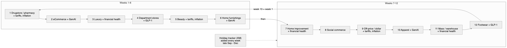

## 7.1 Cadence

| Measure | Value |
|---|---|
| Tracker launches (UTC) | Monday 12–13 in 56 of 66 waves; Monday 14–16 in 7; Friday 2; Tuesday 1 |
| Close (IST) | Monday 20:00 → Wednesday 23:00 |
| Fielding time | median 13.1 h, 90th percentile 49 h, range 2.4 h – 6 days |
| Qualified | 400–414 per tracker wave (fixed quota ≈400) |
| Total started | 403 – 887 |
| Gender quota | exactly balanced (7,000 / 7,000 in the team's Feb–Sep file) |
| Hibernation | ≈3–4 months after close (`428`); deletion 365 days after creation |

## 7.2 Title grammar

`Shopping and Spending - inc <part> + <part> + …` — the first part is the **lead sector**; each further part is a
recurring topic, a seasonal tracker, or a one-off event. Matching (case-insensitive regex, first part only for the
lead):

| Kind | Codes (config) |
|---|---|
| sector | DRUGSTORE, ECOMMERCE, LUXURY, DEPT_STORES, BEAUTY, HOME_FURNISHINGS, HOME_IMPROVEMENT, SOCIAL_COMMERCE, OFF_PRICE, APPAREL, MASS_WAREHOUSE, FOOTWEAR |
| topic | TARIFFS_INFLATION, GLP1, GENAI, FINANCIAL_HEALTH, MIDEAST_GAS |
| seasonal | HOLIDAY_TRACKER (title "holiday track…" or question "current status of your holiday shopping") |
| event | any other part, slugged (PRIME_DAY, LABOR_DAY, BLACK_FRIDAY …) |
| annual | HOLIDAY_SHOPPING, AMAZON_APPAREL, ONLINE_GROCERY, BACK_TO_SCHOOL (not "inc" titles) |
| adhoc | everything else, slug of the title |

## 7.3 Rotation evidence (weeks between appearances of each lead sector)

| Sector | Gaps (weeks) |
|---|---|
| Drugstore | 12, 12, 12, 12, 12 |
| eCommerce | 12, 12, 12, 12, 12 |
| Luxury | 12, 12, 11, 12, 12 |
| Department stores | 12, 12, 12, 12, 12 |
| Beauty | 12, 12, 12, 12, 12 |
| Home furnishings | 13, 11, 12, 12, 12 |
| Home improvement | 13, 11, 12, 12 |
| Social commerce | 24 (replaced by a Holiday week, Nov 3 2025), 12, 12 |
| Off-price / dollar, Apparel, Mass / warehouse, Footwear | 12, 12, 12, 12 |

Prediction check: after Home furnishings (Oct 5 2026) the rotation gives Home improvement for Oct 12 — the Forsta
survey `261000` is "Home Improvement/DIY + Holiday Tracker + …".

## 7.4 Module question codes

| Prefix | Module | Example |
|---|---|---|
| q1–q5, CS1–CS2, D1–D8 | Core (every wave) | see the business description, section 4.1 |
| CS3+, D9+ , q6+ | Topical extensions of the core (tax filing, government shutdown, expenses) | CS3 "Have you filed your 2026 income tax return, yet?" |
| BT | Beauty | BT1 "Have you purchased any beauty products … in the past three months?" |
| XM | Holiday tracker | XM3 status · XM1 bought in last 7 days · XM1A categories · XM2 retailers |
| HX | Holiday outlook | HX1 spend vs last year · HX6 bipolar preferences |
| TF / T | Tariffs | TF1 "What impact, if any, do you think tariffs have on you personally?" |
| IN | Inflation | IN1 "Have you noticed any recent price changes in retail?" |
| GP | GLP-1 | GP1 "Are you currently using a GLP-1 drug like Ozempic?" |
| G, GU | GenAI | GU1 "Which, if any, of the following AI tools have you used …?" |
| F | Financial health | F1 "How long could you cover all of your bills … using just your personal savings?" |
| AP, DNM, R | Apparel, denim, returns | |
| HF, HI | Home furnishings, home improvement | |
| DP, LX, FW, EC, SC, O, DS, M | Dept stores, luxury, footwear, eCommerce, social commerce, off-price, dollar stores, mass | |
| PB, BF, APR, PDR, BD, JP, SD | Holiday purchases, Black Friday, Prime Day, Big Deal Days, Singles Day | |
| E, ID/IDR, FDR, LDR, HW, FWC/FWCR | Easter, July 4th, Father's Day, Labor Day, Halloween, FIFA World Cup | |
| EAT, CPG, SHRNK, BN, DJ, BST, EH, PF | Restaurants, packaged goods, shrink, BNPL, diamonds, store tech, experience, preferences | |

Codes are **not** stable across waves (the same code can carry different wording), which is why the harmoniser
matches on wording.

## 7.5 Known scheme changes

| Change | Effect | Handling |
|---|---|---|
| D2 age: bands (to Oct 2025) → single years (2026) | Age band / generation derivation differs | `classify_age` derives bands from either |
| XM1 (bought in last 7 days): asked of everyone in 2025, only of those who started shopping in 2026 | Not comparable year on year | flagged in outputs |
| HX6 bipolar grid: blank answer titles | Excel route lost ~3,300 answers | API route stores left/right statements |

## 7.6 Applying the patterns

* **Expect the next wave** — `python -m etl.survey_calendar` lists the next 12 lead sectors.
* **Trend a sector** — read waves where `cip_wave_module.module_code = 'BEAUTY' AND is_lead = 1` (every 12 weeks).
* **Year-on-year holiday** — join this season's `HOLIDAY_TRACKER` wave N to last season's wave N on
  `series_wave_no`.
* **New module or sector** — add a line to `config/survey_calendar.yml`; the next run re-labels every survey.

# 8. Operations runbook

## 8.1 Schedule

| | |
|---|---|
| Scheduler | launchd user agent `com.coresight.cip-forsta-etl` (plist in `scripts/launchd/`, installed in `~/Library/LaunchAgents/`) |
| Command | `.venv/bin/python scripts/weekly_forsta.py` in the repository |
| Times (IST) | daily **09:00**; Tuesday and Wednesday **14:00** and **23:30** |
| Why these times | waves launch Monday 12–13 UTC and close Monday 20:00 – Wednesday 23:00 IST; a missed slot runs when the Mac wakes |
| Log | `logs/forsta-etl.log` (appended) |
| Server equivalent | cron `0 9 * * *`, `0 14 * * 2,3`, `30 23 * * 2,3` with `APP_ENV=staging` |

## 8.2 What one run does

1. Database health check — 4 tries, 5 minutes apart.
2. Forsta key check — `GET rh/users/self`.
3. Schema check — `cip_forsta_survey`, `cip_search`, `cip_tracker_line` must exist.
4. Discover → load every due wave → verify → derive (see sections 2–5).
5. Re-check every frozen publication for drift.

## 8.3 Exit codes

| Code | Meaning | Action |
|---|---|---|
| 0 | Everything due loaded and verified (or nothing due) | none |
| 1 | A wave failed to load or verify | read `cip_forsta_survey.last_error`; the next run retries |
| 2 | Forsta rejected the key, it is not configured, or the schema is behind the code | renew the key / run `python scripts/init_db.py` |
| 3 | Loaded, but a published number moved | review on the Publications page |
| 4 | Database unreachable after 4 tries | check VPN / Azure firewall; the next slot retries |

## 8.4 Commands

```bash
python scripts/test_connection.py                  # database + Forsta check (never prints the key)
python scripts/init_db.py                          # create / upgrade the schema (refuses while a load runs)
python scripts/weekly_forsta.py                    # the scheduled run, by hand
python -m etl.forsta_etl --discover                # refresh the register only
python -m etl.forsta_etl --due                     # discover + load everything due
python -m etl.forsta_etl --survey selfserve/58f/260908   # load or reload one wave
python -m etl.forsta_etl --reconcile               # every loaded Forsta wave vs Forsta
python -m etl.forsta_etl --reindex                 # rebuild search for every verified wave
python -m etl.tracker_line --rebuild               # rebuild line-by-line rows
python -m etl.tracker_line --compare "<team file>.xlsx"  # compare with the data team's file (reads only)
python -m etl.survey_calendar                      # calendar + next 12 lead sectors
python -m etl.legacy_dwh --all [--era surveymonkey]      # history from dwh_sm*
python scripts/reconcile.py                        # every wave vs its source
python scripts/perf_check.py                       # P95 timings
python scripts/data_dictionary.py > docs/technical/06-data-dictionary.md
```

## 8.5 Monitoring queries

```sql
-- what the pipeline knows about Forsta
SELECT load_state, COUNT(*) FROM cip_forsta_survey GROUP BY load_state;

-- anything waiting or failed
SELECT forsta_path, state, load_state, qualified_n, total_n, closed_at, last_error
  FROM cip_forsta_survey WHERE load_state IN ('due', 'failed');

-- last runs
SELECT load_id, survey_id, source_type, status, rows_read, rows_loaded, started_at, finished_at, error_text
  FROM cip_load_log ORDER BY load_id DESC LIMIT 20;

-- nothing should be stuck
SELECT survey_id, wave_label, load_status FROM cip_survey WHERE load_status <> 'verified';
```

## 8.6 Common situations

| Situation | Cause | Fix |
|---|---|---|
| Runs log "Loaded 0" for days | No survey has closed in Forsta | Expected; the wave loads at the first run after it is closed |
| Exit 4 / "Can't connect to MySQL … timed out" | VPN down or office IP not allowed by the Azure firewall | Reconnect; the next slot retries |
| A wave `failed` with "does not match its payload" | Forsta changed data mid-load, or a load step broke | `python -m etl.forsta_etl --survey <path>`; investigate `last_error` |
| Survey `hibernated` and history needed | Forsta hibernated it before it was loaded | A Forsta owner reactivates it; the next run loads it |
| Survey reopened and closed again | New respondents | Discovery marks it due; it is reloaded in place |
| Exit 2 "schema is behind the code" | New code deployed | `python scripts/init_db.py` |

## 8.7 Change management

* Code: Python 3.13, SQLAlchemy 2, PyMySQL, tenacity, pandas; tests `pytest` (227 passing, SQLite).
* Schema: `sql/001_schema.sql` is the single source (MySQL DDL, converted to SQLite for tests);
  `app/core/schema_upgrade.py` adds new columns and indexes to an existing database.
* Rules without code changes: `config/survey_map.yml` (topics, demographics, bands), `config/cohorts.yml`,
  `config/tracker_line.yml`, `config/survey_calendar.yml`.

## 8.8 Security

* Forsta: GET only; no write method exists in the client. Key in `.env`, git-ignored, never printed.
* Warehouse: TLS; the portal uses a read-only account; only the ETL writes.
* Personal data: never stored (browser string, link, session, fingerprint, IP); panel id only as sha256.
