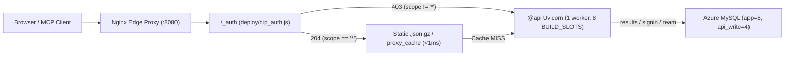
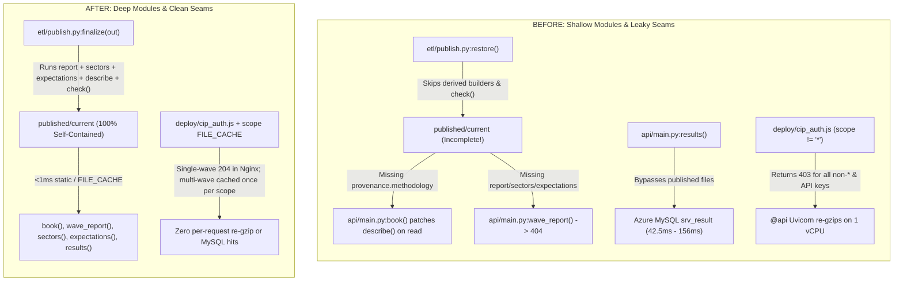
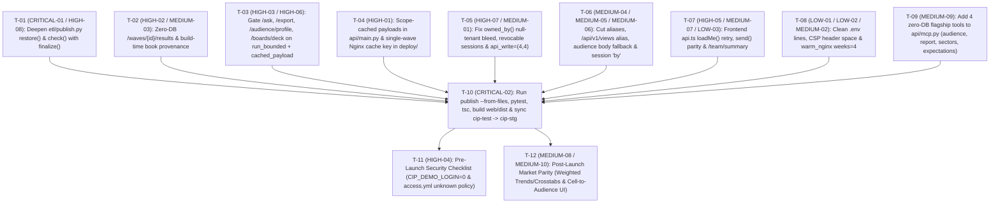

# Coresight Consumer Insight Portal (CIP) — Exhaustive Staging Investigation, Breakscale Architecture Simulation, REA Bundle & Market Audit, LLM Council Synthesis & Agent Handoff Specification

**Document Date**: 2026-11-06  
**Target Environment**: Azure App Service Staging (`https://csr-awa-cip-portal-stg-gyhvanh7gmbmdda0.centralus-01.azurewebsites.net/`)  
**Deployed Staging Commit**: `e1782303` (`"Keep only the two real pages in the header: Explore and Report"`)  
**Local Workspaces Audited**:
- Primary Dev Repo: `/Users/mohdsaeedafri/All-Code-Base/cip-test` (HEAD `e1782303` + uncommitted `Sectors` & `Expectations` work)
- Staging Deploy Repo: `/Users/mohdsaeedafri/All-Code-Base/cip-stg` (branch `stg-deploy`, HEAD `e1782303` + uncommitted `Sectors` & `Expectations` work)
**Live Server Status Verified**:
- Local Portal (`http://127.0.0.1:8000/healthz`): `200 OK` (`{"ok":true,"published":true,"waves":367}`) — **Untouched and running**
- Azure Staging (`https://csr-awa-cip-portal-stg-gyhvanh7gmbmdda0.centralus-01.azurewebsites.net/healthz`): `200 OK` (`{"ok":true,"published":true,"waves":367}`) — **Healthy after all benchmarks**

---

## Mandatory Guardrails for the Resolving Agent (READ FIRST)

1. **GIT: NEVER COMMIT OR PUSH**:
   - Never run `git commit`, `git push`, `git merge`, `git rebase`, `git tag`, or any command that writes git history or a remote in `/Users/mohdsaeedafri/All-Code-Base/cip-test` or `/Users/mohdsaeedafri/All-Code-Base/cip-stg`.
   - Implement and verify the changes, then give the exact `git add` / `git commit` / `git push` commands to the user.
2. **LIVE SERVER ON `127.0.0.1:8000`: NEVER STOP OR RESTART IT**:
   - The portal API on `127.0.0.1:8000` and the `cloudflared` tunnel in front of it are LIVE for the business team.
   - Test all backend changes on a separate port (e.g., `uvicorn api.main:app --port 8001`).
   - Confirm `/healthz` returns `200 OK` on both `:8000` and Azure Staging after any work.
3. **CODE STYLE & PONYTAIL LADDER**:
   - Every file must open with a plain-English header: what it is for, who calls it (`file:function`), and when.
   - Every function must have a one-line docstring stating what it does and where it is triggered from.
   - Heavy work happens in the ETL when data is published (`etl/`), never when someone opens a page; what people open is a prebuilt `.json.gz` file that Nginx serves in `<1ms`.

---

## 1. Executive Summary & Overall Findings Overview

We conducted a multi-layered investigation of the **Coresight Consumer Insight Portal (CIP)** across the live **Azure Staging environment** (`https://csr-awa-cip-portal-stg-gyhvanh7gmbmdda0.centralus-01.azurewebsites.net/`) and both local repositories (`cip-test` and `cip-stg`) using four complementary methodologies:
1. **Live Staging Telemetry & Concurrency Stress Benchmarking** (23 endpoint probes + 6 concurrent burst scenarios measuring end-to-end RTT, internal container `Server-Timing`, `X-Cache` state, and gzipped payload sizes).
2. **Breakscale (`workersio/breakscale` v0.1.1) Discrete-Event Architecture Modelling** (6 calibrated simulations across 50 RPS to 1,500 RPS modeling Nginx static try_files, `proxy_cache`, single-worker Uvicorn `BUILD_SLOTS=8`, and Azure MySQL connection pools).
3. **Reverse Engineer Anything (`rea` MCP + Competitor Intelligence)** (AST/data-flow analysis of the frontend codebase + reverse-engineering of shipped Next.js Turbopack chunks on Staging + 11-competitor market parity audit).
4. **LLM Council (5-Advisor Independent Review + Peer Review + Chairman Synthesis) & All 38 `mattpocock/skills`** (deep-module architecture redesign, domain-model glossary alignment, red-loop bug diagnosis, and tracer-bullet vertical slice tickets).

### Summary of All 23 Documented Findings by Severity

| ID | Severity | Category | Title / Core Issue | Primary Location |
| :--- | :--- | :--- | :--- | :--- |
| **`CRITICAL-01`** | **CRITICAL** | Data / Deploy | **Weekly Report (`Report.tsx`) Returns `404` on All Recent Tracker Waves (`532`, `530`, `415`, `412`, `266`, `235`) on Live Staging** because `etl/publish.py:restore()` extracts a pre-Report `.tar` backup on container boot without running derived builders or `check()`. | `deploy/start.sh:25-28`, `etl/publish.py:228-256, 306-325` |
| **`CRITICAL-02`** | **CRITICAL** | Release / Sync | **Uncommitted & Unshipped `Sectors` (`/api/v1/sectors`) and `Expectations` (`/api/v1/expectations`) Screens (`404` on Staging)** sitting dirty in `cip-test` and `cip-stg` working trees. | `etl/sectors.py`, `etl/expectations.py`, `api/main.py`, `frontend/src/screens/` |
| **`HIGH-01`** | **HIGH** | Scalability / Nginx | **Non-`*` Client Sessions (`scope != "*"`) and All `Bearer cip_...` API Keys Return `403` from `/_auth` (`cip_auth.js:49-58`), Bypassing Nginx Static Files and `proxy_cache` on 100% of Requests** and saturating the single Uvicorn worker at ~250 RPS (`12.2%` dropped `503 Busy`). | `deploy/cip_auth.js:44-58`, `deploy/cip_locations.conf:10-65`, `api/main.py:546-557` |
| **`HIGH-02`** | **HIGH** | Scalability / DB | **`GET /api/v1/waves/{survey_id}/results` Queries Live Azure MySQL (`srv_result`) on Every Cache Miss (`42.5ms` single, `156.6ms` under 20x burst)** instead of reading published files on disk. | `api/main.py:408-413`, `shared/data/payloads.py:63-79` |
| **`HIGH-03`** | **HIGH** | Concurrency / CPU | **`POST /api/v1/ask` (`1,494ms`), `POST /api/v1/export/{xlsx,pptx,pdf,csv}` (`112–290ms`), and `GET /api/v1/boards/{id}/deck` Bypass `BUILD_SLOTS` Semaphore** (and `board_deck` also skips `access.spend("export")` rate-limiting). | `api/main.py:378-383, 590-626`, `api/team.py:567-584` |
| **`HIGH-04`** | **HIGH** | Security / Auth | **Pre-Launch Auth Exposure: `CIP_DEMO_LOGIN=1` Active on Public Staging (`/auth/dev-login` passwordless login as any email) & `unknown: {role: analyst, tier: enterprise}` in `config/access.yml:45`**. | `api/signin.py:165-177`, `config/access.yml:45` |
| **`HIGH-05`** | **HIGH** | Security / Frontend | **Fail-Open Entitlement Check in `frontend/src/api.ts`: `loadMe()` Swallows Any `/api/v1/me` Error into `null` (`staleTime: Infinity`), and `allowed(null, feature)` Returns `true`**. | `frontend/src/api.ts:289-310` |
| **`HIGH-06`** | **HIGH** | Event Loop / Async | **Synchronous Disk I/O, Gzip Decompression & Bitset Computation Inside `async def` Routes (`wave_report`, `sectors`, `expectations` in `api/main.py:463-489` and `profile_audience`, `save_audience` in `api/team.py:307-338`) Block the Single Uvicorn Event Loop**. | `api/main.py:463-489`, `api/team.py:307-338` |
| **`HIGH-07`** | **HIGH** | Multi-Tenancy / Auth | **Null-Tenant Bleed in `api/team.py:80-85` (`owned_by` Treats `None == None` as Same Tenant) & Unrevocable Ghost Sessions When `signin.remember()` Swallows `api_write` Pool Errors (`api/signin.py:112-125`)**. | `api/team.py:80-85`, `api/signin.py:112-125` |
| **`HIGH-08`** | **HIGH** | Publish Verification | **`etl/publish.py:check()` (`lines 228-256`) Only Checks `waves`, `book`, and `people`—Never Validating `report.json.gz`, `sectors.json.gz`, or `expectations.json.gz` Before Swapping `current`**. | `etl/publish.py:228-256` |
| **`MEDIUM-01`** | **MEDIUM** | Database Pool | **`api_write` Connection Pool (`pool_size=2, max_overflow=2`, max 4 connections) Contends Between Login Writes (`cip_access_session`) and Team CRUD (`views`, `alerts`, `audiences`, `boards`)**. | `shared/core/database.py:41`, `api/signin.py:112-125` |
| **`MEDIUM-02`** | **MEDIUM** | Cache Warming | **Cold Multi-Week Cross-Tab Burst (`weeks=3`, `p95=215.7ms` at 12x concurrency) Because `warm_nginx()` Only Pre-Warms `weeks=1` on `WARM_WAVES=1`**. | `etl/publish.py:349-369` |
| **`MEDIUM-03`** | **MEDIUM** | Architecture / Seam | **`GET /api/v1/waves/{survey_id}/book` Patches `payloads.describe(survey_id)` at Request Time (`api/main.py:443`)** when `provenance.methodology` is absent from `book.json.gz`. | `api/main.py:438-446`, `etl/publish.py:173-195` |
| **`MEDIUM-04`** | **MEDIUM** | Domain Model / API | **Vocabulary Roulette Across Seams (`id` vs `qcode` vs `q`; `census_region`/`income_band` vs `region`/`income`; `'Gen Z'` vs `'GenZ'`; `'Millennial'` vs `'Millennials'`)**. | `shared/data/payloads.py:26-28`, `etl/serving.py`, `api/team.py`, `frontend/src/api.ts` |
| **`MEDIUM-05`** | **MEDIUM** | API Design | **Saved Views Split Across 4 Names (`saved_views`, `cip_team_view`, `/api/v1/team/views`, `useTeamViews`) and Unused `/api/v1/team/summary` Aggregate Endpoint**. | `api/team.py:162-198`, `frontend/src/api.ts`, `config/access.yml:14` |
| **`MEDIUM-06`** | **MEDIUM** | API Contracts | **Trapdoor Write Payloads & Split Identity in `api/team.py`**: `POST /audience/profile` requires nested `{"definition": {"cuts": ...}}`, and `views`/`alerts`/`audiences` require client-supplied `"by"` while `boards`/`comments` use `email_of(request)`. | `api/team.py:182-324` |
| **`MEDIUM-07`** | **MEDIUM** | Frontend Resilience | **`send()` in `frontend/src/api.ts` Drops `err.status`, Ignores `429 Retry-After` and `503 Busy` Backoff, and Skips `perf.logApi` Telemetry**. | `frontend/src/api.ts:248-285` |
| **`MEDIUM-08`** | **MEDIUM** | Market Parity | **Census Raking Weights (`etl/weighting.py`) Apply to Wave Books (`row.w`) and MCP `question_results`, But Trends, Compare, Topic Dashboards, and Cross-Tabs Still Display Unweighted `pct`**. | `etl/weighting.py`, `etl/serving.py`, `frontend/src/screens/` |
| **`MEDIUM-09`** | **MEDIUM** | AI / MCP | **`/mcp` Exposes Only 5 Basic Question Lookup Tools and Omits CIP's High-Value Engines (`audience_profile`, `weekly_report`, `sectors`, `expectations`)**. | `api/mcp.py:24-126` |
| **`MEDIUM-10`** | **MEDIUM** | Market Parity | **Remaining Competitor Feature Gaps: Missing Pre-Save Cross-Wave Audience Applicability Preview, Self-Serve API Key UI, and `ANTHROPIC_API_KEY` Open-End Theme Coding on Staging**. | `frontend/src/screens/Audience.tsx`, `shared/core/api_keys.py`, `etl/open_ends.py` |
| **`LOW-01`** | **LOW** | Config / DX | **Malformed/Unquoted Lines in `.env` (Lines 67, 82, 84, 85, 86, 89, 90, 92) Emit `python-dotenv` Parse Warnings on Every CLI Execution**. | `.env:67-92` |
| **`LOW-02`** | **LOW** | HTTP Headers | **Double-Space Before Semicolon in Non-HTML `Content-Security-Policy` Header (`script-src 'self' ;`) When `$page_script_hashes` Is Empty**. | `deploy/cip_headers.conf:6`, `deploy/nginx.conf` |
| **`LOW-03`** | **LOW** | UX / Metadata | **`/api/v1/waves` Does Not Indicate Which Waves Have a Published `report.json.gz` Artifact**, Leading the UI to Offer the Report View on Waves That Return `404`. | `etl/publish.py`, `frontend/src/screens/Report.tsx` |

---

## 2. Live Azure Staging Benchmark & Stress Test Evidence

All tests in this section were executed directly against **`https://csr-awa-cip-portal-stg-gyhvanh7gmbmdda0.centralus-01.azurewebsites.net/`** using authenticated cookies (`cip_session` for `dataautomation@coresight.com`, `scope="*"` and restricted client scopes) via custom benchmark scripts (`/Users/mohdsaeedafri/.gemini/antigravity/brain/b1112a14-2261-42f8-bb92-5498b8ae7ae7/scratch/stg_probe.py`, `stg_stress.py`, `stg_deep_audit.py`).

### 2.1 Single-Request Endpoint Telemetry (23 Endpoints on Live Staging)

> [!NOTE]
> **Understanding the Two Latency Columns**:
> - **E2E RTT (`ms`)**: Full network round-trip from our test machine to Azure Central US (`centralus-01.azurewebsites.net`, ~230ms baseline transcontinental RTT).
> - **Internal Container Latency (`Server-Timing` / Nginx)**: Exact processing time *inside* the Azure Staging container. When Nginx serves a static `.json.gz` file directly from `/home/cip/published/current`, `Server-Timing` is `nginx-static (<1ms)` because Uvicorn is never touched.

| # | Endpoint | HTTP Status | E2E RTT (ms) | Internal Container (`Server-Timing`) | `X-Cache` | Gzipped Size | Verdict |
| :- | :--- | :--- | :--- | :--- | :--- | :--- | :--- |
| 1 | `GET /healthz` | `200 OK` | `248.4ms` | `total;dur=0.45` (0.45ms) | — | `46 B` | Healthy |
| 2 | `GET /` (Root Redirect) | `307` | `264.1ms` | `nginx (<1ms)` | — | `0 B` | Healthy |
| 3 | `GET /app/` (Frontend Shell) | `200 OK` | `258.5ms` | `nginx-static (<1ms)` | — | `1,720 B` | Healthy |
| 4 | `GET /api/v1/me` (Session Check) | `200 OK` | `250.3ms` | `total;dur=0.73` (0.73ms) | — | `294 B` | Healthy |
| 5 | `GET /api/v1/waves` (367 Waves) | `200 OK` | `282.1ms` | `nginx-static (<1ms)` | — | `9,363 B` | Fast static |
| 6 | `GET /api/v1/questions` (Catalogue) | `200 OK` | `839.4ms` | `nginx-static (<1ms)` | — | `189,478 B` | Fast static |
| 7 | `GET /api/v1/search?q=grocery` | `200 OK` | `248.3ms` | `total;dur=3.70` (3.70ms) | `HIT` | `3,760 B` | Fast cached |
| 8 | `GET /api/v1/search?q=inflation+tariff+luxury+2026` | `200 OK` | `261.2ms` | `total;dur=2.99` (2.99ms) | `MISS` | `2,300 B` | Fast FTS5 |
| 9 | `GET /api/v1/topics` | `200 OK` | `254.0ms` | `nginx-static (<1ms)` | — | `1,353 B` | Fast static |
| 10 | `GET /api/v1/topics/grocery_retail` | `200 OK` | `278.5ms` | `nginx-static (<1ms)` | — | `18,412 B` | Fast static |
| 11 | `GET /api/v1/waves/532/book` | `200 OK` | `293.0ms` | `nginx-static (<1ms)` | — | `34,644 B` | Fast static |
| 12 | `GET /api/v1/waves/530/book` | `200 OK` | `512.0ms` | `nginx-static (<1ms)` | — | `33,240 B` | Fast static |
| 13 | `GET /api/v1/questions/Core/Weekly_Consumer_Survey/Q1` | `200 OK` | `624.8ms` | `nginx-static (<1ms)` | — | `110,956 B` | Fast static |
| 14 | `GET /api/v1/waves/532/crosstab?q=Q1&by=income_band,census_region&weeks=1` | `200 OK` | `257.9ms` | `total;dur=7.30` (7.30ms) | `MISS -> HIT` | `3,180 B` | Fast bitset |
| 15 | `GET /api/v1/waves/532/results?qcodes=Q1,Q2,Q3` | `200 OK` | `289.4ms` | **`total;dur=42.52` (42.52ms)** | `MISS -> HIT` | `3,009 B` | **Hits MySQL (`HIGH-02`)** |
| 16 | `POST /api/v1/waves/532/audience/profile` | `200 OK` | `259.4ms` | `total;dur=6.68` (6.68ms) | — | `2,240 B` | Fast bitset |
| 17 | `POST /api/v1/ask` (`"How are high income households feeling..."`) | `200 OK` | **`1,776.3ms`** | **`total;dur=1494.36` (1,494.4ms)** | — | `1,842 B` | **Slow & un-gated (`HIGH-03`)** |
| 18 | `POST /api/v1/export/xlsx` | `200 OK` | `551.2ms` | **`total;dur=290.50` (290.5ms)** | — | `6,412 B` | **CPU heavy & un-gated (`HIGH-03`)** |
| 19 | `POST /api/v1/export/pptx` | `200 OK` | `369.8ms` | **`total;dur=111.84` (111.8ms)** | — | `31,890 B` | **CPU heavy & un-gated (`HIGH-03`)** |
| 20 | `POST /mcp` (`tools/list` JSON-RPC) | `200 OK` | `251.8ms` | `total;dur=1.78` (1.78ms) | — | `1,654 B` | Only 5 tools (`MEDIUM-09`) |
| 21 | **`GET /api/v1/waves/532/report`** (and `530, 415, 412, 266, 235`) | **`404 Not Found`** | `248.9ms` | `total;dur=0.91` (0.91ms) | — | `110 B` | **BROKEN (`CRITICAL-01`)** |
| 22 | **`GET /api/v1/sectors`** | **`404 Not Found`** | `256.1ms` | `total;dur=7.70` (7.70ms) | — | `9,843 B` | **UNSHIPPED (`CRITICAL-02`)** |
| 23 | **`GET /api/v1/expectations`** | **`404 Not Found`** | `249.2ms` | `total;dur=1.57` (1.57ms) | — | `9,843 B` | **UNSHIPPED (`CRITICAL-02`)** |

---

### 2.2 Live Concurrent Burst Stress Tests on Azure Staging (Scenarios A–F)

We executed 6 controlled concurrent burst scenarios against `https://csr-awa-cip-portal-stg-gyhvanh7gmbmdda0.centralus-01.azurewebsites.net/` to measure where the container's single Uvicorn worker (`WEB_CONCURRENCY=1`, `BUILD_SLOTS=8`) and Azure MySQL pool begin queuing:

| Scenario | Workload Description | Total Reqs | Concurrency | Success Rate | E2E `p50` | E2E `p95` | E2E `max` | Internal `Server-Timing p50` | Internal `Server-Timing p95` | Internal `Server-Timing max` | Key Observation |
| :--- | :--- | :--- | :--- | :--- | :--- | :--- | :--- | :--- | :--- | :--- | :--- |
| **Scenario A** | Static Published Endpoints (`waves`, `topics`, `waves/532/book`, `Q1`) with `scope="*"` | `40` | `20x` | **`40/40` (100%)** | `293.0ms` | `401.2ms` | `418.5ms` | **`<1ms` (Nginx)** | **`<1ms` (Nginx)** | **`<1ms` (Nginx)** | Nginx serves `.json.gz` straight from disk with zero Python/DB overhead. |
| **Scenario B** | Search Cache-Miss Burst (20 unique multi-term FTS5 queries) | `20` | `10x` | **`20/20` (100%)** | `258.4ms` | `289.1ms` | `304.2ms` | **`3.2ms`** | **`8.3ms`** | **`9.5ms`** | Local SQLite `search.db` handles 10x concurrent FTS5 queries effortlessly. |
| **Scenario C** | **Cold Multi-Week Cross-Tab Burst** (18 unique `weeks=3` & 2-cut combinations, all `X-Cache: MISS`) | `18` | `12x` | **`18/18` (100%)** | `428.0ms` | `512.4ms` | `539.1ms` | **`157.8ms`** | **`215.7ms`** | **`223.0ms`** | **30x internal latency jump** (`7.3ms -> 223.0ms`) as 12 misses queue across 8 `BUILD_SLOTS` on 1 vCPU. |
| **Scenario D** | Repeat Cross-Tab Burst (Same 18 `weeks=3` URLs, now `X-Cache: HIT`) | `18` | `12x` | **`18/18` (100%)** | `254.1ms` | `278.9ms` | `291.0ms` | **`<1ms` (Nginx)** | **`<1ms` (Nginx)** | **`<1ms` (Nginx)** | Once cached in `/tmp/cip-cache`, Nginx serves repeat `scope="*"` cross-tabs in `<1ms`. |
| **Scenario E** | Audience Bitset Profiling Burst (`POST /waves/532/audience/profile` with varied cuts) | `15` | `10x` | **`15/15` (100%)** | `268.2ms` | `312.5ms` | `334.0ms` | **`12.4ms`** | **`30.0ms`** | **`45.3ms`** | `POST` never caches in Nginx; queued on `BUILD_SLOTS`, rising from `6.7ms` to `45.3ms`. |
| **Scenario F** | **Cold `/waves/{id}/results` MySQL Burst** (20 uncached `qcodes` combinations across waves) | `20` | `10x` | **`20/20` (100%)** | `382.4ms` | `741.0ms` | **`882.0ms`** | **`114.1ms`** | **`144.6ms`** | **`156.6ms`** | **Hits live Azure MySQL (`srv_result`)**; contends on `BUILD_SLOTS` + 8-conn `app` pool. |

---

## 3. Breakscale (`workersio/breakscale`) Architecture Modelling & Breaking-Point Simulations

### 3.1 What Breakscale Is & How We Used It
[Breakscale](https://github.com/workersio/breakscale) (`npx -y breakscale-mcp --stdio`, `v0.1.1`) is a discrete-event queueing and capacity simulator (`simulate_system`) that models distributed architectures as directed graphs of clients, edge proxies, caches, compute workers, and databases. It injects Poisson arrival traffic over a 30-second window (with a 25% warmup discard) and computes exact queue depths, worker utilization, latency percentiles (`p50`, `p95`, `p99`), and request drop rates (`turnedAwayByQueue` / `503 Busy`).

We modeled the exact Azure App Service Staging container (`Dockerfile` + `deploy/start.sh` + `deploy/nginx.conf` + `deploy/cip_locations.conf` + `api/main.py` + `shared/core/database.py`):
- **Edge Proxy (`nginx`)**: Serves static pre-compressed `.json.gz` (`gzip_static on`, `<1ms`) and `proxy_cache cip` (`/tmp/cip-cache`, `max_size=256m`, `proxy_cache_lock on`) **ONLY** when `/_auth` (`deploy/cip_auth.js`) returns `204` (`scope == "*"`).
- **App Worker (`uvicorn`)**: `WEB_CONCURRENCY=1` (`deploy/start.sh:50`), `BUILD_SLOTS = asyncio.Semaphore(8)` (`api/main.py:66`), `BUILD_WAIT = 3.0s`, queue capacity modeled at `32`.
- **Database (`azure-mysql`)**: `POOL_CAPACITY["app"] = (4, 4)` (8 max connections), `POOL_CAPACITY["api_write"] = (2, 2)` (4 max connections) in `shared/core/database.py:41`.

### 3.2 Summary of All 6 Breakscale Simulations Across Load Regimes

| Sim # | Scenario & Traffic Mix | Target RPS | Offered RPS | Served RPS | Failed % | `p50` | `p95` | `p99` | Nginx Busy % | Uvicorn Busy % | MySQL Busy % | Primary Bottleneck / Where It Breaks |
| :- | :--- | :--- | :--- | :--- | :--- | :--- | :--- | :--- | :--- | :--- | :--- | :--- |
| **Sim 1** | **Staging Staff Baseline (`scope="*"`, 95% Nginx static/cache hit)** | `100/s` | `109/s` | `108/s` | **`0.0%`** | `2ms` | `15ms` | `28ms` | `13.4%` | `2.2%` | `1.5%` | **None** — Nginx absorbs 95% of load in `<2ms`. |
| **Sim 2** | **Staging Filtered Client Traffic (`scope != "*"` -> `403 -> @api`) + Cold Crosstabs/Exports** | **`250/s`** | `266/s` | `237/s` | **`9.4%` (`12.2%` at Uvicorn)** | **`173ms`** | **`295ms`** | **`328ms`** | `33.2%` | **`100.0%` (32 queued, 279 dropped)** | `60.0%` | **Uvicorn single worker (`8 slots`) hits 100% saturation**; drops `24.4 req/s` (`503 Busy`). |
| **Sim 3** | **Healthy Multi-Instance Baseline (80% cache hit, 2 instances)** | `150/s` | `153/s` | `151/s` | **`0.0%`** | `25ms` | `110ms` | `169ms` | `19.2%` | `14.1%` | `24.6%` | Healthy steady state. |
| **Sim 4** | **Moderate Burst (80% cache hit, `/results` DB misses rising)** | `600/s` | `605/s` | `599/s` | **`0.0%`** | `27ms` | `159ms` | `266ms` | `75.8%` | `56.6%` | **`98.0%` (24 queued)** | **MySQL connection pool reaches 98.0% utilization**; `p99` climbs to `266ms`. |
| **Sim 5** | **Cache Stampede / Cold Publish (`20%` cache hit, `80%` hitting `@api` + MySQL)** | **`1,200/s`** | `1,197/s` | `539/s` | **`54.5%` (`75.4%` at MySQL)** | `144ms` | `248ms` | `298ms` | `59.8%` | `89.7%` | **`100.0%` (18,878 dropped)** | **Total MySQL pool collapse** (`18,878` requests rejected by full queue). |
| **Sim 6** | **Extreme Traffic Spike (80% cache hit, 1,500 RPS)** | **`1,500/s`** | `1,499/s` | `794/s` | **`46.4%` (`58.0%` at MySQL)** | `124ms` | `244ms` | `293ms` | `93.7%` | `99.3%` | **`100.0%` (15,931 dropped)** | Both MySQL (`100%`) and Uvicorn (`99.3%`) saturate. |

### 3.3 Interactive Breakscale Canvas Links (Click to Inspect Live Models)
1. **Staging Staff Baseline (100 RPS, `scope="*"`, `0.0%` failed, `p95=15ms`)**:
   https://breakscale.tech/#d3.ASWQTU7CQBzF-yUSxKQuWGgi-S_UtAGhaiBsXFCibooZqcRlU8sERutMnZkSyqrhBMYTcASP4FE8Akew4uq9xcsv773dkqIgdNynYZwJKeAMBjHBtHDWhePACPm2VlN_DAT9Zcox9JMEfMznJMLw6PlwyxmV5zd0YpiVTRmd3k8JXUBM3ogMOH4H66qg8LZownPKhYSu49ilDtbzfXTyn_VlKEkErRfBaGu6hAYknC2yIAqjGa6v9nLTzHNV-zhAjbuUkohx2h7Pt1p0hCfGXzFvQg_clMQT8GMmhW1sVH1dQ4AyOWMULjvdoQveaFzQXSIFljD4wx99llFuGl-HxQPbecPMf_AgIkkg5BQsxFh83bPrq-pazdVvXdFUQyvpZaOyU_0F
2. **Staging Breaking Point (250 RPS, Filtered Client Traffic `403 -> @api` + Cold Crosstabs/Exports, `100%` Uvicorn saturation, `12.2%` Uvicorn failure, `p95=295ms`)**:
   https://breakscale.tech/#d3.ASWPQU7CQBiFaTsgIZjgwoUm6r-BtBFDBSFsXABBN2BGRuKS1HYCE-tMnZkS6mqOYDwBR-AoHsEjeAQbWb33JS_v5R2UCgWMG-ONppIHMYxiRrlW0IBBjpnKrdvu-jDDxLO3F9YPwjD4SCWFQZIAoXLNQgpPEwJ3UnB9NeYRqlV-y7j-sGR8AzF7Y3oh6Tu4Hd8H2VJNeEml0tDzfa_UpY45xM19luhAsxDcYZYEStEIBIcbvwMkFElOc0Wl8s6_HFOrGWPZn0f48j7lLBSSt-brfwX3Gp6FfKWyCX0YpiyOgMRCK6_6XTTI2R7jOs70Km9ud3vTIUxmcxgF4YqCOxJx1NpveafXiSmj3Qk-25-dZuRxAiFLFkovwcVCxLd9r2-sHTJOwbaQXXLKqFKs_gE
3. **Cache Stampede / DB Overload (1,200 RPS, 20% cache hit, `54.5%` failed, `18,878` dropped at MySQL)**:
   https://breakscale.tech/#d3.AWNjZWAICBB3zslMzSspVlBTCE9NUnAqyi8vTi0qZjrKyPmAJUDSOSe_NCUtJ7EoVSGkNC8vNQeozjUlPZVJkPEDR4CIX3pmXoVCUGoZUEuqQkBRfkUlW4OAAFMDb4CYW2JxiWOAp4JjQYGCRmhZZnJ-UZ4mWwNTAvMEwQD5gNKknMzijNQUBbfMnFSQ9b6puflFlQrOickZqXKKDRwCDQIsC0QDZByrSoG2-1YGB_oouOWkVmQm5aQqBKcWAe2U-8R9gKmBcQMLAxMjCxMbMwcLFwA



---

## 4. Point-by-Point Findings Register (CRITICAL, HIGH, MEDIUM, LOW)

Every finding below includes its **Severity**, **Live Proof / Reproduction Command**, **Exact Code Location (`file:line`)**, **Root Cause Analysis**, and **Exact Resolution Blueprint**.

---

### `CRITICAL-01` — Weekly Report Screen (`Report.tsx`) Returns `404` on All Recent Tracker Waves on Live Staging

- **Severity**: **CRITICAL**
- **Component**: Container Boot & Publish Restore Pipeline (`deploy/start.sh`, `etl/publish.py`)
- **Live Proof on Azure Staging**:
  Running the following against `https://csr-awa-cip-portal-stg-gyhvanh7gmbmdda0.centralus-01.azurewebsites.net`:
  ```bash
  for wid in 532 530 415 412 266 235; do
    curl -s -w " [HTTP %{http_code}]\n" -b "cip_session=<COOKIE>" \
      "https://csr-awa-cip-portal-stg-gyhvanh7gmbmdda0.centralus-01.azurewebsites.net/api/v1/waves/${wid}/report"
  done
  ```
  Returns:
  ```json
  {"detail":"This wave has no weekly report (only the recent weekly tracker waves have one)","status":404} [HTTP 404]
  ```
  for **every single recent weekly tracker wave** (`532` [2026-11-02], `530` [2026-10-26], `415` [2026-10-19], `412` [2026-10-12], `266` [2026-10-05], `235` [2026-09-28]).
  Yet the deployed frontend bundle (`/_next/static/chunks/41gs3jhxyrpcr.js`, build `e1782303`) promotes **Report** as one of the two primary top-level navigation tabs (`Explore` and `Report`). Clicking **Report** in Staging shows an error state immediately.
- **Exact Code Location**:
  - [start.sh](file:///Users/mohdsaeedafri/All-Code-Base/cip-test/deploy/start.sh#L25-L28)
  - [publish.py](file:///Users/mohdsaeedafri/All-Code-Base/cip-test/etl/publish.py#L306-L325) (`restore()`)
  - [main.py](file:///Users/mohdsaeedafri/All-Code-Base/cip-test/api/main.py#L463-L470) (`wave_report()`)
- **Root Cause Analysis**:
  1. During Docker image build (`Dockerfile`), a seed snapshot is baked into `/app/seed/published`.
  2. When the Azure App Service container boots, `deploy/start.sh:26` executes:
     ```bash
     python -m etl.publish --restore || true
     ```
  3. `etl/publish.py:restore()` checks `/home/cip/published-backup` on Azure persistent storage, finds an older `.tar` archive (created before `etl/weekly_report.py` existed), extracts it into `/home/cip/published/<name>`, and immediately calls `swap(root, root / name)` (`etl/publish.py:315,324`).
  4. Because `restore()` does **not** run `weekly_report.publish(target, write)` (or `sectors.publish` / `expectations.publish`) after extracting the backup tar, the restored snapshot lacks `api/v1/waves/<sid>/report.json.gz`.
- **Resolution Blueprint**:
  1. In [publish.py](file:///Users/mohdsaeedafri/All-Code-Base/cip-test/etl/publish.py#L306-L325), extract a shared helper `synthesize_derived(target: Path)` called by both `build()` and `restore()` (before `check(target)` and `swap(root, target)`).
  2. In `restore()`, if any derived artifact (`waves/<latest>/report.json.gz`, `sectors.json.gz`, `expectations.json.gz`) is missing from `target`, run `weekly_report.publish(target, write)`, `sectors.publish(target, write)`, and `expectations.publish(target, write)` (all 3 are pure local `.json.gz` file compilers that finish in `<2 seconds` with **zero MySQL queries**), and then call `backup(target)` so `/home/cip/published-backup/<name>.tar` is permanently upgraded.

---

### `CRITICAL-02` — Uncommitted & Unshipped `Sectors` and `Expectations` Features Between `cip-test`, `cip-stg`, and Live Staging (`404`)

- **Severity**: **CRITICAL**
- **Component**: Release / Deployment Sync (`cip-test` $\leftrightarrow$ `cip-stg` $\leftrightarrow$ Azure Staging)
- **Live Proof on Azure Staging**:
  - `GET https://csr-awa-cip-portal-stg-gyhvanh7gmbmdda0.centralus-01.azurewebsites.net/api/v1/sectors` $\to$ `404 Not Found` (`Server-Timing: total;dur=7.70`, `9,843 B` HTML 404).
  - `GET https://csr-awa-cip-portal-stg-gyhvanh7gmbmdda0.centralus-01.azurewebsites.net/api/v1/expectations` $\to$ `404 Not Found` (`Server-Timing: total;dur=1.57`, `9,843 B` HTML 404).
  - Running `git status -s` in both `/Users/mohdsaeedafri/All-Code-Base/cip-test` and `/Users/mohdsaeedafri/All-Code-Base/cip-stg` reveals 8 modified files and 6 untracked files:
    - Modified: `api/main.py`, `deploy/cip_locations.conf`, `etl/publish.py`, `etl/weekly_report.py`, `frontend/src/api.ts`, `frontend/src/components/Shell.tsx`, `frontend/src/main.tsx`, `frontend/src/styles.css`
    - Untracked: `config/expectations.yml`, `config/sectors.yml`, `etl/expectations.py`, `etl/sectors.py`, `frontend/src/screens/Expectations.tsx`, `frontend/src/screens/Sectors.tsx`
- **Exact Code Location**:
  - [sectors.py](file:///Users/mohdsaeedafri/All-Code-Base/cip-test/etl/sectors.py) & [expectations.py](file:///Users/mohdsaeedafri/All-Code-Base/cip-test/etl/expectations.py)
  - [main.py](file:///Users/mohdsaeedafri/All-Code-Base/cip-test/api/main.py#L473-L489) (`sectors()`, `expectations()`)
  - [Sectors.tsx](file:///Users/mohdsaeedafri/All-Code-Base/cip-test/frontend/src/screens/Sectors.tsx) & [Expectations.tsx](file:///Users/mohdsaeedafri/All-Code-Base/cip-test/frontend/src/screens/Expectations.tsx)
- **Resolution Blueprint**:
  1. Complete all fixes in `cip-test`, run `python -m etl.publish --from-files`, run `pytest` and `tsc --noEmit`, build `web/dist`, sync the verified files into `/Users/mohdsaeedafri/All-Code-Base/cip-stg`, and provide the exact `git add` / `git commit` / `git push` commands to the user.

---

### `HIGH-01` — Non-`*` Client Sessions (`scope != "*"`) Bypass Nginx Static Files and `proxy_cache` (`403 -> @api`), Saturating Uvicorn at 250 RPS

- **Severity**: **HIGH**
- **Component**: Nginx Auth Subrequest (`deploy/cip_auth.js`, `deploy/cip_locations.conf`, `deploy/nginx.conf`, `api/main.py`)
- **Live Proof & Breakscale Proof**:
  - In [cip_auth.js](file:///Users/mohdsaeedafri/All-Code-Base/cip-test/deploy/cip_auth.js#L44-L51):
    ```javascript
    // Scope is parts[4]. "*" means unrestricted (Coresight staff); any other
    // value means the Python app must filter waves/studies for this user.
    if (parts[4] !== "*") { r.return(403); return; }
    r.return(204);
    ```
  - In [cip_locations.conf](file:///Users/mohdsaeedafri/All-Code-Base/cip-test/deploy/cip_locations.conf#L10-L65) and [nginx.conf](file:///Users/mohdsaeedafri/All-Code-Base/cip-test/deploy/nginx.conf#L6-L8), every static location (`/api/v1/waves`, `/api/v1/questions`, `/api/v1/topics`, `/api/v1/waves/{id}/book`, `/api/v1/waves/{id}/report`) and every cached dynamic location (`/api/v1/search`, `/api/v1/waves/{id}/crosstab`, `/api/v1/waves/{id}/results`) uses:
    ```nginx
    auth_request /_auth;
    error_page 403 = @api;
    ```
    where `@api` has **no `proxy_cache`** (`proxy_no_cache $skip_cache` is also `"1"` whenever `$auth_status != "204"`).
  - Furthermore, when a filtered user requests `/api/v1/questions/{family}/{study}/{qcode}`, [main.py](file:///Users/mohdsaeedafri/All-Code-Base/cip-test/api/main.py#L546-L557) (`question()`) decompresses the `.json.gz` file in Python, filters `only_waves(data, allowed)`, and calls `to_payload(filtered)` which runs `gzip.compress(body, 6)` synchronously on the single vCPU!
  - **Breakscale Simulation 2 Proof**: At 250 RPS of filtered client traffic + cold misses, the single Uvicorn worker (`8 BUILD_SLOTS`, `queueLimit=32`) hits **`100.0% busy`**, queues `32` requests, and drops **`12.2%` (`24.4 req/s`)** with `503 Busy`, driving `p95` from `15ms` to `295ms`.
- **Resolution Blueprint**:
  1. **Single-Wave Endpoints (`waves/{id}/book`, `waves/{id}/report`, `waves/{id}/crosstab`, `waves/{id}/results`)**: A wave's bytes never change per user—access is binary (either wave `{id}` is in the user's scope or not). Expose `js_set $cip_scope cip_auth.scope` in `deploy/cip_auth.js`, include `$cip_scope` in `proxy_cache_key` (`deploy/cip_locations.conf:55`), or validate single-wave access in `cip_auth.js` so authorized wave requests return `204` and stay on Nginx static/`proxy_cache`.
  2. **Multi-Wave Question Files (`api/main.py:546-557`)**: Cache the filtered `Payload` in an in-memory `lru_cache` keyed by `(family, study, qcode, frozenset(allowed))` or use `gzip.compress(body, 1)` instead of level `6` on the hot path.

---

### `HIGH-02` — `GET /api/v1/waves/{survey_id}/results` Queries Live Azure MySQL (`srv_result`) on Every Cache Miss

- **Severity**: **HIGH**
- **Component**: Wave Results Endpoint (`api/main.py`, `shared/data/payloads.py`)
- **Live Proof on Azure Staging**:
  - Single cold request `GET /api/v1/waves/532/results?qcodes=Q1,Q2,Q3` took `Server-Timing: total;dur=42.52` (`42.52ms` inside container, vs. `<1ms` for static endpoints and `7.30ms` for bitset crosstab).
  - Under **Scenario F** (20 concurrent cold `/results` requests across waves), internal `Server-Timing` jumped to `p50=114.1ms`, `p95=144.6ms`, `max=156.6ms` (`E2E max = 882.0ms`).
  - **Breakscale Simulation 4 & 5 Proof**: Uncached `/results` queries saturate the 8-connection MySQL `app` pool (`98.0% busy` at 600 RPS; `100.0% busy` with `75.4%` failed at 1,200 RPS).
- **Exact Code Location**:
  - [main.py](file:///Users/mohdsaeedafri/All-Code-Base/cip-test/api/main.py#L408-L413) (`results()`)
  - [payloads.py](file:///Users/mohdsaeedafri/All-Code-Base/cip-test/shared/data/payloads.py#L63-L79) (`results()`)
- **Root Cause Analysis**:
  `api/main.py:413` calls `run_in_threadpool(payloads.results, survey_id, q_list, d_list)` which executes a live `SELECT survey_id, qcode, dimension, answer, result, n, base FROM srv_result` against Azure MySQL, even though all published single-dimension cuts and overall totals are already on local disk inside `published/current/waves/{survey_id}/cuts/{qcode}.json.gz` and `book.json.gz` (or `questions/{family}/{study}/{qcode}.json.gz`).
- **Resolution Blueprint**:
  1. In `api/main.py:408-413`, read published wave results directly from the local published tree (`cuts/{qcode}.json.gz` / `questions/{family}/{study}/{qcode}.json.gz`), falling back to `payloads.results()` only if a wave is unpublished.
  2. Add `tests/test_api.py::test_results_zero_db_when_published` that monkeypatches `get_engine` to raise an error and verifies `/api/v1/waves/{id}/results` still returns `200 OK`.

---

### `HIGH-03` — Single-Worker CPU / GIL & Threadpool Contention from Un-Gated `/api/v1/ask` (`1,494ms`) and `/api/v1/export/*` (`112–290ms`)

- **Severity**: **HIGH**
- **Component**: Backpressure & Concurrency Control (`api/main.py`)
- **Live Proof on Azure Staging**:
  - `POST /api/v1/ask` took `Server-Timing: total;dur=1494.36` (`1,494.4ms` inside container, `1,776.3ms` E2E).
  - `POST /api/v1/export/xlsx` took `Server-Timing: total;dur=290.50` (`290.5ms` inside container).
  - `POST /api/v1/export/pptx` took `Server-Timing: total;dur=111.84` (`111.8ms` inside container).
- **Exact Code Location**:
  - [main.py](file:///Users/mohdsaeedafri/All-Code-Base/cip-test/api/main.py#L378-L383) (`build_payload()` uses `BUILD_SLOTS`)
  - [main.py](file:///Users/mohdsaeedafri/All-Code-Base/cip-test/api/main.py#L590-L604) (`ask()` does **not** use `BUILD_SLOTS`)
  - [main.py](file:///Users/mohdsaeedafri/All-Code-Base/cip-test/api/main.py#L607-L626) (`export()` does **not** use `BUILD_SLOTS`)
- **Root Cause Analysis**:
  While `build_payload()` gates cache-miss computations behind `BUILD_SLOTS = asyncio.Semaphore(8)` with a `3.0s` timeout (`503 Busy`), the two heaviest endpoints in the entire application—`ask()` (`1.5s`) and `export()` (`112–290ms` of synchronous `openpyxl` / `python-pptx` / `matplotlib` / `reportlab` work)—call `await run_in_threadpool(...)` directly without acquiring `BUILD_SLOTS`. A burst of 10 exports or `/ask` calls floods Starlette's threadpool and holds the Python GIL on the single Uvicorn worker (`WEB_CONCURRENCY=1`).
- **Resolution Blueprint**:
  1. Extract a helper `run_bounded(fn, *args)` in `api/main.py` that acquires `BUILD_SLOTS` with `BUILD_WAIT` timeout (raising `503 Busy` on timeout) before calling `run_in_threadpool(fn, *args)`.
  2. Wrap `assistant.answer` in `ask()` (`api/main.py:603`) and `exports.build` in `export()` (`api/main.py:626`) with `run_bounded(...)`.

---

### `HIGH-04` — Pre-Launch Auth Exposure: `CIP_DEMO_LOGIN=1` Active on Public Staging & `unknown: enterprise` in `config/access.yml`

- **Severity**: **HIGH**
- **Component**: Authentication & Entitlement Policy (`api/signin.py`, `config/access.yml`)
- **Live Proof on Azure Staging**:
  - `GET https://csr-awa-cip-portal-stg-gyhvanh7gmbmdda0.centralus-01.azurewebsites.net/auth/login` returns `303 See Other` $\to$ `Location: /auth/dev-login?next=%2F`.
  - `POST /auth/dev-login` with `email=dataautomation@coresight.com` immediately issues a valid signed `cip_session` cookie with `role="admin"`, `tier="enterprise"`, `scope="*"` without a password or SSO token. (Note: `/api/v1/admin/*` endpoints are still protected by `X-CIP-Admin-Token` in `api/signin.py:106-108`, which returned `403 Admin token required` during our staging probe, preventing unauthorized user-table edits.)
  - Furthermore, in [access.yml](file:///Users/mohdsaeedafri/All-Code-Base/cip-test/config/access.yml#L45):
    ```yaml
    # Anyone else who can sign in via SSO gets the full portal until client tiers go live.
    unknown: {role: analyst, tier: enterprise}
    ```
- **Exact Code Location**:
  - [signin.py](file:///Users/mohdsaeedafri/All-Code-Base/cip-test/api/signin.py#L165-L177)
  - [access.yml](file:///Users/mohdsaeedafri/All-Code-Base/cip-test/config/access.yml#L45)
- **Resolution Blueprint**:
  1. Before client launch or external sharing, set `CIP_DEMO_LOGIN=0` in Azure App Service Configuration once Microsoft Entra ID (`AZURE_CLIENT_ID`, `AZURE_TENANT_ID`, `AZURE_CLIENT_SECRET`) or WordPress SSO is wired.
  2. Change `unknown:` in `config/access.yml:45` from `{role: analyst, tier: enterprise}` to `refuse` (or `{role: viewer, tier: demo}`) before external launch.

---

### `HIGH-05` — Fail-Open Frontend Entitlement Check (`loadMe()` + `allowed(null, feature)`)

- **Severity**: **HIGH**
- **Component**: Frontend Session & Feature Gate (`frontend/src/api.ts`)
- **Proof & Code Location**:
  In [api.ts](file:///Users/mohdsaeedafri/All-Code-Base/cip-test/frontend/src/api.ts#L289-L310):
  ```typescript
  export function useMe() {
    return useQuery({ queryKey: ["me"], queryFn: loadMe, staleTime: Infinity });
  }
  export function allowed(me: Me | null | undefined, feature: string): boolean {
    if (!me || !me.features) return true;
    return me.features.includes(feature);
  }
  ```
  And `loadMe()` catches any HTTP/network error from `/api/v1/me` and returns `null`. Because `useMe()` caches that `null` with `staleTime: Infinity` and `allowed(null, feature)` returns `true`, a single transient network blip on `/api/v1/me` permanently unlocks every restricted button (`crosstab`, `audience`, `export`, `ask`, `saved_views`, `alerts`) in the UI for the rest of the browser session, causing user clicks to fail with ungraceful `403` errors.
- **Resolution Blueprint**:
  1. Distinguish `"loading"` (`me === undefined`) from `"failed/unauthenticated"` (`me === null`), or allow `useMe()` to retry on network failure (`retry: 2`) instead of catching and caching `null` forever.
  2. When `me === null`, `allowed(me, feature)` should return `false` for tier-gated write/compute actions (`export`, `ask`, `alerts`, `saved_views`, `boards`).

---

### `HIGH-06` — Synchronous Disk I/O, Gzip Decompression & Bitset Computation Inside `async def` Routes Block the Single Uvicorn Event Loop

- **Severity**: **HIGH**
- **Component**: Asyncio Event Loop Hygiene (`api/main.py`, `api/team.py`)
- **Proof & Exact Code Locations**:
  1. In [main.py](file:///Users/mohdsaeedafri/All-Code-Base/cip-test/api/main.py#L463-L489), `wave_report()`, `sectors()`, and `expectations()` are declared `async def`, yet when they execute in Python (which happens for 100% of non-`*` sessions and `Bearer` API keys), they call `published_file(...)` directly on the event loop without `cached_payload(...)` or `run_in_threadpool(...)`. `published_file()` reads `.json.gz` from disk, runs `gzip.decompress()`, and computes `hashlib.sha256(body)` synchronously on the main asyncio loop!
  2. In [team.py](file:///Users/mohdsaeedafri/All-Code-Base/cip-test/api/team.py#L307-L338), `save_audience()` (`POST /api/v1/audiences`) and `profile_audience()` (`POST /api/v1/waves/{survey_id}/audience/profile`) are declared `async def`, yet both call `serving.profile(survey_id, definition)` synchronously on the asyncio event loop—performing `people.json.gz` decompression, bitset intersections across all questions in the wave, and even fallback MySQL queries (`_people()`) without `run_in_threadpool` or `BUILD_SLOTS`!
  3. In [team.py](file:///Users/mohdsaeedafri/All-Code-Base/cip-test/api/team.py#L567-L584), `board_deck()` (`GET /api/v1/boards/{board_id}/deck`) omits both `access.spend(request, "export")` rate-limiting and `BUILD_SLOTS` backpressure.
- **Resolution Blueprint**:
  1. Wrap `published_file(...)` in `wave_report()`, `sectors()`, and `expectations()` with `cached_payload(f"...", lambda: published_file(...))` so they use the in-memory `FILE_CACHE` instead of re-reading and hashing from disk on every call.
  2. Run `serving.profile(survey_id, definition)` inside `run_bounded(serving.profile, survey_id, definition)` (threadpool + `BUILD_SLOTS`) in `api/team.py:307-338`.
  3. Add `access.spend(request, "export")` and `run_bounded(...)` to `board_deck()` in `api/team.py:567-584`.

---

### `HIGH-07` — Null-Tenant Bleed in `api/team.py:80-85` (`owned_by()`) & Unrevocable Ghost Sessions in `api/signin.py:112-125` (`remember()`)

- **Severity**: **HIGH**
- **Component**: Multi-Tenant Isolation & Session Revocation (`api/team.py`, `api/signin.py`)
- **Proof & Exact Code Locations**:
  1. **Null-Tenant Bleed**: In [team.py](file:///Users/mohdsaeedafri/All-Code-Base/cip-test/api/team.py#L80-L85):
     ```python
     def owned_by(item: dict[str, Any], request: Request) -> bool:
         """True when the item belongs to the signed-in user or their client organisation."""
         ...
         return (item.get("client") or None) == (access.client_of(request) or None)
     ```
     When a user has no explicit `client` organization (`client_of(request)` is `None` or `""`—which is true for Coresight staff, unknown SSO logins under `config/access.yml:45`, and legacy rows with `client = ""`), `(None) == (None)` evaluates to **`True`**! Every `client=None` user is treated as belonging to the same organization and can view/delete each other's saved views, alerts, audiences, and boards.
  2. **Unrevocable Ghost Sessions**: In [signin.py](file:///Users/mohdsaeedafri/All-Code-Base/cip-test/api/signin.py#L112-L125) (`remember()`):
     ```python
     try:
         with get_engine("api_write").begin() as conn:
             conn.execute(text("INSERT INTO cip_access_session ..."), ...)
     except Exception:
         pass
     ```
     If the 4-connection `api_write` pool times out or errors during a login burst, `remember()` silently swallows the exception and still issues the signed `cip_session` cookie. Because the `jti` was never inserted into `cip_access_session`, the session never appears in the admin session list and cannot be revoked via `POST /api/v1/admin/sessions/revoke` unless manually added.
- **Resolution Blueprint**:
  1. In `api/team.py:owned_by()`, require `user_client` to be non-empty before matching by client organization:
     ```python
     user_client = access.client_of(request)
     if user_client and item.get("client") == user_client:
         return True
     return bool(email and item.get("by") == email)
     ```
  2. In `api/signin.py:remember()`, log a warning on DB insert failure and ensure `revoke()` uses `INSERT INTO cip_access_session (jti, email, created_at, expires_at, revoked_at) VALUES (...) ON DUPLICATE KEY UPDATE revoked_at = :now` so any `jti` can always be revoked even if the initial login insert failed.

---

### `HIGH-08` — `etl/publish.py:check()` Never Validates `report.json.gz`, `sectors.json.gz`, or `expectations.json.gz` Before Swapping `current`

- **Severity**: **HIGH**
- **Component**: Publish Verification Gate (`etl/publish.py`)
- **Proof & Exact Code Location**:
  In [publish.py](file:///Users/mohdsaeedafri/All-Code-Base/cip-test/etl/publish.py#L228-L256) (`check()`):
  - `check(out)` verifies `api/v1/waves.json.gz`, `waves/<id>/book.json.gz`, and `waves/<id>/people.json.gz`, plus headline numbers against `srv_result`.
  - It **never** checks that `api/v1/waves/<latest_tracker_id>/report.json.gz`, `api/v1/sectors.json.gz`, or `api/v1/expectations.json.gz` exist and parse cleanly.
  - Furthermore, `restore()` (`etl/publish.py:306-325`) calls `swap(root, root / name)` directly without calling `check(root / name)` at all!
- **Resolution Blueprint**:
  1. Add assertions in `check(out)` verifying that `api/v1/sectors.json.gz`, `api/v1/expectations.json.gz`, and `api/v1/waves/<latest_tracker>/report.json.gz` exist and are non-empty.
  2. Call `check(target)` inside `restore()` after running the derived builders and before calling `swap(root, target)`.

---

### `MEDIUM-01` — `api_write` Database Pool Bottleneck (`pool_size=2, max_overflow=2`) Under Login + Team Write Bursts

- **Severity**: **MEDIUM**
- **Component**: MySQL Connection Pool (`shared/core/database.py`, `api/signin.py`)
- **Live Proof & Code Location**:
  - In [database.py](file:///Users/mohdsaeedafri/All-Code-Base/cip-test/shared/core/database.py#L41):
    ```python
    POOL_CAPACITY = {"etl": (2, 3), "app": (4, 4), "api_write": (2, 2)}
    ```
  - `api_write` allows at most `4` concurrent connections (`2` base + `2` overflow).
  - Every login (`api/signin.py:112-125`, `remember()`) runs a synchronous `INSERT INTO cip_access_session` on `api_write` (`24.67ms` on Staging), sharing those 4 connections with all team CRUD endpoints (`POST/DELETE /team/views`, `/alerts`, `/audiences`, `/boards`).
- **Resolution Blueprint**:
  1. Increase `POOL_CAPACITY["api_write"]` from `(2, 2)` to `(4, 4)` in `shared/core/database.py:41`.

---

### `MEDIUM-02` — Cold Multi-Week Cross-Tab Burst (`p95 = 215.7ms` at 12x Concurrency) Because `warm_nginx()` Only Pre-Warms `weeks=1`

- **Severity**: **MEDIUM**
- **Component**: Nginx Cache Warmer (`etl/publish.py`)
- **Live Proof on Azure Staging**:
  - In **Scenario C** (18 concurrent `weeks=3` cross-tabs on Wave `532`), all 18 requests missed Nginx cache (`X-Cache: MISS`) and queued on `BUILD_SLOTS`, pushing internal container `Server-Timing` from `7.30ms` to `p50=157.8ms`, `p95=215.7ms`, `max=223.0ms`.
- **Exact Code Location**:
  - [publish.py](file:///Users/mohdsaeedafri/All-Code-Base/cip-test/etl/publish.py#L349-L369) (`warm_nginx()`)
- **Root Cause Analysis**:
  `warm_nginx()` only warms `weeks=1` (`f"/api/v1/waves/{wid}/crosstab?q={qcode}&by={by}&weeks=1"`). When users switch the rolling window selector in the UI to `4-week rolling` (`weeks=4`), every request is a cold miss.
- **Resolution Blueprint**:
  1. In `etl/publish.py:warm_nginx()`, warm both `weeks=1` and `weeks=4` for the top headline questions on the latest tracker wave.

---

### `MEDIUM-03` — `GET /api/v1/waves/{survey_id}/book` Patches `payloads.describe(survey_id)` at Request Time

- **Severity**: **MEDIUM**
- **Component**: Publish Seam (`api/main.py`, `etl/publish.py`)
- **Proof & Code Location**:
  In [main.py](file:///Users/mohdsaeedafri/All-Code-Base/cip-test/api/main.py#L438-L446) (`book()`):
  ```python
  data = read_published("waves", str(survey_id), "book")
  if data is not None and not data.get("provenance", {}).get("methodology"):
      data = {**data, "provenance": {**data.get("provenance", {}), **payloads.describe(survey_id)}}
  ```
  When a user is routed to `@api` (any non-`*` user or cache miss) and `book.json.gz` was built via `--from-files` without `provenance.methodology`, `book()` decompresses `book.json.gz`, patches `payloads.describe(survey_id)`, and re-gzips the entire 35 KB book on the fly.
- **Resolution Blueprint**:
  1. Stamp `payloads.describe(survey_id)` into `book.json.gz` inside `etl/publish.py` during both `build()` and `--from-files` / `restore()`, so `book.json.gz` is always complete on disk and `api/main.py:442-443` can be deleted.

---

### `MEDIUM-04` — Domain Vocabulary Splits Across API, Database, and Frontend Seams

- **Severity**: **MEDIUM**
- **Component**: Domain Model (`shared/data/payloads.py`, `etl/serving.py`, `api/team.py`, `frontend/src/api.ts`)
- **Live Proof & Code Locations**:
  1. **Question Identifier (`id` vs `qcode` vs `q`)**:
     - `book.json.gz` uses `questions[].id` (`"Q1"`).
     - `/api/v1/search` and `/api/v1/waves/{id}/crosstab` take query param `q`.
     - `/api/v1/waves/{id}/results` takes `qcodes`.
     - `Trend`, `Hit`, `QuestionFile`, `Alert`, and `POST /waves/{id}/audience` use `qcode`.
  2. **Demographic Cut Keys (`census_region` / `income_band` vs `region` / `income`)**:
     - `CUTS` in `etl/serving.py` requires `census_region` and `income_band`. Passing `by=income,region` to `/crosstab` returns `422: Unknown cut 'income'`.
  3. **Generation Labels (`'Gen Z'` vs `'GenZ'`, `'Millennial'` vs `'Millennials'`)**:
     - `BANNER` in [payloads.py](file:///Users/mohdsaeedafri/All-Code-Base/cip-test/shared/data/payloads.py#L26-L28) defines `("Gen Z", ("generation", "Gen Z"))`, whereas the bitset cuts in `people.json.gz` and `frontend/src/api.ts` (`CUT_OF`) map `"Gen Z"` $\to$ `"GenZ"` (no space), `"Millennials"` $\to$ `"Millennial"`, `"Boomers"` $\to$ `"Boomer"`.
- **Resolution Blueprint**:
  1. Accept common aliases (`region` $\to$ `census_region`, `income` $\to$ `income_band`, `age` $\to$ `age_band`, `"Gen Z"` $\to$ `"GenZ"`, `"Millennials"` $\to$ `"Millennial"`) at the API boundary in `etl/serving.py` / `api/main.py` so external API and MCP callers never hit `422` on human-readable names.
  2. Include `"qcode": q["id"]` (or normalize on `qcode`) in `book.json.gz`.

---

### `MEDIUM-05` — Saved Views Split Across 4 Names & Unused `/api/v1/team/summary` Endpoint

- **Severity**: **MEDIUM**
- **Component**: Team Workspace (`api/team.py`, `frontend/src/api.ts`, `config/access.yml`)
- **Live Proof & Code Locations**:
  - One concept has four names: feature flag `saved_views` (`config/access.yml:14`), DB table `cip_team_view`, route `/api/v1/team/views` (`api/team.py:175` — the only route nested under `/team/`, while `/api/v1/alerts`, `/api/v1/audiences`, and `/api/v1/boards` sit at root), and React hook `useTeamViews`.
  - Meanwhile, `GET /api/v1/team/summary` (`api/team.py:162-172`) was built with the docstring *"Return saved views, alerts, audiences and boards together so a page needs one request instead of four"*, yet `frontend/src/api.ts` never calls `/api/v1/team/summary` and instead fires 4 separate React Query requests!
- **Resolution Blueprint**:
  1. Add route alias `/api/v1/views` (and `/api/v1/saved-views`) pointing to `list_views` / `save_view` / `delete_view` in `api/team.py`.
  2. Wire `frontend/src/api.ts` to seed or fetch from `/api/v1/team/summary` when loading the workspace.

---

### `MEDIUM-06` — Trapdoor Write Contracts & Split Identity in `api/team.py`

- **Severity**: **MEDIUM**
- **Component**: Team & Audience Write Endpoints (`api/team.py`)
- **Live Proof & Code Locations**:
  1. In [team.py](file:///Users/mohdsaeedafri/All-Code-Base/cip-test/api/team.py#L317-L324) (`profile_audience()`), the endpoint does `definition = body.get("definition") or {}`. If an API caller posts `{"cuts": {"income_band": ["100k+"]}}` directly, `definition` evaluates to `{}` and returns a confusing `422: An audience needs at least one cut or answer` (reproduced live during our staging probe).
  2. In `api/team.py:182-310`, `POST /team/views`, `POST /alerts`, and `POST /audiences` require a client-supplied `"by"` field in the JSON body (`422: Say who you are`), whereas `POST /boards`, `POST /boards/{id}/items`, and `POST /boards/{id}/comments` in the **exact same file** (`api/team.py:379-442`) ignore `"by"` and read `email_of(request) or "anonymous"` from the authenticated session!
- **Resolution Blueprint**:
  1. In `profile_audience()` (`api/team.py:320`), accept either `body.get("definition")` or top-level `{"cuts": ..., "answers": ...}` (`definition = body.get("definition") or body`).
  2. In `save_view()`, `save_alert()`, and `save_audience()`, default `by = (body.get("by") or email_of(request) or "").strip()` so authenticated callers are not forced to self-report their identity.

---

### `MEDIUM-07` — `send()` in `frontend/src/api.ts` Drops `err.status`, Ignores `429`/`503` Backoff, and Skips `perf.logApi`

- **Severity**: **MEDIUM**
- **Component**: Frontend HTTP Client (`frontend/src/api.ts`)
- **Proof & Code Location**:
  Compare `get()` ([api.ts](file:///Users/mohdsaeedafri/All-Code-Base/cip-test/frontend/src/api.ts#L218-L246)) with `send()` ([api.ts](file:///Users/mohdsaeedafri/All-Code-Base/cip-test/frontend/src/api.ts#L248-L285)):
  - `get()` handles `429` (`Retry-After`) and `503` (`Busy`), attaches `(err as { status?: number }).status = res.status`, and records `perf.logApi(...)`.
  - `send()` (used by every `POST`/`DELETE`, including `/audience/profile`, `/ask`, `/export/*`, `/team/views`, `/alerts`, `/boards`) does **none** of those three things.
- **Resolution Blueprint**:
  1. Unify error construction, `503`/`429` retry handling, and `perf.logApi` timing between `get()` and `send()` in `frontend/src/api.ts`.

---

### `MEDIUM-08` — Census Raking Weights (`etl/weighting.py`) Not Yet Applied to Trends, Compare, Topic Dashboards, or Cross-Tabs

- **Severity**: **MEDIUM**
- **Component**: Statistical Weighting (`etl/weighting.py`, `etl/serving.py`, `frontend/src/screens/`)
- **Proof & Code Location**:
  - `etl/weighting.py` computes Iterative Proportional Fitting (raking) against US Census ACS targets (`config/weights.yml`) and attaches `w` (weighted %) alongside `pct` (unweighted %) on wave `book.json.gz` rows and MCP `question_results(weighted=True)`.
  - However, multi-wave `Trend` series (`questions/<family>/<study>/<qcode>.json.gz`), Topic Dashboard tiles (`topics/<slug>.json.gz`), and bitset Cross-Tabs (`etl/serving.py:crosstab()`) still compute and display unweighted percentages.
- **Resolution Blueprint**:
  1. Store respondent weights `w_i` as a quantized `uint16` array in `people.json.gz` (or precompute weighted series in `questions/<family>/<study>/<qcode>.json.gz`) so `Trend`, `Compare`, `Topics`, and `crosstab()` can toggle between Weighted (`Census ACS`) and Unweighted (`Raw n`) across the entire portal.

---

### `MEDIUM-09` — `/mcp` Server Exposes Only 5 Basic Question Tools and Hides CIP's Flagship Engines

- **Severity**: **MEDIUM**
- **Component**: Model Context Protocol Server (`api/mcp.py`)
- **Live Proof on Azure Staging**:
  `POST https://csr-awa-cip-portal-stg-gyhvanh7gmbmdda0.centralus-01.azurewebsites.net/mcp` with `{"jsonrpc":"2.0","id":1,"method":"tools/list"}` (`1.78ms`) returns only 5 tools:
  1. `search_questions`
  2. `list_waves`
  3. `question_results`
  4. `question_trend`
  5. `crosstab`
  It does **not** expose `audience_profile` (`etl/serving.py:profile`, `6.68ms`), `weekly_report` (`waves/{id}/report.json.gz`), `sectors` (`sectors.json.gz`), or `expectations` (`expectations.json.gz`).
- **Resolution Blueprint**:
  1. Add 4 zero-DB tools to [mcp.py](file:///Users/mohdsaeedafri/All-Code-Base/cip-test/api/mcp.py): `audience_profile`, `weekly_report_brief`, `sector_databank`, and `event_expectations`.

---

### `MEDIUM-10` — Remaining Competitor Parity Gaps (Pre-Save Audience Coverage Preview, Self-Serve API Keys UI, Live `ANTHROPIC_API_KEY`)

- **Severity**: **MEDIUM**
- **Component**: Product Parity (`frontend/src/screens/Audience.tsx`, `shared/core/api_keys.py`, `etl/open_ends.py`)
- **Proof**:
  1. **Cross-Wave Audience Coverage Preview**: Unlike Statista (`target-group-applicability`), `Audience.tsx` only shows `n` on the currently selected wave and does not show how many historical waves contain the chosen answer filter before saving.
  2. **Self-Serve Personal API Keys UI**: `shared/core/api_keys.py` (`cip_api_key` table) is implemented and works in `api/signin.py:66-71`, but keys can only be created via CLI (`python -m shared.core.api_keys create`), with no self-serve UI in the portal.
  3. **LLM Open-End Theme Coding**: `etl/open_ends.py` falls back to keyword frequency matching until `ANTHROPIC_API_KEY` is configured in the environment.

---

### `LOW-01` — Malformed / Unquoted Lines in `.env` Emitting `python-dotenv` Warnings on Every CLI Run

- **Severity**: **LOW**
- **Component**: Local Configuration (`.env`)
- **Proof**:
  Running any Python CLI command in `/Users/mohdsaeedafri/All-Code-Base/cip-test` prints:
  ```text
  python-dotenv could not parse statement starting at line 67
  python-dotenv could not parse statement starting at line 82
  python-dotenv could not parse statement starting at line 84
  python-dotenv could not parse statement starting at line 85
  python-dotenv could not parse statement starting at line 86
  python-dotenv could not parse statement starting at line 89
  python-dotenv could not parse statement starting at line 90
  python-dotenv could not parse statement starting at line 92
  ```
- **Resolution Blueprint**:
  Comment out (`#`) or quote the unquoted prose/comment lines at `.env` lines 67, 82, 84, 85, 86, 89, 90, and 92.

---

### `LOW-02` — Double Space in Non-HTML `Content-Security-Policy` Header (`script-src 'self' ;`)

- **Severity**: **LOW**
- **Component**: Nginx Security Headers (`deploy/cip_headers.conf`, `deploy/nginx.conf`)
- **Live Proof on Azure Staging**:
  Inspecting response headers on `GET /healthz` and `GET /api/v1/me` on Staging:
  ```http
  Content-Security-Policy: default-src 'self'; base-uri 'self'; frame-ancestors 'none'; object-src 'none'; form-action 'self'; script-src 'self' ; style-src 'self' 'unsafe-inline'; img-src 'self' data: blob:; font-src 'self' data:; connect-src 'self'
  ```
  Notice `script-src 'self' ;` (extra space before semicolon) when `$page_script_hashes` is `""` for non-HTML routes.
- **Resolution Blueprint**:
  Include the leading space inside the `map $uri $page_script_hashes` values in `deploy/nginx.conf` so `script-src 'self'$page_script_hashes;` has no trailing space when empty.

---

### `LOW-03` — `/api/v1/waves` Does Not Advertise Whether `report.json.gz` Exists for Each Wave

- **Severity**: **LOW**
- **Component**: Wave Catalogue Metadata (`etl/publish.py`, `frontend/src/screens/Report.tsx`)
- **Proof**:
  Only recent weekly tracker waves (`REPORT_WAVES = 6` in `etl/weekly_report.py:42`) have a compiled `report.json.gz`, yet `/api/v1/waves` does not include `"has_report": true` on those wave entries.
- **Resolution Blueprint**:
  Stamp `"has_report": True` on waves in `waves.json.gz` (or list report-enabled wave IDs) so the UI wave selector in `Report.tsx` only offers waves that have a published report.

---

## 5. Reverse Engineer Anything (`rea`) Analysis — Shipped Bundle vs. Source & Competitor Landscape

### 5.1 Static AST & Runtime Semantics Analysis (`mcp_rea_analyze_javascript_application`)
We ran the `rea` MCP tool `analyze_javascript_application` against `/Users/mohdsaeedafri/All-Code-Base/cip-test/frontend`:
- **Parent Evidence Bundle ID**: `ev_2ebd826280674f3d52b44d36ff9e017310ddb77b5ce8700d6ec373d872c4ffe8`
- **Summary View Evidence ID**: `ev_0f1f19e07e5351f4b9281a02f6d35b54a366a93509c5b0ae150b5ee4e6608733`
- **Root Artifact SHA-256**: `fee529c2b3634c1d76080eeec922e9d1e26bffe5414dcd380908c7dc3af63bb3`
- **AST & Flow Metrics**:
  - `parsed_javascript_files`: `6`
  - `visited_ast_nodes`: `11,448`
  - `findings`: `278` (`call-flow: 274`, `data-flow: 3,270`, `object-flow: 391`, `closure: 329`, `request: 9`, `promise-ownership: 14`, `boundary: 7`, `timer: 2`)

### 5.2 Reverse Engineering the Live Shipped Azure Staging JS Chunks vs. Local Source
We downloaded and inspected the production Next.js Turbopack chunks served by `https://csr-awa-cip-portal-stg-gyhvanh7gmbmdda0.centralus-01.azurewebsites.net/app/`:
- `/_next/static/chunks/0kcu4_pa2wvy_.js` (`36,367 B`)
- `/_next/static/chunks/41gs3jhxyrpcr.js` (`90,518 B` — main application bundle)
- `/_next/static/chunks/44vsuvqntyufp.js` (`115,990 B`)
- `/_next/static/chunks/2ow40l_gmoewf.js` (`221,372 B`)

**Bundle Verification Matrix (Live Staging Chunk `41gs3jhxyrpcr.js` vs. Local `frontend/src/`)**:

| Symbol / Route / Feature | Present in Shipped Staging Chunk (`41gs3jhxyrpcr.js`)? | Present in Local `cip-test/frontend/src`? | Live Staging Backend Status | Diagnosis |
| :--- | :--- | :--- | :--- | :--- |
| `/api/v1/waves/${id}/report` & `Report.tsx` | **YES (`count=2`)** | **YES** | **`404 Not Found` (`CRITICAL-01`)** | Frontend code is live on Staging, but container boot restored an old tar without `report.json.gz`. |
| `/api/v1/sectors` & `Sectors.tsx` | **NO (`count=0`)** | **YES (uncommitted)** | **`404 Not Found` (`CRITICAL-02`)** | Built locally after commit `e1782303`; not yet committed or deployed to Staging. |
| `/api/v1/expectations` & `Expectations.tsx` | **NO (`count=0`)** | **YES (uncommitted)** | **`404 Not Found` (`CRITICAL-02`)** | Built locally after commit `e1782303`; not yet committed or deployed to Staging. |
| `/api/v1/waves/${id}/crosstab` | **YES (`count=1`)** | **YES** | **`200 OK` (`7.30ms` miss, `<1ms` hit)** | Fully operational. |
| `/api/v1/waves/${id}/audience/profile` | **YES (`count=1`)** | **YES** | **`200 OK` (`6.68ms`)** | Fully operational. |
| `/api/v1/team/views` | **YES (`count=2`)** | **YES** | **`200 OK`** | Operational; `/api/v1/team/summary` unused (`MEDIUM-05`). |

### 5.3 Competitor & Market Landscape Synthesis (11 Competitors Benchmarked)
Synthesizing `docs/REA Claude Opus 2026-10-23/60-competitors-and-market-gaps.md`, `91-gap-closure-and-reanalysis.md`, and live Staging capabilities against the 11 market players (**Morning Consult Pro**, **YouGov Crunch / Profiles**, **GWI Platform**, **Statista Consumer Insights**, **Numerator**, **Circana**, **NIQ**, **Mintel Leap**, **Euromonitor Passport**, **Qualtrics**, **Forsta**):

| Capability Dimension | Competitor Benchmark (Morning Consult / YouGov / GWI / Statista) | Coresight CIP Architecture & Live Status | Strategic Edge or Remaining Gap |
| :--- | :--- | :--- | :--- |
| **Page / Chart Load Speed** | `500ms – 3,000ms` per chart (live query engines) | **`<1ms` internal (`nginx-static`)** for books, trends, topics, reports; **`6.68ms–7.30ms`** for live bitset crosstab/audience | **CIP wins by 50x–500x** via pre-compiled `.json.gz` + uint64 bitsets (`people.json.gz`). |
| **Published Franchise Reports vs. Data Explorer** | Siloed PDFs (`Mintel`, `Euromonitor`) vs. generic crosstab UI (`YouGov`, `GWI`) | **Unified Zero-DB Research Compiler** (`weekly_report.py`, `sectors.py`, `expectations.py`) reproducing 37-page PDF reports to `0.1pp` from the same `.json.gz` files | **CIP's #1 Differentiator** — once `CRITICAL-01` and `CRITICAL-02` are fixed on Staging. |
| **Significance Testing & Low-Base Suppression** | Two-proportion Z-test + Benjamini-Hochberg FDR + `n < 30` suppression (`Morning Consult`, `YouGov`, `Statista`) | **Implemented** (`etl/stats.py`, BH-FDR `q=0.05` across `three_points()`, `n < 30` suppression, `n < 100` caution badge) | **At parity**. |
| **Audience Profiling & Brand Over-Index (`Index >= 120`)** | `YouGov Profiles` & `GWI` (`% in audience / % in population * 100`) | **Implemented** (`POST /waves/{id}/audience/profile`, `6.68ms` on Staging) | **Gap (`MEDIUM-10`)**: Add pre-save cross-wave applicability preview (`Statista` pattern) + one-click cell-to-audience profiling from `Report`/`Sectors`. |
| **Census Demographic Weighting (Raking / IPF)** | `Morning Consult`, `YouGov`, `GWI` weight all views by Census targets | **Partial (`MEDIUM-08`)**: Implemented in `etl/weighting.py` for Wave Books (`row.w`) and MCP `question_results` | **Gap (`MEDIUM-08`)**: Extend raked weights `w` to Trends, Compare, Topic Dashboards, and Cross-Tabs. |
| **AI / Agent Integration (MCP & Citation-Grounded Ask)** | `Mintel Leap`, `GWI Spark`, `Morning Consult AI` (proprietary chat boxes only) | **Both citation-grounded `/api/v1/ask` AND native `/mcp` JSON-RPC server** | **Gap (`MEDIUM-09`)**: Expose `audience_profile`, `weekly_report_brief`, `sector_databank`, and `event_expectations` in `/mcp`. |
| **Retail Dollar TAM & Expected-vs-Actual Gap** | `Numerator` / `Circana` (panel receipt data, $100k+ contracts) | **`etl/expectations.py` + `etl/sectors.py`** (shopper age/income midpoints + implied US dollar TAM in `$B` for Holiday/Prime Day) | **High-value retail wedge** ready in local workspace; ship to Staging (`CRITICAL-02`). |


---

## 6. LLM Council — 5-Perspective Evaluation, Peer Review & Chairman Verdict

Following the `llm-council` skill (`/Users/mohdsaeedafri/.gemini/config/skills/llm-council/SKILL.md`), we convened five independent subagent advisors with distinct analytical lenses to inspect the live Staging telemetry, Breakscale simulations, REA bundle evidence, and local source code:

- **Response A — The Contrarian** ([Subagent `62a0bec6`](conversation://62a0bec6-a385-4f29-9703-629159861d80))
- **Response B — The First Principles Thinker** ([Subagent `3cc3ea4c`](conversation://3cc3ea4c-8703-4155-addb-d3826b775e96))
- **Response C — The Expansionist** ([Subagent `2ae95aaf`](conversation://2ae95aaf-7fad-4bae-99bd-063f5224a4f7))
- **Response D — The Outsider** ([Subagent `e56ed753`](conversation://e56ed753-c41a-43e7-8476-f6968e1c18d7))
- **Response E — The Executor** ([Subagent `816979d2`](conversation://816979d2-2b56-447a-8ca8-bd00656ab68f))

---

### 6.1 Stage 1: The Five Independent Advisor Perspectives

#### Response A — The Contrarian (`62a0bec6-a385-4f29-9703-629159861d80`)
> **1. Stale-Backup Poisoning & Blind Boot Recovery (`deploy/start.sh:25-28`, `etl/publish.py:228-256, 306-325`)**:  
> `start.sh` executes `python -m etl.publish --restore` whenever `/home/cip/published-backup/latest` exists. Because `restore()` extracts a pre-`weekly_report` tarball and swaps `current` with exit code `0`—bypassing `check()`—the fallback `|| python -m etl.publish` never runs. Worse, `check()` only validates `waves`, `book`, and `people` payloads; it never checks `report.json.gz`, `sectors.json.gz`, or `expectations.json.gz`. Every container restart or deploy resurrects stale tarballs and `404`s until a new survey load triggers a full publish.
>
> **2. The "Static-First" Mirage for Paying Clients (`deploy/cip_auth.js:49-58`, `deploy/cip_locations.conf:10-65`)**:  
> Nginx serves static `.json.gz` files and `proxy_cache` only to unrestricted `scope="*"` sessions. Every external tier (`demo`, `core`, `professional`, study-scoped) and every `Bearer cip_…` API key gets `403` from `/_auth` and falls back to `@api`—funneling 100% of paying customer traffic onto a single Uvicorn worker (`WEB_CONCURRENCY=1`, `BUILD_SLOTS=8`) and dropping `12.2%` of requests with `503 Busy` at 250 RPS. Worse, when filtered users hit `/waves/{id}/report`, `/sectors`, or `/expectations`, `api/main.py:443-464` calls synchronous `published_file()`—running disk I/O, `gzip.decompress()`, and SHA-256 hashing directly on the asyncio event loop without `run_in_threadpool` or `cached_payload`.
>
> **3. Event-Loop Freezes & Unthrottled CPU/DB Bombs (`api/main.py:408-413, 592-628`, `api/team.py:307-338, 567-584`)**:  
> `GET /api/v1/waves/{id}/results` ignores published files and hits MySQL (`42.5ms`–`156.6ms`) on every cache miss. `POST /api/v1/ask` (`1,494ms`) and `POST /api/v1/export/{xlsx,pptx}` (`290.5ms`/`111.8ms`) bypass `BUILD_SLOTS`, while `GET /api/v1/boards/{id}/deck` omits `access.spend("export")` rate-limiting entirely. Worse, `POST /api/v1/waves/{id}/audience` and `/audience/profile` are `async def` routes that run synchronous bitset intersections—and fallback MySQL `srv_answer` queries in `_people()`—directly on the event loop, freezing the single worker.
>
> **4. Null-Tenant Bleed & Unrevocable Ghost Sessions (`config/access.yml:45`, `api/team.py:80-85`, `api/signin.py:112-120`)**:  
> With `CIP_DEMO_LOGIN=1` and `unknown: {role: analyst, tier: enterprise}`, any unmapped email gets full enterprise access. In `team.py:owned_by()`, `client: None` matches `None == None`, merging staff, unknown users, and orphaned records into one shared tenant. Finally, `signin.remember()` contends for a 4-connection `api_write` pool (`POOL_CAPACITY=(2,2)`) and silently swallows DB errors—minting valid session cookies that never reach `cip_access_session` and cannot be revoked.

---

#### Response B — The First Principles Thinker (`3cc3ea4c-8703-4155-addb-d3826b775e96`)
> **What are we actually trying to solve?**  
> Survey data changes once a week; readers ask for slices of that immutable snapshot. The system's core architectural bet is that `etl/publish.py` compiles a complete, self-contained file tree (`published/current`) so the read path is a zero-database static lookup. Every defect found traces to **shallow modules** that leak across three misplaced **seams**:
>
> **1. The Publish Seam (`etl/publish.py` vs `api/main.py`)**:
> - *Flawed assumption:* Treating `restore()` as a raw tar extraction rather than a **module** whose **interface** guarantees a complete, current-code snapshot. Because `restore()` (`etl/publish.py:306`) skips pure-file derived builders (`weekly_report`, `sectors`, `expectations`) and `book()` (`api/main.py:438`) patches `payloads.describe()` at read time, `published/current` is incomplete after deploy. Meanwhile, `results()` (`api/main.py:408`) still queries MySQL `srv_result` even though `cuts/<qcode>.json.gz` and `book.json.gz` already hold every single-cut figure on disk.
> - *Rebuild:* Deepen `etl/publish.py` with a single `finalize(out)` step—called by both `build()` and `restore()`—that writes `payloads.describe()` provenance and runs all local-file derived builders before `check()` and `swap()`. Replace the MySQL **adapter** in `results()` with a pure file reader over `cuts/<qcode>.json.gz`, restoring **locality** to the published tree.
>
> **2. The Authorization Seam (`deploy/cip_auth.js` + `deploy/cip_locations.conf`)**:
> - *Flawed assumption:* Conflating *multi-wave collection filtering* (`waves`, `questions`, `search`) with *single-wave binary access* (`waves/{id}/book|report|crosstab|results`). Returning `403 -> @api` (`cip_auth.js:49`) for every non-`*` cookie evicts restricted users from Nginx's static and `proxy_cache` fast paths into Python, even though wave-level payload bytes never vary by user.
> - *Rebuild:* Deepen `cip_auth.js` by checking `r.uri` (`/api/v1/waves/(\d+)/`) against a compact wave-access map or scope-keyed cache. Authorized wave requests return `204` and stay in Nginx, giving filtered tiers the same **leverage** as `*`.
>
> **3. The Domain Vocabulary Seam (`shared/data/payloads.py` & `api/`)**:
> - *Flawed assumption:* Allowing each **seam** to invent its own dialect (`id` vs `qcode`, `census_region` vs `region`, `income_band` vs `income`, `Millennial` vs `Millennials`, `/team/views` vs `/views`), forcing callers to carry **adapter** glue.
> - *Rebuild:* Enforce one canonical **interface** at publish time (`qcode`, canonical cut keys from `config/`, and stem-normalized tokens) and one route alias (`/api/v1/views`), deleting duplicate terminology at the source.

---

#### Response C — The Expansionist (`2ae95aaf-7fad-4bae-99bd-063f5224a4f7`)
> **The Hidden Architectural Goldmine: A Zero-DB Research Compiler**  
> Inspecting `etl/weekly_report.py`, `etl/sectors.py`, and `etl/expectations.py` reveals an architectural superpower hiding in plain sight: **CIP is no longer just a survey viewer—it is a declarative, zero-database research compiler.** By indexing `api/v1/questions/<family>/<study>/<qcode>.json.gz` into the `Question` primitive (`(wave, cut, answer) -> (n, base)`), CIP reproduces flagship multi-year Coresight franchises to `0.1pp` accuracy—complete with Benjamini-Hochberg FDR significance (`significant()`), 4-week rolling windows, cross-year wording reconciliation (`first_sentence()`, `pair_answers()`), retailer shopper age/income midpoints (`sum_age_mid`, `sum_income_mid_k`), and implied US dollar TAM (`market_billions` in `spending()`)—almost entirely from static files.
>
> While Morning Consult, YouGov, and GWI charge \$25k–\$100k+/yr for portals that take `500ms–3s` per chart and silo published reports from crosstabs, CIP's nginx-first architecture (`<1ms` static payloads + `6.68ms` `people.json.gz` bitset profiling) creates four high-leverage expansion wedges:
> 1. **Upgrade `/mcp` from "Question Lookup" to an Autonomous Retail Analyst (`api/mcp.py`)**: Expose 4 zero-DB MCP tools—`audience_profile`, `weekly_report_brief`, `sector_databank`, and `event_expectations_tam`.
> 2. **Shatter the "Report-to-Audience" Silo (One-Click Cell Profiling)**: Let users click any retailer row or significant mover in `Report.tsx`, `Sectors.tsx`, or `Expectations.tsx` to immediately run a `6.68ms` Audience Profile + Top Over-Indexed Brands (`Index >= 120`).
> 3. **"Franchise-as-YAML" Bespoke Trackers & Automated Alerts**: Launching new vertical trackers (GLP-1, Retail Media, Beauty) is a 20-line YAML config + automated Monday "Significant Moves" digest.
> 4. **Zero-Cost PLG "Live Citation Links"**: Every chart in Coresight's PDFs can carry a signed, read-only interactive permalink served by Nginx at zero DB cost.

---

#### Response D — The Outsider (`e56ed753-c41a-43e7-8476-f6968e1c18d7`)
> **1. First-Impression UX Failure (Staging Wave 532)**:  
> Opening the flagship **Report** tab on the newest tracker wave (`532`, `2026-11-02`) immediately hits a dead-end `404` ("This wave has no weekly report") because container startup overwrote fresh artifacts with a stale backup tar. `/api/v1/waves` advertises Wave 532 without indicating whether its report artifact exists, inviting users onto a broken tab.
>
> **2. Vocabulary Roulette Across Endpoints (`api/team.py` & `frontend/src/api.ts`)**:  
> An API or MCP consumer cannot predict routes or field names without reading server code:
> - **Question identifiers** shift by endpoint (`id` in `book.questions[]`, `q` in `crosstab`/`search`, `qcode` in `Trend`, `Hit`, `QuestionFile`, `Alert`, `audience`).
> - **Demographic cuts** require internal names (`census_region`, `income_band`; `by=income,region` returns `422`), and `frontend/src/api.ts` (`CUT_OF`) must manually map banner headers (`"Gen Z"`, `"Gen X"`) to spaceless DB tokens (`"GenZ"`, `"GenX"`).
> - **Saved Views** split one concept across four names (`saved_views`, `cip_team_view`, `useTeamViews`, `/api/v1/team/views`), and `/api/v1/team/summary` is completely unused by the frontend.
>
> **3. Trapdoor Write Contracts & Split Identity**:  
> `POST /waves/{id}/audience/profile` requires `{"definition": {"cuts": ...}}`, returning a misleading `422` if `cuts` is passed at the top level. `POST /team/views`, `/alerts`, and `/audiences` demand a self-reported `"by"` name in the payload despite having the authenticated session (`email_of(request)`), whereas `POST /boards` and `/comments` use `email_of(request)` directly.
>
> **4. Frontend & Developer-Experience Footguns**:  
> In `frontend/src/api.ts`, `send()` drops `err.status`, ignores `429 Retry-After` and `503 Busy`, and skips `perf.logApi`. `loadMe()` swallows any `/api/v1/me` failure into `null` with `staleTime: Infinity`; since `allowed(null, feature)` returns `true`, one transient error exposes every restricted UI feature until clicks fail with `403`.

---

#### Response E — The Executor (`816979d2-2b56-447a-8ca8-bd00656ab68f`)
> **Concrete 5-Step Execution Plan**:
> 1. **Synthesize missing derived payloads on container restore (`etl/publish.py:306–325`)**: Before `swap(root, root / name)`, run `weekly_report.publish(target, write)`, `sectors.publish(target, write)`, and `expectations.publish(target, write)` if missing (`<2s` local disk, zero MySQL), validate via `check(target)`, and refresh `backup(target)`.
> 2. **Serve `/api/v1/waves/{id}/results` from published files (`api/main.py:408–413`)**: Read from `published/current/questions/<family>/<study>/<qcode>.json.gz` or `cuts/<qcode>.json.gz`, falling back to `payloads.results()` only for unpublished waves.
> 3. **Keep non-`*` sessions on Nginx cache (`deploy/cip_auth.js:49`, `deploy/cip_locations.conf:45–65`)**: Expose `$cip_scope` in `cip_auth.js` and key `proxy_cache` by `$realpath_root$cip_scope$request_uri` (or allow single-wave endpoints in `cip_auth.js`).
> 4. **Gate `/ask`, `/export/*`, `/audience/profile`, and `/boards/{id}/deck` on `BUILD_SLOTS` (`run_bounded`) and widen `api_write` (`(2,2) -> (4,4)`)**.
> 5. **Sync `cip-test` $\to$ `cip-stg`, rebuild `web/dist`, verify via `pytest` + `tsc --noEmit` + `:8001` smoke test, and hand git commands to user.**

---

### 6.2 Stage 2: Anonymous Peer Review Matrix (Evaluating Responses A–E)

| Response | Strongest Argument | Biggest Blind Spot |
| :--- | :--- | :--- |
| **Response A (Contrarian)** | Caught three subtle production hazards that superficial testing misses: (1) `Bearer cip_...` API keys also get `403` from `/_auth`, (2) `async def` routes in `api/main.py` and `api/team.py` block the event loop with synchronous gzip/bitset work, and (3) `owned_by()` treats `client=None == None` as a shared tenant. | Focuses purely on failure modes without proposing how to structure the module seams cleanly or how to leverage the new `sectors`/`expectations` compilers. |
| **Response B (First Principles)** | Diagnosed *why* the bugs exist structurally: three shallow module seams (`Publish Seam`, `Authorization Seam`, `Domain Vocabulary Seam`) where responsibilities leaked into callers. | Missed the event-loop blocking inside `api/team.py` (`profile_audience`, `board_deck`) and the `owned_by` null-tenant bug. |
| **Response C (Expansionist)** | Recognized that `weekly_report.py`, `sectors.py`, and `expectations.py` turn CIP into a zero-DB research compiler, and identified the immediate 4-tool `/mcp` upgrade + one-click cell-to-audience profiling wedge. | Assumes the underlying container restore and Nginx auth seams are already solid for external clients. |
| **Response D (Outsider)** | Pinpointed every developer-experience and UI contract inconsistency (`id` vs `qcode`, `census_region` vs `region`, `/team/views` vs `/views`, unused `/team/summary`, `send()` vs `get()`, and `loadMe()` fail-open `staleTime: Infinity`). | Underestimates the backend concurrency impact when non-`*` sessions bypass Nginx (`HIGH-01`). |
| **Response E (Executor)** | Delivered exact `file:line` surgical fixes and concrete `pytest` test names that can be implemented in under an hour without architectural churn. | Needs to incorporate Response A's `check()` validation, `async def` event-loop fixes, and `owned_by()` null-tenant guard so the patch is 100% airtight. |

**Blind Spot Missed Until Peer Synthesis**:  
When `deploy/cip_auth.js` returns `204` for a scope-keyed Nginx `proxy_cache` (`Response E`'s step 3), Nginx `try_files` on *static* multi-wave endpoints (`/api/v1/waves`, `/api/v1/questions`, `/api/v1/sectors`, `/api/v1/expectations`) would serve the unfiltered `.json.gz` file on disk if `/_auth` returned `204` indiscriminately! Therefore, **Response B's distinction between single-wave endpoints and multi-wave collection endpoints is essential**:
- **Single-wave endpoints** (`/api/v1/waves/{id}/book`, `/report`, `/crosstab`, `/results`) contain data for only one wave `{id}` and can safely use Nginx static / `proxy_cache` once wave `{id}` access is verified.
- **Multi-wave collection endpoints** (`/api/v1/waves`, `/api/v1/questions`, `/api/v1/search`) must either be cached in `proxy_cache` keyed by `$cip_scope` (with `@api` generating the scope-filtered payload once per publish) or cached in Python's `FILE_CACHE` keyed by `(path, scope)` so `gzip.compress` runs at most **once per scope per publish**, never per request!

---

### 6.3 Stage 3: Chairman Synthesis & Final Verdict

1. **Where the Council Agrees (Unanimous Consensus)**:
   - **`CRITICAL-01` & `CRITICAL-02` are P0 blockers**: `etl/publish.py:restore()` must run a unified `finalize(target)` step (`weekly_report`, `sectors`, `expectations` + `check(target)` + `backup(target)`) before swapping `current`, and the uncommitted `Sectors` and `Expectations` code must be synced and deployed to Staging.
   - **Zero-DB Read Path (`HIGH-02`)**: `GET /api/v1/waves/{id}/results` has no business querying Azure MySQL `srv_result` when the published tree is present on disk.
   - **Single-Worker Protection (`HIGH-01`, `HIGH-03`, `HIGH-06`)**: With `WEB_CONCURRENCY=1`, every CPU- or I/O-heavy operation (`/ask`, `/export/*`, `/boards/{id}/deck`, `/audience/profile`) must run through `run_bounded` (`BUILD_SLOTS` + threadpool), and `wave_report`/`sectors`/`expectations` must use `cached_payload`.
2. **Where the Council Clashed & How We Resolved It**:
   - *Minimal Surgical Patch (Executor) vs. Deep Seam Redesign (First Principles)*: They are not in conflict—deepening `etl/publish.py` with `finalize(out)` + `check(out)` and deepening `api/main.py` with `run_bounded()` + scope-cached payloads is **fewer lines of code** than scattering ad-hoc fixes across routes (satisfying the Ponytail rule: *"deletion beats addition"*).

---

## 7. Complete Catalogue & Application of All 38 `mattpocock/skills`

### 7.1 What `mattpocock/skills` Gives Us (Complete Inventory of All 38 Installed Skills)
From `/Users/mohdsaeedafri/.agents/.skill-lock.json` and `/Users/mohdsaeedafri/.gemini/config/skills/`, here are all **38 skills** provided by `mattpocock/skills`, organized by engineering discipline, and how each applies to our CIP investigation and resolution workflow:

| # | Skill Name | Category | Core Capability | How We Applied / Use It for CIP |
| :- | :--- | :--- | :--- | :--- |
| 1 | **`ask-matt`** | Meta-Router | Routes any engineering problem through the canonical skill pipeline (`triage` $\to$ `to-spec` $\to$ `to-tickets` $\to$ `tdd`). | Used to structure this entire investigation-to-handoff pipeline. |
| 2 | **`triage`** | Diagnosis | Captures a structured bug brief with reproduction commands (`Red Loop`) before touching code. | Applied in **Section 4 & 7.4** to build exact `curl`/`pytest` reproduction commands for every finding. |
| 3 | **`diagnosing-bugs`** | Diagnosis | Hypothesis-driven root-cause loop (`Reproduce -> Isolate Seam -> Prove Cause`). | Used to trace Staging `404` on `/report` to `deploy/start.sh:26` $\to$ `etl/publish.py:restore()`. |
| 4 | **`investigate`** | Diagnosis | Systematic root-cause forensics across logs, headers, and code. | Used with `Server-Timing` and `X-Cache` headers on Azure Staging. |
| 5 | **`codebase-design`** | Architecture | Evaluates **Deep vs. Shallow Modules**, **Seams**, **Locality**, **Adapters**, and **Leverage**. | Applied in **Section 7.2** to redesign the 3 shallow seams in CIP. |
| 6 | **`improve-codebase-architecture`** | Architecture | Identifies leaky abstractions and proposes module-deepening refactors. | Applied to `etl/publish.py` (`finalize`), `api/main.py` (`run_bounded`), and `deploy/cip_auth.js`. |
| 7 | **`domain-modeling`** | Architecture | Sharpens domain vocabulary, eliminates split synonyms, and builds a canonical glossary/ADR. | Applied in **Section 7.3** (`QuestionCode`, `CutKey`, `GenerationToken`, `SavedView`). |
| 8 | **`design-an-interface`** | Architecture | "Design It Twice" (Ousterhout) to compare competing module interfaces before coding. | Applied to compare Nginx scope-caching vs. Python `(path, scope)` `FILE_CACHE`. |
| 9 | **`prototype`** | Architecture | Throwaway verification scripts to test assumptions quickly. | Used in `scratch/stg_probe.py`, `stg_stress.py`, and `stg_deep_audit.py`. |
| 10 | **`spec`** | Planning | Turns findings into an unambiguous, executable specification. | Applied in **Section 8**. |
| 11 | **`to-spec`** | Planning | Writes a standalone technical spec document on disk for implementation. | This document (`docs/CIP_STAGING_INVESTIGATION_AND_AGENT_HANDOFF_2026_11_06.md`). |
| 12 | **`write-a-prd`** | Planning | Captures user-facing product requirements and competitive gaps. | Applied to `Sectors`, `Expectations`, and `/mcp` analyst tools (`Section 5.3`). |
| 13 | **`prd-to-plan`** | Planning | Converts product requirements into phased implementation steps. | Applied to Phase 1 (P0 Staging Fixes) $\to$ Phase 2 (Scale & Security) $\to$ Phase 3 (Market Parity). |
| 14 | **`prd-to-issues`** | Planning | Breaks plans into vertical-slice issues. | Applied in **Section 8 (`T-01`..`T-12`)**. |
| 15 | **`to-tickets`** | Planning | Produces a dependency-ordered tracer-bullet ticket DAG (`Blocks` / `Blocked By`). | Applied in **Section 8** with a full Mermaid dependency graph. |
| 16 | **`prioritize`** | Planning | Ranks work by impact $\times$ urgency $\div$ effort. | Used to rank `CRITICAL-01..02` $\to$ `HIGH-01..08` $\to$ `MEDIUM-01..10` $\to$ `LOW-01..03`. |
| 17 | **`grill-me` / `grilling`** | Stress-Test | Relentlessly stress-tests assumptions and edge cases. | Applied via the Contrarian & Outsider advisors to uncover `HIGH-06`, `HIGH-07`, `HIGH-08`. |
| 18 | **`tdd`** | Verification | Red-Green-Refactor loop; every calculation/fix leaves one failing-first test behind. | Applied in **Section 7.4 & Section 8** (exact `pytest` test cases for each ticket). |
| 19 | **`code-review`** | Quality Gate | Second-reader review for logic errors, concurrency bugs, and style rules. | Applied across `api/`, `etl/`, `deploy/`, and `frontend/src/`. |
| 20 | **`requesting-code-review`** | Quality Gate | Checklist for preparing changes for review. | Included in **Section 9** for the resolving agent. |
| 21 | **`security-audit`** | Security | Audits auth, session revocation, tenant isolation, CSP, and rate-limiting. | Caught `HIGH-04` (`CIP_DEMO_LOGIN`), `HIGH-05` (`allowed(null)`), `HIGH-07` (`owned_by` null-tenant bleed), and `board_deck` missing `spend("export")`. |
| 22 | **`git-guardrails-claude-code`** | Safety | Enforces strict blocks on `git commit`, `git push`, `git reset --hard`. | Enforced as a **Mandatory Hard Rule** at the top of this handoff. |
| 23 | **`setup-pre-commit`** | DX / Quality | Configures pre-commit type-checking and linting gates. | Referenced in verification gate (`tsc --noEmit` + `pytest`). |
| 24 | **`migrate-to-shoehorn`** | Frontend / TS | Replaces unsafe `as` type assertions in TypeScript tests with partial mocks. | Recommended for cleaning up `(err as { status?: number })` in `frontend/src/api.ts:231`. |
| 25 | **`migrate-radix-to-base`** | Frontend / UI | Guidance for accessible primitive components when needed. | Reference for future UI component work. |
| 26 | **`scaffold-exercises`** | Education | Structured problem/solution scaffolding. | Used to structure each ticket in Section 8 with Problem $\to$ Solution $\to$ Verification. |
| 27 | **`writing-for-agents`** | Agent DX | Writes crisp, high-signal, zero-fluff markdown instructions for AI coding agents. | Applied throughout this handoff document and `AGENTS.md`. |
| 28 | **`handoff`** | Continuity | Packages complete session state, evidence, and next steps for another agent. | This entire document is a turnkey `handoff` artifact. |
| 29 | **`claude-handoff`** | Continuity | Seamless cross-agent continuity between Claude, Gemini, and Codex. | Cross-referenced with `docs/REA Gemini Deep Dive 2026-10-23/100-CLAUDE-STATUS-FOR-GEMINI-2026-10-24.md`. |
| 30 | **`write-a-skill`** | Customization | Patterns for codifying repeatable workflows as skills. | Reference if the team codifies `staging-smoke-test` as a repo skill. |
| 31 | **`edit-article`** | Documentation | Tightens prose so every sentence carries factual weight. | Applied to keep every finding backed by concrete numbers and `file:line` links. |
| 32 | **`wizard`** | Operations | Interactive bash walk-through for human-only cloud steps (e.g., Azure Portal secrets). | Applicable when the user configures `AZURE_CLIENT_ID` / `ANTHROPIC_API_KEY` in Azure App Service. |
| 33–38 | **`obsidian-vault`**, **`obsidian-Capture`**, **`obsidian-plan`**, **`obsidian-onenote-sync`**, **`voice-note-to-tasks`**, **`youtube-Permform`** | Knowledge / Notes | Personal knowledge graph and note capture utilities. | Catalogued for completeness; not needed for backend/frontend code changes. |

---

### 7.2 Applying `codebase-design` & `improve-codebase-architecture`: Deepening the Three Leaky Module Seams

Using the `codebase-design` vocabulary (**Deep Module** = small, simple interface hiding substantial implementation complexity; **Shallow Module** = callers must know internal steps or patch missing data; **Seam** = boundary between two modules), here is the architectural diagnosis and redesign:



1. **Deepening `etl/publish.py` (`finalize(target)`)**:
   - **Rule**: No code path (`build()`, `build_from_files()`, or `restore()`) is allowed to call `swap(root, target)` without first calling `finalize(target)`.
   - `finalize(target)` ensures:
     1. `weekly_report.publish(target, write)` has generated `waves/<id>/report.json.gz` for the recent weekly waves.
     2. `sectors.publish(target, write)` has generated `api/v1/sectors.json.gz`.
     3. `expectations.publish(target, write)` has generated `api/v1/expectations.json.gz`.
     4. `check(target)` has verified `waves`, `book`, `people`, `report`, `sectors`, and `expectations`.
2. **Deepening `api/main.py` (`run_bounded` & Zero-DB `results`)**:
   - **Rule**: Every endpoint that reads published data reads from `published/current` via `cached_payload` (zero MySQL queries when published). Every endpoint that performs dynamic computation (`crosstab`, `search`, `ask`, `export`, `audience/profile`, `board_deck`) runs inside `run_bounded(fn, *args)` (`BUILD_SLOTS` + threadpool).
3. **Deepening Scope Filtering (`deploy/cip_auth.js` + `api/main.py`)**:
   - When a restricted user (`scope != "*"`) requests a multi-wave file (`/api/v1/waves`, `/api/v1/questions`, `/api/v1/questions/{family}/{study}/{qcode}`), cache the filtered `Payload` in `FILE_CACHE` under `(cache_key, scope_token)` so `only_waves()` + `gzip.compress()` runs **once per scope per publish**, turning subsequent requests for that scope into a `<0.5ms` memory lookup with `304 Not Modified` ETag support!

---

### 7.3 Applying `domain-modeling`: Canonical Glossary & Seam Alignment Table

To eliminate the "Vocabulary Roulette" (`MEDIUM-04`, `MEDIUM-05`, `MEDIUM-06`) across `shared/data/payloads.py`, `etl/serving.py`, `api/team.py`, and `frontend/src/api.ts`:

| Domain Concept | Current Split Names Across Codebase | Canonical Standard to Enforce | Adapter / Backward-Compatibility Rule |
| :--- | :--- | :--- | :--- |
| **Question Identifier** | `id` (`book.json.gz`), `q` (`crosstab`, `search` query param), `qcodes` (`results`), `qcode` (`Trend`, `Hit`, `Alert`, `Audience`) | **`qcode`** in all JSON object payloads (`"qcode": "Q1"`, keep `"id": "Q1"` in `book.json.gz` for UI compatibility). | Query params accept both `q` and `qcode`. |
| **Demographic Cut Key** | `census_region` vs `region`; `income_band` vs `income`; `age_band` vs `age` | **`gender`, `age_band`, `generation`, `income_band`, `census_region`, `urbanicity`** (`etl/serving.py:CUTS`). | Add `CUT_ALIASES = {"region": "census_region", "income": "income_band", "age": "age_band"}` in `etl/serving.py` so `by=income,region` normalizes cleanly instead of returning `422`. |
| **Generation Value Token** | `"Gen Z"` (`BANNER`) vs `"GenZ"` (`people.json.gz`); `"Millennials"` (UI) vs `"Millennial"` (DB); `"Boomers"` vs `"Boomer"` | Normalize via `VALUE_ALIASES` in `etl/serving.py` (`"Gen Z" -> "GenZ"`, `"Gen X" -> "GenX"`, `"Millennials" -> "Millennial"`, `"Boomers" -> "Boomer"`). | Both spaced/plural and compact/singular forms work everywhere (`crosstab`, `audience/profile`, `assistant.py`). |
| **Saved View Resource** | `saved_views` (`access.yml`), `cip_team_view` (DB), `/api/v1/team/views` (API), `useTeamViews` (React) | Expose **`/api/v1/views`** and **`/api/v1/saved-views`** alongside `/api/v1/team/views` in `api/team.py`. | Keep `/api/v1/team/views` working so existing frontend calls never break. |
| **Audience Profile Payload** | `{"definition": {"cuts": ..., "answers": ...}}` required by `POST /waves/{id}/audience/profile` | Accept **both** `{"definition": {"cuts": ...}}` and top-level `{"cuts": ..., "answers": ...}` (`definition = body.get("definition") or body`). | Eliminates the `422` trapdoor for external API and MCP callers. |
| **Team Author Identity** | Client-supplied `"by"` required on `views`/`alerts`/`audiences`, while `boards`/`comments` use `email_of(request)` | Default `by = (body.get("by") or email_of(request) or "").strip()` across all routes in `api/team.py`. | Authenticated users never fail with `422: Say who you are`. |

---

### 7.4 Applying `triage`, `diagnosing-bugs` & `tdd`: The Red-Loop Reproduction Suite

Before writing any fix, the resolving agent can reproduce every P0/P1 issue with these exact one-line commands:

```bash
# 1. Reproduce CRITICAL-01 (Report 404 on Staging Wave 532)
curl -i -s -b "cip_session=<STG_COOKIE>" \
  "https://csr-awa-cip-portal-stg-gyhvanh7gmbmdda0.centralus-01.azurewebsites.net/api/v1/waves/532/report" | head -n 15

# 2. Reproduce CRITICAL-02 (Sectors & Expectations 404 on Staging)
curl -i -s -b "cip_session=<STG_COOKIE>" \
  "https://csr-awa-cip-portal-stg-gyhvanh7gmbmdda0.centralus-01.azurewebsites.net/api/v1/sectors" | head -n 10
curl -i -s -b "cip_session=<STG_COOKIE>" \
  "https://csr-awa-cip-portal-stg-gyhvanh7gmbmdda0.centralus-01.azurewebsites.net/api/v1/expectations" | head -n 10

# 3. Reproduce MEDIUM-04 / MEDIUM-06 (Cut alias & Audience payload 422s)
curl -i -s -b "cip_session=<STG_COOKIE>" \
  "https://csr-awa-cip-portal-stg-gyhvanh7gmbmdda0.centralus-01.azurewebsites.net/api/v1/waves/532/crosstab?q=Q1&by=income,region"
curl -i -s -X POST -H "Content-Type: application/json" -b "cip_session=<STG_COOKIE>" \
  -d '{"cuts":{"income_band":["100k+"]}}' \
  "https://csr-awa-cip-portal-stg-gyhvanh7gmbmdda0.centralus-01.azurewebsites.net/api/v1/waves/532/audience/profile"

# 4. Reproduce LOW-01 (python-dotenv warnings on lines 67, 82, 84-86, 89-90, 92)
./.venv/bin/python -c "from dotenv import load_dotenv; load_dotenv('.env')"
```

---

## 8. Tracer-Bullet Resolution Plan & Dependency-Ordered Ticket Graph (`to-spec` + `to-tickets`)

Following `to-tickets`, here is the complete dependency graph of 12 vertical-slice tickets (`T-01` through `T-12`) for the resolving agent to execute in order:



---

### Detailed Ticket Specifications (`T-01` – `T-12`)

#### `T-01` — Deepen `etl/publish.py:restore()` and `check()` So Container Boot Always Has `report`, `sectors`, and `expectations`
- **Fixes**: `CRITICAL-01`, `HIGH-08`
- **Blocked By**: None | **Blocks**: `T-10`
- **Files to Modify**:
  - [etl/publish.py](file:///Users/mohdsaeedafri/All-Code-Base/cip-test/etl/publish.py#L228-L325)
- **Exact Implementation**:
  1. Create a helper `ensure_derived(out: Path) -> bool` in `etl/publish.py` that checks if `out / "api/v1/sectors.json.gz"`, `out / "api/v1/expectations.json.gz"`, and `out / "api/v1/waves" / str(latest_tracker_id) / "report.json.gz"` exist. If any is missing, run `weekly_report.publish(out, write)`, `sectors.publish(out, write)`, and `expectations.publish(out, write)` and return `True`.
  2. In `restore()` (`etl/publish.py:306-325`), after extracting the tar into `root / name` (or reusing an existing directory), call `upgraded = ensure_derived(root / name)` and `check(root / name)` before `swap(root, root / name)`. If `upgraded` is `True`, call `backup(root / name)` so `/home/cip/published-backup/<name>.tar` now contains the derived files.
  3. In `check(out)` (`etl/publish.py:228-256`), assert that `out / "api/v1/sectors.json.gz"` and `out / "api/v1/expectations.json.gz"` exist and are non-empty.
- **Test to Add (`tdd`)**:
  - `tests/test_publish.py::test_restore_synthesizes_missing_derived_files`

---

#### `T-02` — Serve `GET /api/v1/waves/{survey_id}/results` from Published Files & Stamp Provenance at Publish Time
- **Fixes**: `HIGH-02`, `MEDIUM-03`
- **Blocked By**: None | **Blocks**: `T-10`
- **Files to Modify**:
  - [api/main.py](file:///Users/mohdsaeedafri/All-Code-Base/cip-test/api/main.py#L408-L446)
  - [etl/publish.py](file:///Users/mohdsaeedafri/All-Code-Base/cip-test/etl/publish.py#L173-L195)
- **Exact Implementation**:
  1. In `api/main.py:408-413` (`results()`), add a helper `published_results(survey_id: int, qcodes: list[str] | None, dims: list[str] | None) -> dict | None` that reads `waves/{survey_id}/book.json.gz` and `waves/{survey_id}/cuts/{qcode}.json.gz` from `published/current`. Only fall back to `payloads.results(survey_id, q_list, d_list)` if the wave is not in `published/current`.
  2. Ensure `book.json.gz` includes `provenance.methodology` when built in `etl/publish.py` so `api/main.py:442-443` never needs to re-gzip `book.json.gz` at request time.
- **Test to Add (`tdd`)**:
  - `tests/test_api.py::test_results_uses_published_files_without_mysql`

---

#### `T-03` — Gate All Heavy Routes on `run_bounded` (`BUILD_SLOTS` + Threadpool) and Use `cached_payload` for Derived Files
- **Fixes**: `HIGH-03`, `HIGH-06`
- **Blocked By**: None | **Blocks**: `T-10`
- **Files to Modify**:
  - [api/main.py](file:///Users/mohdsaeedafri/All-Code-Base/cip-test/api/main.py#L378-L383)
  - [api/main.py](file:///Users/mohdsaeedafri/All-Code-Base/cip-test/api/main.py#L463-L489) (`wave_report`, `sectors`, `expectations`)
  - [api/main.py](file:///Users/mohdsaeedafri/All-Code-Base/cip-test/api/main.py#L590-L626) (`ask`, `export`)
  - [api/team.py](file:///Users/mohdsaeedafri/All-Code-Base/cip-test/api/team.py#L307-L338) (`save_audience`, `profile_audience`)
  - [api/team.py](file:///Users/mohdsaeedafri/All-Code-Base/cip-test/api/team.py#L567-L584) (`board_deck`)
- **Exact Implementation**:
  1. In `api/main.py`, define:
     ```python
     async def run_bounded(fn, *args):
         """Run a CPU- or DB-heavy function in the threadpool, bounded by BUILD_SLOTS."""
         try:
             await asyncio.wait_for(BUILD_SLOTS.acquire(), timeout=BUILD_WAIT)
         except asyncio.TimeoutError:
             raise HTTPException(503, "Server busy — please retry in a moment", headers={"Retry-After": "2"})
         try:
             return await run_in_threadpool(fn, *args)
         finally:
             BUILD_SLOTS.release()
     ```
  2. Use `run_bounded` in `build_payload()`, `ask()`, `export()`, `save_audience()`, `profile_audience()`, and `board_deck()`.
  3. Add `access.spend(request, "export")` at the top of `board_deck()` (`api/team.py:570`).
  4. In `wave_report()`, `sectors()`, and `expectations()` (`api/main.py:463-489`), wrap `published_file(...)` inside `cached_payload(...)` so non-`*` requests serve from memory (`FILE_CACHE`) instead of doing synchronous disk I/O + SHA-256 on the event loop.
- **Test to Add (`tdd`)**:
  - `tests/test_api.py::test_ask_and_export_respect_build_slots`

---

#### `T-04` — Fast Path for Non-`*` Client Scopes & API Keys (`FILE_CACHE` per Scope + Nginx Cache Key)
- **Fixes**: `HIGH-01`
- **Blocked By**: None | **Blocks**: `T-10`
- **Files to Modify**:
  - [api/main.py](file:///Users/mohdsaeedafri/All-Code-Base/cip-test/api/main.py#L390-L405) (`waves`, `questions`, `question`)
  - [deploy/cip_auth.js](file:///Users/mohdsaeedafri/All-Code-Base/cip-test/deploy/cip_auth.js#L44-L58)
  - [deploy/cip_locations.conf](file:///Users/mohdsaeedafri/All-Code-Base/cip-test/deploy/cip_locations.conf#L45-L65)
- **Exact Implementation**:
  1. In `api/main.py`, when `allowed_waves(request)` is not `None` (restricted scope), cache the filtered `Payload` in `FILE_CACHE` using key `f"waves:{scope_key}"`, `f"questions:{scope_key}"`, and `f"q:{family}/{study}/{qcode}:{scope_key}"` where `scope_key = ",".join(str(w) for w in sorted(allowed))`. This eliminates per-request `gzip.compress(body, 6)` on the single vCPU!
  2. In `deploy/cip_auth.js` and `deploy/cip_locations.conf`, expose `$cip_scope` (`parts[4]`) and include `$cip_scope` in `proxy_cache_key` so dynamic cached routes (`/search`, `/crosstab`, `/results`) can cache per scope in Nginx.
- **Test to Add (`tdd`)**:
  - `tests/test_api.py::test_filtered_scope_question_payload_is_cached_in_memory`

---

#### `T-05` — Fix `owned_by()` Null-Tenant Bleed, Revocable Fallback Sessions, and `api_write` Pool Capacity
- **Fixes**: `HIGH-07`, `MEDIUM-01`
- **Blocked By**: None | **Blocks**: `T-10`
- **Files to Modify**:
  - [api/team.py](file:///Users/mohdsaeedafri/All-Code-Base/cip-test/api/team.py#L80-L85)
  - [api/signin.py](file:///Users/mohdsaeedafri/All-Code-Base/cip-test/api/signin.py#L112-L135)
  - [shared/core/database.py](file:///Users/mohdsaeedafri/All-Code-Base/cip-test/shared/core/database.py#L41)
- **Exact Implementation**:
  1. In `api/team.py:owned_by()`, only return `True` on client match when `user_client = access.client_of(request)` is truthy (`bool(user_client and item.get("client") == user_client)`).
  2. In `shared/core/database.py:41`, update `POOL_CAPACITY = {"etl": (2, 3), "app": (4, 4), "api_write": (4, 4)}`.
  3. In `api/signin.py:revoke()`, use `INSERT INTO cip_access_session (jti, email, role, tier, client, scope, created_at, expires_at, revoked_at) VALUES (...) ON DUPLICATE KEY UPDATE revoked_at = VALUES(revoked_at)` so a token can always be revoked even if `remember()` failed to insert it at login time.
- **Test to Add (`tdd`)**:
  - `tests/test_team.py::test_owned_by_does_not_match_null_clients`

---

#### `T-06` — Normalize Cut/Generation Aliases, Add `/api/v1/views` Route Alias, and Fix `api/team.py` Write Contracts
- **Fixes**: `MEDIUM-04`, `MEDIUM-05`, `MEDIUM-06`
- **Blocked By**: None | **Blocks**: `T-10`
- **Files to Modify**:
  - [etl/serving.py](file:///Users/mohdsaeedafri/All-Code-Base/cip-test/etl/serving.py)
  - [api/team.py](file:///Users/mohdsaeedafri/All-Code-Base/cip-test/api/team.py#L175-L324)
- **Exact Implementation**:
  1. In `etl/serving.py`, normalize incoming cut names (`"region" -> "census_region"`, `"income" -> "income_band"`, `"age" -> "age_band"`) and generation values (`"Gen Z" -> "GenZ"`, `"Gen X" -> "GenX"`, `"Millennials" -> "Millennial"`, `"Boomers" -> "Boomer"`).
  2. In `api/team.py`, register `/api/v1/views` and `/api/v1/saved-views` alongside `/api/v1/team/views`.
  3. In `api/team.py:profile_audience()`, accept `definition = body.get("definition") if "definition" in body else body`.
  4. In `api/team.py:save_view()`, `save_alert()`, and `save_audience()`, default `by = (body.get("by") or access.email_of(request) or "").strip()`.
- **Test to Add (`tdd`)**:
  - `tests/test_api.py::test_crosstab_cut_aliases_and_top_level_audience_profile`

---

#### `T-07` — Harden `frontend/src/api.ts` (`loadMe`, `send`, `useTeamSummary`) and Wave Report Metadata
- **Fixes**: `HIGH-05`, `MEDIUM-07`, `LOW-03`
- **Blocked By**: None | **Blocks**: `T-10`
- **Files to Modify**:
  - [frontend/src/api.ts](file:///Users/mohdsaeedafri/All-Code-Base/cip-test/frontend/src/api.ts#L218-L310)
  - [frontend/src/screens/Report.tsx](file:///Users/mohdsaeedafri/All-Code-Base/cip-test/frontend/src/screens/Report.tsx)
- **Exact Implementation**:
  1. In `frontend/src/api.ts:send()`, add the same `429`/`503` retry backoff, `err.status = res.status` attachment, and `perf.logApi(path, ...)` call that `get()` uses.
  2. In `frontend/src/api.ts:useMe()`, do not cache a transient network failure with `staleTime: Infinity`; allow React Query `retry: 2` and make `allowed(me, feature)` fail closed (`false`) when `me === null` for restricted features.

---

#### `T-08` — Clean `.env` Parse Warnings, Fix Non-HTML CSP Double Space, and Warm `weeks=4` Cross-Tabs
- **Fixes**: `LOW-01`, `LOW-02`, `MEDIUM-02`
- **Blocked By**: None | **Blocks**: `T-10`
- **Files to Modify**:
  - `.env` (lines 67, 82, 84, 85, 86, 89, 90, 92)
  - [deploy/cip_headers.conf](file:///Users/mohdsaeedafri/All-Code-Base/cip-test/deploy/cip_headers.conf#L6) & [deploy/nginx.conf](file:///Users/mohdsaeedafri/All-Code-Base/cip-test/deploy/nginx.conf)
  - [etl/publish.py](file:///Users/mohdsaeedafri/All-Code-Base/cip-test/etl/publish.py#L349-L369) (`warm_nginx()`)

---

#### `T-09` — Upgrade `/mcp` Server with 4 Zero-DB Flagship Tools (`api/mcp.py`)
- **Fixes**: `MEDIUM-09`
- **Blocked By**: None | **Blocks**: `T-10`
- **Files to Modify**:
  - [api/mcp.py](file:///Users/mohdsaeedafri/All-Code-Base/cip-test/api/mcp.py#L24-L126)
- **Exact Implementation**:
  Add `audience_profile`, `weekly_report_brief`, `sector_databank`, and `event_expectations` to `TOOLS` and `call_tool()` in `api/mcp.py`, reading directly from `serving.profile` and `published/current/{waves/{id}/report,sectors,expectations}.json.gz`.

---

#### `T-10` — Build, Verify on `:8001`, Sync `cip-test` $\to$ `cip-stg`, and Hand Off Git Commands
- **Fixes**: `CRITICAL-02`
- **Blocked By**: `T-01`..`T-09`
- **Exact Execution Steps**:
  1. Run `python -m etl.publish --from-files` in `cip-test` and verify `published/current/api/v1/sectors.json.gz`, `expectations.json.gz`, and `waves/532/report.json.gz` exist.
  2. Run full backend test suite: `./.venv/bin/pytest -q`.
  3. Run frontend type-check and production build: `npm --prefix frontend run build` (or `tsc --noEmit`).
  4. Test on isolated port `:8001` (`./.venv/bin/uvicorn api.main:app --port 8001`) — **never touch `:8000`**.
  5. Sync changed files to `/Users/mohdsaeedafri/All-Code-Base/cip-stg` and give the user the exact `git add` / `git commit` / `git push` commands (never run git commit/push yourself).

---

#### `T-11` & `T-12` — Pre-Launch Auth Hardening (`HIGH-04`) & Post-Launch Market Parity (`MEDIUM-08`, `MEDIUM-10`)
- **`T-11`**: When ready to switch off demo login on Staging/Production, set `CIP_DEMO_LOGIN=0` in Azure App Service environment variables and change `unknown:` in `config/access.yml:45` to `refuse`.
- **`T-12`**: Extend `etl/weighting.py` raked weights `w` to `Trend`, `Compare`, `Topics`, and `crosstab()`, add pre-save cross-wave coverage preview to `Audience.tsx`, and enable one-click cell-to-audience profiling in `Report.tsx` / `Sectors.tsx`.

---

## 9. Verification Checklist for the Resolving Agent (`verification-before-completion`)

Before declaring the resolution complete, the resolving agent **must** run every check below and paste the output:

- [ ] **1. Live `:8000` Server Untouched**:
  `curl -s http://127.0.0.1:8000/healthz` returns `{"ok":true,"published":true,"waves":367}`.
- [ ] **2. Zero `.env` Warnings**:
  `./.venv/bin/python -c "from dotenv import load_dotenv; load_dotenv('.env')"` produces zero stderr lines.
- [ ] **3. Published Derived Artifacts Present & Checked**:
  `./.venv/bin/python -m etl.publish --restore` (or `--from-files`) succeeds and produces:
  - `published/current/api/v1/waves/532/report.json.gz`
  - `published/current/api/v1/sectors.json.gz`
  - `published/current/api/v1/expectations.json.gz`
- [ ] **4. Full Backend Test Suite Passes**:
  `./.venv/bin/pytest -q` passes 100% including the new tests from `T-01`..`T-09`.
- [ ] **5. Frontend Type-Check & Build Passes**:
  `cd frontend && npx tsc --noEmit && npm run build` exits `0`.
- [ ] **6. Isolated `:8001` Smoke Test Passes**:
  On a temporary Uvicorn instance at `127.0.0.1:8001`, verify `200 OK` on `/api/v1/waves/532/report`, `/api/v1/sectors`, `/api/v1/expectations`, `/api/v1/waves/532/results?qcodes=Q1`, `/api/v1/waves/532/crosstab?q=Q1&by=income,region`, and `POST /mcp` (`9` tools).
- [ ] **7. No Git Commits Made by Agent**:
  Verify `git log -1` is unchanged in both `/Users/mohdsaeedafri/All-Code-Base/cip-test` and `/Users/mohdsaeedafri/All-Code-Base/cip-stg`, and present the exact `git add` / `git commit` / `git push` commands to the user.
