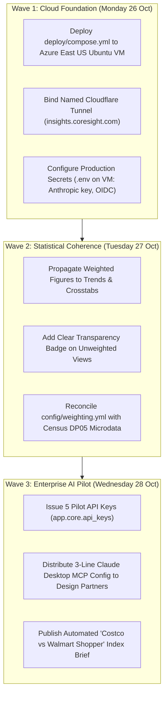

# Action Plan · Prioritized Engineering & Commercial Roadmap
## Reconciled Post-Council Execution Sequence

**Audit & Council Date:** 24 October 2026  
**Guiding Principle:** Ship the infrastructure foundation first, eliminate statistical split-brain ambiguity, and execute the enterprise MCP pilot.

---

---

### Phase 1: Operational Cloud Infrastructure (Monday, 26 October)

| Task | Owner | Execution Command / Action | Acceptance Criteria |
|---|---|---|---|
| **VM Cutover** | IT / Eng | Deploy container stack via `docker compose -f deploy/compose.yml up -d` on Azure VM. | `curl -i http://127.0.0.1:8000/healthz` returns `{"ok": true}` inside Azure VM. |
| **Named Tunnel** | IT / Eng | Run persistent Cloudflare tunnel daemon: `cloudflared tunnel run cip-production` pointing to `insights.coresight.com`. | Domain resolves over HTTPS with valid edge SSL; laptop tunnel PID 49265 retired. |
| **Secrets Setup** | Eng | Export `ANTHROPIC_API_KEY`, `CIP_RESPONDENT_SALT`, and set `CIP_DEMO_LOGIN=0` on host. | Text coding executes via Claude Haiku; respondent IDs use salted HMAC-SHA256. |

---

### Phase 2: Statistical Integrity & Secondary Views (Tuesday, 27 October)

| Task | Owner | Execution Command / Action | Acceptance Criteria |
|---|---|---|---|
| **Weighting in Trends** | Eng | Connect `row.w` in `api/trends.py` and `web/src/pages/TrendsPage.tsx`. | Toggling Weighted switch updates historical trend series using weighted proportions. |
| **Methodology Transparency** | Eng | Update public `/methodology` page with exact ACS raking marginals and margin of error tables ($\pm 4.9\%$). | Enterprise buyers have access to a citable research methodology page. |
| **Census Data Audit** | Research | Verify `config/weighting.yml` against 2023 ACS Table DP05 (Age, Gender, Region). | Exact alignment with official US Census Bureau marginal distributions. |

---

### Phase 3: Commercial MCP Pilot & Launch (Wednesday, 28 October)

| Task | Owner | Execution Command / Action | Acceptance Criteria |
|---|---|---|---|
| **Pilot API Keys** | Product | Provision 5 enterprise pilot keys: `python -m app.core.api_keys new <client_email> <label>`. | Keys authenticate successfully on `POST /mcp` and `/api/v1/waves`. |
| **MCP Quickstart Guide** | Product | Deliver 1-page integration sheet for Claude Desktop and Claude Code. | Enterprise analysts query CIP retail trends directly from their desktop AI prompts. |
| **Distinctiveness Marketing** | Coresight | Auto-generate top over-indexing themes using `POST /api/v1/waves/{id}/audience/profile` for weekly research note. | High-visibility publication driving inbound enterprise subscription demand. |

