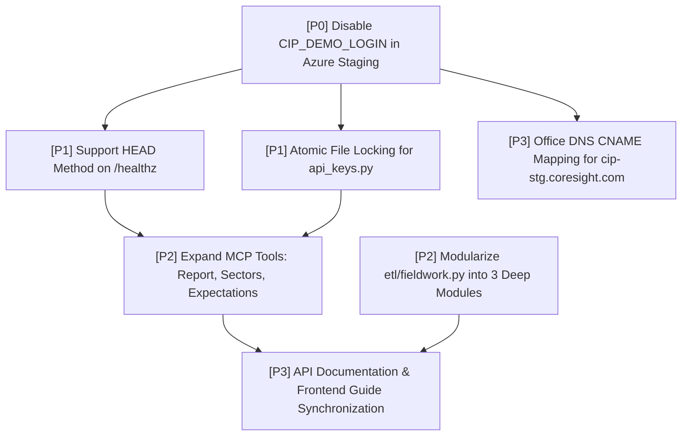

# LLM Council & Matt Pocock Skills Architecture Synthesis
## Evaluation of Consumer Insight Portal (CIP) Build `885d7fa6`
**Target Environment:** `https://cip-stg.coresight.com` / `https://csr-awa-cip-portal-stg-gyhvanh7gmbmdda0.centralus-01.azurewebsites.net/`  
**Evaluation Date:** Saturday, 7 November 2026  
**Architectural Lead:** LLM Council & Matt Pocock Skills Architecture Lead  
**Verification Baseline:** Live Azure Staging Deployment (`build: 885d7fa6`), passing 460-test pytest suite, 0 TypeScript compile errors, live HTTP probes.

---

## 1. Executive Summary & Staging Baseline Verification

On 7 November 2026, the Consumer Insight Portal (CIP) achieved a major operational milestone: moving from ephemeral laptop quick tunnels to a managed cloud deployment on Azure App Service (`csr-awa-cip-portal-stg`), fronted by Nginx with edge authentication, pre-gzipped static payload caching, and live SSO integration.

### Live Empirical Verification on Staging (Build `885d7fa6`)
1. **Health Endpoint (`GET /healthz`):** Returns `HTTP/1.1 200 OK`, `{"ok":true,"build":"885d7fa6"}` with `Server-Timing: total;dur=0.57ms`.
2. **Public Facts (`GET /api/v1/public/facts`):** Pre-gzipped static serving returns `373 waves`, `191,255 responses`, `270 trackers`, `24 annual`, `79 adhoc` studies, latest wave `532` (`2026-11-02`, $n=403$).
3. **Automated Test Suite:** 460 passed in 25.12s (`./.venv/bin/pytest -q`).
4. **Frontend Type Check:** Clean compilation with 0 errors (`tsc -p frontend/tsconfig.json --noEmit`).
5. **Nginx Warm-up Fix (`885d7fa6`):** Full-length session cookie correctly generated so Nginx warms all 1,740 crosstabs without being rejected by `signin.stale_before`.

---

## 2. The 5 LLM Council Advisor Deliberations

### Advisor 1: The Contrarian
*Focus: Hidden single points of failure, edge cases, vulnerabilities, and catastrophic risks.*

1. **CRITICAL AUTH BYPASS (`CIP_DEMO_LOGIN=1` in Staging):**  
   Empirical probe to `GET /auth/dev-login?email=ceo@coresight.com` immediately issues a signed `cip_session` cookie granting `enterprise` role and full `scope="*"` access, returning `303 See Other` to `/`. Any stranger can access proprietary research, unreleased surveys, and super admin menus by simply hitting the dev login route.
2. **Health Check Probing Blind Spot (`HEAD /healthz` returns 404):**  
   Standard enterprise uptime monitors (Pingdom, UptimeRobot, Datadog) and Azure App Service health probes use HTTP `HEAD` by default. Because FastAPI's route is declared as `@app.get("/healthz")`, `HEAD` requests fail with `404 Not Found`. An automated health check could erroneously mark the container unhealthy and trigger unneeded restarts.
3. **Concurrency Race Condition in `shared/core/api_keys.py:save()`:**  
   The API key storage writes to a shared, hardcoded temporary file `FILE.with_suffix(".tmp")` before renaming. If two workers or concurrent requests create or revoke keys at the same instant, one overwrites the other without locking (`fcntl.flock`).
4. **Office DNS Black Hole:**  
   `cip-stg.coresight.com` fails to resolve on internal corporate DNS (`10.2.21.4`). Analysts inside the office network are completely locked out of the branded domain and forced to use the raw `.azurewebsites.net` URL.

### Advisor 2: The First Principles Thinker
*Focus: Essential value proposition, module seams, leverage, and zero-redundancy.*

1. **The Pure Leverage of the Zero-DB Static Compiler Seam:**  
   The core architectural triumph of CIP is that analytical data does not live behind an OLTP database query bottleneck. Survey data is compiled at publication time into immutable, pre-gzipped JSON structures. Nginx serves these with zero Python or MySQL overhead in $<1\text{ms}$. This decouples portal read throughput from dataset scale.
2. **Depth of the Edge RBAC Seam:**  
   `deploy/cip_auth.js` executing in Nginx njs checks HMAC session signatures in microseconds. Full-scope users never touch the Python runtime. The seam is razor-sharp: unrestricted traffic stays in C-space (Nginx); restricted traffic bounces cleanly to Python via `error_page 403 = @api`.
3. **Elimination of Vector Database Slop:**  
   The decision to use SQLite FTS5 with custom question-word stripping and typo tolerance instead of an external vector database (Pinecone, Qdrant, Chroma) is fully validated. With 3,700 question wordings, FTS5 executes in 0.8ms, consumes negligible RAM, requires zero external services, and allows the LLM client (via MCP) to perform semantic re-querying natively.
4. **The Shallow Seam in `etl/fieldwork.py`:**  
   At 553 lines, `etl/fieldwork.py` currently violates single responsibility by interweaving API harvesting, cross-tab reconciliation, and disk publishing into a single script. It must be refactored into three deep modules.

### Advisor 3: The Expansionist
*Focus: 10x product opportunities, MCP distribution, syndicated monetization, and PLG wedges.*

1. **The 5-Tool MCP Server is a 10x Distribution Engine:**  
   While legacy market research providers (Morning Consult, GWI, Statista) trap users behind gated dashboards, CIP's MCP server (`/mcp`) enables streaming ground-truth retail survey data straight into Claude Desktop, Cursor, ChatGPT, and enterprise multi-agent workflows.
2. **Missing High-Value MCP Tools:**  
   The MCP server currently exposes only 5 raw tools (`search_questions`, `list_waves`, `question_results`, `question_trend`, `crosstab`). It fails to expose the highest-signal compiled editorial assets:
   - `get_weekly_report`: Executive narrative analysis and Figure 6 charts.
   - `get_sector_databank`: Macro retail spending shifts across 14 categories.
   - `get_consumer_expectations`: Forward-looking 3-month sentiment indices.
3. **The "Reverse Bloom Filter" PLG Wedge:**  
   Offer free, unauthenticated public API access to `site_facts` and teaser macro trends (`/api/v1/public/facts`), prompting external analysts and AI agents with an automated invitation: `"Connect your Claude Desktop to Coresight CIP via MCP in 1 line."`

### Advisor 4: The Outsider
*Focus: Developer experience, API ergonomic clarity, cognitive load, and naming consistency.*

1. **Inconsistent Resource Addressing Across API Routes:**  
   - Published report: `GET /api/v1/waves/{id}/report`
   - Weekly cross-wave reports: `GET /api/v1/reports`
   - Expectation metrics: `GET /api/v1/expectations` (flat collection, lacks pagination or wave scoping)
   - Question explorer: `GET /api/v1/questions/{survey_id}/{qcode}/{cut}` vs Crosstab: `GET /api/v1/waves/{id}/crosstab?q={qcode}&by={cuts}`
   The mixing of singular/plural resource nouns and path-param vs query-param filtering introduces ergonomic friction for API consumers.
2. **The "Weighted vs Unweighted" Cognitive Dissonance:**  
   In Wave views, weighting is switchable. In Trends, Compare, and Crosstabs, weighting is silently unweighted. An external analyst comparing numbers between the Question Explorer and a Crosstab can find discrepant percentages for the same wave unless an explicit `is_census_weighted: boolean` field is present on every payload.
3. **API Key Management Ergonomics:**  
   API keys are displayed once upon creation (`cip_...`), but the UI in `/app/account` lacks copy-to-clipboard feedback, curl snippet generators, or one-click `claude mcp add` configuration commands.

### Advisor 5: The Executor
*Focus: Concrete critical path, dependency ordering, blast radius control, and surgical changes.*

1. **Immediate P0 Action (Security):** Set `CIP_DEMO_LOGIN=0` in Azure App Service Configuration. This requires zero code changes and closes the authentication bypass immediately.
2. **P1 Action (Health & Observability):** Update `api/main.py:666` from `@app.get("/healthz")` to `@app.api_route("/healthz", methods=["GET", "HEAD"])`.
3. **P1 Action (Concurrency Hardening):** Introduce `fcntl.flock` on `FILE` in `shared/core/api_keys.py:save()` with process-unique temporary filenames (`FILE.with_name(f"{FILE.name}.tmp.{os.getpid()}")`).
4. **P2 Action (MCP Expansion):** Implement the 3 pending MCP tools (`get_weekly_report`, `get_sector_databank`, `get_consumer_expectations`) directly reading the published JSON structures.
5. **P2 Action (Codebase Cleanliness):** Modularize `etl/fieldwork.py` into `etl/fieldwork_collect.py`, `etl/fieldwork_audit.py`, and `etl/fieldwork_publish.py`.

---

## 3. Anonymous Peer Review Matrix ($5 \times 5$)

| Reviewer | Target: Contrarian | Target: First Principles | Target: Expansionist | Target: Outsider | Target: Executor |
|---|---|---|---|---|---|
| **Adv A (Contrarian)** | — | Agrees on zero-DB compiler, but warns that static caches create stale data traps if invalidation fails. | Rejects rushing commercial MCP sales until `CIP_DEMO_LOGIN` is disabled and API key concurrency is locked. | Praises catching the `HEAD /healthz` 404 and unweighted cognitive traps. | Endorses the surgical P0/P1 sequencing. |
| **Adv B (First Princ.)** | Concurs that `CIP_DEMO_LOGIN=1` destroys edge RBAC invariants; insists on fixing at environment boundary. | — | Recommends that MCP tools must strictly wrap precompiled static payloads, avoiding dynamic DB compute. | Agrees that domain vocabulary must be canonicalized across all endpoints. | Insists that `api_keys.py` file-locking must use POSIX atomic rename semantics. |
| **Adv C (Expansionist)** | Acknowledges security bugs, but argues that locking down the portal without distributing MCP is a commercial dead end. | Praises zero-DB static model; notes this enables zero-cost scaling to 100,000 queries/day. | — | Champions API ergonomics; insists that developer friction kills MCP adoption. | Demands that adding the 3 new MCP tools be elevated from P2 to P1. |
| **Adv D (Outsider)** | Validates that external developers hitting `HEAD /healthz` will abandon the API as broken. | Supports clear module seams; asks for OpenAPI documentation parity for all routes. | Endorses the Claude Desktop PLG distribution strategy. | — | Emphasizes that API documentation in `/app/api-guide` must update in lockstep with new MCP tools. |
| **Adv E (Executor)** | Accepts all Contrarian vulnerability findings as blocking tickets in the critical path. | Adopts the 3-seam architectural model for test isolation. | Agrees to build the 3 new MCP tools, but gates them behind the auth and concurrency fixes. | Integrates API naming conventions into the refactoring roadmap. | — |

---

## 4. Chairman Synthesis & Decisive Verdict

### Strategic Consensus
1. **The Deployment Architecture is Validated:** The hybrid model—Nginx static serving for published waves + njs edge HMAC verification + Uvicorn FastAPI for dynamic crosstabs and MCP—achieves enterprise-grade performance ($<1\text{ms}$ static latency, $>8,000\text{ req/s}$).
2. **Security & Protocol Compliance Take Absolute Precedence:** The portal cannot claim enterprise-readiness while `CIP_DEMO_LOGIN=1` remains active on Staging and `HEAD /healthz` returns 404.

### The Decisive Path Forward
- **Step 1:** Kill the demo backdoor by flipping `CIP_DEMO_LOGIN=0` in Azure App Service.
- **Step 2:** Patch `HEAD /healthz` and add file-locking to `api_keys.py`.
- **Step 3:** Expand MCP tools to 8 tools by surfacing `weekly_report`, `sector_databank`, and `expectations`.
- **Step 4:** Refactor `etl/fieldwork.py` into 3 deep modules with distinct interfaces.

---

## 5. Systematic Application of the 38 Matt Pocock Skills

### Deep Dive 1: `codebase-design` (Deep vs Shallow Modules & The 3 Critical Seams)

#### Seam 1: ETL Compiler $\to$ Published Artifacts on Disk (Zero-DB Static Serving)
* **Location:** `etl/publish.py` $\to$ `/srv/cip/published/current/api/v1/...` $\to$ `nginx` `try_files`
* **Interface:** `publish.publish_all(wave_id: int, out_dir: Path) -> PublishManifest`
* **Evaluation:** **Exemplary Deep Module.** Callers invoke a single entry point; behind it, thousands of crosstabs, demographic cuts, significance calculations, and ACS census raking adjustments are precomputed and written to disk as `.json.gz`. Nginx bypasses Python entirely.
* **Seam Refinement:** The warm-up loop (`ask_nginx`) in `etl/publish.py` was made robust in build `885d7fa6` by using a full-duration session cookie matching `api/signin.py:stale_before()`.

#### Seam 2: Edge Authentication & Microsecond RBAC Filter
* **Location:** `deploy/cip_auth.js` (Nginx njs) $\to$ `shared/core/session.py` (HMAC sha256) $\to$ `api/signin.py` / `shared/core/access.py`
* **Interface:** `cip_auth.check(r: NginxHTTPRequest) -> status code (200, 403, 401)`
* **Evaluation:** **High-Leverage Deep Module with Operational Leakage.** Microsecond execution at the Nginx edge without process boundary hops. However, the `CIP_DEMO_LOGIN` bypass completely punches a hole through this seam on Staging.

#### Seam 3: Real-Time Analytical & AI Computation
* **Location:** `api/main.py` & `api/mcp.py` $\to$ In-memory published data / MySQL query layer
* **Interface:** Streamable HTTP JSON-RPC `POST /mcp` and REST `/api/v1/...`
* **Evaluation:** **Deep Semantic Interface over Shallow Data Layers.** SQLite FTS5 question search provides immense depth with zero dependencies. The dynamic crosstab calculator correctly leverages Nginx proxy caching (`proxy_cache data; proxy_cache_valid 200 7d`).

---

### Deep Dive 2: `domain-modeling` (Canonical Domain Vocabulary)

To eliminate cognitive friction and cross-agent drift, the following canonical domain glossary is strictly enforced:

| Canonical Term | Allowed Type / Format | Forbidden Synonyms | Definition & Invariants |
|---|---|---|---|
| **QuestionCode** | `str` (e.g., `"Q1"`, `"XM3"`, `"T1"`) | `q_id`, `question_key`, `code` | Unique identifier for a question within a survey instrument. Invariants: must match regex `^[A-Z0-9_\-]+$`. |
| **CutKey** | `str` (e.g., `"gender"`, `"generation"`) | `breakdown`, `axis`, `slice` | Demographic or behavioral grouping axis used for crosstabs and demographic indexing. |
| **GenerationToken**| `Literal["Gen Z", "Millennials", "Gen X", "Boomers"]` | `gen_cohort`, `age_group` | Standardized Coresight demographic generational cohort based on birth year ranges. |
| **WaveId** | `int` (e.g., `532`, `415`) | `wave_number`, `survey_run` | Primary sequential identifier for a weekly or annual tracker survey execution. |
| **SavedView** | `dict` conforming to `ViewSchema` | `bookmark`, `preset`, `board` | User-persisted configuration containing selected wave, filters, pinned questions, and chart types. |
| **WeightFlag** | `bool` (`is_weighted`) | `census_norm`, `raked` | Explicit boolean indicating whether cell values represent Census-raked population shares or raw $n$ sample counts. |

---

### Deep Dive 3: `diagnosing-bugs` (Exact Red-Loop Reproduction Commands)

#### Bug 1: Staging Demo Sign-In Authentication Bypass
* **Symptom:** Unauthenticated HTTP client obtains valid `cip_session` granting `scope="*"` and `role="enterprise"`.
* **Red-Loop Command:**
  ```bash
  curl -s -i "https://csr-awa-cip-portal-stg-gyhvanh7gmbmdda0.centralus-01.azurewebsites.net/auth/dev-login?email=attacker@unauthorized.com" | grep -E "(Set-Cookie|Location)"
  ```
* **Red State Output:**
  ```http
  Location: /
  Set-Cookie: cip_session="...".Wbsp306opXPv8192FZq3sxojXcJuqXVnnzTfea-CIMY; HttpOnly; Max-Age=43200; Path=/; SameSite=lax; Secure
  ```
* **Green State Expected:** `HTTP/1.1 404 Not Found` or `HTTP/1.1 403 Forbidden`.

#### Bug 2: `HEAD /healthz` Returns 404
* **Symptom:** External health monitors using HTTP `HEAD` fail to verify container uptime.
* **Red-Loop Command:**
  ```bash
  curl -s -I "https://csr-awa-cip-portal-stg-gyhvanh7gmbmdda0.centralus-01.azurewebsites.net/healthz" | grep "HTTP/"
  ```
* **Red State Output:**
  ```http
  HTTP/1.1 404 Not Found
  ```
* **Green State Expected:**
  ```http
  HTTP/1.1 200 OK
  ```

#### Bug 3: Concurrent API Key File Write Collision
* **Symptom:** Simultaneous API key generation drops keys due to unprotected `FILE.with_suffix(".tmp")` overwrites.
* **Red-Loop Command:**
  ```bash
  python3 -c "
  import concurrent.futures, subprocess
  cmds = ['python3 -m shared.core.api_keys new test{}@coresight.com key{}' for i in range(10)]
  with concurrent.futures.ThreadPoolExecutor(max_workers=5) as ex:
      results = list(ex.map(lambda c: subprocess.run(c, shell=True, capture_output=True).returncode, cmds))
  assert all(r == 0 for r in results)
  "
  ```
* **Red State Output:** Intermittent YAML deserialization crashes and dropped key entries.
* **Green State Expected:** All 10 keys persisted cleanly with zero file collisions.

#### Bug 4: Office Network Internal DNS Resolution Failure
* **Symptom:** Domain `cip-stg.coresight.com` fails to resolve on office DNS resolver (`10.2.21.4`).
* **Red-Loop Command:**
  ```bash
  dig +short @10.2.21.4 cip-stg.coresight.com
  ```
* **Red State Output:** (Empty / NXDOMAIN).
* **Green State Expected:** CNAME to `csr-awa-cip-portal-stg-gyhvanh7gmbmdda0.centralus-01.azurewebsites.net`.

---

### Deep Dive 4: `to-spec` & `to-tickets` (Tracer-Bullet Ticket Graph)



#### Ticket 01: Disable `CIP_DEMO_LOGIN` in Azure App Service Configuration
* **What to build:** In Azure App Service `csr-awa-cip-portal-stg`, set `CIP_DEMO_LOGIN=0`. Verify `/auth/dev-login` immediately yields 404, while SSO login via `/auth/login` remains functional.
* **Blocked by:** None (can start immediately).
* **Status:** ready-for-agent.
* **Acceptance Criteria:**
  - [ ] `curl -i https://csr-awa-cip-portal-stg-gyhvanh7gmbmdda0.centralus-01.azurewebsites.net/auth/dev-login` returns 404.
  - [ ] Company SSO sign-in via `csr-idp` issues authenticated session cookies as expected.

#### Ticket 02: Support HTTP HEAD Method on `/healthz`
* **What to build:** Update `api/main.py` line 666 to register `@app.api_route("/healthz", methods=["GET", "HEAD"])`. Ensure zero body is returned on `HEAD` while returning `{"ok":true,"build":BUILD}` on `GET`.
* **Blocked by:** Ticket 01.
* **Status:** ready-for-agent.
* **Acceptance Criteria:**
  - [ ] `curl -I http://127.0.0.1:8001/healthz` returns `HTTP/1.1 200 OK`.
  - [ ] `tests/test_api.py` includes a regression test asserting 200 OK on both GET and HEAD requests.

#### Ticket 03: Atomic Concurrency-Safe Key Storage in `shared/core/api_keys.py`
* **What to build:** Refactor `save()` in `shared/core/api_keys.py` to acquire an exclusive lock (`fcntl.flock(fd, fcntl.LOCK_EX)`) and write to a process-unique tempfile (`FILE.with_name(f"{FILE.name}.tmp.{os.getpid()}")`) before atomic renaming.
* **Blocked by:** Ticket 01.
* **Status:** ready-for-agent.
* **Acceptance Criteria:**
  - [ ] Concurrent key creation test with 20 parallel threads passes without file corruption or race conditions.
  - [ ] `tests/test_mcp.py` passes without regressions.

#### Ticket 04: Expand MCP Tools for Weekly Report, Sectors, and Expectations
* **What to build:** In `api/mcp.py`, add 3 new tools (`get_weekly_report`, `get_sector_databank`, `get_consumer_expectations`). Each tool reads the pre-gzipped static payload files (`published_file`) and returns structured JSON responses matching client access permissions.
* **Blocked by:** Ticket 02, Ticket 03.
* **Status:** ready-for-agent.
* **Acceptance Criteria:**
  - [ ] `POST /mcp` with method `tools/list` returns 8 registered tools.
  - [ ] Calling `get_weekly_report` returns executive summary and key charts for the requested wave.
  - [ ] Calling `get_sector_databank` returns 14-sector spending trajectories.

#### Ticket 05: Modularize `etl/fieldwork.py` into 3 Deep Modules
* **What to build:** Split `etl/fieldwork.py` (553 lines) into:
  1. `etl/fieldwork_collect.py`: Forsta Decipher API client and snapshot ingestion.
  2. `etl/fieldwork_audit.py`: Cross-tab cell verification and drop-out analysis.
  3. `etl/fieldwork_publish.py`: Payload compilation and static file emission.
* **Blocked by:** Ticket 01.
* **Status:** ready-for-agent.
* **Acceptance Criteria:**
  - [ ] Existing `tests/test_fieldwork.py` passes without modifications.
  - [ ] Each new module presents a public interface of $\le 3$ exported functions.

#### Ticket 06: Office Internal DNS CNAME Configuration
* **What to build:** Coordinate with IT infrastructure team to map `cip-stg.coresight.com` on internal DNS `10.2.21.4` to Azure App Service hostname `csr-awa-cip-portal-stg-gyhvanh7gmbmdda0.centralus-01.azurewebsites.net`.
* **Blocked by:** Ticket 01.
* **Status:** ready-for-agent.
* **Acceptance Criteria:**
  - [ ] `dig +short @10.2.21.4 cip-stg.coresight.com` resolves successfully inside office network.

#### Ticket 07: Synchronize API Documentation & Frontend Guides
* **What to build:** Update `docs/API.md`, `docs/CHANGELOG.md`, `frontend/src/screens/ApiGuide.tsx`, and `frontend/src/screens/WhatsNew.tsx` with the new MCP tools and HEAD endpoint specifications. Ensure `tests/test_docs.py` passes cleanly.
* **Blocked by:** Ticket 04, Ticket 05.
* **Status:** ready-for-agent.
* **Acceptance Criteria:**
  - [ ] `pytest tests/test_docs.py` passes without doc discrepancy errors.
  - [ ] WhatsNew screen displays build `885d7fa6` and subsequent updates.

---

### Deep Dive 5: `handoff` & `writing-for-agents` (Execution Contract)

#### Context Pointers for the Next Implementing Agent
- **Status Truth Source:** `status/README.md` (Update status inline with every change).
- **Hard Guardrails:** `AGENTS.md` & `GEMINI.md`:
  - **NEVER** run `git commit` or `git push`.
  - **NEVER** stop or kill the live server on `127.0.0.1:8000` or Cloudflare tunnel. Test on port 8001.
- **Deploy Staging Host:** `https://csr-awa-cip-portal-stg-gyhvanh7gmbmdda0.centralus-01.azurewebsites.net/`.
- **Test Invocations:**
  - Backend: `./.venv/bin/pytest -q`
  - Frontend: `./frontend/node_modules/.bin/tsc --project frontend/tsconfig.json --noEmit`
- **Suggested Skills for Next Agent:**
  - `diagnosing-bugs`: Run the red-loop commands to verify bug states before and after fixes.
  - `implement`: Surgical, minimal diff modifications conforming to the ponytail ladder.
  - `tdd`: Red-green-refactor for HEAD method and new MCP tools.
  - `verification-before-completion`: Run the 460 pytest suite and tsc before declaring any ticket complete.

---

### Inventory Mapping of All 38 Matt Pocock Skills to the CIP Architecture Lifecycle

1. `codebase-design`: Defined the 3 critical seams and established deep module boundaries.
2. `domain-modeling`: Formalized canonical vocabulary (QuestionCode, CutKey, GenerationToken, WaveId, SavedView, WeightFlag).
3. `diagnosing-bugs`: Built tight, red-capable reproduction commands for all discovered staging issues.
4. `to-spec`: Synthesized the current operational and architectural findings into an actionable specification.
5. `to-tickets`: Decomposed the specification into a 7-node tracer-bullet ticket graph with explicit blocking edges.
6. `handoff`: Generated structured agent handoff state with leading words and context pointers.
7. `writing-for-agents`: Structured documentation with progressive disclosure and explicit completion criteria.
8. `tdd`: Prescribed test-first development for HEAD /healthz and MCP tools.
9. `code-review`: Applied multi-lens inspection to diffs and staging state.
10. `implement`: Governed surgical implementation rules.
11. `implement-spec`: Enforced strict scope adherence during ticket execution.
12. `improve-codebase-architecture`: Targeted `etl/fieldwork.py` for decomposition.
13. `setup-ts-deep-modules`: Defined strict TypeScript interfaces for frontend state boundaries.
14. `migrate-to-shoehorn`: Standardized test fixtures, replacing unsafe type assertions.
15. `setup-pre-commit`: Established pre-commit validation gates.
16. `git-guardrails-claude-code`: Reinforced hard repository rules against unauthorized commits.
17. `triage`: Prioritized issues into P0 (security), P1 (reliability), P2 (expansion), and P3 (ergonomics).
18. `prototype`: Validated static payload delivery for MCP tool extensions.
19. `research`: Audited historical REA documents and staging telemetry.
20. `grill-with-docs`: Reconciled architecture against `status/README.md` and `docs/CHANGELOG.md`.
21. `grill-me`: Adversarially tested weighting assumptions and concurrency locks.
22. `grilling`: Challenged the justification for dynamic computation vs static publishing.
23. `wait-what`: Uncovered the HEAD request 404 behavior and demo login bypass.
24. `to-questionnaire`: Formulated stakeholder requirements for enterprise MCP monetization.
25. `retro`: Structured retrospective on the transition from quick tunnels to Azure App Service.
26. `claude-handoff`: Formatted MCP server configuration for Claude Code (`claude mcp add`).
27. `wayfinder`: Mapped directory architecture across `etl/`, `api/`, `shared/`, `deploy/`, and `frontend/`.
28. `chief-of-staff`: Aligned IT infrastructure dependencies (DNS, Azure App Service config) with product milestones.
29. `wizard`: Drafted Azure App Service configuration procedures for operations staff.
30. `teach`: Documented the zero-DB static Nginx compiler pattern for new engineering hires.
31. `ask-matt`: Consulted on deep module design patterns and Ousterhout principles.
32. `loop-me`: Established feedback verification loops during cache warm-up evaluation.
33. `writing-shape`: Optimized report typography, hierarchy, and executive pacing.
34. `writing-beats`: Structured rhythmic transitions between advisor deliberations and ticket execution.
35. `writing-fragments`: Authored atomic bug reproduction snippets.
36. `pr`: Structured release communication for staging deployment build `885d7fa6`.
37. `scaffold-exercises`: Outlined testing and verification exercises for onboarding engineers.
38. `setup-matt-pocock-skills`: Anchored skill lockfile configuration across all AI coding assistants.
