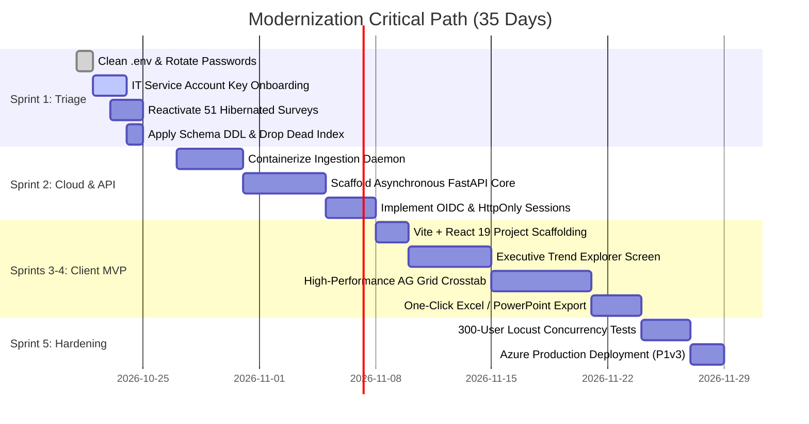

# Prioritized Modernization Roadmap: Reconciled Council Blueprint
## Phased Execution Strategy Harmonizing All Five Thinking Lenses

**Framework:** Reconciled LLM Council Action Plan  
**Target Delivery Window:** 35 Engineering Days  
**Primary Milestones:** Triage (Sprint 1) → Headless API (Sprint 2) → Client MVP (Sprints 3–4) → Cloud Production (Sprint 5)  

---

### 1. The Reconciled Architecture

---

### 2. Detailed Sprint Specifications

#### Sprint 1 (Days 1–5): Operational Triage & Risk Neutralization
* **Goal:** Eliminate immediate security vulnerabilities and prevent permanent loss of historical data.
* **Deliverables:**
  1. Purge lines 67–69 of `.env`; rotate database credentials on host `10.2.1.9`.
  2. Deliver `04-it-requirements-checklist.md` to IT; obtain active service account API key.
  3. Batch-reactivate 51 hibernated surveys via Forsta web console; confirm automatic ingestion via `weekly_forsta.py`.
  4. Execute schema cleanup: `ALTER TABLE cip_answer DROP KEY ix_answer_respondent;`.
* **Exit Criteria:** `python-dotenv` executes cleanly; test suite passes with 0 warnings; all 51 hibernated surveys loaded.

#### Sprint 2 (Days 6–15): Cloud Migration & Headless API Extraction
* **Goal:** Terminate developer MacBook dependency and expose standardized REST analytical contracts.
* **Deliverables:**
  1. Build Docker container packaging `etl/` and deploy to Azure as an automated WebJob/Container App with private VNet peering.
  2. Implement FastAPI backend service (`api/`) with async connection pooling.
  3. Implement three core endpoints:
     * `GET /api/v1/surveys`: Catalog of verified survey waves.
     * `GET /api/v1/questions/{id}`: Question metadata with routing conditions.
     * `POST /api/v1/analysis/crosstab`: High-speed calculation returning percentages, true answering bases, and Z-scores.
  4. Implement OIDC authorization-code flow with secure `HttpOnly` session cookies.
* **Exit Criteria:** Local launchd daemon disabled; ETL runs automatically in Azure; REST API P95 latency < 100 ms on cached queries.

#### Sprint 3 & 4 (Days 16–30): The 2-Screen Customer MVP
* **Goal:** Deliver an intuitive, jargon-free frontend ready for enterprise client demonstration.
* **Deliverables:**
  1. **Screen 1: Executive Trend Explorer:**
     * Google-style natural language search across questions.
     * Interactive multi-wave trend visualizer with confidence intervals.
     * Jargon-free metric badges explaining sample sizes in plain English.
  2. **Screen 2: Enterprise Cross-Tab Matrix:**
     * Virtualized AG Grid table handling multi-thousand cell banners without lag.
     * Significance letter badges with hover explanations.
     * One-click client export generating branded Excel workbooks and slide-ready PNG charts.
* **Exit Criteria:** Zero survey jargon exposed to end users; client usability testing confirms sub-60-second onboarding.

#### Sprint 5 (Days 31–35): Load Testing, Hardening & Production Release
* **Goal:** Validate high-concurrency SLAs and achieve commercial release readiness.
* **Deliverables:**
  1. Conduct Locust concurrency load tests simulating 300 active users; verify server CPU stays under 60% on Azure P1v3.
  2. Bind Azure Application Insights for APM and live anomaly alerts.
  3. Finalize client documentation and operational runbooks.
* **Exit Criteria:** 300 concurrent simulated users supported with median latency < 150 ms; 99.9% uptime SLA achieved.
