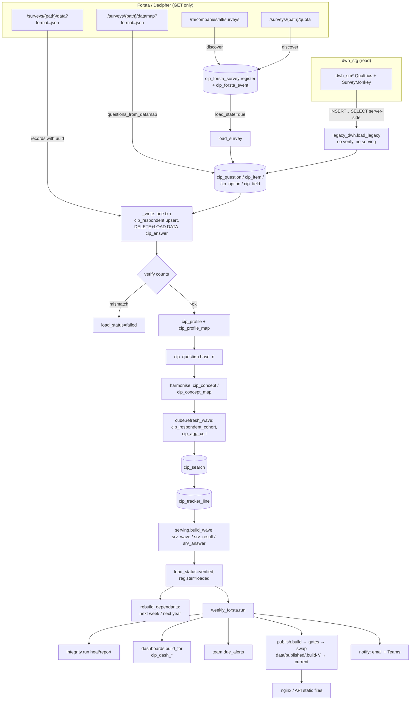

# 10 · ETL pipeline: end-to-end reconstruction and launch-readiness audit

Audit date: Friday 23 Oct 2026, from about 11:00 to 12:00 IST. Scope: Forsta extraction, the legacy and Qualtrics loaders, transformation (definitions, profiles, harmonisation, cube, cohorts, tracker lines, serving), load semantics, publication, alerts, scheduling and the watchdog.

Method:
- Read every ETL module.
- Ran read-only `SELECT`s against `cip_stg` through `get_engine("app")`.
- Read `logs/forsta-etl.log`, `logs/forsta-etl-errors.jsonl` and `logs/etl-watchdog.log`.
- Ran the SQLite test files for the ETL.

Nothing was written to any database. Forsta was not called and nothing on :8000 was touched.

Markers: **[O]** observed in code, data or logs · **[I]** inferred · **[U]** unknown.

---

## 1. Summary verdict

**The Forsta loading path is sound for the data it holds today. The layers built on top of it, and the way it is operated, are not launch-ready.**

What is solid [O]:
- **Counts reconcile.** For every one of the 84 Forsta waves, the register's total and qualified counts equal the stored respondents, and those equal `srv_wave.qualified_n` (SQL §3.1).
- **No bad codes in the sampled waves.** Six recent waves have no single-choice answer outside its option list and no multi-select code other than 0 or 1.
- **Integrity checks are clean.** All 19 checks, run read-only, pass. There are no stuck or failed waves, no duplicate respondents and no unloaded closed surveys.

Seven things stand in the way of launch:

1. **A numeric answer with more than four decimals now fails the whole wave, permanently** (ETL-01). This already happened on 20 Oct (`qtime` in 250701). Under the code at that time it was absorbed by a fallback. The fallback was removed on 22 Oct, so the same payload would now fail on every attempt. [O]/[I]
2. **Wrong numbers are published for 8 legacy waves** (ETL-02). The serving build keys cells on the item *label*, so questions with duplicate labels silently lose cells: 766 cells in total. Example: survey 97 Q7 "YouTube" is published as **0 %** while its other cell has n = 612 of 1,293 (47 %). [O]
3. **Harmonisation never reaches the serving layer or the published files** (ETL-03). `concept_option_id` is NULL in all 2.4 M cube cells and all serving rows, so the 8,928 confirmed concept mappings have no effect on prior-week, last-year or trend-version joins. [O]
4. **The whole pipeline runs on one MacBook** (ETL-05). The Mac sleeps after 1 minute unless a hand-started `caffeinate` is running, and that `caffeinate` is tied to a hand-started `cloudflared`. The database was unreachable on 7 days between 11 and 20 Oct. Nothing backs up the published files off the laptop. [O]
5. **Any transient error during a planned Monday's 54-hour watch ends the watch** (ETL-04). The wave then waits for the Friday 09:00 run. [O]
6. **Annual studies do not trend year on year** (ETL-10). Families are derived from survey titles: Holiday 2026 (n = 2,042 qualified) sits in a different family from Holiday 2025, and a 2-respondent aborted launch sits in 2025's family. [O]
7. **Every annual and ad hoc study is loaded and published 9 hours after launch, while still fielding** (ETL-06). It is not reloaded until Forsta closes it. [O]

Unchanged from the earlier audits: the run lock is incomplete (ETL-08), verification checks counts only (ETL-09), alerts go to one developer (ETL-19), and the respondent salt is still not configured (ETL-14).

---

## 2. How it works

### 2.1 Data flow



### 2.2 Extraction

**Client.**
- `ForstaClient` uses GET only, with the `x-apikey` header (`etl/forsta_client.py:54-57`). [O]
- Retries cover connection errors, timeouts, 429 and 5xx, with exponential backoff from 2 to 60 s. The attempt count is `FORSTA_MAX_RETRIES`, default 4 (`:64-69`). [O]
- 401 and 403 raise `ForstaAuthError` and are not retried (`:73-81`). [O]

**Discovery** (`etl/forsta_etl.py:122-187`). One list call, plus one quota call per live survey (`:139`). Load-state rules:
- loaded and (live or unchanged) → `loaded` (`:140`)
- live and `fielded()` → `due` (`:142`)
- not closed → `testing`
- hibernated → `hibernated`
- otherwise `due`, or `failed` if it was failed before (`:149`). [O]

A closed survey whose `closedDate` or `total` changed is treated as reopened and reloaded (`:137`). [O]

**Fielded rule** (`:101-119`). A survey counts as fielded on the first of these that holds:
- 9 hours since `dateLaunched`, for **any** study type (`:108`);
- a tracker at ≥ 400 qualified;
- every unconditional quota cell full;
- qualified ≥ the smallest sheet target. [O]

**Load** (`load_survey`, `:282-358`):
- Fetches the datamap and the data, then drops records without a `uuid` (`:299`).
- Wave label: the Monday of the first qualified record's date (`etl/run_pipeline.py:316-327`). A reload keeps the wave label of its first load, read through `cip_load_log` (`forsta_etl.py:302-307`). [O]

**Personal fields.** `userAgent`, `url`, `session`, `dcua`, `ipAddress` and `RID` are never stored. RID is kept only as `respondent_key` (`etl/forsta_api.py:25`, `etl/records.py:19-25`). [O]

**Legacy** (`etl/legacy_dwh.py`). Qualtrics and SurveyMonkey history are moved server-side by `INSERT … SELECT` from `dwh_sm*` (`:180-228`). These loads:
- set no `loading`/`verified` status, so they rely on the column default `verified` (`sql/001_schema.sql:52`);
- run no `verify`;
- build no serving rows or tracker lines in-line (serving is backfilled by `serving --all`). [O]

`qualtrics_export.py` is a hand-run Excel loader and is not scheduled. [O]

### 2.3 Transformation

**Datamap to definitions** (`forsta_api.questions_from_datamap`, `etl/forsta_api.py:40-97`):
- One `ParsedQuestion` per Forsta question.
- `multiple` becomes `multi` with codes 0/1.
- `single` with more than one variable becomes `grid_single`. A grid whose answers have no titles becomes a bipolar grid.
- Text variables inside non-text questions ("other specify") become separate `text` questions.
- Flag `t` marks technical questions and `v` marks virtual ones; "- NORMALIZED" copies are marked virtual. [O]

**Definitions are upserted, never deleted** (`etl/loaders.py:122-240`). `cip_field` rows are `INSERT IGNORE` (`:204,220`), and `qcode` and `item_code` are cut to 50 characters (`:136,179`). [O]

**Answers** (`forsta_etl._answer`, `:250-263`):
- **numeric** → `value_number`, kept only if finite and under 1e14, and **not rounded**;
- **text** → `value_text`;
- **coded** → `value_code` with a label;
- a non-integer value in a coded field is kept as the label, with a NULL code. [O]

**Profiles** (`run_pipeline._rebuild_profiles`, `:141-254`). The demographic questions come from `config/survey_map.yml` (`profile.CSI-US` maps codes D1–D8 and CS1/CS2) or are detected from wording. [O]

Live check [O]: every mapped question in every wave carries the expected wording, giving 15 distinct wordings across 10 dimensions. No mapping was false.

**Question base** (`:257-294`): qualified respondents with any stored answer to the question. Multi-select zeros count, so the base is "total answering". [O]

**Harmonisation** (`app/data/harmonise.py`):
- Same normalised wording and type, with every answer already known → auto-confirmed.
- Same wording that adds answers, or ≥ 85 % similar wording → proposed (`:146-176`).
- Proposals do not trend until a person confirms them. [O]

**Cube** (`app/data/cube.py`). It counts qualified respondents for single, grid-single and multi questions over 7 cuts, plus cohorts (`:43-113`).
- Numeric and text questions are never in the cube (`:54-56`).
- `concept_option_id` is **not among the columns written** (`:37-38`). [O]

**Serving** (`etl/serving.py:104-164`). For each cell it computes:
- `pct = 100 × n / base_n` (`:115`);
- prior week (the same family, ≤ 14 days earlier) and last year (364 ± 3 days) (`:44-67`);
- the flags `small_base` (< 50), `wording_changed_*` and `base_changed_*` (> 10 points of base share).

Cells are matched across waves on `(qcode, item_label, option_code, dim, dim_value)` (`:91-92`). [O]

**Weighting:** none. All figures are unweighted counts. `cip_weight_scheme` and `cip_profile.weight` are unused (grep: no ETL or serving reference). [O]

**Small bases:**
- Serving flags bases under 50 (`serving.py:31`).
- Payloads hide n and pct below `HIDDEN_BASE = 5` (`app/data/payloads.py:28`).
- Significance testing needs a base of 30 (`:29`). [O]

**Tracker lines** (`etl/tracker_line.py:52-113`): one JSON line per qualified CSI-US respondent, in the analysts' column layout. [O]

### 2.4 Load semantics

**One transaction per wave write** (`forsta_etl._write`, `:361-404`):
1. Upsert respondents on `uq_respondent (survey_id, record_no)` (`sql/001_schema.sql:204`).
2. Delete respondents that Forsta no longer returns, with their answers, cohort rows and profiles (`:381-387`).
3. `DELETE` every answer of the wave, then stream the new answers with `LOAD DATA LOCAL INFILE` (`app/core/database.py:158-196`).

**Any LOAD DATA warning, including a Note, aborts the transaction** (`database.py:192-194`). Only "LOCAL INFILE is off" (1148, 2068, 3948) falls back to batched INSERTs (`:187`). [O]

**Status lifecycle:**
1. `upsert_survey` inserts the row with the default `verified`. [O]
2. The next statement sets `loading` (`forsta_etl.py:315-321`).
3. On success → `verified` and register `loaded` (`:354-355`).
4. On failure → `failed`. The exception: if the write never committed and the wave was verified before, it stays `verified` (`:348-352`). [O]

**Verify** (`:416-433`). It checks:
- respondents stored = records sent;
- every datamap variable has a field;
- the per-field count of non-empty values matches.

It counts; it does **not** compare values. Value comparison is `reconcile_survey` (`:436-467`), which is manual only. [O]

**Retries:** a failed wave is retried while `attempts < 3` (`:471-480`). [O]

**Lock:** `GET_LOCK('cip_etl', 0)`, taken only by `scripts/weekly_forsta.py:234-235` and `forsta_etl --discover/--due/--survey` (`forsta_etl.py:527-530`). [O]

**Integrity** (`etl/integrity.py:62-124`). Derived checks (cube, search, tracker lines) are healed. Orphan checks are deleted. Base checks are reported. Planned tracker weeks still missing 4 days after their Monday are reported (`:179-188`). [O]

### 2.5 Publication

`etl/publish.py:69-167` writes gzip JSON per wave into `.build-<UTC version>`:
- the book, `people` bitsets and per-question cuts;
- dashboards;
- per-family question files.

Unchanged waves are hard-linked from the live version (`:95-102`). A reloaded wave's question files are all rebuilt (`:138-146`). [O]

**Gates** (`:170-197`): the picker lists every wave; every book and every `people` file is readable; no book lost more than 10 % of its questions against the live version. Then `current` is swapped atomically (`:200-209`) and the last 3 versions are kept (`:54`). [O]

Live state [O]:
- `data/published/current` points to `.build-20261022T144915372572Z`: 371 waves, a full rebuild of 889 s, done because the small-cell rule changed.
- Incremental builds take 42–53 s.
- `CIP_PUBLISH_BACKUP_URL`, `CIP_NGINX_URL` and `CIP_NGINX_CACHE` are not set in `.env` or `~/.config/cip/api.env`.
- So there is no off-machine copy and no cache warming.

### 2.6 Scheduling and alerts

The four launchd agents are installed and identical to the repo copies (`diff` clean, `launchctl list` shows them). [O]

| Agent | Schedule |
|---|---|
| `cip-forsta-etl` | 17:30 local time on 12 listed Mondays (26 Oct 2026 – 11 Jan 2027) and every Friday 09:00 (`scripts/launchd/com.coresight.cip-forsta-etl.plist`) |
| `cip-etl-watchdog` | every 3,600 s |
| `cip-backup` | Sunday 10:00 |
| `cip-api` | KeepAlive |

**Monday run** (`weekly_forsta.watch`, `:149-169`):
1. Posts a heads-up to Teams.
2. Runs `run()` every 30 minutes until the week's wave is loaded and closed, or for 54 h.

Each `run()` (`:73-146`) does: DB healthcheck (4 tries, 5 min apart) → `whoami` → schema check → discover → `run_due` → notify → integrity (only after a load, or on Friday) → dashboards → team alerts → publish → drift check.

**Watchdog** (`:208-229`): reads `logs/etl-heartbeat.json` and alerts on a silent run, on a planned Monday that never started, or when there has been no run for 8 days. [O]

**Alerts:**
- Email via Office 365 SMTP and Teams via webhook (`etl/notify.py:55-93`).
- A failure is throttled for 6 h per subject, and marked as told only after a successful send (`:285-327`).
- `config/notify.yml`: `default` has one address; `tracker`, `annual`, `adhoc` and `failure` are empty. [O]

### 2.7 Timings and robustness

**Per wave**, from the log on 20–21 Oct [O]:

| Step | Seconds |
|---|---|
| fetch | 2–3 |
| definitions | 8–20 |
| write | 10–60 |
| verify | 1.5–2.5 |
| profiles | 9–11 |
| harmonise | 5–14 |
| cube | 24–33 |
| search | 3 |
| tracker line | 9–16 |
| serving | 12–20 |
| **Total** | **≈ 100–180** |

Every round trip from India to Azure costs about 250 ms (`etl/loaders.py:126-127`).

**Single laptop** [O]:
- `pmset`: `sleep 1` minute, no auto-restart on power loss.
- Sleep is prevented only by `caffeinate -dimsu -w 7387`, where 7387 is a hand-started `cloudflared` (started 10:51 today after the 10:35 reboot), and by a 300 s caffeinate from a Claude session.
- launchd starts a missed calendar job when the Mac wakes, but not if it was powered off.
- The DB was unreachable (Azure timeouts) on 11, 13, 14, 15, 16, 18 and 20 Oct (`logs/forsta-etl.log:628-1112`).

---

## 3. Data correctness findings (with SQL evidence)

All queries are read-only against `cip_stg`. Results are as of about 11:10–11:45 IST, 23 Oct.

### 3.1 Clean results [O]

| Check | Result |
|---|---|
| `cip_survey` by status | 371 waves, all `verified` (forsta 84 · qualtrics 142 · surveymonkey 145); no `loading` or `failed` |
| Register | 84 `loaded` (79 closed, 5 closed + hibernated), 8 `testing`; 0 due, failed or hibernated-unloaded |
| Register total and qualified vs stored respondents vs `srv_wave.qualified_n`, all 84 Forsta waves | 0 mismatches |
| `srv_wave` vs verified waves | 0 verified waves without serving; 0 serving rows for a non-verified wave |
| All 19 `integrity.CHECKS` plus `planned_weeks_missing()`, read-only | all 0 / `[]` |
| Single and grid answers whose code has no option, waves 415, 412, 266, 235, 446, 265 | 0 rows |
| Multi answers with a code other than 0/1, same waves | 0 |
| Profile mappings: distinct wording per dimension | 15 wordings, all correct |
| Duplicate uuid or qualified `respondent_key` in a wave | 0 |
| Case-variant field names in one wave | 0 |
| `cip_answer` indexes | `ft_answer_text` and `ix_answer_respondent` are gone (PRIMARY, uq_answer, ix_answer_cover, fk_answer_field) |
| GLP-1 code reuse (wave 446 reused GP2/GP3 for grocery questions) | `srv_wave(446).prior = 443`; no GP row in 446 carries a prior or last-year % (443 never asked GP2/GP3). The published trend uses `payloads.versions` (`app/data/payloads.py:141-164`), which splits on wording |

### 3.2 Defects found

**F1. Serving drops cells when two items share a label (ETL-02)** [O]

```sql
-- cube cells (non-technical, cohort NULL, base>0) vs srv_result rows
SELECT COUNT(*) FROM cip_agg_cell ...;   -- 2,416,875
SELECT COUNT(*) FROM srv_result;          -- 2,416,109   (766 missing)
-- per wave: 97 (−576), 295 (−84), 210 (−28), 361 (−28), 383 (−15), 201 (−14), 214 (−14), 406 (−7)
```

**Cause.** `rows_for` builds `by_wave[sid][_key(c)] = c` with `_key = (qcode, item_label, option_code, dim, dim_value)` (`etl/serving.py:91-112`). When a question has two items with the same label, the later cell silently overwrites the earlier one.

**Survey 97 (US Social Commerce Survey 2023), Q7:**
- Items r1–r12 and r13–r20 repeat the labels Twitter, YouTube, Snapchat, Twitch, LinkedIn, Reddit, Clubhouse and Other.
- Published: `YouTube n=0, base 1,293, 0.000 %` (item 13115). The other YouTube item (13120) has n = 612, which is 47 %.
- Facebook, Instagram, Pinterest and TikTok are also 0 %. The legacy import of this question looks malformed in itself: only the second item set carries ticks. [I]

All 8 affected waves are legacy (Qualtrics or SurveyMonkey); no Forsta wave is affected today. Any future Forsta multi with a repeated row label (for example two "Other" rows) would hit the same bug.

**F2. Harmonised concepts never reach serving or the published files (ETL-03)** [O]

```sql
SELECT SUM(concept_option_id IS NOT NULL), COUNT(*) FROM cip_agg_cell WHERE survey_id IN (415,412,97,239); -- 0 of 48,643
SELECT SUM(concept_option_id IS NOT NULL), COUNT(*) FROM srv_result  WHERE survey_id IN (415,412);        -- 0 of 27,064
SELECT status, COUNT(*) FROM cip_concept_map WHERE concept_option_id IS NULL GROUP BY status;          -- confirmed 8,928 · proposed 3,771
```

The cube's `_COLUMNS` (`app/data/cube.py:37-38`) leaves out `concept_option_id`, so it is always NULL. As a result, the concept branch of `serving.same_question` (`etl/serving.py:99-100`) and of `payloads.versions` (`app/data/payloads.py:146-148,162`) never fires. Comparison and trend versions depend on identical normalised wording only.

**F3. Mixed time zones** [O]/[I]

Register times are UTC; `completed_at` is earlier than `launched_at`.

| Wave | launched_at | min completed_at | max completed_at | closed_at |
|---|---|---|---|---|
| 415 | 12:27:56 | 11:02 | 14:31 | 18:35:13 |
| 235 | 12:26 | 10:52 | — | — |

This fits respondent dates being Forsta-local (US Eastern) while the register is UTC; `_when` drops the offset (`forsta_etl.py:71-74`), and `_dt` parses naive strings (`run_pipeline.py:353-363`). Wave labels are unaffected today. Any "completed vs field window" logic would be off by 4–5 h.

**F4. Duplicate tracker weeks (ETL-13)** [O]

CSI-US 2023-12-04, 2023-12-11 and 2023-12-26 each have two verified waves: the regular survey plus a "- RIWI" sample (survey_id 135/136, 137/138, 141/142). Both appear in trends, and the prior-week pick between them is arbitrary (`serving.py:49-53` takes the latest by date only, so ties are unordered).

**F5. Annual families broken by title (ETL-10)** [O]

| survey_id | Title | Family | Qualified (n) |
|---|---|---|---|
| 239 | Holiday Shopping and Spending 2025 | `HOLIDAY_SHOPPING_AND_SPENDING` | 2,005 |
| 261 | Holiday Shopping and Spending 2026 | `HOLIDAY_SHOPPING_AND_SPENDING` | **2** (closed after 67 minutes; an aborted launch) |
| 262 | Holiday Shopping 2026 | `HOLIDAY_SHOPPING` | 2,042 |

The 2026 study (262) therefore has no 2025 partner. The 2025 trend ends in a 2-respondent "wave". Legacy annual studies each get their own family from the full title, for example `GROCERY_SHOPPING_SURVEY_MARCH_2022` (`legacy_dwh.study_for`, `:51-55`; `forsta_etl.family`, `:62-68`).

**F6. Client studies auto-loaded (ETL-12)** [O]

Board, T-Mobile, T-Mobile AI Governance, Rokbot, Zebra-Elo, Zebra-Elo-QSR, Simbe Robotics, APTOS Cloud POS, ARC and Coresight Connect are verified waves in the same portal. Discovery loads every survey the key can see (`forsta_client.py:92-94`), with no allowlist.

**F7. `qtime` with too many decimals (ETL-01)** [O]/[I]

`qtime` is stored as a numeric answer, with values such as 12.642. On 20 Oct, `LOAD DATA warned [('Note', 1265, "Data truncated for column 'value_number' at row 29529")]` for 250701 (`logs/forsta-etl.log:1220`). The code at that time reloaded the answers with INSERTs. The current code raises instead (`database.py:192-194`, added in d2e2c69 on 22 Oct), and `_number` does not round (`forsta_etl.py:215-221`). `@@sql_notes = 1`, so Notes are listed by SHOW WARNINGS.

The SQLite test `test_reconcile_compares_numbers_at_the_stored_precision` loads `qtime = "61.12345"` and passes only because SQLite does not warn (`tests/test_forsta_etl.py:393-396`).

**F8. Concurrency evidence** [O]

`cip_load_log` holds four `failed` API loads on 20 Oct:

| load_id | Error |
|---|---|
| 431 | 1213 deadlock in `INSERT INTO cip_agg_cell` |
| 505 | 1213 deadlock in `INSERT INTO cip_agg_cell` |
| 507 | 1205 lock wait timeout in `INSERT INTO cip_question` |
| 510 | 1205 lock wait timeout in `INSERT INTO cip_question` |

The log also shows `LOAD DATA refused (1205 Lock wait timeout)` (`forsta-etl.log:1488`). These are two writers at once. Only `serving.build_wave` retries deadlocks (`serving.py:135-145`); `cube.build_cube` does not.

---

## 4. Gap table

Severity reflects what happens on a launch with the business team relying on the portal.

| ID | Sev | Gap | Evidence | Consequence | Smallest fix |
|---|---|---|---|---|---|
| ETL-01 | **High** | A numeric answer with more than four decimals fails the wave on every attempt. | `forsta_etl.py:215-221` (no rounding); `database.py:192-194` (any warning raises); Note 1265 on 250701, `forsta-etl.log:1220` [O]; recurrence [I] | That week's tracker wave never loads: 3 attempts, then a hand run that also fails. Code must change first. | `return round(number, 4) if …` in `_number`. Add a MySQL-dialect test, or a unit test that `_answer` output fits DECIMAL(18,4). |
| ETL-02 | **High** | Serving overwrites cells whose items share a label, so wrong percentages are published. | `serving.py:91-112`; 766 cells missing in 8 legacy waves; survey 97 Q7 YouTube published 0 % instead of 47 % [O] | Wrong numbers on live screens and in published files for those waves. Any future Forsta question with duplicate row labels is exposed too. | Key on `item_id` / `option_id` for the wave itself. Match prior and last year on (qcode, normalised item_label, option_code) only when it is unique. Add an integrity check: cube cell count = `srv_result` count per wave. Re-examine survey 97's legacy definition. |
| ETL-03 | **High** | Harmonisation has no effect on comparisons or trend versions in the served product. | `cube.py:37-38` never writes `concept_option_id`; 0 non-NULL in cube and serving [O]; `serving.py:99`, `payloads.py:146-162` depend on it | A reworded but confirmed question shows `wording_changed_*` and no prior or last-year value; trends split. The 8,928 confirmed mappings do nothing for React and static users. Docstrings say otherwise. | Fill `concept_option_id` in `store`/`cube_rows` by joining `cip_concept_map` on `map_key` with status confirmed, at serving build time. Rebuild serving when a mapping is confirmed (`refresh_cohorts` already hooks decisions). |
| ETL-04 | **High** | One exception inside `run()` ends the 54-hour Monday watch; the next attempt is Friday 09:00. | `weekly_forsta.py:157-169` (no try around `run()`); `run()` leaves discover, `run_due`'s list call, integrity and drift unguarded (`:105-106,116,139`) [O] | A Forsta 5xx after 4 retries, or a DB drop mid-run, delays the week's wave by up to 4 days. A crash email goes out, but polling stops. | Wrap `code = run()` in the watch loop in `try/except Exception` → log, `tell(notify.failure…)`, `code = 1`, carry on watching. |
| ETL-05 | **Critical** (operational) | Extraction, load, serving and publication all depend on one MacBook. | `pmset` sleep = 1 min, no auto-restart; caffeinate tied to a hand-started cloudflared (pid 7387); DB unreachable on 7 days between 11 and 20 Oct (`forsta-etl.log`); no `CIP_PUBLISH_BACKUP_URL` [O] | A power-off, lid close, reboot or VPN/IP change on a Monday means no load. Today's 10:35 reboot left nothing keeping the Mac awake until a person started cloudflared. There is no off-machine copy of the published files. | Before launch: `sudo pmset -c sleep 0 autorestart 1`; a launchd agent for caffeinate; set `CIP_PUBLISH_BACKUP_URL`. Real fix: run `weekly_forsta.py` in Azure (docs/14 §141). |
| ETL-06 | **High** | Annual and ad hoc studies load 9 h after launch while still fielding, and are published and emailed as complete. | `fielded()`: the `FIELD_HOURS` rule applies to every study type (`forsta_etl.py:106-109`); a loaded live survey is not reloaded until Forsta closes it (`:140`) [O]. Holiday 2025 fielded for 8 days (register 239) | Partial N on screens and in published files for days. Any publication frozen in between drifts (exit 3). | Apply the `FIELD_HOURS` and 400 rules to `study_type == "tracker"` only; others load at `closed`. Or mark in-field waves visibly. |
| ETL-07 | Medium | A reload that fails after the write commits hides the wave from live API paths, but its old `srv_*` rows and published files stay. | `forsta_etl.py:348-352` (failed after commit); `srv_wave` and `payloads.waves` do not filter on `load_status` (`payloads.py:64-75`) [O] | Live screens (repository, `load_status = 'verified'`) and published screens disagree; the answers are new while the serving rows are old. | On failure after the write, delete that wave's `srv_wave` row (cascades) or keep both layers on the same status. Better: write into a staging copy and swap. |
| ETL-08 | Medium | The run lock is incomplete. | Lock only in `weekly_forsta.py:234` and `forsta_etl.py:527`. `serving --all`, `cube --all`, `legacy_dwh`, `publish`, `dashboards --build`, `integrity` and `--reindex` take none. The lock's connection sits idle up to 54 h, while `@@wait_timeout = 28800` s (8 h). `cube.build_cube` has no deadlock retry. 20 Oct deadlocks and timeouts (F8) [O] | Two writers deadlock and fail a wave; after 8 h of watching the lock is silently released. | Take the lock in a shared `with etl_lock():` used by every write entry point. Run `SELECT 1` on the lock connection at each watch cycle (or `SET SESSION wait_timeout`). Add the 1213 retry to `refresh_wave`. |
| ETL-09 | Medium | "Verified" means the counts match, not the values; value reconciliation is never scheduled, and `--reconcile` passes a hibernated wave. | `verify` (`forsta_etl.py:416-433`); `reconcile_survey` returns `(0, [])` on `ForstaError` and `main` exits 0 (`:449-451,550-554`) [O]; `scripts/reconcile.py:42` already fixes this | A wrong code-to-label mapping, a dropped decimal or a mis-keyed field passes the gate. | Run `reconcile_survey` for each newly loaded wave inside `run()` (a GET, a few seconds). Count `checked == 0` as bad in `forsta_etl.main` the way `scripts/reconcile.py` does. |
| ETL-10 | **High** | Annual study families come from titles, so year-on-year breaks on any title change. | `family()` (`forsta_etl.py:62-68`); `study_for()` (`legacy_dwh.py:51-55`); Holiday 2025 vs 2026 are in different families; 2-respondent survey 261 sits in 2025's family (F5) [O] | No year-on-year comparison for flagship annual studies, and a misleading 2-person "2026" point. | An explicit `family:` map per Forsta path or tag in `config/survey_map.yml`, overriding the title rule. Exclude survey 261 (see ETL-11). |
| ETL-11 | Low | No minimum-sample gate: an aborted or test launch becomes a verified wave. | Survey 261, n = 2, verified and published [O] | Noise waves in pickers and trends (cells are hidden below 5, but the wave is listed). | Skip or flag `qualified_n < 30` for non-tracker studies in `discover`, with a register state `too_small`. |
| ETL-12 | Medium [U] | Every survey visible to the API key is loaded and published, including client-commissioned studies. | `client.surveys()` with `rh/companies/all` (`forsta_client.py:92-94`); 10 client or partner studies verified (F6) [O] | Possible exposure of client-paid data to every portal user. | An allowlist or denylist of Forsta tags or paths in config, or a product entitlement per wave. The owner must decide. |
| ETL-13 | Low | Two tracker waves in the same week (RIWI split samples, Dec 2023). | F4 [O] | Double points in trends; arbitrary prior-week pick. | Merge them into one wave, or mark RIWI as a separate family. |
| ETL-14 | Medium | Respondent keys are unsalted SHA-256 of the panel RID. | `CIP_RESPONDENT_SALT` absent from `.env` and `api.env` (grep count 0); `records.respondent_key` falls back to plain (`records.py:23-25`) [O] | Keys can be reversed by brute force if the RID space is small. The rekey script exists but has never run. | Set the salt in `.env`, then run `scripts/rekey_respondents.py` once. |
| ETL-15 | Low | Mixed time zones in naive datetimes. | F3 [O]/[I] | Any completion-vs-window or "fielded" maths can be off by 4–5 h; a non-UTC offset from Forsta would be dropped without conversion. | Convert with `.astimezone(timezone.utc)` in `_when`; document that `completed_at` is Forsta-local. |
| ETL-16 | Low | A failed publish leaves its `.build-*` folder, which counts toward KEEP and can become the rollback target. | `build()` deletes the folder only on a gate failure (`publish.py:195-197`); an exception earlier leaves it. `rollback` picks the newest older folder (`:305-315`) [O] | `--rollback` could point `current` at a half-written version. | `try/except: shutil.rmtree(out); raise` around the body of `build()`. |
| ETL-17 | Medium | The launchd schedule is a hard-coded list of Monday dates ending 11 Jan 2027, and launchd repeats Month/Day every year. | plist `StartCalendarInterval`; `launch_schedule.write_launchd` (`:178-189`) [O] | After 11 Jan only the Friday run fires, so waves are up to 4 days late. In Oct–Dec 2027 the old dates fall on other weekdays. | Add a watchdog or integrity warning when `load_plan()` has fewer than 4 Mondays ahead. Re-run `--launchd` after each plan import (already printed). |
| ETL-18 | Low | Two ETL tests fail today because of the date (CI would be red). | `test_integrity_heals_derived_rows_and_reports_base_problems` and `test_the_scheduled_run_waits_out_a_database_blip` get exit 5 instead of 0, because `planned_weeks_missing` reads the real `config/launch_schedule.yml` against today [O] (114 passed / 2 failed across 8 ETL test files) | Real regressions can hide behind a known-red suite. | Monkeypatch `launch_schedule.weeks` in those tests, or give `planned_weeks_missing` an injectable plan. |
| ETL-19 | Medium | Every ETL alert and load report goes to one developer's mailbox plus a Teams webhook. Fixed subjects throttle new problems for 6 h. | `config/notify.yml` (only `default` filled); `notify.failure` subjects "integrity check" and "published numbers moved" (`weekly_forsta.py:135,145`) [O] | Bus factor of one; a second, different integrity problem within 6 h is not emailed. | Fill the `failure:` and `tracker:` lists before launch; put a short hash of the detail in the subject. |
| ETL-20 | Low | 3,771 proposed concept units never trend until reviewed. | `cip_concept_map` count (§3.2 F2) [O] | Legacy and repository trend paths miss those questions (and ETL-03 voids concepts in serving anyway). | Review queue ownership; auto-confirm exact-wording "changed" cases. |
| ETL-21 | Low | `load_status` defaults to `verified`; the legacy and Qualtrics loaders never set `loading` and never verify. | `sql/001_schema.sql:52`; `legacy_dwh.load_legacy` (`:284-345`) [O] | A crashed legacy reload is visible half-loaded. A new Forsta wave is "verified" with 0 rows for one round trip (~250 ms) before `loading` is set. | Default `loading`; set `verified` explicitly at the end of each loader. |
| ETL-22 | Low | A live survey that keeps failing bypasses `MAX_ATTEMPTS`. | `discover` sets `due` for live and fielded surveys whatever their previous state (`forsta_etl.py:142-143`); `run_due` loads every `due` (`:478-480`) [O] | A full fetch every 30 min and repeated failure emails while the survey stays live. | `elif live and fielded(...) and previous != "failed"`. |
| ETL-23 | Low | Reload never deletes definitions: questions, items and options removed from the datamap remain. | `load_definitions` upserts only, and `cip_field` uses INSERT IGNORE (`loaders.py:143-232`) [O] | Empty questions with base 0 linger in that wave's definitions and search rows. | Delete `cip_question` rows of the wave whose qcode is not in the new datamap (they cascade). |
| ETL-24 | Info | No weighting anywhere; numeric and text questions are outside the cube and serving. | §2.3 [O] | Published figures are unweighted sample percentages; numeric questions (for example spend amounts) have no served summary. | A policy decision; state it on screens and in documents. |
| ETL-25 | Medium (security) | `.env` hygiene: `FORSTA_API_KEY` is defined twice. Lines 83–85 are a pasted `curl` command that includes a Cloudflare API bearer token. python-dotenv reports parse errors on every run. | `grep -c '^FORSTA_API_KEY='` → 2; `logs/etl-watchdog.log` floods with "could not parse statement" [O]. `.env` is git-ignored [O]; the token value is not reproduced here. | The token sits in plain text next to DB credentials; whichever key wins is implicit. | Remove lines 83–85 and rotate that Cloudflare token; keep one `FORSTA_API_KEY`. |

---

## 5. Status of prior-audit ETL gaps

### REA Claude (`docs/REA Claude/02-identified-gaps.md`)

| Gap | Status now | Evidence |
|---|---|---|
| G-02: ~50 hibernated tracker weeks not loaded | **Fixed (data)** | Register: 0 `hibernated` without `survey_id`; 84 loaded. Integrity watch count is 0. The 21 Oct log shows 42 waves loaded in one run |
| G-04: production runs untracked code | **Fixed** | `etl/integrity.py` and `scripts/backup_db.py` are tracked; the only untracked file is `scripts/launchd/com.coresight.cip-api.plist` |
| G-06: `.env` hygiene | **Open** (now worse) | Duplicate `FORSTA_API_KEY`; a pasted curl with a Cloudflare token (ETL-25) |
| G-07: throttle marked before send | **Fixed** | `notify.py:324-326` marks only if sent or posted. The fixed-subject part is still open (ETL-19) |
| G-08: crash after healthcheck exits silently | **Partly fixed** | `weekly_forsta.py:263-267` alerts on a crash. A crash inside the watch still ends polling (ETL-04) |
| G-09: pytest sends real email/Teams | **Fixed** | `tests/conftest.py:36-50` stubs SMTP, `notify.send`/`teams` and `requests.post` |
| G-13: views do not filter verified | **Open, lower impact** | Only `v_cip_wave`, `v_cip_respondent` and `v_cip_answer_long` filter (`sql/002_views.sql:195,204,217`). The React and static paths use `srv_*`, which has the same problem in another form (ETL-07) |
| G-14: one laptop | **Open** | ETL-05 |
| G-16: no run lock | **Partly fixed** | `GET_LOCK` exists on two entry points; the gaps are in ETL-08 |
| G-17: any OperationalError falls back to INSERT | **Fixed** | Falls back only on 1148, 2068 and 3948 (`database.py:187`) |
| G-18: a failed reload hides a good wave | **Partly fixed** | Kept `verified` if the write never committed (`forsta_etl.py:350-351`). A failure after commit still sets `failed` (ETL-07) |
| G-19: unlimited retries | **Fixed** (closed surveys) | `MAX_ATTEMPTS = 3` (`:471`); live surveys still bypass it (ETL-22) |
| G-20: no DB read timeout | **Fixed** | `read_timeout`/`write_timeout` 1800 s for the ETL role, plus `max_execution_time` for the app role (`database.py:95-100`) |
| G-26: unsalted respondent key | **Code fixed, not deployed** | HMAC is in `records.py:19-25`; `CIP_RESPONDENT_SALT` is not set anywhere (ETL-14) |
| G-27: proposed mappings | **Open, larger** | 2,625 → 3,771 proposed units (ETL-20) |
| G-34: FULLTEXT on `cip_answer` | **Fixed** | Index list on live has no `ft_answer_text` |
| G-36: duplicate `ix_answer_respondent` | **Fixed** | Gone on live |
| G-37: case-insensitive code collation + INSERT IGNORE | **Open, no live hit** | `utf8mb4_0900_ai_ci` on `field_name`/`qcode`/`item_code`; 0 collisions today. Forsta `verify` would fail loudly; the legacy path would not |
| G-40: `FORSTA_MAX_RETRIES` ignored | **Fixed** | `forsta_client.py:67` |
| G-41: `scripts/reconcile.py` passes hibernated | **Fixed in that script, open in `forsta_etl --reconcile`** | `scripts/reconcile.py:42` vs `forsta_etl.py:449-451,550-554` (ETL-09) |
| G-42: weight tables unused | **Open (policy)** | ETL-24 |
| G-43: launchd uses local time | **Open, acceptable** | The Mac is on IST. The schedule's real problem is ETL-17 |
| G-28: backup gaps | Not re-audited here (ops) | — |

### REA Codex (`docs/REA Codex/02-gap-register.md`, `backend-evidence.md`)

| Gap | Status now | Evidence |
|---|---|---|
| G08 / B06: incremental publish keeps the trends of dropped questions | **Fixed** | `publish.py:138-155` rebuilds every file that lists a fresh wave and deletes it when no wave asks the question any more |
| G09 / B07: publish gate checks the picker and books only | **Partly fixed** | A ≥ 10 % question-loss gate was added (`publish.py:189-194`); cuts, trends and dashboards are still not validated, and the build is not snapshot-pinned |
| G10 / B08: count-only verification; reconcile exits 0 on unavailable | **Open** | ETL-09 |
| G13 / B03: weights | **Open (policy)** | ETL-24 |
| G15 / B10: cohort signature by count + sum | **Fixed** | `cube.py:158-160` compares the frozenset of members |
| G24 / B12: numeric and text outside the cube | **Open (by design)** | ETL-24 |
| G11 / B11: grants omit `srv_*` | Not re-audited (ops) | — |

### REA Gemini (`docs/REA Gemini/03-…`, `05-…`)

| Claim or gap | Status now | Evidence |
|---|---|---|
| "On a LOAD DATA warning, falls back to batched INSERTs" (§2.2) | **Was right then, wrong now** | The current code raises (`database.py:192-194`), which is the cause of ETL-01 |
| "Any failure … rollback, marking failed" (§3.1.4) | **Wrong** | A verify failure happens after the write commits; nothing is rolled back (ETL-07) |
| GAP-01: Forsta key disabled (401) | **Wrong now** | The key works: daily `whoami` succeeds; last run 23 Oct 09:00, exit 0 |
| GAP-03: 51 hibernated | **Fixed** | See G-02 |
| GAP-06: `cip_tracker_line` and `cip_forsta_survey` have no FKs | **Open, mitigated** | Still no FK (`sql/001_schema.sql:701,766`); integrity orphan checks cover it (`integrity.py:74-77,99-101`) |
| GAP-10: launchd dependence | **Open** | ETL-05 |

### docs/14 pipeline validation report

| Item | Status now |
|---|---|
| §141 "Run the ETL in Azure" | Not done (ETL-05) |
| §145 "Cap retries" | Done (3) |
| §252 "reloaded on every run until it loads" | Now false: it stops after 3 attempts |
| §219 "Distribution list: open" | Still open (ETL-19) |

---

## 6. Unknowns needing the user

1. **Client studies (ETL-12).** Is it intended that client-commissioned surveys (T-Mobile, Board, Rokbot, Zebra, Simbe, APTOS, ARC) are visible to every portal user? [U]
2. **RIWI samples (ETL-13).** Should RIWI samples be merged with the main tracker wave of the same week, or kept separate? [U]
3. **Survey 261.** Should the 2-respondent survey be excluded, and should Holiday 2025 and 2026 be one family? Which other annual families need explicit linking: Back-to-school, Online Grocery, Amazon Apparel, and the legacy SurveyMonkey years? [U]
4. **Survey 97 Q7.** Is the duplicated item set real (two sub-questions folded into one), or a legacy import defect? This decides whether ETL-02 is only a serving fix or also a reload of that wave. [U]
5. **Partial loads (ETL-06).** Is a partial annual load at 9 hours acceptable to the business if it is labelled "in field"? [U]
6. **Who receives alerts at launch** (`config/notify.yml` lists)? Is the Teams webhook a team channel or a personal chat? [U]
7. **Why the 20 Oct deadlocks happened.** Was a second process (a hand `serving --all`, `cube --all`, or a second `--due`) running alongside the scheduled run? The logs do not say. [U]
8. **Forsta time zone.** Is the `date` field in Forsta records US Eastern? Confirm against one record in the Forsta UI. [U]
9. **Monday 26 Oct 17:30 IST.** Will the Mac be awake, on the network that Azure MySQL allows, and with cloudflared and caffeinate running? Nothing restarts them after a reboot. [U]
10. **Value reconciliation.** Has a full reconcile been run since the 22 Oct code change? No log line shows one. [U]
