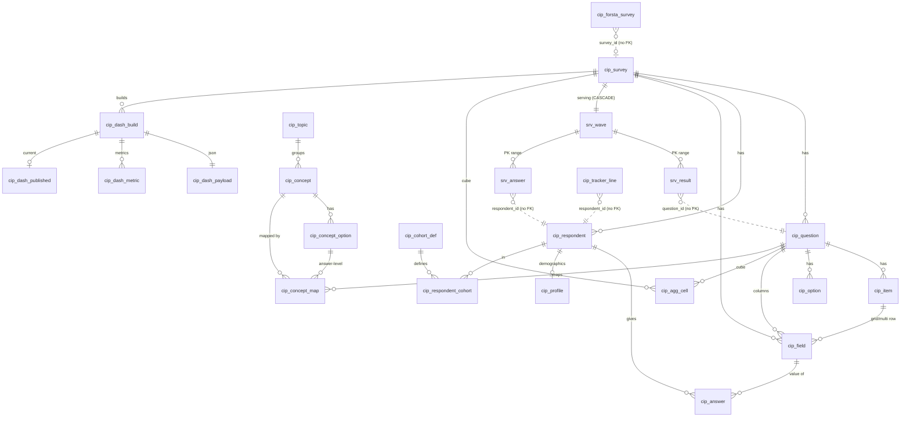

# 20 · Database audit: `cip_stg` (Azure MySQL)

Audited 23 Oct 2026, read-only (SELECT / SHOW / EXPLAIN / information_schema only, `MAX_EXECUTION_TIME=20000`), through `app/core/database.py` `get_engine("app")`. No writes, no DDL, nothing on port 8000 touched.

Markers: **[O]** observed (query or file line quoted), **[I]** inferred, **[U]** unknown.

---

## 1 · Summary verdict

**The data is correct. The access model is not, and the storage is about 3 times larger than it needs to be.**

- **Correctness is good [O].**
  - All 371 waves are `verified` and every one has a `srv_wave` row.
  - `srv_wave.qualified_n` equals the recount from `cip_respondent` for all 371 waves.
  - For waves 238, 204 and 415, every sampled `srv_result` cell (n and base) matches a recount from raw `cip_answer`. The `pct`, prior and last-year arithmetic is exact on 55,802 rows.
  - There are no orphans and no cross-survey mismatches, no duplicate respondents, and no mojibake.
- **Security is the launch blocker [O].**
  - The API's "read-only" engine logs in as the owner's personal account, `mohdsaeedafri@%`.
  - That account has **ALL PRIVILEGES on `cip_stg` and on 3 other projects' databases** (`chainxydata_stg`, `coresight_market_data_stg`, `dwh_directus_stg`, about 560 GB together), plus SELECT on `dwh_stg`.
  - The `cip_app` account that `sql/004_grants.sql` describes is not in use.
- **Privacy [O/I].**
  - `cip_stg.dwh_smresponse` holds 79,626 plaintext respondent IPv4 addresses.
  - `respondent_key` is very likely an **unsalted** SHA-256 of the panel ID, because `CIP_RESPONDENT_SALT` is set nowhere the jobs load from.
  - `forsta_uuid` is stored for all 215,345 respondents.
- **Storage and performance [O].**
  - `cip_stg` is 11.9 GB. The InnoDB buffer pool is 2 GB and is shared with about 656 GB of other schemas on a 1-vCPU server.
  - A plain full scan of `srv_result` (2.5 M rows, 650 MB) **could not finish in 20 s**. Any serving query that is not a primary-key range is I/O-bound.
  - The API's own queries are all primary-key or index range reads (EXPLAIN in §4) and are fine.
  - The bulk is `cip_answer` (6.0 GB, 27.8 M rows). There, 41–76 % of rows in the sampled waves are multi-select "not chosen" zeros, and 41 % belong to non-qualified respondents (wave 415).
  - The legacy `dwh_sm*` copies (about 2.6 GB) are dead weight once the legacy waves are loaded.
- **Schema drift is nil [O].** `schema_upgrade.plan()` has nothing pending except its idempotent backfill. Every table, column and index in `sql/001`–`007` is present live. The only extra objects live are the 7 `dwh_sm*` legacy copies and the implicit `fk_*` indexes.

---

## 2 · Inventory

Server [O]:

| Setting | Value |
|---|---|
| Version | MySQL 8.0.46-azure |
| `innodb_buffer_pool_size` | 2 GB (8 instances); lifetime hit ratio 99.88 % |
| `max_connections` | 341; `Max_used_connections` 310 (server-wide) |
| `sql_mode` | STRICT_TRANS_TABLES, ONLY_FULL_GROUP_BY, NO_ZERO_DATE, ERROR_FOR_DIVISION_BY_ZERO |
| Time zone | `+00:00` |
| Character set | utf8mb4 / utf8mb4_0900_ai_ci |
| `local_infile` | ON |
| `require_secure_transport` | ON; session TLS 1.3, TLS_AES_256_GCM_SHA384 |
| Slow log | ON; `long_query_time` 10 s |
| Binary log | `log_bin` ON |
| `lower_case_table_names` | 1 |
| Global `max_execution_time` | 0 (the app sets 600 s per session) |

Server-wide size by schema: `coresight_market_data_stg` 331 GB, `chainxydata_stg` 230 GB, `dwh_stg` 83 GB, `cip_stg` 11.9 GB.

The schema has 54 base tables and 12 views. All tables are InnoDB, DYNAMIC row format, utf8mb4_0900_ai_ci (the `dwh_sm*` copies use utf8mb4_unicode_ci or utf8mb3). There are 54 primary keys, 21 unique keys, 48 FKs, **0 CHECK constraints**, and no triggers, routines, events or partitions.

| Table | Rows | Data + index (MB) | Purpose | Used by code |
|---|---|---|---|---|
| `cip_answer` | 27.8 M (estimate) | 2,641 + 3,348 (796 free) | Raw answers: respondent × field | ETL, cube, Streamlit |
| `dwh_smresponseqa` | 5.2 M | 1,424 + 946 | Legacy SurveyMonkey answers (copy) | `etl/legacy_dwh.py` only |
| `cip_agg_cell` | 2.79 M | 687 + 764 | Cube: counts per wave × question × cut × cohort | serving build, Streamlit |
| `srv_answer` | 10.0 M | 1,209 + 0 | Serving: qualified answers with 6 cut strings | API (`payloads.people`, `question_cuts`) |
| `srv_result` | 2.54 M | 488 + 164 | Serving: finished percentages + prior/LY | API |
| `cip_tracker_line` | 27,371 | 239 + 2 | Team line-by-line JSON (about 5.3 KB per row) | ETL |
| `cip_respondent` | 215,345 | 34 + 50 | One row per interview | everything |
| `cip_profile` | 185,064 | 31 + 25 | Flattened demographics | cube, API |
| `dwh_smresponse` / `smdemography` / `smanswer` / `smquestion` / `smsurveydetail` / `smsurveytrend` | 162 k / 72 k / 65 k / 6.6 k / 312 / 14.6 k | about 85 together | Legacy copies | `etl/legacy_dwh.py` |
| `cip_concept_map` | 90,857 | 7 + 23 | Question → concept harmonisation | API, serving |
| `cip_field` / `cip_item` / `cip_option` / `cip_question` | 70.9 k / 64.6 k / 43.7 k / 11.5 k | about 30 | Questionnaire metadata | everything |
| `cip_search` | 13,317 | 7.5 + 2.5 (FULLTEXT) | Search catalogue | Streamlit / ETL |
| `cip_concept` / `cip_concept_option` | 2.3 k / 13.5 k | about 5 | Concepts | API |
| `cip_dash_*` (build, metric, payload, published) | 395 / 5.5 k / 210 / 175 | about 5 | Built dashboards | API |
| `srv_wave` | 371 | <1 | Serving: one row per verified wave | API |
| `cip_survey` | 371 | <1 | Wave register | everything |
| `cip_respondent_cohort` / `cip_cohort_def` | 6.5 k / 2 | <1 | Behavioural cohorts | cube |
| `cip_load_log` | 520 | <1 | Load history (511 success, 9 failed) | ETL |
| `cip_forsta_survey` / `cip_forsta_event` / `cip_wave_module` | 92 / 5 / 253 | <1 | Forsta register / calendar | ETL, API |
| `cip_publication` / `cip_publication_cell` / `cip_profile_map` / `cip_topic` | 3 / 198 / 1.3 k / 16 | <1 | Support tables | Streamlit / ETL |
| `cip_auth_session` | 2 | <1 | Streamlit sessions (plaintext `session_id`) | `app/core/auth.py` |
| **Empty, no code reference** | 0 | — | `cip_crosstab`, `cip_crosstab_run`, `cip_banner`, `cip_segment`, `cip_weight`, `cip_weight_scheme`, `cip_load_error` | none [O] (grep of etl/app/api/scripts) |
| Empty, referenced | 0 | — | `cip_load_state` (only `scripts/rekey_respondents.py`); `cip_saved_view`, `cip_team_view`, `cip_audience`, `cip_metric_alert`, `cip_board*` (team features, unused so far) | — |

**Views [O].** All 12 have `DEFINER=mohdsaeedafri@%` and `SQL SECURITY DEFINER`.

- Used by code: `v_cip_survey_health`, `v_cip_mapping_queue` and `v_cip_trend` (through `v_cip_item_incidence`). All three are used by the Streamlit `app/data/repository.py` only.
- Never referenced by code (analyst views): `v_cip_answers`, `v_cip_answer_long`, `v_cip_crosstab`, `v_cip_grid`, `v_cip_single_distribution`, `v_cip_respondent`, `v_cip_question_base`, `v_cip_wave`.

---

## 3 · Entity-relationship diagram

Dotted lines are logical links that MySQL does not enforce. `etl/integrity.py` guards them instead. The orphan checks in §6 found all of them clean.

---

## 4 · Hot queries and EXPLAIN (wave 415, CSI-US, 19 Oct 2026, 400 qualified)

### API (serving layer)

All API reads are good: each is a primary-key or index range, with no full scans.

| Query (file:line) | Plan [O] | Verdict |
|---|---|---|
| `srv_result WHERE survey_id=:s AND qcode IN :q AND dim IN :d` (`app/data/payloads.py:49`) | range on PRIMARY, about 99 rows | ideal |
| `srv_result WHERE survey_id=:s AND dim IN (total, gender, generation)` (`payloads.py:97`) | ref on PRIMARY prefix, 28,968 rows estimated, 30 % filtered | acceptable; reads the whole wave because `dim` is 3rd in the PK |
| `srv_answer WHERE survey_id=:s` (`payloads.py:272`) | ref on PRIMARY, about 74 k rows estimated (28,366 actual), Using index | fine |
| `srv_answer … GROUP BY 10 cols` (`payloads.py:308`) | range on PRIMARY, Using temporary | fine at wave size |
| `srv_wave` self-join for pooled weeks (`payloads.py:260`) | const + range on `ix_srv_wave_family` | fine |
| `srv_result JOIN cip_question … qcode, dim` (`api/team.py:137`) | ref PRIMARY (15 rows) + eq_ref | ideal |
| concept trend `srv_result.concept_option_id` | ref on `ix_srv_concept` | ideal |
| catalogue `cip_question JOIN srv_wave JOIN cip_survey` (`api/main.py:150`) | **ALL on cip_question (11.3 k rows)** | cheap at this size; cached |
| `cip_concept_map … status='confirmed' AND concept_option_id IS NULL` (`api/main.py:166`) | ref on `ix_map_concept_option` (NULL), about 23 k rows, Using temporary | OK; runs once per cache build |
| `cip_wave_module` + correlated `SUM(is_qualified)` (`api/dashboards.py:49`) | ref + dependent subquery on `ix_respondent_qualified` (covering) | fine |

### ETL and Streamlit (raw layer)

| Query | Plan [O] | Verdict |
|---|---|---|
| Cube input `ANSWER_ROWS` (`app/data/cube.py:43`) | `q` ref `uq_question` → `f` → `a` ref **`ix_answer_cover` (Using index)** → `o`, `r`, `p` eq_ref | good: the covering index works |
| `wave_report` text/number answers (`app/data/repository.py:138`) | **`q` ALL 11.3 k** → `f` → `a` ref `fk_answer_field` (283 rows per field across all waves) | the `a.survey_id` filter is applied late. Add `AND q.survey_id = :sid` |
| `wave_report` cube cells (`repository.py:126`) | **`q` ALL** → `c` ref `ix_agg_question` | same: add `q.survey_id = :sid` |
| `analyse` raw path (`repository.py:445`) | `f` ref → `a` ref `fk_answer_field` → `r` eq_ref | OK |
| `v_cip_trend` (`repository.py:156`, Trends page) | DERIVED over **all** waves' answers, plus DEPENDENT SUBQUERY over a derived table of about 120 k rows × answers (index scan of `cip_respondent` 195 k → `cip_answer` by `uq_answer`) | **full-table work per call.** Prior gap G-33 confirmed. Streamlit-only (not deployed by launchd); never point the API at it |
| `v_cip_survey_health` | derived ALL 193 k | Streamlit-only; fine occasionally |

Evidence of I/O pressure [O]:

- `SELECT COUNT(*), SUM(dim<>'total' AND dim_value='') FROM srv_result` was killed at 20 s.
- So was the `srv_result ⟕ cip_question` orphan check.
- A per-survey `COUNT` over `cip_answer` for 3 waves (717 k rows) took 12.6 s.

---

## 5 · Optimisation findings

| # | Finding | Evidence | Recommendation | Expected gain |
|---|---|---|---|---|
| O-1 | **`cip_answer` stores the "not chosen" zero for every multi item.** | [O] Wave 415: 81,909 of 128,665 rows are multi with `value_code=0` (64 %); wave 214: 271,340 / 358,747 (76 %); wave 204: 41 %. | Store only chosen items (`value_code=1`), plus one "answered" marker row per respondent × multi question. The cube's base is `COUNT(DISTINCT rid)` over non-null codes (`cube.py:97–110`), so it needs that marker. | [I] −40 to −60 % of rows and indexes, about 2.5–3.5 GB, and a faster cube and reload |
| O-2 | Non-qualified respondents' answers are kept in full. | [O] Wave 415: 53,055 of 128,665 rows (41 %) are from `is_qualified=0`. | Archive the raw Forsta JSON (already archived: `cip_load_log.archive_uri`) and load only qualified plus partial answers. Keep `cip_respondent` for field health. | [I] up to −40 % more |
| O-3 | Surrogate `answer_id` plus 3 secondary indexes. Indexes (3.35 GB) are larger than the data (2.64 GB). | [O] PK `answer_id` (`sql/001_schema.sql:248,256`), `uq_answer`, `ix_answer_cover`, `fk_answer_field`. `answer_id` is referenced by no code [O grep]. | Make `PRIMARY KEY (survey_id, field_id, respondent_id)` (clusters the cube scan and drops `ix_answer_cover`). Keep `(respondent_id, field_id)` for the respondent FK. Drop the field FK and its index (the field row cascades per survey anyway). | [I] about −1.5 GB of indexes and one fewer index write per row on load |
| O-4 | **Legacy `dwh_sm*` copies**: 2.6 GB including 79,626 plaintext IPs. | [O] sizes in §2; only `etl/legacy_dwh.py` reads them. Legacy waves are loaded (145 SurveyMonkey + 142 Qualtrics). | After a final reconcile, drop them, or move them to a separate restricted schema. | −2.6 GB (22 % of `cip_stg`), and the PII exposure is gone |
| O-5 | `srv_answer` repeats 6 VARCHAR(120) cut strings on every row (about 46 bytes on average), and `qcode` VARCHAR(50) sits in the PK. | [O] DDL `sql/005_serving.sql:58–71`; average 46.4 bytes per row of cut text on wave 415. | Move the cuts to `srv_respondent(survey_id, respondent_id, 6 × TINYINT codes)`. Key `srv_answer` on `(survey_id, question_id INT, item_id, option_id, respondent_id)`. | [I] 1.2 GB → about 0.35 GB, so it fits in the buffer pool |
| O-6 | Waves with **no profile rows** still get 6 "blank cut" copies of Total in `srv_result` and `cip_agg_cell`. | [O] 41 waves have no `cip_profile` rows; 18,968 qualified respondents have no profile. The largest such wave has `srv_result dim='gender' dim_value=''`: 290 rows. | Skip non-total dims for a wave whose `cip_profile_map` is empty, or skip `dim_value=''` rows. | [I] a few % of `srv_result`, and cleaner cuts in the UI |
| O-7 | `cip_agg_cell` (1.45 GB) and `srv_result` (0.65 GB) hold the same numbers twice. `cell_key` VARCHAR(200) is UNIQUE, and there are 4 secondary indexes. | [O] STATISTICS; `etl/serving.py:82` builds `srv_result` from `cip_agg_cell`. | Long term, keep the cube only for cohort cells and build `srv_result` straight from the answer scan. Short term, drop `uq_agg_cell` in favour of a composite natural key. | [I] about −1 GB |
| O-8 | Empty, unreferenced tables and views. | [O] 7 tables and 8 views (§2). | Drop them, or move them to a `sql/archive/` file, so a reader's model is the real one. Prior gap G-42 stays true (weights 1.0 on all 185,064 profiles; no view applies them). | Clarity; no runtime gain |
| O-9 | `wave_report` and the cube-cell queries start from a full `cip_question` scan. | [O] EXPLAIN (§4). | Add `AND q.survey_id = :sid`. | ms now; scales with the question count |
| O-10 | Partitioning `cip_answer` by survey. | [O] InnoDB partitioned tables **cannot have FKs**, and every hot read is already survey-prefixed. | **Don't**, unless O-3 drops the FKs. It would help only bulk `DELETE … WHERE survey_id` on reload (`TRUNCATE PARTITION`). | Low |
| O-11 | Collation `utf8mb4_0900_ai_ci` on code keys (`qcode`, `field_name`, `dim_value` in PKs and unique keys). | [O] COLUMNS. `qcode` 'q1' = 'Q1'; accented and unaccented cut values collide. | `utf8mb4_bin` on code columns (prior G-37). | Correctness guard |
| O-12 | Low-selectivity `ix_map_status` (2 values). | [O] Cardinality 1; the planner uses it only in an index_merge for the mapping queue. | Fold it into `(status, concept_option_id)`, or leave it (small table). | Negligible |

**Model comparison [I].** Survey platforms keep data case-level, or pre-aggregate it.

| Platform or format | How it stores and reads data |
|---|---|
| Forsta/Decipher, SPSS `.sav`, Q/Displayr | One record per respondent, one column per variable. Q/Displayr compute tables in memory from that. |
| Qualtrics | Response documents, plus an aggregate reporting store |
| OLAP tools | Pre-built cubes |

CIP already does the right thing at the top. `srv_result` is a pre-aggregated cube, and `payloads.people()` turns `srv_answer` into case-level bitsets (respondents × answer). The tall EAV `cip_answer` is a reasonable raw layer for 371 waves with different questionnaires, but it does not need to be **hot in MySQL**. The cheapest structural win:

1. Keep per-wave case-level files (Parquet or the archived JSON) in blob storage as the raw layer.
2. Keep only `srv_*` plus the metadata in MySQL.
3. Do ad-hoc reprocessing with DuckDB over the per-wave files.

Expected size [I]: `cip_stg` from about 12 GB to under 3 GB, and the whole serving working set fits inside the 2 GB buffer pool.

---

## 6 · Integrity and data-quality findings

| Check | Query (abridged) | Result |
|---|---|---|
| Waves by status | `GROUP BY platform, study_type, load_status` on `cip_survey` | [O] 371 verified, 0 loading/failed/superseded. Forsta 84, Qualtrics 142, SurveyMonkey 145. |
| Verified wave without serving | `cip_survey ⟕ srv_wave WHERE load_status='verified' AND w IS NULL` | [O] 0 |
| Serving for a non-verified wave | `srv_wave ⋈ cip_survey WHERE load_status<>'verified'` | [O] 0 |
| `qualified_n` vs recount | `srv_wave ⋈ (SUM(is_qualified) GROUP BY survey_id) WHERE <>` | [O] 0 mismatches of 371 |
| `srv_result` vs raw recount, single/grid | wave 238: 69/69 n and base; wave 415: 311/311; wave 204 (SurveyMonkey): 309/309 | [O] exact |
| `srv_result` vs raw recount, multi (Total Answering base) | wave 238: 12/12 | [O] exact |
| Arithmetic | `ABS(pct-100*n/base_n)>0.001`, `n>base_n`, `pct∉[0,100]` over 5 waves (55,802 rows) | [O] 0 |
| Prior comparison | wave 415 `prior_pct` vs the prior wave's `pct` on the same key | [O] 0 mismatches |
| Total base ≤ qualified | waves 415, 412, 266 | [O] 0 violations |
| Load log | `GROUP BY status` | [O] 511 success, 9 failed (latest 20 Oct 19:16, waves 503/497/425, all later verified). 10 rows point at deleted surveys (kept on purpose, docs/14 §1.4) |
| Forsta register | `cip_forsta_survey GROUP BY load_state` | [O] 84 loaded, 8 `testing` (no `survey_id`) |
| Duplicate respondents | `(survey_id, record_no)` dup; `(survey_id, forsta_uuid)` dup | [O] 0 and 0 |
| Same panelist twice in a wave | `(survey_id, respondent_key)` dup | [O] 1 group: wave 471, 3 records, only 1 qualified (2 terminated), so analysis is unaffected |
| Respondent key format | not `^[0-9a-f]{64}$` | [O] 0. Null keys: 1,359 |
| Orphans without FK | `cip_tracker_line`→respondent (unqualified or other wave); `cip_forsta_survey`→survey; `cip_wave_module`→survey; `srv_answer`→respondent (5 waves); `srv_result`→question (5 waves) | [O] all 0. The global `srv_result` check timed out at 20 s, so it is [U] for all waves |
| Cross-survey consistency | `profile.survey_id≠respondent.survey_id`; `field≠question`; `concept_map≠question` | [O] all 0 |
| Qualified respondents without a profile | `cip_respondent ⟕ cip_profile WHERE is_qualified=1 AND p IS NULL` | [O] **18,968** across 139 waves. Whole waves (e.g. 214: 1,937/1,937; 391: 1,231/1,231); 41 waves have no profile at all. Cuts for these waves are a single blank segment (O-6) |
| Blank text | `qtext`, `qtext_short`, option and item labels empty or null | [O] 0 / 0 / 0 / 0 |
| Single or grid question with no options; multi or grid with no items | | [O] 0 / 0 |
| Mojibake | binary-collation REGEXP `Ã\|â€\|Â\|�` on question, option, item, concept and `srv_result` | [O] 0. (A naive `LIKE '%Ã%'` under `ai_ci` "finds" 11,088 questions: false positives, because the collation is accent-insensitive) |
| HTML entities | `qtext REGEXP '&(amp\|#[0-9]+\|quot…);'` | [O] **87 questions** (e.g. wave 104 Q10 "brand&#39;s"); 0 in options and items |
| Dates | `wave_date` in the future, before 2017, or null | [O] 0 / 0 / 0. Range 2018-01-18 → 2026-10-19 |
| Question-code reuse with different wording | `COUNT(DISTINCT qtext)` per family × qcode | [O] CSI-US: 163 of 753 codes carry more than one wording, up to **85** different texts on one code. `etl/serving.py:same_question` guards comparisons; wave 415 shows 0 `wording_changed_prior` |
| Concept map | `GROUP BY status` | [O] proposed **3,771**, confirmed 87,086, rejected 0. Proposed rows are not on any trend |
| Tiny or test waves served | `srv_wave WHERE qualified_n<50` | [O] 382 (n=1), 261 (n=2, "Holiday Shopping 2026", in field), **394 (n=2, family `TEST_TRAINING`)**, 211 (15), 238 (35). None is published as a dashboard, but all are in `srv_result` and so in the API catalogue [I] |
| Weights | `cip_profile.weight` | [O] 185,064 of 185,064 = 1.0. The weight tables are empty |
| PII: emails or phones in free text | REGEXP over `value_text` (3 waves, 2,894 texts), 3,000 tracker lines, 300 k `answer_othertext` | [O] 0 hits (sample, not exhaustive) |
| PII: identifiers | `dwh_smresponse.ip_address`; `cip_respondent.forsta_uuid`; `sample_rid` | [O] 79,626 IPv4 addresses; `forsta_uuid` on 215,345 rows; `sample_rid` 0 (nulled) |

---

## 7 · Security (DB level)

| Item | Finding |
|---|---|
| Account the API uses | [O] `CURRENT_USER()` = `mohdsaeedafri@%` for `get_engine("app")`. `APP_DB_USER` in `.env` is set to the **same user and password** as `STG_DB_USER` (compared in-process, values not printed). The live API is launched by `scripts/launchd/com.coresight.cip-api.plist`, which sources `~/.config/cip/api.env` (holds only `APP_ENV` and `CIP_SESSION_SECRET`) and then `.env` through `config.py` |
| Grants | [O] `ALL PRIVILEGES ON cip_stg.*`, `chainxydata_stg.*`, `coresight_market_data_stg.*`, `dwh_directus_stg.*`; `SELECT, SHOW VIEW ON dwh_stg.*`. Any SQL injection or SSRF-to-DB in the portal can therefore read and write the other projects' data, and can DROP them |
| "Read-only" claim | [I] The app engine is read-only only by convention: autocommit with no `SET SESSION TRANSACTION READ ONLY` (`database.py:91–110`) |
| `sql/004_grants.sql` | [O] Now correct (`cip_stg.*` for ETL; per-table writes for the app), so prior G-11 and Codex G11 are **fixed in the file**. [U] Whether `cip_app`/`cip_etl` exist on the server: `mysql.user` is not readable by this account. They are not used either way |
| View DEFINER | [O] All 12 views: `mohdsaeedafri@%`, `SQL SECURITY DEFINER`. If that personal account is removed, every view breaks |
| TLS | [O] `require_secure_transport=ON`, TLS 1.3. Client pins `DigiCertGlobalRootG2.crt.pem` (present; `config.py:70–74`), so PyMySQL verifies the certificate and hostname [I from the PyMySQL default] |
| `local_infile` | [O] ON at the server. Enabled only on the ETL engine (`database.py:93`) |
| Respondent key | [O] `etl/records.py:19–25`: HMAC only if `CIP_RESPONDENT_SALT` is set. It is absent from `.env`, `~/.config/cip/api.env` and all 4 launchd plists → [I] keys are plain `sha256(RID)`, reversible by enumerating a numeric RID space. `v_cip_respondent` exposes it |
| Sessions | [O] `cip_auth_session.session_id` is stored in plaintext. Anyone with SELECT can replay a live Streamlit session (2 rows) |
| Binary log | [O] `log_bin=ON`. [I] Deleted PII lingers in binlogs and backups until rotated (Azure-managed) |

---

## 8 · Gap table

| ID | Severity | Gap | Evidence | Consequence | Smallest fix |
|---|---|---|---|---|---|
| DB-01 | **Critical** | The API connects as the owner's personal account, with ALL on `cip_stg` and 3 unrelated project databases | §7: `CURRENT_USER()`, `SHOW GRANTS`, `APP_DB_USER`==`STG_DB_USER` | One injection bug exposes or destroys about 560 GB of other teams' data. A leaver or password change breaks prod | DBA creates `cip_app` per `sql/004_grants.sql`; put its credentials in `~/.config/cip/api.env`; make `config.py` refuse `role=app` with the owner account outside LOCAL |
| DB-02 | High | Plaintext respondent IP addresses in `cip_stg.dwh_smresponse` | 79,626 IPv4 addresses (§6) | Personal data held without need, on an account shared with the portal | Drop `dwh_sm*` after the legacy reconcile (O-4), or null `ip_address` |
| DB-03 | High | `respondent_key` is unsalted SHA-256 | `records.py:23–25`; salt absent from all env sources | Panel IDs can be recovered by brute force; `v_cip_respondent` exposes the keys | Set `CIP_RESPONDENT_SALT` (secret store) and run `scripts/rekey_respondents.py` once |
| DB-04 | High | Views use the personal DEFINER with SQL SECURITY DEFINER | §2, §7 | Views break when the account goes; views escalate to owner rights | Recreate with `SQL SECURITY INVOKER` (or a service definer) when DB-01 lands |
| DB-05 | Medium | Storage is about 3× what is needed (`cip_answer` zeros, non-qualified rows, `answer_id` and indexes, legacy copies) on a 2 GB buffer pool shared with 656 GB | §5 O-1…O-5; a 20 s scan timeout on 2.5 M rows | Cold-cache API latency spikes; slow reloads; backup size | O-4 (drop the legacy copies) first; then O-1/O-3 in one rebuild window |
| DB-06 | Medium | 18,968 qualified respondents (41 whole waves) have no profile, so every cut collapses to one blank segment | §6 | Gender and generation filters on those waves show a blank-named group equal to Total | Skip non-total dims (or the `''` value) when a wave has no profile map; label it "Demographics not collected" |
| DB-07 | Medium | Test and tiny waves are in serving (394 `TEST_TRAINING` n=2; 382 n=1; 261 n=2) | §6 | Visible in the catalogue; an n=1 wave is respondent-level disclosure if not suppressed everywhere | Add a `cip_survey.is_listed` flag (or `load_status='superseded'`) and exclude it in `etl/serving.py`; apply `HIDDEN_BASE` in the API |
| DB-08 | Medium | 3,771 concept-map rows still `proposed` (G-27 said 2,625: grew) | §6 | Those questions are silently missing from cross-wave trends | Weekly review queue alert; auto-confirm exact-text matches |
| DB-09 | Medium | `v_cip_trend` / `v_cip_item_incidence` do whole-table work per call; 8 of 12 views lack a `load_status='verified'` filter | EXPLAIN §4; `sql/002_views.sql` (only lines 195, 204, 217 filter) | The Streamlit Trends page can stall the shared 1-vCPU server; a future failed wave would leak into views | Point Trends at `srv_result` (or drop the view); add the verified join |
| DB-10 | Low | Case- and accent-insensitive collation on code keys | §5 O-11 | `Q1`/`q1` or `é`/`e` cut values merge silently | `utf8mb4_bin` on `qcode`, `field_name`, `dim_value` |
| DB-11 | Low | 87 question texts carry HTML entities (`&#39;`, `&amp;`) | §6 | Shown literally in UI and search | `html.unescape` in `records.clean_text`; one UPDATE in a load window |
| DB-12 | Low | 7 empty unreferenced tables and 8 unreferenced views | §2 | Misleading model (docs/02 claims weighted views) | Move them to an archive DDL file; fix docs/02:157 |
| DB-13 | Low | `cip_auth_session.session_id` is stored in plaintext | §7 | Session replay by anyone with SELECT | Store `sha256(session_id)` |
| DB-14 | Low | `wave_report` and the cube-cell queries full-scan `cip_question` | §4 | Wasted I/O, grows with history | Add `q.survey_id = :sid` |
| DB-15 | Low | `.env` still has unparseable lines (python-dotenv warns at lines 67, 82, 84, 85) | [O] run output | Noise; a possible stray secret line (prior G-06) | Clean `.env` (values not inspected here) |
| DB-16 | Info | No CHECK constraints at all (enums, `pct` range and `is_qualified` are typed but unchecked) | §2 | Relies on ETL correctness; currently clean | Optional `CHECK (pct BETWEEN 0 AND 100)`, `CHECK (n <= base_n)` on `srv_result` |

---

## 9 · Status of prior-audit DB gaps

| Prior gap | Claim | Status now | Evidence |
|---|---|---|---|
| Claude G-03 | App runs on the owner's all-privileges account; views have the personal DEFINER | **Open** (worse: the grants now also span 3 other project databases) | §7 |
| Claude G-11 / Codex G11 | `004_grants.sql` cannot work / misses the serving tables | **Fixed in the file**, not applied | `sql/004_grants.sql:9–22` |
| Claude G-12 | Unescaped apostrophe breaks a fresh install | **Fixed** | `sql/001_schema.sql:775` uses `''` |
| Claude G-13 | 8 of 12 views lack the verified filter | **Open** (no live impact: all 371 waves are verified) | `002_views.sql`: only 3 views filter |
| Claude G-20 | No DB read timeout | **Fixed** | `database.py:26,94–99` (`read_timeout`, `max_execution_time` 600 s for app) |
| Claude G-26 | `respondent_key` unsalted | **Open**: HMAC code added, salt never configured | `records.py:19–25`; env check §7 |
| Claude G-27 | 2,625 proposed mappings | **Open, grew to 3,771** | §6 |
| Claude G-29 | docs/14 says 26 FKs and 16 checks; "live has 39 FKs and 19 checks" | **Partly wrong**: live has **48 FKs and 0 CHECK constraints**. The "16 checks" are `etl/integrity.py` assertions, not DDL. docs/14 is stale | §2 |
| Claude G-32 | `ON DELETE CASCADE` from `cip_survey` wipes human work (saved views, confirmed mappings) | **Open** | `001_schema.sql:476–477, 690`; live FK rules §2 |
| Claude G-33 | `v_cip_item_incidence` scans all of `cip_answer` | **Confirmed** by EXPLAIN | §4 |
| Claude G-34 | Unused FULLTEXT `ft_answer_text` on `cip_answer` | **Fixed**: dropped (no FULLTEXT on `cip_answer`; `schema_upgrade.DROP_INDEXES`) | STATISTICS §2 |
| Claude G-36 / docs/14 | Redundant `ix_answer_respondent` | **Fixed**: dropped (also `ix_answer_field`) | STATISTICS; `schema_upgrade.py:82–86` |
| Claude G-37 | ai_ci collation on code keys | **Open** | COLUMNS |
| Claude G-38 | `uq_saved_view` lacks `survey_id` | **Open** (table empty) | `001_schema.sql:688` |
| Claude G-42 / Codex G13 / docs/02:157 | Crosstab and weight tables empty; views "apply weights" | **Open / claim wrong**: all weights are 1.0; no view multiplies by weight | §6 |
| Claude G-30 / G-31 | `.env.example` points at `dwh_stg`; drop script writes `dwh_stg` | Not DB-runtime. [U] not re-checked here | — |
| docs/14 §1.4 | Recommended FKs: `cip_tracker_line→cip_respondent`, `cip_forsta_survey→cip_survey` | **Not added**; integrity checks keep them clean (0 orphans) | §2 FK list; §6 |
| docs/14 | "0 duplicate respondents (uuid)" | **Still true** | §6 |
| Gemini 02 | `cip_search` is the FULLTEXT catalogue; integrity runs 16 checks | **True** (`ft_search` on title, body). The API's search uses its own SQLite FTS (`api/search.py:99`), not `cip_search` | STATISTICS |
| docs/11 | `dwh_pro` = `dwh_stg` for surveys (312 surveys, 161,748 responses) | **Consistent**: the `cip_stg.dwh_smresponse` copy has 161,748 rows | §6 |

---

## 10 · Unknowns

- [U] Whether the `cip_app` / `cip_etl` accounts exist on the server (`mysql.user` is not readable).
- [U] Per-index sizes (`mysql.innodb_index_stats` is denied) and statement digests (`performance_schema` digest table is denied). Ask the DBA for the top `cip_stg` digests by `SUM_TIMER_WAIT` and the slow-log entries.
- [U] A global `srv_result`→`cip_question` orphan count and the global count of blank-cut `srv_result` rows. Both timed out at 20 s; run them off-hours:
  - `SELECT COUNT(*) FROM srv_result r LEFT JOIN cip_question q ON q.question_id=r.question_id WHERE q.question_id IS NULL OR q.survey_id<>r.survey_id;`
  - `SELECT COUNT(*) FROM srv_result WHERE dim<>'total' AND dim_value='';`
- [U] Whether `respondent_key` values really are plain `sha256(RID)`. To confirm, hash one known RID locally and look it up.
- [U] Exact per-wave share of zero and non-qualified rows across all 371 waves. Three waves were sampled; a full count is a 27.8 M-row scan.
- [U] Binlog retention and backup encryption on the Azure side.
- [U] Whether the Streamlit staff app (which reads the heavy views) is reachable anywhere. It is not in the launchd plists.
