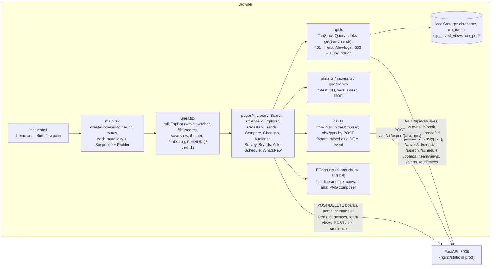

# 40 · Frontend (web/) and user experience

**Date:** 23 Oct 2026 · **Scope:** React 19 + Vite SPA in `web/`, its API contract, and the live portal behind the shared tunnel link.
**Method:** full source read of `web/src` (5,403 lines); `tsc --noEmit` (pass); `npm run check` / `stats.check.ts` (pass); `npm outdated`, `npm audit`; a scratch `vite build` into the session scratchpad (the live `web/dist` was never rebuilt); REA static analysis of `web/dist`; and a read-only headless-Chrome walk of 32 live screens over raw CDP (desktop 1440×900 and phone 390×844). The walk made no clicks or form submits, and `prompt`/`alert`/`confirm` were stubbed.
**Markers:** [O] observed, [I] inferred, [U] unknown. Screenshots are in `screens/`. The raw walk log is in the session scratchpad and is not in the repo.

---

## 1. Summary verdict

The frontend is in good shape for an internal beta. It is fast and well built, and its statistics are mostly careful. It is **not yet research-grade for clients**. Five problems should be fixed before launch:

1. **The significance rules disagree with each other on the same wave.** [O] On the latest wave (415, 19 Oct):
   - Overview and What changed say **"No significant change against last week"** and **"0 significant changes"**.
   - Explorer shows a red **"▲ 8.0 pts vs last week"** significant chip on q1 (`screens/m04-explorer.png`).
   - The GLP-1 takeaway on the same Overview says **"Biggest significant move vs the previous wave … +17.0 pts"** (`screens/03-overview.png`).

   Three different rules are applied to the same numbers: uncorrected z, Benjamini–Hochberg (BH), and the backend's dashboard rule.
2. **The BH denominator is wrong.** `moves.ts:16-22` gives every untestable row p = 1, including rows with no prior and rows whose routing changed, and then runs BH over all of them. On wave 415 that is **577 tests**, while only 368 rows have a prior and the page says "of 231 answers evaluated". This makes the correction stricter than it should be, and real moves are suppressed. For example, CS3 moved **−11.7 pts at n=400/404, p = 0.0004**, and it is hidden.
3. **"What changed" gives its headline space to noise.** "Largest increase **+14.4 pts**" is D33 at **n = 62, p = 0.10**, shown in the significance colour while the same page says 0 significant (`Changes.tsx:36-39,65`).
4. **The provenance text is hardcoded and wrong for non-consumer studies.** Every chart, PNG and export says "Coresight Research US Consumer Survey · US adults 18+" (`bits.tsx:96,102`). That includes the **T-Mobile AI Governance** B2B study (n = 100 companies), whose Overview also shows "Male 0 · Female 0" (`screens/15-adhoc-overview.png`). The sidebar also shows an unconditional **"✓ Verified Sample"** badge (`Shell.tsx:79`).
5. **A malformed shared link crashes a screen.** `/w/415/trends?range=foo` throws a TypeError and lands on the generic "Portal Notice" error page [O] (`Trends.tsx:145`).

Also worth knowing:

| Area | Result |
|---|---|
| Deploy freshness | `web/dist` is byte-for-byte what `web/src` builds today. All 40 hashed asset names are identical to a scratch build, so the deploy is not stale. [O] |
| Console and network | No console errors and no failed requests on any healthy screen. [O] |
| Phone layout | No horizontal overflow at 390 px on six screens. [O] |
| Source maps | Not exposed (`.map` returns 404). [O] |
| Prior audits | Most prior frontend gaps are now fixed. Status is in section 8. |

---

## 2. Architecture

| Concern | How it works | Evidence |
|---|---|---|
| Routing | 15 routes under one `Shell`. All screen state is in the URL (path `:id/:q` plus query `view`, `cut`, `row`, `ref`, `marks`, `mode`, `range`, `col`, `show`, `pick`, `waves`, `vs`…), so **Copy link** reproduces a view. Exceptions: Explorer's "Sort by value" (`Explorer.tsx:35`) and Audience definitions are component state, so they are lost on share or refresh. | [O] `main.tsx:38-78` |
| Data layer | One `useQuery` per endpoint. `staleTime` is 5 min and `gcTime` 30 min. There is no refetch on focus. A 503 retries 3× at 3 s; any other error retries once. `/schedule` polls every 60 s. Errors become `Failure` with "Refresh to try again", which does a full `location.reload`. | [O] `api.ts:62-116,158`, `main.tsx:80-84`, `bits.tsx:68-75` |
| Writes | `send()` has no CSRF token. Same-origin cookie plus JSON content-type gives implicit protection only. [I] Names come from `window.prompt` and are kept in localStorage (`api.ts:189-197`). | [O] |
| Exports | CSV is built client-side with a formula-injection guard (`csv.ts:5`). Excel and PowerPoint are built server-side from the same rows and notes. "Board" pins a frozen copy. A PNG has the question title, chart and source line. | [O] `csv.ts`, `EChart.tsx:25-54` |
| Charts | ECharts core is tree-shaken to bar/line/pie. Each chart has a canvas `role="img"`, an aria label and the ECharts aria description. The palette follows the Coresight rules: red highlight, sky bars, a blue ombre for several series, and a scale palette from `theme.ts:64-76`. | [O] |
| Theme | Light and dark tokens in `theme.ts`. The saved theme is applied before first paint (`index.html:9-13`). `<main key={theme}>` remounts every chart on a theme switch. | [O] |
| Perf | `perf.ts` (567 lines) and the `PerfHUD` overlay are developer telemetry kept in the browser only, with no beacon. It is always bundled in the entry chunk. React `<Profiler>` callbacks do nothing in a production React build, so component timings in the HUD are empty in prod. [I] | `perf.ts`, `Profiled.tsx` |
| Idle prefetch | The charts chunk is imported on `requestIdleCallback` (`main.tsx:89-90`). | [O] |

---

## 3. Screen-by-screen walkthrough (live, 23 Oct, wave 415 unless noted)

API timings are the browser's view through the Cloudflare tunnel from India. Book and question-file requests return in about 1 ms on a cache hit.

| # | Screen | What it does | Data calls observed [O] | Issues observed |
|---|---|---|---|---|
| 01 | **Library** `/` | Latest tracker hero, KPIs (268 tracker waves, 103 others, 190k respondents), team saved views and alerts, filterable archive by year | `waves` 55 ms / 21 KB; `team/views` and `alerts` ~300 ms (`alerts` once **2,888 ms**); `boards` | Says "400 qualified **US adults**" (`Library.tsx:45`). It crashes on an empty catalogue or one with no trackers (`Library.tsx:35,62`), which is an [I] edge case. |
| 02 | **Search** `?q=holiday` | Paged lexical search; shows corrections and expansions; by-wording or by-measure view | `search` 272 ms / 2 KB | Fine. The popular-topic chips are hardcoded (`Search.tsx:70`). |
| 03 | **Overview** | Generated headline, Glance dashboards (3 modules), KPIs, biggest moves, one chart per section | `book` 46 ms / 22 KB; 3 × `dashboards` ~270 ms | The headline says "No significant change" while the GLP-1 takeaway names a "significant move" of +17 pts (section 5.4). The 4,767 px page is long and has no section jump links. The "Print report" print CSS was not runtime-tested. [U] |
| 04 | **Question explorer** | Question list, chart or table, cuts, grid row, exports, Alert me, PNG, links | Book from cache | **No `<h1>`**: the question text is a `
`. On a phone the 52-question list fills the first screen and the chart sits below it (`screens/m04-explorer.png`). The question list is sorted by section A–Z, while "1 of 52" uses book order, so ‹ › jump around the list. |
| 05 | **Cross-tab** | Banner with base row, heat ombre, letters within each cut, arrows vs rest; "Combine two cuts" with 1/2/4-week pooling | `crosstab?q=q1&by=gender,generation` 289 ms | Hidden cells show **"n<30"**, but the rule is 5 (section 5.5). The cell hover card is mouse-only. No `<h1>`. |
| 06 | **Trends** | Time axis with gaps, focus answer in red, significance rings, 4-wk average, MOE band, answer picker, recent-waves table | `questions/CSI-US/tracker/q1` 290 ms / **57 KB** | `?range=foo` **crashes** (`screens/18-trends-badrange.png`). Rings are uncorrected. The MOE band follows the raw series even when the 4-week average line is drawn (section 5.3). |
| 07 | **Compare waves** | Last 4/8/13, same event, or picked waves; by cut; ▲▼ vs the wave to the left; first→last | Question file from cache | Tests are uncorrected. Bad `waves=` values degrade gracefully to "Pick at least one more wave." |
| 08 | **What changed** | Every answer vs prior or last year; BH; filters; export | Book from cache | "0 significant" alongside **"Largest increase +14.4 pts"**, which is noise at n = 62. "231 answers evaluated" does not match the 577-test BH denominator (section 5.2). |
| 09 | **Audiences** | AND-only audience builder from cuts and answers; POST `/waves/:id/audience`; save | `audiences` 359 ms | Says "Groups under 30 show no figure" while the cells say "n<5" (`Audience.tsx:101,106`). There is no OR or NOT. The definition is not in the URL. |
| 10 | **Survey preview** | Questionnaire one question at a time; answer for yourself and see the share | Book | Fine. |
| 11 | **Boards** | Pinned frozen tables, comments, deck download | `boards` | Empty state is "No boards yet." "Delete board" has **no confirmation** (`Boards.tsx:69`). |
| 12 | **Ask CIP** | Question → cited answer | none on load | Not exercised, because it is a POST and may call an LLM. [U] |
| 13 | **Schedule** | Launch plan vs Forsta, quota cells, history | `schedule` 294 ms, refetched every 60 s | All times are shown in **IST** (`Schedule.tsx:17`, `bits.tsx:83`). That is internal-ops content inside a client-facing portal. |
| 14 | **What's new** | Hardcoded release notes with WebP shots | 210 KB of images | Static. |
| 15 | **Ad hoc wave 259** (T-Mobile AI Governance) | Overview, Trends | `book` 282 ms | Says "US adults 18+", "Male 0 · Female 0", "vs last week: –" and "Biggest significant moves **this week**" for a one-off B2B study. Trends correctly says "fielded once". |
| 16 | **Unknown wave** `/w/999999` | Error state | `book` **404 ×2** (one retry) | "Could not load: No such wave" plus "Refresh to try again". A refresh cannot help, and there is no link back. |
| 17 | **404** `/nope` | Not-found card | none | Fine, but uses `<h2>` with no `<h1>`. |
| m* | Phone (390 px) | Library, Overview, Explorer, Cross-tab, Changes, Schedule | | `overflowX = 0` on all of them. Tables scroll inside `.table-wrap`. |

**On every navigation** `GET /api/v1/boards` (~300 ms) fires, because `PinDialog` is mounted in the Shell and calls `useBoards()` on mount (`PinDialog.tsx:16`, `Shell.tsx:94`). It is harmless but wasted. It should be enabled only when the dialog opens. [O]

---

## 4. Bundle analysis

REA evidence: `analyze_javascript_application` on `web/dist` gives parent `ev_e01e3b41061627e341adf68b686d8528535dba692dd23ba51f7ec8db0447a212` and summary view `ev_a630a6968b08e8de365fcf3ff7f4039fece4bb40174217ed43407a43905a2658`. It found 34 relevant files, 33 parsed JS files, 0 parse failures and 374k AST nodes. Semantic coverage is partial for `charts` and `index` because of the result budget. There were no Electron or IPC findings, as expected for a web SPA.

| Chunk | Raw | gzip | Note |
|---|--:|--:|---|
| `charts-*.js` (echarts + zrender) | 549 KB | **187 KB** | Own long-cached group (`vite.config.ts:16-17`); idle-prefetched |
| `index-*.js` (react, react-dom, router, query, perf, shell) | 376 KB | **119 KB** | The entry. `perf.ts` (567 lines) ships to every user. |
| 14 page chunks | 3–14 KB each | 1.5–5 KB | Every route is code-split. [O] |
| CSS | 36 KB | 8 KB | |
| Montserrat variable woff2 ×5 subsets | 13–71 KB | | `unicode-range` means only latin is fetched. [I] |

| Check | Result |
|---|---|
| **Deployed vs source** | `npx vite build --outDir <scratch>` produced **identical content-hashed filenames** for all 40 assets. The deployed bundle equals the current `web/src`. [O] Stale-deploy risk G03 from the prior audit is closed. |
| **Cache headers** | Hashed assets are `public, max-age=31536000, immutable` and gzip. `index.html` is `no-cache`. [O] |
| **Source maps** | None in `dist`; `/assets/*.js.map` returns 404. [O] |
| **HTML security headers** | Absent: no CSP, X-Frame-Options, HSTS or Referrer-Policy on `/`. [O] The SPA shell `/` is served without a session; only `/api` needs one. [O] Handed to the security/backend investigator. |
| **TypeScript** | `tsc --noEmit -p web` passes. [O] |

**Dependencies** (`web/package.json`):

| Package | Status |
|---|---|
| `mermaid` ^12.2, `@mermaid-js/mermaid-cli` ^12, `reactflow` ^11, `@xyflow/react` ^12 | **0 imports in `src`** [O]. Added by commit aa4bfdb ("add new packages"). `mermaid-cli` pulls Puppeteer and Chromium into `node_modules` (823 MB total), and it is the source of both `npm audit` findings (2 low, katex prototype pollution, GHSA-238p-pmpm-9mq7). None of these reach the browser bundle. Remove them. |
| `react-scan` | Belongs in `devDependencies`. It is used only under `import.meta.env.DEV` (`main.tsx:14`). |
| Outdated | `react-router` 7.18.4 → 8.5.0 (major); `typescript` 5.9 → 7.0 (major); `vite` 8.3.4 → 8.3.5 (patch). No runtime CVEs. [O] |

---

## 5. Statistics correctness

### 5.1 The maths in `stats.ts`

| Function | Verdict |
|---|---|
| `pValue` (`stats.ts:7-13`) | Correct pooled two-proportion z-test, two-sided via erfc. The Numerical Recipes erfcc has error below 1.2e-7. It returns 1 when either base is under 30 (`TEST_BASE`) or SE is 0. [O] Checked against known values in `stats.check.ts`. |
| `moe` (`stats.ts:52`) | Wald 95 % MOE. It is acceptable for p in 10–90 % and n ≥ 30. At p near 0 or 100 or small n it understates (it gives ±0 at 0 % and 100 %). Wilson would be safer. [I] |
| `versusRest` (`stats.ts:34-40`) | Correct "column vs everyone else" test. It reconstructs the rest share from rounded 1-dp percentages, which adds a small error. [I] |
| `survivesFdr` (`stats.ts:24-31`) | Correct step-up BH. [O] |
| Crosstab letters (`Crosstab.tsx:194-197`) | Tested **only within the same cut**; Total is never lettered; each base must be ≥ 50. The overlapping-group flaw from prior audit FE-02 is **fixed**. [O] No multiplicity correction across the 6 generation pairs × rows, which is standard banner practice and acceptable if disclosed. |
| Arrows vs Total | Use `versusRest`, which is correct. Arrows vs another column are suppressed across cuts. [O] |

### 5.2 Benjamini–Hochberg denominator bug (High)

`moves.ts:16-23` builds one entry per answer row. Rows with no prior, with a routing change, or from a profile question all get **p = 1** and still go into `survivesFdr`.

On wave 415 [O]:
- 577 rows enter BH, but only 368 have a prior.
- The page then counts "231 answers evaluated", because it excludes profile rows.
- The first BH threshold becomes 0.05/577 = 8.7e-5 instead of 0.05/368 = 1.4e-4.
- The best p-values (3.2e-4 for D30, 4.2e-4 for CS3, 4.4e-4 for D3) all fail, so **zero** moves are reported.

Complementary rows of a single-choice question (Yes/No) are also counted twice. This is a correlated pair that BH under independence or positive dependence tolerates, but it inflates m.

Fixing m alone may still give 0 on this wave, because BH over hundreds of tests at n ≈ 400 is very conservative. That leads to the product question in 5.4.

**Smallest fix:** pass only testable rows (prior present, no routing flag, not profile) to `survivesFdr`, and show that same m in the "of N answers evaluated" text.

### 5.3 Uncorrected tests elsewhere (Medium)

These use plain z at 95 % with no correction:
- Explorer and Overview `Change` chips (`bits.tsx:39`)
- Question tooltip and table (`QuestionChart.tsx:39,148`)
- Trends rings and the recent-waves table (`Trends.tsx:196,220,294`)
- Compare ▲▼ and first→last (`Compare.tsx:135,141`)

Across a year of weekly points, about 1 in 20 rings is chance. Showing 3 answers × 52 weeks gives about 8 false rings a year. [I] The source-line `title` says only the What-changed list is corrected (`bits.tsx:95`), which is honest, but the disclosure is hover-only.

Other Trends defects:
- With the 4-week average on, `significant()` is skipped (correct). But the **MOE band is still built from raw `s.pct`** (`Trends.tsx:204-205`), so the band follows the unsmoothed series while the line is smoothed. [O]
- `t.waves[at]` assumes the current wave is in the trend (`Trends.tsx:148`). `at = -1` would throw. Reachability is [U].

### 5.4 Three significance rules on one page (High)

The Overview headline uses BH ("No significant change"). Its KPI cards use uncorrected `Change`. The Glance takeaways come from the backend (`api/dashboards.py`) with their own test, and say "Biggest significant move … +17.0 pts" at n = 61. Explorer then shows "▲ 8.0 pts vs last week" in red for q1.

A reader sees the word "significant" contradicted within one page. [O] (`screens/03-overview.png`, `screens/m04-explorer.png`, `screens/08-changes.png`)

**Fix:** pick one public rule and say it on screen. One option: BH for lists and headlines, and uncorrected tests labelled "single comparison" everywhere else. Do not use the bare word "significant" for both.

### 5.5 Small-cell labels contradict the rule (Medium)

The rule is `HIDDEN_BASE = 5` in both the backend and the frontend (`app/data/payloads.py:28`, `stats.ts:43`; What's new, 22 Oct). The UI still says **"n<30"** in four places:

- `QuestionChart.tsx:150` (table cell)
- `Crosstab.tsx:213` (banner hidden cell)
- `Crosstab.tsx:269` (two-cut suppressed cell)
- `Audience.tsx:101` ("Groups under 30 show no figure")

Code comments say the same (`api.ts:27,36,128`, `QuestionChart.tsx:134`). The two-cut subtitle claims cells "under 30 never tested for significance" (`Crosstab.tsx:249`), but TwoCuts runs **no** tests at all. [O]

### 5.6 Small bases and weighting (Medium)

- `SMALL_BASE` = 50 fades bars and flags them amber; `TEST_BASE` = 30; `HIDDEN_BASE` = 5. This is reasonable and well signposted with the `BaseNote` chip, bases in table headers, hover counts and opacity. [O]
- The data is **unweighted** (disclosed on every source line). Live evidence of sample-composition drift: D3 "In a long-term relationship" moved **+12.4 pts week-on-week at n = 400 / 404, p = 0.0004**. With quota-only samples, several "moves" may be composition rather than behaviour. [O/I] Profile questions are excluded from the headline list (`moves.ts:28`), which helps, but nothing adjusts for this. The weighting decision belongs to research.

### 5.7 Exports (`csv.ts`)

| Item | Status |
|---|---|
| Formula injection | Fixed. A leading `= + - @ \t \r` is prefixed with `'` (`csv.ts:5`). Leading-space-then-`=` is not covered (Low). XLSX safety is server-side [U]. |
| Base in exports | Crosstab includes a base row per grid group (`Crosstab.tsx:161`), which fixes FE-08. Compare exports a base per cell. Explorer puts bases in the notes. [O] |
| Download reliability | `URL.revokeObjectURL` runs **immediately after `a.click()`** (`csv.ts:10,29`). Safari and Firefox can cancel the download. [I] Revoke after a `setTimeout`. |
| 401 handling | XLSX/PPTX `fetch` has no 401 handling (`csv.ts:25-27`). An expired session gives "Export failed (401)" as an unhandled promise rejection; nothing shows on screen. [I] |
| Provenance in exports | Every export and PNG says "US Consumer Survey" (`Explorer.tsx:63`, `Trends.tsx:237`, `bits.tsx:102`). |

---

## 6. Accessibility and responsive

| Area | Finding | Marker |
|---|---|---|
| Landmarks | Skip link, `<main id="main" tabIndex=-1>`, `nav` with labels, `role="search"`. Good. | [O] `Shell.tsx:55-94` |
| Headings | **No `<h1>` on Explorer, Cross-tab, Trends, Compare, Audience or 404.** The question text is a `
`. | [O] walk `h1count = 0` |
| Focus | Global `:focus-visible` red 2 px outline (`styles.css:42`). `main:focus{outline:none}` is fine. | [O] |
| Tooltips | The `Tooltip` component turns all help into an HTML **`title` attribute** (`ui/tooltip.tsx:20-26`). That covers significance meaning, small-base warnings and "base changed" explanations. Keyboard and touch users never see it, and screen readers read it unreliably. The Crosstab hover card is mouse-move only (`Crosstab.tsx:37-45`). | [O] |
| Charts | Canvas has `role="img"`, an aria label and the ECharts aria auto-description. A **Table** view exists in Explorer, and Trends/Compare/Crosstab are tables, so there is a data alternative. Chart click handlers have no keyboard equivalent. | [O] |
| Mobile drawer | Has a backdrop and `aria-expanded`, but **no focus trap, no Escape and no focus restore** (`Shell.tsx:43-57,187-196`). | [O] |
| Keyboard shortcuts | ⌘K for search; `[` and `]` for wave; ←/→ in Survey. They are discoverable only through title tooltips. | [O] |
| Contrast | Text tokens pass: ink #2D2A29 on #FAFAFA is ≈ 13:1; ink-2 #5F5C5B ≈ 6.4:1; warn #8A5A00 ≈ 6:1; white on red #D62E2F ≈ 4.9:1. The **default bar fill sky #A3C0CE against white is ≈ 1.9:1**, below the WCAG 1.4.11 3:1 for graphics. This is mitigated by data labels on every bar. Heat-ombre text uses `inkOn()` and avoids the 0.55–0.78 dead zone (`theme.ts:42-55`). | [I] computed |
| Motion | `prefers-reduced-motion` is honoured for CSS, ECharts animation and CountUp. | [O] |
| Responsive | No horizontal scroll at 390 px on 6 screens. The split pages put the full question list above the content on a phone. | [O] |
| Print | `@media print` exists (`styles.css:629`). Not runtime-tested. | [U] |

---

## 7. Gap table

| ID | Sev | Gap | Evidence | Consequence | Smallest fix |
|---|---|---|---|---|---|
| UI-01 | **High** | BH runs over 577 rows, including untestable p = 1 rows; the page says 231 evaluated | `moves.ts:16-23`, `Changes.tsx:61`; live wave 415 [O] | Real moves (CS3 −11.7 pts, p = 4e-4) are hidden; "0 significant" headline | Filter to testable rows before `survivesFdr`; show the same m |
| UI-02 | **High** | Three conflicting significance rules on one wave | `bits.tsx:39` vs `moves.ts:22` vs dashboards takeaways; screenshots 03, m04, 08 [O] | Clients see "significant" contradicted on the same page | One rule per surface, labelled; align dashboard takeaways with the BH list or call them "single comparison" |
| UI-03 | **High** | Provenance hardcoded as "US Consumer Survey · US adults 18+"; "Verified Sample" badge always shown | `bits.tsx:96,102`, `Explorer.tsx:63`, `Trends.tsx:237`, `Library.tsx:45`, `Shell.tsx:79`; wave 259 B2B [O] | Wrong universe on B2B and client studies, in every PNG and export | Build the source line from wave metadata (`study_type`, `country`, title or universe field); drop the badge or tie it to a real QA flag |
| UI-04 | **High** | "Largest increase/decrease" KPI ignores significance | `Changes.tsx:36-39,65-71` [O] | +14.4 pts at n = 62, p = 0.10 is the headline | Use `sigMoves`, or grey the KPI and add "not significant" |
| UI-05 | Medium | `?range=` outside 3m/6m/1y/all crashes Trends | `Trends.tsx:145`; `screens/18-trends-badrange.png` [O] | A hand-edited or old shared link gives the error page | `?? RANGES[2]` fallback |
| UI-06 | Medium | Small-cell copy says n<30; the rule is 5 | `QuestionChart.tsx:150`, `Crosstab.tsx:213,249,269`, `Audience.tsx:101` [O] | Users misread suppression; methodology text is wrong | Use `HIDDEN_BASE` in every label; remove the "never tested" claim or add tests |
| UI-07 | Medium | Weekly-tracker wording on ad hoc and annual studies | `Overview.tsx:61,67,77`, `Changes.tsx:53`; wave 259 "vs last week: –" [O] | Confusing labels on 103 of 371 surveys | Branch on `study_type`, as `Explorer.tsx:60` already does |
| UI-08 | Medium | Help, significance and small-base explanations exist only as `title` | `ui/tooltip.tsx:20-26`, `Crosstab.tsx:37-45` [O] | Lost on touch and keyboard; WCAG 1.3.1 / 2.1.1 risk | Visually-hidden text or a focusable popover; click or tap toggle on crosstab cells |
| UI-09 | Medium | Uncorrected rings and arrows in Trends and Compare | `Trends.tsx:196,294`, `Compare.tsx:135,141` [O] | About 5 % of points flagged by chance | Label "single comparison, 95 %", or apply BH per series |
| UI-10 | Medium | Shared team identity: live login is dev-login (all users are `analyst@coresight.com`); names come from `window.prompt` | `api.ts:93,164,189-197`; `api/main.py:466-474`; live 303 [O] | Ownership checks ("only the author can delete") are meaningless; anyone can delete any board, alert or view; names can be spoofed | OIDC before external launch (backend); derive "by" from the session only |
| UI-11 | Medium | Destructive actions with no confirmation or undo | `Boards.tsx:69,90,100`, `Library.tsx:166,179` [O] | One click deletes a board and its comments for the whole team | `confirm()` or an undo toast; soft delete |
| UI-12 | Medium | 401 sends the user to `/auth/dev-login`, which is 404 in prod | `api.ts:93,164`; `api/main.py:469` [O] | Session expiry in prod has no recovery | Configurable login URL that keeps path and query |
| UI-13 | Low | Trends MOE band ignores the 4-week average | `Trends.tsx:204-207` [O] | Band and line disagree | Build the band from `values` |
| UI-14 | Low | Download revokes the blob URL synchronously | `csv.ts:10,29` [I] | Downloads can drop in Safari and Firefox | `setTimeout(() => revokeObjectURL(…), 0)` |
| UI-15 | Low | `/boards` fetched on every navigation | `PinDialog.tsx:16`; walk [O] | ~300 ms request per screen, wasted | `enabled` only while the dialog is open |
| UI-16 | Low | Unused deps (mermaid, mermaid-cli, reactflow, @xyflow/react); react-scan in dependencies | `package.json`; grep shows 0 imports [O] | 823 MB `node_modules`; both audit findings | Remove; move react-scan to devDeps |
| UI-17 | Low | No `<h1>` on 5 analysis screens and the 404 | walk [O] | Screen-reader navigation, SEO-irrelevant | Make `.qtext` an `<h1>` |
| UI-18 | Low | Mobile drawer has no focus trap or Escape | `Shell.tsx:43-57` [O] | Keyboard users on narrow screens | Use `<dialog>` (as PinDialog does) or add an Escape handler and focus restore |
| UI-19 | Low | Phone: question list above the content | `screens/m04-explorer.png` [O] | Chart is below the fold on every question | Collapse `QuestionNav` into a `
` under 900 px |
| UI-20 | Low | Explorer sort and Audience definition not in the URL | `Explorer.tsx:35`, `Audience.tsx:26` [O] | Copy link does not reproduce them | Move them to search params |
| UI-21 | Low | Empty catalogue or no trackers crashes Library | `Library.tsx:35,62` [I] | Blank error screen in a new or permissioned tenant | Guard `latest` and `trackers.at(-1)` |
| UI-22 | Low | Times in IST for a US-consumer product | `bits.tsx:83-84`, `Schedule.tsx:17` [O] | Client confusion | Viewer's locale and timezone, or UTC with a label |
| UI-23 | Low | Default bar colour below 3:1 non-text contrast | `theme.ts:10` [I] | Bars hard to see for low-vision users | Darker default series blue, or keep labels as the mitigation and document it |
| UI-24 | Low | No HTML security headers (CSP, XFO, HSTS) | live headers [O] | Clickjacking and XSS hardening missing | nginx `add_header` (backend owner) |
| UI-25 | Info | Unknown-wave error offers "Refresh" | `bits.tsx:72`; `screens/16-badwave.png` [O] | Dead-end | Add a "Back to library" link on 404 |

Not gaps (keep these):
- URL state on every screen
- Version-safe trends (reused question codes are never joined)
- Routing-change guards
- Per-group bases in exports
- Formula-safe CSV
- Code splitting with immutable caching
- Theme with no flash on load
- Reduced-motion support
- Honest empty states (one-wave trends, no profile to cut by)

---

## 8. Status of prior-audit frontend gaps

| Prior ID | Claim | Status 23 Oct | Evidence |
|---|---|---|---|
| Codex FE-01 / G01 | Product entitlement not enforced on static and generic paths | **[U] backend scope**: not re-tested here | — |
| FE-02 / G04 | Letters compare overlapping Total/subgroups | **Fixed** | `Crosstab.tsx:188-197` |
| FE-03 / G06 | "US adults 18+" hardcoded | **Open**; confirmed live on a B2B study | UI-03 |
| FE-04 / G13 | Unweighted only, no design effects | **Open** (policy); live composition drift shown | 5.6 |
| FE-05 / G31 | Search capped at 60, no total or paging | **Fixed** (50 per page, total, pager) | `Search.tsx:121-125` |
| FE-06 / G16 | No saved workspaces or comments | **Mostly fixed** (team views, boards, comments, frozen data version); identity is weak (UI-10) | `Boards.tsx`, `saved.ts` |
| FE-07 / G17 | No XLSX/PPTX | **Fixed in UI** (Excel, PowerPoint, board deck). Server output not runtime-tested. [U] | `bits.tsx:129-136`, `csv.ts:24-30` |
| FE-08 / G07 | Grid CSV used first-group bases; "Last week" label | **Fixed** in Crosstab export and Explorer label; **still open** on Overview and Changes wording (UI-07) | `Crosstab.tsx:161`, `Explorer.tsx:61` |
| FE-09 / G20 | Malformed URL params crash | **Partly fixed**: `row` is clamped both ways and `view` falls back; **`range` still crashes** (UI-05) | `Explorer.tsx:46`, `Trends.tsx:145` |
| FE-10 / G21 | Hover-only details, drawer focus | **Open** | UI-08, UI-18 |
| FE-11 / G19 | No audience builder | **Partly fixed** (AND-only builder, saved) | `Audience.tsx` |
| FE-12 / G23 | No assistant | **Partly fixed** (Ask CIP with cited sources; not exercised) | `Ask.tsx` |
| FE-13 / G18 | No user alerts | **Fixed** ("Alert me", team alerts, email and Teams) | `AlertMe.tsx` |
| FE-14 / G02 | 401 goes to local-only dev-login | **Open**, and the live link itself runs on dev-login | UI-10, UI-12 |
| FE-15 | Library assumes a non-empty catalogue | **Open** | UI-21 |
| FE-16 / G25 | CSV formula injection | **Fixed** for CSV; XLSX [U] | `csv.ts:5` |
| G03 (runtime) | Trends error page; Compare 404 | **Fixed**: Trends and Compare load live with 0 errors; Compare now reads the question file | walk 06, 07 |
| G26 | 4-week average across gaps or versions | **Fixed** (gap- and version-aware window) | `Trends.tsx:178-186` |
| Gemini 04 (whole doc) | Describes the UI as Streamlit on :8611 | **Wrong / obsolete** for the client UI. The live portal is the React SPA. Streamlit is legacy or internal only. | `main.tsx`, live walk |
| Claude G-10 | Auth fails open when `APP_ENV` is unset | **Still relevant**: the live shared link signs everyone in through `/auth/dev-login`, so LOCAL mode is on | live 303 |
| Claude G-39 | Multi-select donut shows share of mentions | **N/A in React**: the donut is offered only for single-choice questions with ≤ 7 answers | `QuestionChart.tsx:17-22` |
| Ui-Design 00 | AG Grid, in-browser pivot packs, OIDC + PKCE, `web/src/App.tsx` | **Diverged**: no AG Grid (plain tables); per-question files rather than wave packs; no OIDC in the SPA; `App.tsx` does not exist (the link is broken) | `package.json`, `api.ts:132` |

---

## 9. Unknowns

- **[U]** Server-side XLSX/PPTX and board-deck output (formula safety, bases, branding). No export was triggered.
- **[U]** Ask CIP answer quality and latency. The POST was not sent.
- **[U]** Print stylesheet output and PDF fidelity.
- **[U]** Screen-reader behaviour of the ECharts aria descriptions. No assistive-technology session was run.
- **[U]** Whether `Trends` can reach `at = -1` (current wave absent from the cut's trend) with real data.
- **[U]** Production identity flow (OIDC) and entitlement enforcement. These belong to backend and security scope.
- **[U]** Performance under concurrent users from the browser side. No load was generated, by rule.
- **[I]** The `alerts` endpoint once took 2.9 s on first load. It was not reproduced, and could be a cold cache or tunnel latency.

### Artefacts

- Screenshots: `screens/00-login.png` … `screens/23-changes-all.png` (desktop) and `screens/m01…m13` (390 px phone).
- REA evidence: `ev_e01e3b41061627e341adf68b686d8528535dba692dd23ba51f7ec8db0447a212` (application graph) and `ev_a630a6968b08e8de365fcf3ff7f4039fece4bb40174217ed43407a43905a2658` (summary view).
- After the walk the live link still returned 200 on `/healthz`. Nothing on :8000 or cloudflared was touched; only the scratch headless Chrome on :9333 was started and stopped.
