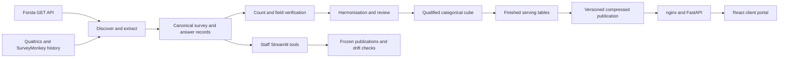

# Product and data reconstruction

## What customers can do

The client portal is a React and TypeScript application, served by FastAPI and optionally nginx. It exposes the survey library, question search, launch schedule, per-wave overview, question exploration, banner/two-cut cross-tabs, trends, wave comparison, change detection and questionnaire preview. Staff use a separate Streamlit surface for analysis, mappings, data health and frozen publications.

The local library displayed **371 surveys and waves**, **268 weekly tracker waves**, **103 annual/ad hoc studies**, and approximately **190k qualified respondent records across waves**. Its newest displayed tracker was 19 October 2026, wave 415, n=400. These are observed interface values, not an independently reconciled database inventory. Respondent totals across waves must not be called unique people without cross-wave identity evidence.

`PRODUCT.md` still describes 144+ waves/71k respondents while README and the runtime show a later scope. Older performance and reconciliation results in repository documents are historical measurements. A generated, release-pinned inventory should replace copied headline counts.

## How a wave becomes a customer result

Detailed code anchors are in [backend evidence](backend-evidence.md). Source-platform integrations retrieve answers; CIP does not operate its own consumer panel or retailer transaction network.

1. Forsta discovery registers surveys, fieldwork/quota states and load eligibility. The extraction client is GET-only. Planned schedules/polling are used rather than assuming provider webhooks.
2. Long-form storage retains survey, question, grid item, option, field, qualified respondent, profile and answer records. Categorical, numeric and text fields can be stored.
3. Loader verification checks incoming respondent/field/nonempty answer counts. Separate reconciliation compares answer values. Those are different assurance levels.
4. Harmonisation links exact compatible wordings/types/options to concepts and proposes uncertain matches for staff. Confirmed concept/answer mappings contribute to cross-wave compatibility.
5. Cohort rules support AND/OR/NOT, asked/answered semantics and confirmed concept responses in the backend. React currently exposes fixed demographic choices rather than the full behavioral audience builder.
6. The fast cube is categorical and unweighted. It records distinct answering bases, categorical counts and standard demographic cuts. Stored weight tables are not an implemented weighted serving pipeline.
7. `srv_wave`, `srv_result` and `srv_answer` support ready-to-render results and ad hoc two-cut aggregation. Server cache bytes and build admission are bounded.
8. Publishing writes compressed immutable files into a new build and swaps a pointer atomically. Optional Azure backup code exists; this audit did not execute a backup/restore.
9. Frozen analyst publications store definitions/cells/footnotes and can detect later numerical drift. This is a useful foundation for a future client report workspace.

## What a percentage means

A question percentage is selected respondents divided by that question's answering base, potentially by grid row and demographic cut. Multi-select shares can sum above 100%. “Qualified respondents”, “asked”, “answered”, “selected” and “mentions” are not interchangeable.

The repository's current policy is unweighted percentages, caution below n=50, and suppression below n=30 on selected paths. Unweighted is a declared analytical choice; a product gap exists when customers need calibrated population estimates or when labels imply population accuracy beyond the design. A conventional z-test/MOE assumes a sampling model; it does not prove an opt-in panel is representative.

Comparison guards use wording/concepts and routing/base flags. What Changed uses Benjamini–Hochberg correction. Other markers and dashboard text use simpler significance policies. Letter tests across overlapping banners need correction before automated claims expand.

## Access and operations

FastAPI uses a signed, expiring `cip_session`; local sign-in is explicitly guarded by LOCAL. Streamlit has a separate session/OIDC implementation. The production identity bridge, revocation and differentiated dataset policy are not established by this checkout's client API.

The API checks product strings on dashboard handling, while general dataset routes and nginx's published-file check lack equivalent resource policy. This is a launch-blocking design question for restricted subscriptions and confidential client studies.

The existing local process was left running. REA used its documented development sign-in and read workflows only. Its library rendered, but Trends showed Portal Notice and Compare returned 404. Current source and the running backend were not proven to be the same release.

## Evidence coverage by aspect

| Aspect | Investigated | Remaining boundary |
|---|---|---|
| User journeys and navigation | All React route families traced; six wave routes captured | Every question/filter/device was not exercised |
| Data source and ETL | Source-to-serving code and tests | No new provider/database reconciliation |
| Statistical treatment | Bases, tests, FDR, comparability, weighting, suppression | Sample design, repeat-panel overlap and calibration inputs |
| Governance | Session, product restriction, static delivery, saved/frozen outputs | Actual deployment and contracted tenant rules |
| Operations | Publication, cache/admission, backup code, grants | Live recovery, uptime, capacity and service accounts |
| Market capabilities | 23 official public product entries | Paid tenant behavior, negotiated pricing and proprietary engines |
| Strategy | Two Council passes and implementation gates | Customer willingness to pay and business outcomes remain experiments |

