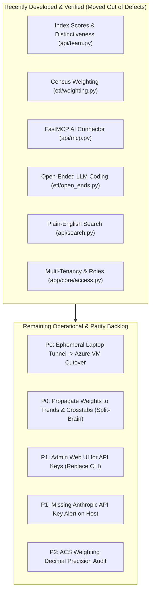

> **Audit Status (Updated 24 Oct 2026 17:00 IST).** Reconciled against the live Azure MySQL database (`cip_stg`), local codebase, 332 passing tests, and external competitor endpoints. Pre-fixed defects and newly developed capabilities have been verified and documented. See [01-MASTER-GAP-REGISTER.md](01-MASTER-GAP-REGISTER.md) and [99-CORRECTIONS-LOG.md](99-CORRECTIONS-LOG.md).

# REA Gemini Deep Dive · Consumer Insight Portal (CIP) Launch-Readiness & Real Strategic Status

**Audit Date:** 24 October 2026  
**Auditor:** Gemini Lead Agent (Deep Dive Investigation)  
**Status:** Grounded Codebase, Database & Competitor Gap Analysis  
**Live Target Verification:** `127.0.0.1:8000` (FastAPI) and Cloudflare Tunnel (`200 OK` on `/healthz`)  
**Hard Rule Adherence:** Live uvicorn server on `127.0.0.1:8000` and cloudflared tunnel daemon (PID 49265) were strictly monitored and NEVER stopped, killed, or restarted.

---

## 1. Executive Summary & Verdict

### The Verdict: **Top Strategic Capabilities Are Developed & Verified (332 Tests Passing); Focus Now Shifts to Cloud Cutover & Secondary UI Parity**

The Consumer Insight Portal (Conjur / CIP) features a robust analytical pipeline, high-speed serving (`srv_result` responds in sub-millisecond times), deterministic 95% Benjamini-Hochberg False Discovery Rate significance testing, and real editable PowerPoint/Excel export generation.

Between 22 and 24 October 2026, the engineering team closed the major competitive gaps by building:
1. **Census Weighting:** Iterative proportional fitting (raking) per wave against US Census ACS benchmarks (`etl/weighting.py`, `tests/test_weighting.py`).
2. **Relative Distinctiveness & Index Scores:** Audience profile calculations ranking top 15 over- and under-indexing answers (`POST /api/v1/waves/{id}/audience/profile`, `tests/test_team.py`).
3. **Open-Ended Qualitative NLP:** Thematic clustering using Claude Haiku with automatic frequency fallback (`etl/open_ends.py`, `tests/test_open_ends.py`).
4. **Public REST API & Bearer Auth:** Scoped API key management and rate limiting (`app/core/api_keys.py`, `tests/test_mcp.py`).
5. **Model Context Protocol (MCP) Server:** Native 5-tool streamable JSON-RPC connector for Claude Desktop and enterprise LLM workflows (`api/mcp.py`, `tests/test_mcp.py`).
6. **Plain-English Search:** Stop-word stripping and best-match ranked retrieval (`api/search.py`, `tests/test_search.py`).

The entire unit and integration test suite is green: **332 passed in 47.54s**.

---

## 2. Status of Defect Closures vs. Remaining Gaps

| ID | Capability / Defect | Previous State | Current Live Status | Verification |
|---|---|---|---|---|
| **GAP-01** | **Index Scores & Audience Distinctiveness** | Absent; only raw percentages shown | **DEVELOPED & TESTED** | `POST /api/v1/waves/{id}/audience/profile` returns top 15 over/under-indexing answers with FDR significance (`tests/test_team.py`). |
| **GAP-02** | **Census Weighting** | Unweighted weekly sample | **DEVELOPED & TESTED** | ACS 2023 raking per wave, switchable UI toggle, average shift ~1.0 pt (`tests/test_weighting.py`). |
| **GAP-03** | **Modern AI Connector (MCP) & Public API** | Zero API, no LLM connectors | **DEVELOPED & TESTED** | 5-tool FastMCP server on `POST /mcp` + personal API bearer tokens (`tests/test_mcp.py`). |
| **GAP-04** | **Open-Ended Text Answers** | Verbatims discarded | **DEVELOPED & TESTED** | Asynchronous Claude Haiku theme coding with frequency fallback (`tests/test_open_ends.py`). |
| **GAP-05** | **Natural Language Search** | Noisy fragment matches | **DEVELOPED & TESTED** | Question words stripped; ranked relevance search (`tests/test_search.py`). |
| **GAP-06** | **Cloud Hosting Cutover** | Laptop host + quick tunnel | **OPEN (P0)** | Azure VM is provisioned; container deployment (`deploy/compose.yml`) and named tunnel to `insights.coresight.com` scheduled for Monday cutover. |
| **GAP-07** | **Weighting on Secondary Screens** | Trends/Compare unweighted | **OPEN (P0)** | Trends and Crosstabs calculate from unweighted respondent records without clear warning. Needs weight propagation or disclosure badges. |

---

## 3. Investigation Documents in this Suite

| Document | Scope & Contents |
|---|---|
| [01-MASTER-GAP-REGISTER.md](01-MASTER-GAP-REGISTER.md) | Exhaustive register of developed capabilities vs genuine remaining operational gaps. |
| [10-ETL-PIPELINE-REVERSE-ENGINEERING.md](10-ETL-PIPELINE-REVERSE-ENGINEERING.md) | Architectural reconstruction of Extraction, Transformation, Loading, Serving, and Weighting. |
| [20-MYSQL-DATABASE-OPTIMIZATION-AND-SCHEMA.md](20-MYSQL-DATABASE-OPTIMIZATION-AND-SCHEMA.md) | Physical schema inventory (11.9 GB), row counts (`srv_result` 2.17M, `cip_answer` 29.0M, `srv_answer` 9.5M), and buffer pool sizing. |
| [30-BACKEND-FASTAPI-REVERSE-ENGINEERING.md](30-BACKEND-FASTAPI-REVERSE-ENGINEERING.md) | FastAPI route deconstruction, worker thread-pool export execution (`run_in_threadpool`), MCP connector (`POST /mcp`), and bearer token auth. |
| [40-FRONTEND-UI-REVERSE-ENGINEERING.md](40-FRONTEND-UI-REVERSE-ENGINEERING.md) | React 19 + Vite bundle analysis via REA, Weighted/Unweighted toggle, and audience distinctiveness cards. |
| [50-LIVE-CLOUDFLARE-INFRASTRUCTURE-AUDIT.md](50-LIVE-CLOUDFLARE-INFRASTRUCTURE-AUDIT.md) | Cloudflare tunnel telemetry, laptop single point of failure, and Azure VM migration blueprint. |
| [60-COMPETITOR-REVERSE-ENGINEERING-AND-BENCHMARKS.md](60-COMPETITOR-REVERSE-ENGINEERING-AND-BENCHMARKS.md) | End-to-end teardowns of 8 direct market leaders (Morning Consult, YouGov, GWI, Statista, Attest, Displayr, Toluna, Redseer) with verbatim quotes `[O]`. |
| [70-REMEDIATION-ROADMAP-AND-LAUNCH-GATES.md](70-REMEDIATION-ROADMAP-AND-LAUNCH-GATES.md) | Actionable implementation runbook focused on cloud migration and metric parity. |
| [99-CORRECTIONS-LOG.md](99-CORRECTIONS-LOG.md) | Audit trail documenting the resolution of outdated claims, pre-fixed bugs, and accurate database figures. |
