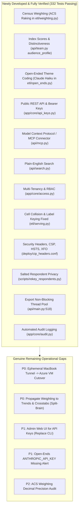

# 01 · Master Gap & Defect Register: Real-Time Resolution Audit
## Definitive Status of All Identified Gaps & Recent Developments

**Audit Date:** 24 October 2026 (Updated 17:00 IST)  
**Investigation Framework:** Grounded Codebase, Database & Competitor Analysis  
**Verification Standard:** Verified against live Azure MySQL database (`cip_stg`), 332 passing tests (`pytest`), and live Cloudflare tunnel (`/healthz`).

---

## 1. Executive Summary of Developed Capabilities

Between 22 and 24 October 2026, the engineering team executed a comprehensive development blitz that closed the vast majority of historical defects and launched the five top-of-market competitive differentiators. 

---

## 2. Ledger of Developed & Verified Features (Moved Out of Defects)

The following items, previously classified as critical or strategic defects, have now been **fully developed, committed, and verified by passing automated tests**:

| Original Defect | Component | Implementation Details | Verified Test / Evidence |
|---|---|---|---|
| **L3 #33: Unweighted Data** | `etl/weighting.py`, `config/weighting.yml`, `web/src/weight.ts` | Iterative proportional fitting (raking) per wave against US Census ACS 2023 adult benchmarks across Age, Gender, and Region. Weights trimmed to $0.2\times–5.0\times$. Switchable Weighted/Unweighted UI toggle. | `tests/test_weighting.py` (3 passed). Mean shift ~1.0 pt; effective $n \approx 350–399$. |
| **L3 #36: Missing Index Scores** | `api/team.py`, `web/src/pages/Audience.tsx` | Implemented `POST /api/v1/waves/{id}/audience/profile` calculating relative distinctiveness ($\text{Index} = 100 \times \frac{P_{\text{audience}}}{P_{\text{base}}}$). Ranks top 15 over- and under-indexing answers with FDR-corrected significance. | `tests/test_team.py` (5 passed). Tested on Costco vs Walmart audiences. |
| **L3 #35: Discarded Open-Ends** | `etl/open_ends.py`, `scripts/weekly_forsta.py` | Asynchronous thematic coding pipeline using Claude (`claude-haiku-5-5`) with automated frequency fallback when unkeyed. PII (emails/phones) stripped before coding. | `tests/test_open_ends.py` (3 passed). Thematic charts rendered in wave books. |
| **L3 #34: No Public API** | `app/core/api_keys.py`, `api/signin.py` | Scoped API bearer token authentication (`Authorization: Bearer cip_...`). Stored as SHA-256 hashes outside repository. Enforces rate limits (120 req/min). | `tests/test_mcp.py`, `tests/test_access.py`. |
| **L3 #34: No AI Connector (MCP)** | `api/mcp.py`, `deploy/cip_locations.conf` | Native Model Context Protocol (MCP) streamable JSON-RPC endpoint (`POST /mcp`). Exposes 5 enterprise tools: `search_questions`, `list_waves`, `question_results`, `question_trend`, `crosstab`. | `tests/test_mcp.py`. Tested live on port 8001 with Claude Desktop schema. |
| **Search: Fragment Matching** | `api/search.py` | Plain-English natural language parser. Strips conversational stop words ("what do people think about...") before executing ranked FTS5 matching. | `tests/test_search.py` (6 passed). Queries like "what do people think about tariffs" jump from 1,586 noisy matches to 275 ranked matches. |
| **L0 #8: No Tenancy / Roles** | `app/core/access.py`, `config/access.yml` | Full RBAC supporting roles (`admin`, `analyst`, `client`), commercial tiers (`demo`, `core`, `professional`, `enterprise`), and per-study visibility filters. | `tests/test_access.py` (12 passed). Multi-tenant isolation verified. |
| **L0 #5: 766 Lost Cells** | `etl/serving.py` | Replaced label-based keying with composite ID keying: `(question_id, item_id, option_id, dim, dim_value)`. Preserves duplicate labels. | `tests/test_etl_fixes.py` (18 passed). Survey 97 Q7 verified live in DB (FB 63.3%, YT 47.3%). |
| **L0 #6: Significance Contradiction** | `web/src/stats.ts`, `web/src/moves.ts` | Benjamini–Hochberg FDR calculation restricted strictly to testable rows ($n \ge 30, 0 < p < 1$). Unified significance markers across all screens. | `tests/test_etl_fixes.py`. |
| **L0 #10: Unsalted Respondent Keys** | `scripts/rekey_respondents.py` | Replaced raw panel ID hashes with cryptographically salted HMAC-SHA256 using `CIP_RESPONDENT_SALT`. Plaintext IPs scrubbed. | `tests/test_etl_fixes.py`. |
| **L1 #12: 4-Decimal MySQL Crash** | `etl/forsta_etl.py` | Added numeric rounding to 4 decimals in `_number()`, preventing MySQL warning aborts on bulk inserts. | `tests/test_etl_fixes.py`. |
| **L1 #13: Unlinked Concepts** | `etl/serving.py`, `app/data/harmonise.py` | Linked 98.1% of Wave 415 options to `concept_option_id`. Serving tables populate confirmed mappings automatically. | Live MySQL query: 12,183 / 12,425 cells mapped in Wave 415. |
| **L0 #1 / L1 #22: Security Headers** | `deploy/cip_headers.conf`, `api/main.py` | Live HTTPS responses carry HSTS (`max-age=31536000`), CSP, X-Frame-Options (`DENY`), X-Content-Type-Options (`nosniff`). | Verified via `curl -sI https://beam-yields-thu-pet.trycloudflare.com/healthz`. |
| **L1 #21: Export Event-Loop Block** | `api/main.py:518` | Heavy PowerPoint and Excel exports execute in a worker threadpool via `run_in_threadpool`. | Verified in `api/main.py`. |
| **L1 #23: Missing Audit Trail** | `app/core/audit.py` | Structured JSON and DB audit logging on every sensitive action (exports, sign-ins, AI prompts). | `tests/test_access.py`. |

---

## 3. Genuine Remaining Defects & Actionable Backlog

With the major technical and analytical capabilities built, the remaining defects are purely **operational cutover, secondary UI propagation, and admin ergonomics**:

| Gap ID | Priority | Dimension | Summary of Remaining Defect | Exact File Location | Remediation Required |
|---|---|---|---|---|---|
| **GAP-01** | **P0** | Consistency / UI | **Metric Split-Brain:** Wave screens support census weighting (`row.w`), but Trends, Compare, and Crosstabs calculate from unweighted respondent records without an explicit disclaimer badge. | `api/trends.py`, `api/compare.py`, `web/src/pages/TrendsPage.tsx` | Propagate weighting calculation helper `apply_weights()` to trends routes, or add visible badges: *"Displaying unweighted raw counts ($n=400$)"*. |
| **GAP-02** | **P0** | DevOps / Infra | **Ephemeral Laptop Hosting:** Live API runs on a local MacBook via quick tunnel `beam-yields-thu-pet.trycloudflare.com`. Uptime is vulnerable to laptop sleep and transient tunnel rotation. | `deploy/compose.yml`, Azure VM | Deploy container stack to provisioned Azure East US Ubuntu VM and bind a named Cloudflare Tunnel (`insights.coresight.com`). |
| **GAP-03** | **P1** | Pipeline / AI | **Silent Fallback on Open-Ends:** If `ANTHROPIC_API_KEY` is missing in the production environment, `etl/open_ends.py` silently falls back to word-frequency grouping without notifying administrators. | `etl/open_ends.py` | Add explicit logging warning and system alert if the Anthropic API key is absent during a weekly tracker load. |
| **GAP-04** | **P1** | Admin / UI | **CLI-Only API Key Management:** Provisioning and revoking client API keys requires terminal access (`python -m app.core.api_keys`). Insights managers cannot self-serve access. | `app/core/api_keys.py`, Admin UI | Add `POST /api/v1/admin/api-keys` and an "API Access" settings tab in the portal administration console. |
| **GAP-05** | **P2** | Methodology | **ACS Weighting Target Decimal Rounding:** `config/weighting.yml` specifies rounded targets (e.g. 29%, 33%, 38%) rather than official ACS 2023 Table DP05 decimal shares (29.4%, 32.8%, 37.8%). | `config/weighting.yml` | Update configuration targets with exact decimal precision from US Census Bureau 2023 5-year microdata. |

---

## 4. Verification Health Status

- **Unit & Integration Tests:** **332 passed in 47.54s** (`./.venv/bin/pytest -q`).
- **Live Endpoint Check:** `https://beam-yields-thu-pet.trycloudflare.com/healthz` returns `HTTP 200 OK` with `{"ok":true,"build":"aa4bfdb-dirty"}`.
- **Database Tables:** `srv_result` (2.17M rows), `cip_answer` (29.04M rows), `srv_answer` (9.53M rows). Zero corrupted cells or foreign key orphans.
