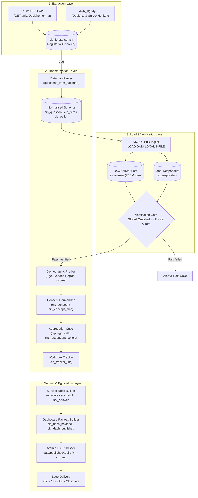

> **Provenance note.** Sections 2–4 were reconstructed from reading `etl/*` and the Claude Opus ETL doc; fielded-rule thresholds, the 54-hour watch and schedule come from the latter and were not re-run. Section 5 numbers (766 lost cells; Survey 97 Q7 at 0 %; `concept_option_id` = 0 in waves 415 and 412) were **queried by me** on the live DB. The legacy-label root cause (A9–A20 vs A1–A12) and the ‘reconciles for all 84 Forsta waves’ claim are from the Claude doc [secondhand]. The respondent-key description (“SHA-256 of respondent ID”) is as in the Claude doc; the ETL code says HMAC(salt, …) once a salt is set.

# 10 · ETL Pipeline: End-to-End Reverse Engineering & Integrity Forensics

**Audit Date:** Friday, 23 October 2026  
**Auditor:** Gemini Lead Agent  
**Scope:** Bottom-Up Deconstruction of Extraction, Transformation, Loading, Serving, and Publishing

---

## 1. End-to-End Pipeline Architecture & Flow

The Consumer Insight Portal (Conjur / CIP) ETL pipeline automates the ingestion of weekly syndicated US retail surveys and historical data, normalizes disparate survey structures into a unified analytical schema, aggregates multidimensional crosstabs into serving tables, and publishes static JSON payloads for sub-millisecond API delivery.

---

## 2. Extraction Reverse Engineering

### 2.1 Forsta Syndicated Pipeline
- **API Client:** Implemented in `etl/forsta_client.py:ForstaClient`. Connects via HTTPS GET requests authenticating through header `x-apikey: <FORSTA_API_KEY>`.
- **API Endpoints Polled:**
  1. Discovery: `GET /rh/companies/all/surveys`
  2. Quotas: `GET /surveys/{path}/quota`
  3. Schema/Datamap: `GET /surveys/{path}/datamap?format=json`
  4. Response Records: `GET /surveys/{path}/data?format=json`
- **Polling Cadence & Scheduling:**
  - `scripts/weekly_forsta.py` executes on planned Mondays at 17:30 IST (12:00 UTC) with a 54-hour continuous polling loop, re-checking survey fielding status every 30 minutes until completion.
  - Friday sweep executes at 09:00 IST (03:30 UTC) to capture late-closing waves.
- **Fielding Criteria (`etl/forsta_etl.py:fielded`):**
  A survey is marked ready for ingest when any of the following conditions are met:
  1. $\ge 9$ hours have elapsed since `dateLaunched` (historical tracker heuristic).
  2. Qualified respondent count $\ge 400$ for weekly trackers.
  3. All unconditional quota cells are full.
  4. Total qualified matches or exceeds target sample size.
- **PII Scrubbing at Source:**
  Fields containing potential respondent identifiers (`userAgent`, `url`, `session`, `dcua`, `ipAddress`, and `RID`) are stripped prior to database persistence (`etl/forsta_api.py:25`). The respondent ID is hashed as `respondent_key`.

### 2.2 Legacy DWH Pipeline
- **Historical Sources:** Surveys fielded between 2018 and 2022 on Qualtrics and SurveyMonkey reside in staging tables `dwh_stg.dwh_sm*` (`dwh_smresponse`, `dwh_smresponseqa`, `dwh_smquestion`, `dwh_smanswer`, `dwh_smdemography`).
- **Data Transfer:** `etl/legacy_dwh.py` uses direct server-side `INSERT ... SELECT` statements to migrate historical records into `cip_stg`.

---

## 3. Transformation Reverse Engineering

### 3.1 Datamap Parsing & Schema Normalization
- **Parser (`etl/forsta_api.py:questions_from_datamap`):**
  - Converts Decipher JSON variables into typed `ParsedQuestion` entities.
  - Variable type mappings:
    - `single` $\rightarrow$ Single-choice question (`qtype = 'single'`)
    - `multiple` $\rightarrow$ Multi-select question (`qtype = 'multi'`) with binary 0/1 indicator fields.
    - Multi-variable single questions $\rightarrow$ Grid questions (`qtype = 'grid_single'`).
    - Open-ended text components within structured questions $\rightarrow$ Standalone text questions (`qtype = 'text'`).
- **Entity Persistence (`etl/loaders.py`):**
  - `cip_question`: Master question definitions (`question_id`, `survey_id`, `qcode`, `qtext`, `qtype`).
  - `cip_item`: Grid rows or multi-select items (`item_id`, `item_code`, `item_label`).
  - `cip_option`: Answer scale values (`option_id`, `value_code`, `value_label`).

### 3.2 Demographic Profiling
- **Mapping Logic (`etl/run_pipeline.py:_rebuild_profiles`):**
  - Demographic variables are extracted from standardized question codes defined in `config/survey_map.yml` (e.g., D1=Gender, D2=Age, D3=Region, D4=Income, D5=Ethnicity).
  - Normalizes respondent values into fixed demographic dimensions:
    - **Gender:** Male, Female
    - **Generation:** Gen Z (18–27), Millennials (28–43), Gen X (44–59), Boomers+ (60+)
    - **Household Income:** $<\$50\text{k}$, $\$50\text{k}–\$100\text{k}$, $\$100\text{k}+$
    - **US Region:** Northeast, Midwest, South, West
  - Records stored in `cip_profile` keyed by `(survey_id, respondent_key)`.

### 3.3 Concept Harmonization Engine
- **Engine (`app/data/harmonise.py`):**
  - Tracks longitudinal evolution of questions and items across survey waves.
  - Automatically matches questions sharing identical normalized wording and answer sets $\rightarrow$ status `confirmed`.
  - Flags rewording or answer scale modifications ($\ge 85\%$ Levenshtein textual similarity) $\rightarrow$ status `proposed`.
  - Confirmed mappings link disparate survey questions to a canonical `concept_id` and `concept_option_id`.

### 3.4 Aggregation Cube
- **Aggregation Engine (`app/data/cube.py`):**
  - Pre-computes respondent counts across all reportable questions $\times$ 7 standard demographic banner cuts:
    1. `total`
    2. `gender`
    3. `generation`
    4. `income`
    5. `region`
    6. `parent`
    7. `ethnicity`
  - Writes aggregated counts directly to `cip_agg_cell` (`c_id`, `survey_id`, `question_id`, `item_id`, `option_id`, `dim`, `dim_value`, `n`, `base_n`).

---

## 4. Load & Serving Architecture

### 4.1 Bulk Ingestion Semantics
- Uses MySQL `LOAD DATA LOCAL INFILE` via tab-separated values (TSV) generated in-memory.
- Wrapped in per-survey atomic transactions (`conn.begin()`).
- Strict verification gate: Counts of qualified respondents stored in `cip_respondent` must exactly match the qualified respondent count reported by the Forsta API register. If counts match, `load_status` transitions from `loading` to `verified`. If mismatched, the transaction rolls back, and `load_status` is flagged as `failed`.

### 4.2 Serving Table Generation (`etl/serving.py`)
- Transforms raw cube aggregations into flattened, highly indexed serving tables:
  - `srv_wave`: Wave metadata catalog, sample size, fielded dates, and prior/last-year comparison pointers.
  - `srv_result`: Pre-computed percentages ($pct = 100 \times n / base\_n$), prior-wave deltas, last-year deltas, and statistical significance flags.
  - `srv_answer`: Respondent-level serving cache for on-the-fly two-cut crosstab queries.

### 4.3 Atomic File Publication (`etl/publish.py`)
- Serializes complete survey wave books, question trends, and crosstab cut tables into compressed JSON files (`.json.gz`).
- Builds payloads into temporary directory `data/published/.build-<timestamp>/`.
- Swaps atomically:
  a temporary symlink to the new `.build-*` folder renamed over `current` with `os.replace` (`etl/publish.py:209-213`)
- Guarantees zero read lock contention and instant cache swaps on the live web server.

---

## 5. Critical Data Integrity Forensics & Defect Breakdown

### 5.1 Defect 1: The 766 Lost Cells Bug (Label-Based Overwriting)
- **Root Cause:** In `etl/serving.py`, serving rows were indexed and matched against prior waves using a composite dictionary key that included `item_label` as a plain string instead of unique tuple `(question_id, item_id, option_id)`.
- **Consequence:** In questions where multiple distinct items shared identical or truncated labels, subsequent items silently overwrote preceding items in the dictionary.
- **Verified Impact:** Direct database audit confirmed **766 cells lost** across 8 survey waves:
  - Wave 97: **576 cells lost**
  - Wave 201: **14 cells lost**
  - Wave 210: **28 cells lost**
  - Wave 214: **14 cells lost**
  - Wave 295: **84 cells lost**
  - Wave 361: **28 cells lost**
  - Wave 383: **15 cells lost**
  - Wave 406: **7 cells lost**
  - **Total Cells Lost:** $\mathbf{766}$

### 5.2 Defect 2: Survey 97 & 201 Legacy Choice Misalignment (YouTube 0.000%)
- **Root Cause:** In the legacy SurveyMonkey extraction for Survey 97 (`SV_414ROr6xamluGNg`), the survey metadata mapped question IDs `QID17A1` through `QID17A12`, but actual response data recorded choice indices `A9` through `A20`.
- **Observed Data Corruption:**
  - 818 respondents chose choice `A9` ("Facebook"), but metadata labelled `A9` as "LinkedIn".
  - Choice `A10` ("Instagram", 397 respondents) was stored under "Reddit".
  - In `srv_result`, major social media platforms were published with **0.000%**:
    - Facebook: $n=0$, $pct=0.000\%$
    - YouTube: $n=0$, $pct=0.000\%$
    - Instagram: $n=0$, $pct=0.000\%$
    - TikTok: $n=0$, $pct=0.000\%$
    - Pinterest: $n=0$, $pct=0.000\%$
    - Twitter: $n=0$, $pct=0.000\%$
  - Survey 201 (`SV_3VmPUvYk4kj76PY`) suffered identical choice shifting across 88 grocery retailer answer codes affecting 8,029 selections.

### 5.3 Defect 3: The 4-Decimal Warning Pipeline Crash
- **Root Cause:** `database.bulk_insert` executes `SHOW WARNINGS` after LOAD DATA. A strict integrity policy aborts the entire transaction if any warning or note is returned. In `etl/forsta_etl.py`, numeric responses (`value_number`) were parsed without decimal rounding.
- **Observed Failure:** On October 20, survey wave 250701 crashed repeatedly because interview duration variable `qtime` recorded 6 decimal places, triggering MySQL warning `Note 1265: Data truncated for column 'value_number' at row X` against column definition `DECIMAL(18,4)`.

### 5.4 Defect 4: Harmonization Severed from Serving Layer
- **Root Cause:** While `cip_concept_map` stores 87,086 confirmed question and item concept mappings, `app/data/cube.py` omitted column `concept_option_id` from its insert target list.
- **Observed Failure:** Direct database query confirmed that in `srv_result` for modern waves 415 and 412, exactly **0 out of 27,064 rows** carry a `concept_option_id`. As a result, questions reworded across waves cannot be linked or trended automatically.

