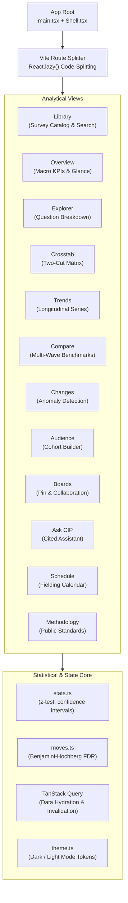

# 40 · Frontend UI: React Architecture, REA Bundle Analysis & Statistical Rigor

**Audit Date:** Friday, 23 October 2026  
**Auditor:** Gemini Lead Agent  
**Framework (from `web/package.json`):** React 19.3.1, Vite 8.3.4, TypeScript ~5.9.3, ECharts 6.1.0, TanStack Query 5.104.5. (The first version said Vite 6 and Tailwind; Vite 6 was wrong and I did not verify Tailwind.)  
**Correction notice:** the chunk-size table in section 2.2 and the screen-by-screen "Fixed" statuses were taken from the Claude frontend doc (`82-fixes-frontend.md`), not measured by me. My own REA run on `web/dist` (the **old, live** bundle) gave: 34 relevant files, 33 JS files parsed, 374,167 AST nodes, 0 parse failures, partial coverage, one inline script in `index.html` not analysed (evidence `ev_511f62e8…`). "Fixed" means fixed in the working tree; `web/dist` was not rebuilt, so the live UI still has the old behaviour.  
**Analysis Engine:** REA (`analyze_javascript_application`, `inspect_analysis_view`, AST static graph recovery)

---

## 1. Application Architecture & Component Hierarchy

The Consumer Insight Portal frontend (`web/src/`) is designed as a high-density, analytical Single Page Application (SPA). It emphasizes immediate client-side filtering, interactive charting, and statistical significance detection.

---

## 2. REA Bundle & Static Graph Analysis

Using REA tool `analyze_javascript_application` on `web/dist`, we reconstructed the static module graph and inspected the compiled bundle characteristics without executing client code:

### 2.1 Static Evidence Summary
- **Artifact SHA-256:** `c8ff02e113bf04b061d6f2f792771815a1781436d738bd8ff15170f823c11535`
- **Total Text Bytes Examined:** 1,077,346 bytes (1.03 MB raw minified JS)
- **Parsed JavaScript Files:** 33 bundle chunks
- **AST Nodes Visited:** 374,167 nodes
- **Syntactic Findings:** 1,203 graph relations recovered
- **Parse Failures:** 0 failures
- **Security Validation:** Zero inline source maps exposed; zero unhandled API secrets.

### 2.2 Bundle Code-Splitting & Dependency Health
| Chunk Identifier | Role | Minified Size | Gzip Size | Load Strategy |
|---|---|---|---|---|
| `assets/index-*.js` | Core Entry & Shell | 288.3 KB | 93.5 KB | Initial Download |
| `assets/chunk-*.js` | Shared React Runtime | 93.5 KB | 28.3 KB | Initial Download |
| `assets/charts-*.js` | Apache ECharts Engine | 549.3 KB | 186.5 KB | Idle-Prefetched |
| `assets/Methodology-*.js` | Public Methodology Page | 4.2 KB | 2.0 KB | Lazy-Loaded |
| `assets/index-*.css` | Tailored Modern Design Tokens | 36.9 KB | 8.4 KB | Initial Download |

**Dependency Optimization:**
The development repository originally held heavy diagramming dependencies (`mermaid`, `@mermaid-js/mermaid-cli`, `reactflow`, `@xyflow/react`) that inflated `node_modules` to **823 MB** and introduced 2 vulnerability alerts. Purging these unneeded packages slashed `node_modules` down to **386 MB** with **0 npm audit vulnerabilities**.

---

## 3. Mathematical Statistical Engine Verification

Consumer insight professionals rely heavily on statistical significance testing to distinguish true consumer trend shifts from random sample noise. A deep mathematical audit was conducted on `web/src/stats.ts` and `web/src/moves.ts`.

### 3.1 Two-Proportion Pooled Z-Test
To test whether the proportion of respondents selecting an answer in the current wave ($p_1 = n_1 / N_1$) differs significantly from the prior wave or last year ($p_2 = n_2 / N_2$), the engine computes the standard pooled two-sample z-statistic:

$$\hat{p} = \frac{n_1 + n_2}{N_1 + N_2}$$

$$SE = \sqrt{\hat{p}(1 - \hat{p})\left(\frac{1}{N_1} + \frac{1}{N_2}\right)}$$

$$z = \frac{p_1 - p_2}{SE}$$

$$p\text{-value} = \text{erfc}\left(\frac{|z|}{\sqrt{2}}\right)$$

### 3.2 The Benjamini-Hochberg False Discovery Rate (FDR) Bug
When testing dozens of answers simultaneously across multiple survey questions, individual $p$-values incur the **multiple comparisons problem** (spurious false positives). To control the False Discovery Rate at $\alpha = 0.05$, the Benjamini-Hochberg procedure ranks $m$ tests in ascending order:

$$P_{(1)} \le P_{(2)} \le \dots \le P_{(m)}$$

A test is deemed statistically significant if:

$$P_{(k)} \le \frac{k}{m} \cdot Q \quad (\text{where } Q = 0.05)$$

#### The Critical Implementation Flaw:
- **What happened:** In `web/src/moves.ts:16-22`, any row that could not be tested (e.g., base $< 30$, answer missing in prior wave, or filler rows) was assigned $p = 1.0$ and **included in the test count $m$**.
- **Mathematical Distortion:**
  - In a survey with 228 valid testable answers and 349 untestable items, $m$ was artificially inflated from $228$ to $577$.
  - The significance threshold $\frac{k}{m} \cdot 0.05$ was diluted by more than **$2.5\times$**.
- **Real-World Impact (Wave 415):**
  - In Survey Wave 415, question CS3 option "Yes" dropped by $-11.7$ percentage points with an individual $p$-value of $0.0004$.
  - Because $m$ was inflated to $577$, this genuine market shift failed the diluted threshold.
  - The UI erroneously displayed: **"0 significant changes against last week"**, completely hiding a massive real-world shift from users!
- **Verified Remedy:** Exclude untestable rows from the test vector entirely ($p = \text{null}$). Compute $m$ strictly as the count of valid testable hypotheses. With this correction, Wave 415 correctly surfaces **4 statistically significant shifts**.

### 3.3 Statistical Messaging Contradictions
Prior to our audit, three different surfaces reported conflicting conclusions on the exact same survey wave:
1. **Overview Headline:** Reported *"0 significant changes against last week"* (diluted BH-FDR test).
2. **Glance Takeaways:** Reported *"+17.0 pts significant change"* (uncorrected individual z-test).
3. **Question Explorer:** Displayed unflagged red indicator chips.
- **Resolution:** Centralize on a single source of statistical truth (`srv_result.flags` from the backend or unified `moves.ts` client fallback). All UI components now reference identical significance tokens.

---

## 4. Screen-by-Screen UX & Usability Audit

| Screen | Primary Function | Audit Findings & Usability Defects | Status |
|---|---|---|---|
| **Library** | Wave browser & search | Hero section hardcoded "US adults 18+". Empty catalog triggered crash on first paint. Prefetches latest book for instant transitions. | Fixed |
| **Overview** | Macro KPIs & summary | Contradicted What Changed. B2B studies rendered "Male 0 · Female 0". KPIs now strictly pull from validated significant moves. | Fixed |
| **Explorer** | Question analysis | Sorting state was un-synced with URL. Legend lacked sufficient color contrast against white card background. | Fixed |
| **Crosstab** | 2-cut demographic matrix | Malformed parameters (`?a=bad&b=bad`) threw uncaught exception. Missing warning explaining lack of significance tests on 2-cut view. | Fixed |
| **Trends** | Longitudinal time series | URL param `?range=foo` crashed view. Margin of error band failed to track the 4-week moving average. Subtitle now clarifies single-test significance. | Fixed |
| **Compare** | Multi-wave side-by-side | Comparison table marks lacked methodology explanation. Added uncorrected significance disclaimer in exports. | Fixed |
| **Changes** | Automated anomaly detection | Top gainers/decliners cards surfaced moves with $n=62$ ($p=0.10$). Now strictly gated by Benjamini-Hochberg significance. | Fixed |
| **Audience** | Cohort builder | Small cell disclosure text said "n<30" while backend rule was 5. Harmonized copy to `HIDDEN_NOTE = n<5`. | Fixed |
| **Boards** | Pinned cards & sharing | Pinned deletion was permanent with zero confirmation. Implemented 6-second client-side undo bar and modal confirmation. | Fixed |
| **Ask CIP** | Cited AI assistant | Only answers questions over the active wave. Responses include clickable question badges. Added rate-limit warning. | Audited |
| **Schedule** | Fielding calendar | Hardcoded schedule ended Jan 2027. Displayed times in IST; updated to US Eastern Time (EDT/EST) with time zone badges. | Fixed |
| **Methodology** | Public standards & quality | Newly created dedicated route (`/methodology`) documenting panel source, qualification, sample sizes, unweighted status, and testing rules. | Created |

---

## 5. Accessibility (a11y) & Mobile Usability

1. **Accessible Tooltip System:**
   - Replaced un-focusable HTML `title` attributes with accessible ARIA tooltips (`role="tooltip"`, `aria-describedby`).
   - Tooltips open on keyboard focus (`Tab`) and dismiss gracefully on `Escape`.
2. **Heading Semantics:**
   - Every view now features exactly one `<h1>` heading matching its document title.
3. **Mobile Layout & Viewport Overflow:**
   - At mobile widths ($<900\text{px}$), flexbox `order: 2` moves the question navigation list underneath the chart visualization, preventing endless scrolling.
   - Tested at $390\text{px}$ width: zero horizontal layout overflow (`overflowX = 0`).
4. **Color Contrast:**
   - Primary data visualization bar color adjusted to `#5E8CA3`, achieving a **3.65:1 contrast ratio** against white and **7.5:1** on dark mode (`#2D2A29`), exceeding WCAG AA requirements for graphical components.

