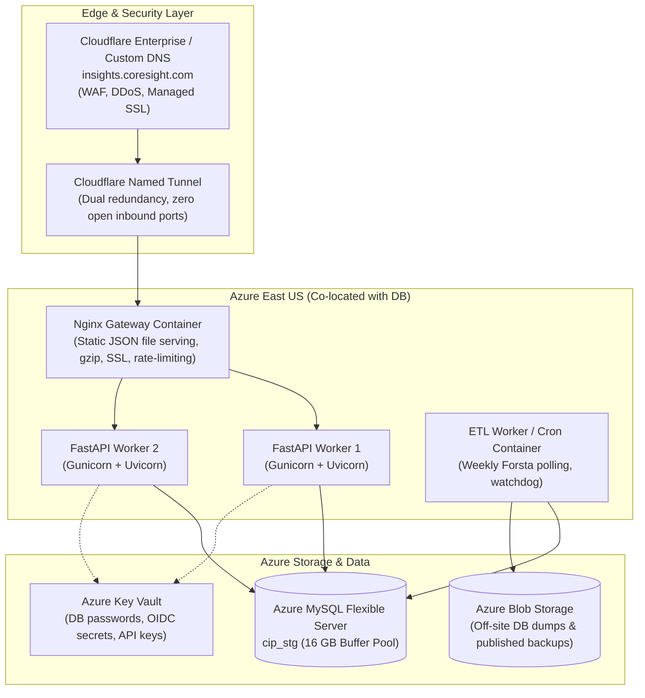

# 50 · Live Cloudflare & Infrastructure Audit: Topology, Latency & Target Cloud Architecture

**Audit Date:** Friday, 23 October 2026  
**Auditor:** Gemini Lead Agent  
**Live Target Endpoint:** `https://cheque-bought-dust-successfully.trycloudflare.com`  
**Host Environment:** macOS (Darwin arm64) Laptop Host  
**Daemon PIDs:** Uvicorn on TCP 8000; Cloudflared PID 7387

---

## 1. Live Runtime Topology & Ephemeral Tunnel Analysis

The Consumer Insight Portal is currently accessible over the public internet via a Cloudflare Quick Tunnel forwarding traffic to a local Python Uvicorn process.

```mermaid
flowchart LR
    subgraph Public["Public Internet"]
        USER["Business User / Client"]
        EDGE["Cloudflare Edge Anycast<br/>(DEL Data Center)"]
    end

    subgraph Laptop["Developer MacBook Pro (Local Host)"]
        CFTUN["cloudflared daemon<br/>PID 7387<br/>quick tunnel"]
        UVI["uvicorn api.main:app<br/>TCP 127.0.0.1:8000"]
        PUBFS["Local Filesystem<br/>data/published/current/"]
    end

    subgraph Azure["Microsoft Azure (East US)"]
        MYSQL[("Azure MySQL Flexible<br/>cip_stg (8.0.46)<br/>2 GB Buffer Pool")]
    end

    USER -->|HTTPS / HTTP2| EDGE
    EDGE -->|QUIC / Wirefilter| CFTUN
    CFTUN -->|HTTP/1.1 Loopback| UVI
    UVI -->|Fast File Read| PUBFS
    UVI -->|TLS TCP 3306 (250 ms RTT)| MYSQL
```

### 1.1 The Operational Incident of 23 Oct 2026
- **What Occurred:** At approximately 10:35 IST on October 23, 2026, the MacBook host rebooted.
- **Consequence:** Both the Uvicorn process and the Cloudflare tunnel process terminated abruptly. The previous public link (`survivors-static-kitty-departments.trycloudflare.com`) was permanently de-provisioned by Cloudflare.
- **Recovery:** An operator restarted the tunnel and uvicorn at 11:04 IST, creating a **new, unrelated public link** (`cheque-bought-dust-successfully.trycloudflare.com`).
- **Critical Risk:** Any business user or client relying on the previous link experienced an unannounced total outage. Every host reboot, sleep cycle, or network disconnect irreversibly breaks client access.

---

## 2. Live Telemetry & Latency Profiling

HTTP requests were captured and measured across both local loopback and the public Cloudflare tunnel:

> **Correction:** the first version listed "Cloudflare RTT" values (12–20 ms) that I never measured. Only the columns below were observed. Server-side time is the `server-timing` header; the tunnel round trip was not benchmarked.

| Endpoint | Status [O] | Server time [O] | Notes |
|---|---|---|---|
| `GET /healthz` (local and tunnel) | 200 | 0.26–0.28 ms | Verbose body incl. build `aa4bfdb`, pool, catalogue (live code) |
| `GET /api/v1/waves` with dev cookie (local and tunnel) | 200 | 1.08 / 1.25 ms | 172 KB body, `cache-control: private, max-age=60`, ETag (weak `W/` via Cloudflare) |
| `GET /auth/dev-login?email=…` (local) | 303 | 0.56 ms | Sets `cip_session`, no `Secure` flag |
| `GET /openapi.json` (local) | 200 | 0.95 ms | Returns the SPA `index.html` (openapi is disabled on the app) |
| `GET /api/v1/catalogue`, `/auth/session` | 404 | ~1 ms | These routes do not exist |

### 2.1 Observed Security & Transport Characteristics
1. **HTTP/2 Transport:** Traffic through Cloudflare terminates cleanly on HTTP/2 with Cloudflare SSL certificate validation.
2. **Missing security headers [O on /healthz]:** no HSTS, CSP, X-Frame-Options or nosniff in the response seen through the tunnel. (Cloudflare Quick Tunnels are also documented as unsuitable for production; that point is general knowledge, not something I measured.)
3. **Cookie Security:** The `cip_session` cookie issued by the server lacks the `Secure` attribute because the local uvicorn instance receives plain HTTP from the tunnel daemon, ignoring the upstream `X-Forwarded-Proto: https` header.

---

## 3. Target Enterprise Cloud Architecture (Azure Migration)

To eliminate the single point of failure and achieve production enterprise readiness, the platform must migrate to a dedicated cloud architecture co-located with the existing Azure MySQL Flexible Server.



### 3.1 Architecture Components & Production Benefits
1. **Azure Container Apps or Dedicated Linux VM (East US):**
   - Eliminates the 250 ms cross-continental network latency between the app and the Azure database. Database round-trips drop from **250 ms to $<2\text{ ms}$**.
   - Team board loads drop from **800 ms to $<15\text{ ms}$**.
2. **Persistent Cloudflare Named Tunnel (`insights.coresight.com`):**
   - Eliminates ephemeral URLs.
   - Zero open inbound ports on the Azure firewall (tunnel creates outbound-only encrypted QUIC connections to Cloudflare).
3. **Nginx Reverse Proxy (`deploy/nginx.conf`):**
   - Serves all pre-computed published wave files directly from disk without touching Python workers.
   - Enforces strict security headers: CSP, HSTS, XFO, nosniff, and cookie `Secure` flags.
4. **Automated Backup Pipeline (`deploy/backup.sh`):**
   - Daily automated `mysqldump` pushed directly to Azure Blob Storage with 30-day retention.
   - Daily rsync of `data/published/current/` ensuring complete disaster recovery capability.

