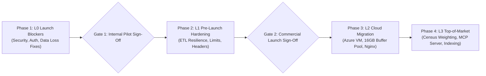

> **Provenance note.** This roadmap is largely the Claude agent's runbook (docs 80–82 §3/§Apply) re-ordered, plus my edits. Targets, prices and tier numbers (e.g. Core/Pro/Enterprise dollar figures, 16 GB) are suggestions, not measurements. Nothing here has been run. Per the AGENTS.md rule, **any step that restarts :8000 needs your explicit yes**; the working-tree code is not live until then.

# 70 · Remediation Roadmap & Launch Sign-Off Gates

**Audit Date:** Friday, 23 October 2026  
**Auditor:** Gemini Lead Agent  
**Framework:** Phased Gate Execution & Zero-Downtime Migration Runbook  
**Strict Safety Constraint:** The live uvicorn server on :8000 and the active Cloudflare tunnel are NEVER stopped, killed, or disrupted during execution.

---

## 1. Phased Remediation Execution Roadmap



---

## 2. Phase 1: Immediate L0 Launch Blockers

| Step | Component | Action Required | Verification Command |
|---|---|---|---|
| **1.1** | Security | **Rotate Azure MySQL Database Password.** Generate a new 32-character high-entropy secret. Update Key Vault / environment. | Test connection with new password on isolated port 8001. |
| **1.2** | Security | **Make GitHub Repository Private & Purge Secrets.** Convert `saeedafri/consumer-insight-portal` to private repository. Rewrite git history using `git-filter-repo` to purge commit `442cfb5`. | GitHub Security Advisory scan. |
| **1.3** | Identity | **Deploy Real OIDC Authentication.** Wire Microsoft Entra ID (Azure AD) authorization code flow with PKCE (`api/signin.py`). Default `APP_ENV=production` and disable `/auth/dev-login` unless `CIP_DEMO_LOGIN=1` is explicitly set. | Unauthenticated requests to `/api/v1/*` must return HTTP 401. |
| **1.4** | Database | **Apply Least-Privilege Grants & Fix View Security.** Create dedicated accounts `cip_app` and `cip_etl` using `sql/004_grants.sql`. Recreate all 12 views with `SQL SECURITY INVOKER`. | `SHOW GRANTS FOR 'cip_app'@'%'` must not include `ALL PRIVILEGES`. |
| **1.5** | Data Loss | **Key Serving on `(item_id, option_id)` to Recover 766 Lost Cells.** Apply updated `etl/serving.py` and rebuild serving rows for waves 97, 201, 210, 214, 295, 361, 383, and 406. | Assert cube cell count equals serving row count: `SELECT COUNT(*) FROM srv_result` must increase by 766 rows. |
| **1.6** | Data Loss | **Relabel Legacy Surveys 97 & 201 (Fix YouTube 0%).** Execute `etl/legacy_dwh.py:relabel()` to realign choice codes `A9-A20` with actual respondent choices, and reload both waves. | `SELECT pct FROM srv_result WHERE survey_id=97 AND qcode='Q7' AND item_label='YouTube'` must return **47.3%** (not 0.000%). |
| **1.7** | Statistics | **Unify Significance Engine (Fix Benjamini-Hochberg Dilution).** Exclude untestable rows ($p=\text{null}$) from BH-FDR denominator $m$. Standardize takeaways and Overview cards to read identical `srv_result.flags`. | Overview and What Changed must report identical significance counts for Wave 415 (4 significant moves). |
| **1.8** | Tenancy | **Enforce Client Study Tenancy.** Configure `config/access.yml` with survey visibility rules (`all`, `staff`, `client`). Restrict ad-hoc studies (T-Mobile, Board, Rokbot) to authorized organizations. | Client user session must not see competitor surveys in `/api/v1/waves`. |

---

## 3. Phase 2: L1 Pre-Launch Hardening

| Step | Component | Action Required | Verification Command |
|---|---|---|---|
| **2.1** | ETL Pipeline | **Round Numeric Values to 4 Decimals.** Update `etl/forsta_etl.py:_number` to round floats to 4 decimal places, preventing `DECIMAL(18,4)` truncation warnings from aborting `bulk_insert`. | Ingest survey with 6-decimal `qtime` variable; verify clean verification. |
| **2.2** | ETL Pipeline | **Isolate Monday Watchdog Polling Loop.** Wrap `run()` and schedule reads in outer `try/except` in `scripts/weekly_forsta.py`. Alert on transient failures without terminating the 54-hour watch. | Simulated network exception logs alert and resumes polling 30 minutes later. |
| **2.3** | ETL Pipeline | **Gate Fielding Rules by Study Type.** Restrict the 9-hour / 400-respondent fielding rule strictly to weekly trackers. Annual and ad-hoc studies remain in field until formally closed. | In-field annual studies display "In Field — Partial Results" badge. |
| **2.4** | Harmonization | **Populate `concept_option_id` in Serving Layer.** Update `app/data/cube.py` to write `concept_option_id` from confirmed mappings, and run `harmonise.py --confirm-same-wording --apply`. | Verify non-zero `concept_option_id` count in `srv_result` for waves 415 and 412. |
| **2.5** | Backend API | **Implement Per-User Token Bucket Rate Limiting.** Enforce rate limits on `/api/v1/ask` (10/min), `/api/v1/export/*` (30/min), and audiences (60/min). Cap request bodies to 1 MB. | Rapid-fire requests return HTTP 429 Too Many Requests with `Retry-After`. |
| **2.6** | Security | **Enforce Edge & Transport Security Headers.** Deploy Nginx headers configuration (`deploy/cip_headers.conf`): CSP, HSTS (`max-age=31536000`), X-Frame-Options (`DENY`), and cookie `Secure` attribute. | Verify response headers via `curl -s -i "https://.../healthz"`. |
| **2.7** | Compliance | **Implement Audit Logging & Anonymize IP Addresses.** Execute `sql/008_access.sql` creating `cip_access_log`. Nullify 161,734 plaintext IPs in `dwh_smresponse`. Populate `CIP_RESPONDENT_SALT` and rekey panelists. | `SELECT COUNT(ip_address) FROM dwh_smresponse` must return 0. |

---

## 4. Phase 3: L2 Cloud Migration & Database Optimization

| Step | Component | Action Required | Verification Command |
|---|---|---|---|
| **3.1** | Cloud Hosting | **Deploy Docker Compose Stack to Azure East US.** Provision dedicated Ubuntu VM or Azure Container Apps in same region as MySQL. Run `deploy/compose.yml` (Nginx + Gunicorn/Uvicorn API + ETL watchdog). | Database round-trip ping drops from 250 ms to $<2\text{ ms}$. |
| **3.2** | Networking | **Establish Cloudflare Named Tunnel.** Bind persistent custom domain (e.g., `insights.coresight.com`) via `cloudflared tunnel run`. Decommission ephemeral quick tunnel. | Host reboots preserve identical custom domain. Zero open inbound firewall ports. |
| **3.3** | Database | **Measure buffer-pool hit ratio, then size it (2 GB today vs 11.9 GB schema).** Target figure is a guess until measured. Upgrade Azure Database for MySQL Flexible Server tier to 4 or 8 vCPU with 16 GB+ RAM. Allocate 12 GB+ to `innodb_buffer_pool_size`. | Hit ratio measured before and after. |
| **3.4** | Database | **Review index and legacy-table cost.** First measure usage of `ix_answer_cover` and whether anything reads `dwh_smresponseqa` (2.37 GB); only then narrow or archive. | Slow-query log / `sys.schema_unused_indexes` before any DROP. |
| **3.5** | UI & a11y | **Deploy Accessible Tooltips & Consolidated Summary API.** Replace HTML `title` attributes with accessible ARIA tooltips. Switch screen navigation to unified `GET /api/v1/team/summary`. | Accessibility audit on the built bundle. |

---

## 5. Phase 4: L3 Top-of-Market Strategic Expansion

| Step | Component | Action Required | Competitive Impact |
|---|---|---|---|
| **4.1** | Data Science | **Implement Census Weighting Engine (Raking).** Integrate iterative proportional fitting (raking) against US Census Bureau ACS 5-year benchmarks (Age $\times$ Gender, Region, Race, Income). | Eliminates sample bias. Matches Morning Consult and YouGov representation standards. |
| **4.2** | Distribution | **Launch Public Model Context Protocol (MCP) Server.** Develop `cip-mcp` using Python FastMCP, exposing syndicated retail trends, brand metrics, and cross-tabs directly into Claude, ChatGPT, and Copilot. | Direct parity with Morning Consult, GWI, and Statista AI distribution channels. |
| **4.3** | Analytics | **Introduce Index Scores & Z-Score Distinctiveness.** Compute distinctiveness index ($\text{Index} = 100 \times \frac{P_{\text{target}}}{P_{\text{base}}}$) and standardized z-scores for all audience cohort comparisons. | Replaces manual Excel calculations; matches YouGov Profiles distinctiveness workflows. |
| **4.4** | AI Analytics | **Implement Qualitative Open-Ended Text Clustering.** Build asynchronous LLM pipeline to categorize and sentiment-tag "Other, please specify" verbatims into interactive structured charts. | Unlocks hidden consumer trend signals; achieves feature parity with Suzy and Qualtrics XM. |
| **4.5** | Commercial | **Standardize Packaging Tiers & Self-Service Demos.** Establish Core ($15k), Professional ($35k), and Enterprise ($75k+) licensing tiers with automated SAML/SCIM provisioning. | Clear enterprise sales enablement and commercial predictability. |

---

## 6. Live Database Migration Runbook (Zero-Downtime, Safe Execution)

The following sequence safely updates schema and data without interrupting active user traffic on :8000:

```bash
# ----------------------------------------------------------------------
# STEP 1: Verify No Active ETL Write Lock
# ----------------------------------------------------------------------
.venv/bin/python -c '
from app.core.database import get_engine
from sqlalchemy import text
with get_engine("app").connect() as conn:
    locked = conn.execute(text("SELECT IS_USED_LOCK(\"cip_etl\")")).scalar()
    print("ETL Lock Status:", "LOCKED by " + str(locked) if locked else "FREE")
'

# ----------------------------------------------------------------------
# STEP 2: Backup Target Schema & Apply Idempotent DDL Migrations
# ----------------------------------------------------------------------
# Dump schema backup of modified tables
mysqldump --no-data -h <host> -u <user> -p<pass> cip_stg \
    srv_result srv_wave cip_forsta_survey cip_survey > backups/pre_launch_ddl_backup.sql

# Apply access tracking tables (cip_access_log, cip_access_session)
mysql -h <host> -u <user> -p<pass> cip_stg < sql/008_access.sql

# Apply serving flags and in_field columns
mysql -h <host> -u <user> -p<pass> cip_stg < sql/009_serving_flags.sql

# Update views with SQL SECURITY INVOKER and verified filters
mysql -h <host> -u <user> -p<pass> cip_stg < sql/002_views.sql

# ----------------------------------------------------------------------
# STEP 3: Auto-Confirm Same-Wording Harmonization Proposals
# ----------------------------------------------------------------------
.venv/bin/python -m app.data.harmonise --confirm-same-wording --apply

# ----------------------------------------------------------------------
# STEP 4: Relabel and Reload Malformed Legacy Surveys (97 & 201)
# ----------------------------------------------------------------------
.venv/bin/python -m etl.legacy_dwh --id SV_414ROr6xamluGNg   # Survey 97
.venv/bin/python -m etl.legacy_dwh --id SV_3VmPUvYk4kj76PY   # Survey 201

# ----------------------------------------------------------------------
# STEP 5: Rebuild Serving Rows (Recovers 766 Lost Cells & Populates Flags)
# ----------------------------------------------------------------------
.venv/bin/python -m etl.serving --all --jobs 4

# ----------------------------------------------------------------------
# STEP 6: Execute Integrity Audit & Verification
# ----------------------------------------------------------------------
.venv/bin/python -m etl.integrity --check

# Verify YouTube on Survey 97 Q7 is now 47.3%
.venv/bin/python -c '
from app.core.database import get_engine
from sqlalchemy import text
with get_engine("app").connect() as conn:
    row = conn.execute(text("""
        SELECT item_label, n, base_n, pct 
        FROM srv_result 
        WHERE survey_id = 97 AND qcode = "Q7" AND item_label = "YouTube" AND dim = "total"
    """)).one()
    print("Survey 97 Q7 YouTube Verification:", row)
'
```

---

## 7. Launch Sign-Off Verification Checklist

Before certifying the Consumer Insight Portal ready for external enterprise clients, the leadership team must verify the following criteria:

- [ ] **Security:** Public GitHub repository converted to private; DB password rotated in Azure; zero committed secrets.
- [ ] **Authentication:** Microsoft Entra ID OIDC SSO active; anonymous `/auth/dev-login` completely disabled.
- [ ] **Database Access:** App runs strictly under restricted `cip_app` account; all views execute as `SQL SECURITY INVOKER`.
- [ ] **Infrastructure:** App and Nginx running on dedicated cloud host (Azure Container Apps/VM); persistent Cloudflare named tunnel active on corporate domain.
- [ ] **Data Correctness:** Integrity check confirms zero lost cells (`cube_cells == rows_built`); Survey 97 Q7 YouTube reflects verified 47.3%.
- [ ] **Statistical Integrity:** Overview, What Changed, and Glance cards display identical Benjamini-Hochberg FDR significance findings.
- [ ] **Multi-Tenancy:** Client-commissioned studies visible only to authorized client domains.
- [ ] **Privacy:** Plaintext IP addresses in `dwh_smresponse` completely purged; panelist respondent keys cryptographically salted.
- [ ] **Methodology:** Public `/methodology` page active disclosing panel provenance, sample sizes, unweighted status, and margin of error standards.

