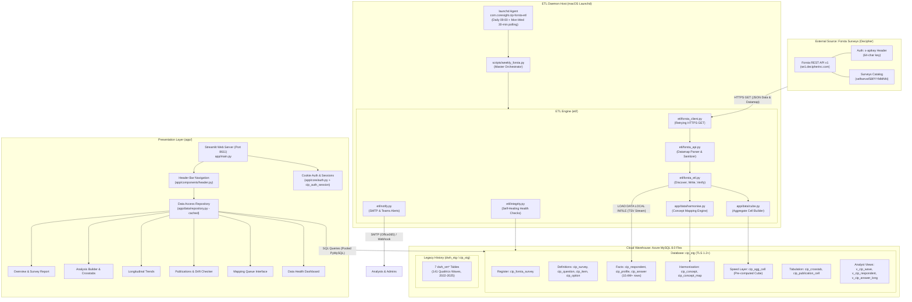

# 01 · System Architecture Reconstruction
## Consumer Insight Portal (CIP) — End-to-End Architectural Analysis

**Framework:** Reverse Engineering Anything (REA v42)  
**Evidence Base:** `etl/`, `app/`, `config/`, `sql/`, `scripts/`, `logs/`, launchd configuration  

---

### 1. High-Level Architectural Topology

The Consumer Insight Portal (CIP) is an automated survey intelligence and data warehousing platform operated by Coresight Research. It continuously extracts, harmonizes, tabulates, and serves weekly consumer tracker waves alongside historic longitudinal survey data spanning from August 2022 to the present day.



---

### 2. Physical & Runtime System Components

#### 2.1 The Source System: Forsta Surveys (formerly Decipher)
* **Host:** `se1.decipherinc.com` `[O]`
* **Base URL:** `https://se1.decipherinc.com/api/v1/` `[O]`
* **Protocol:** HTTPS REST, strictly read-only (`GET` requests only; no `POST`, `PUT`, or `DELETE` endpoints are ever called) `[O]`.
* **Authentication:** HTTP Request Header `x-apikey: <64-character token>` `[O]`.
* **Survey Lifecycle in Forsta:**
  * **Creation:** Weekly on Mondays, ~12:00–13:00 UTC under path `selfserve/58f/YYMMNN` (e.g., `selfserve/58f/261001`) `[O]`.
  * **Fielding:** Runs for approximately 12–14 hours; captures ~500–700 total respondents, yielding ~400 qualified completes `[O]`.
  * **Closure:** Survey transitions to `closed` state on Monday night / Tuesday morning `[O]`.
  * **Hibernation:** After ~90–120 days of inactivity, Forsta automatically hibernates the project. Any subsequent API request returns HTTP `428 Precondition Required` until manual human intervention reactivates it via the web portal `[O]`. Currently, **51 surveys** are in hibernated status `[O]`.
  * **Deletion:** Forsta purges project data permanently after 365 days. The database `cip_stg` is designed to be the immutable system of record `[O]`.

#### 2.2 The Processing Host: macOS Daemon & Launchd Scheduler
* **Execution Environment:** macOS Darwin 24.x, staff user `mohdsaeedafri` `[O]`.
* **Python Runtime:** Python 3.13.x inside virtual environment `.venv/` `[O]`.
* **Daemon Configuration:** `com.coresight.cip-forsta-etl.plist` installed at `~/Library/LaunchAgents/` `[O]`.
* **Execution Interval:**
  * Daily execution at 09:00 IST `[O]`.
  * High-frequency 30-minute polling active from Monday 20:00 IST through Wednesday 23:30 IST to catch the closing window of the weekly tracker `[O]`.
  * Automatic backup daemon: `com.coresight.cip-backup.plist` executing weekly dumps to `backups/` `[O]`.

#### 2.3 The Persistence Layer: Azure Database for MySQL 8.0 Flex Server
* **Server FQDN:** `csr-mysql8-flex-stg.mysql.database.azure.com` (Port 3306) `[O]`.
* **Database Name:** `cip_stg` (migrated from `dwh_stg` on 14–19 October 2026 to ensure zero collision with existing DWH schemas) `[O]`.
* **Security & TLS:** TLS 1.2+ enforced with Azure Global Root CA (`DigiCertGlobalRootG2.crt.pem`) `[O]`.
* **Access Credentials:** Segregated database engine roles:
  * Role `etl`: Full DDL and DML permissions on `cip_stg.*` `[O]`.
  * Role `app`: Read-only permissions on reporting tables and views, with write privileges strictly limited to `cip_auth_session` and `cip_saved_view` `[O]`.

#### 2.4 The Presentation Layer: Streamlit Multi-Page Portal
* **Framework:** Streamlit pinned to version 1.55.0 `[O]`.
* **Execution Entry Point:** `app/main.py` executing on port 8611 `[O]`.
* **Navigation Architecture:** Custom top-level header navigation (`app/components/header.py`) utilizing HTML anchor links, intentionally bypassing Streamlit’s native sidebar navigation (`position="hidden"`) to match Coresight's Market Data Portal (MDP) `[O]`.

---

### 3. Data Flow & Execution Call Paths

#### 3.1 The Master Ingestion Flow (`weekly_forsta.py`)

The end-to-end execution path for survey ingestion follows a deterministic state machine:

```
[Start Run]
   │
   ├─► 1. Healthcheck: Verify MySQL connectivity (up to 4 attempts, 300s backoff)
   │
   ├─► 2. Auth Probe: GET /rh/users/self (asserts x-apikey validity)
   │
   ├─► 3. Schema Check: Asserts cip_forsta_survey, cip_search, cip_tracker_line exist
   │
   ├─► 4. Discovery: GET /rh/companies/all/surveys -> Upsert cip_forsta_survey
   │
   ├─► 5. Due Evaluation: Select surveys WHERE load_state IN ('due', 'failed')
   │
   ├─► 6. Per-Wave Pipeline Execution (load_survey):
   │       ├─► Fetch: datamap JSON + data JSON (all records)
   │       ├─► Register: upsert cip_survey (load_status = 'loading')
   │       ├─► Definitions: upsert cip_question, cip_item, cip_option, cip_field
   │       ├─► Write Answers: bulk LOAD DATA LOCAL INFILE -> cip_answer
   │       ├─► Verification: assert count(stored) == count(payload) across all variables
   │       ├─► Profile Derivation: extract D1-D8, CS1, CS2 -> cip_profile
   │       ├─► Base Rebuild: compute actual answering base_n per question
   │       ├─► Harmonisation: match question texts to canonical cip_concept
   │       ├─► Cube Materialization: insert aggregated cuts -> cip_agg_cell
   │       ├─► Search Indexing: rebuild FULLTEXT index -> cip_search
   │       ├─► Tracker Line: construct JSON row -> cip_tracker_line
   │       └─► Publish: update cip_survey SET load_status = 'verified'
   │
   ├─► 7. Post-Run Integrity: Execute etl/integrity.py (Derived, Orphan, Base checks)
   │
   ├─► 8. Publication Drift: Verify frozen report cells against live database
   │
   └─► 9. Notification: Dispatch summary email / webhook via etl/notify.py
```

---

### 4. Security & Privacy Perimeter

1. **Personally Identifiable Information (PII) Scrubbing `[O]`:**
   * Incoming survey payloads from Forsta contain user agent strings, IP addresses, survey links, session hashes, and panel respondent IDs (RID).
   * In `etl/forsta_api.py`, personal variables are explicitly denylisted (`PERSONAL = {'userAgent', 'url', 'session', 'dcua', 'ipAddress'}`).
   * The panel respondent identifier (`RID`) is cryptographically digested using SHA-256 (`hashlib.sha256(rec['RID'].encode()).hexdigest()`) and stored as `respondent_key`. The raw RID is discarded in memory and never reaches the database `[O]`.

2. **Credential Masking in Observability Infrastructure `[O]`:**
   * Both standard execution logs (`logs/forsta-etl.log`) and structured JSON error telemetry (`logs/forsta-etl-errors.jsonl`) utilize a custom logging formatter that regex-scrubs any environment variable or argument containing `KEY`, `PASSWORD`, `SECRET`, `TOKEN`, `PASSPHRASE`, or `WEBHOOK` `[O]`.
