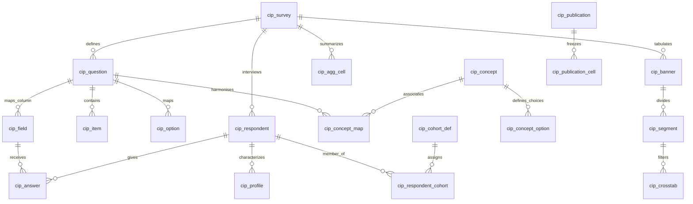

# 02 · Database & Data Model Reverse Engineering
## Exhaustive Schema Analysis, Relational Topology & Storage Architecture

**Framework:** Reverse Engineer Anything (REA v42)  
**Target Schema:** `cip_stg` (MySQL 8.0 Flex, UTF8MB4, collation `utf8mb4_0900_ai_ci`)  
**Evidence Base:** `sql/001_schema.sql`, `sql/002_views.sql`, `scripts/init_db.py`, `etl/legacy_dwh.py`, database inspection  

---

### 1. Architectural Principles of the CSI/CIP Data Model

The CIP data model is structured around three fundamental architectural imperatives:
1. **Dynamic Questionnaires Without Schema Alteration `[O]`:** Each weekly wave contains rotating modules and questions (e.g. Beauty, Social Commerce, Inflation Sentiment, Back-to-School). Rather than modeling questions as database columns, CIP utilizes an entity-attribute-value / long-format fact table (`cip_answer`), allowing arbitrary questionnaire evolutions without DDL operations.
2. **The "Dual Base" Truth in Routed Surveys `[O]`:** In survey research, conditional questions (e.g. Question DP2 "Which department stores did you shop at?") are reached only by a subset of qualified respondents (e.g. 222 of 404). Calculating percentages against the total survey base (404) artificially deflates incidence by 2× to 6×. Therefore, the schema explicitly preserves **both** the banner segment size (`seg_base_n`) and the question answering denominator (`answer_base_n`).
3. **Harmonisation Across Time and Platforms `[O]`:** Longitudinal questions spanning 2022 to 2026 across Qualtrics, SurveyMonkey, and Forsta are tied together via a canonical abstraction layer (`cip_concept` and `cip_concept_map`).

---

### 2. Entity-Relationship Topology

---

### 3. Detailed Functional Domain Decomposition (33 Tables)

#### Domain 1: Questionnaire Definition (What was asked)
* **`cip_survey` (PK: `survey_id`) `[O]`:** Core registry of all survey waves. Carries fielding dates, source platform (`forsta`, `qualtrics`, `surveymonkey`), unique natural key `uq_survey_source (platform, source_ref, wave_label)`, SHA-256 datamap digest, and lifecycle visibility flag (`load_status: loading/verified/failed/superseded`).
* **`cip_topic` (PK: `topic_id`) `[O]`:** Editorial modules (e.g. `DEPT_STORES`, `BNPL`, `GLP-1`, `DEMOGRAPHICS`).
* **`cip_question` (PK: `question_id`) `[O]`:** Question-level metadata (`qcode`, `qtext`, `qtype`, `is_multi`, `is_technical`, `is_virtual`). Uniquely holds `base_n` and `base_desc` representing the exact routing condition.
* **`cip_item` (PK: `item_id`) `[O]`:** Sub-items, statement rows, or rating grid rows (e.g. `q1r1`, `DP7r3`). Stores exclusive flags (`None of these`) and bipolar statements (`left_label`, `right_label`).
* **`cip_option` (PK: `option_id`) `[O]`:** Value-to-label dictionaries (`value_code` → `value_label`). Encodes nonresponse flags and `net_group` categories (e.g. `TOP2`, `BOT2`).
* **`cip_field` (PK: `field_id`) `[O]`:** Direct physical mapping of export columns to logical questions/items. Exactly matches raw datamap columns (e.g. 375 columns in wave 09/21/26).

#### Domain 2: Empirical Survey Data & Microdata (What people said)
* **`cip_respondent` (PK: `respondent_id`) `[O]`:** Master interview log. Captures interview length (`interview_secs`), completion status (1=Terminated, 2=Overquota, 3=Qualified, 4=Partial), technical metadata (device, OS, browser), dropout question, and salted SHA-256 `respondent_key`.
* **`cip_profile` (PK: `respondent_id`) `[O]`:** Demographics flattened from questions D1–D8, CS1, and CS2 into dedicated columns (`gender`, `age_years`, `age_band`, `generation`, `relationship`, `ethnicity`, `income_band`, `urbanicity`, `political`, `census_region`, `outlook_income`, `outlook_economy`). Enables single-join cohort filtering.
* **`cip_answer` (PK: `answer_id`) `[O]`:** The primary fact table holding **10.4M+ answer rows** (approx. 150,000 rows per wave). Stores `value_code` (discrete answers), `value_number` (open numeric metrics), and `value_text` (verbatims). Indexed for high-speed coverage via `uq_answer (respondent_id, field_id)` and `ix_answer_cover (survey_id, field_id, value_code, respondent_id)`.

#### Domain 3: Tabulation & Cross-Tabs (The published numbers)
* **`cip_banner` (PK: `banner_id`) `[O]`:** Banner group headers (e.g. Age, Gender, Income, Region).
* **`cip_segment` (PK: `segment_id`) `[O]`:** Individual banner column slices (e.g. "Male", "GenZ", "$50k-$99k"). Carries statistical testing letters (`seg_letter: A..N1`) and Forsta filtering logic.
* **`cip_crosstab_run` (PK: `run_id`) `[O]`:** Execution parameters of cross-tab workbooks (base filter, statistical tests applied, date ranges).
* **`cip_crosstab` (PK: `crosstab_id`) `[O]`:** Reconciled cross-tab cells. Stores cell percentage, weighted count, `answer_base_n`, and Z-test significance letters (`sig_letters`).

#### Domain 4: Ingestion, Audit & Orchestration
* **`cip_load_log` (PK: `load_id`) `[O]`:** Audit log capturing start/finish times, record counts read/loaded/rejected, source references, and payload SHA-256 hashes.
* **`cip_load_error` (PK: `error_id`) `[O]`:** Detailed error payloads and rejection reasons for unparseable records.
* **`cip_load_state` (PK: `feed_name`) `[O]`:** High-water mark tracking for incremental ingestion.

#### Domain 5: Harmonisation Layer
* **`cip_concept` (PK: `concept_id`) `[O]`:** Canonical question dictionary (828 concepts, 251 spanning multiple waves).
* **`cip_concept_option` (PK: `concept_option_id`) `[O]`:** Canonical answer dictionary, storing scale midpoints and net grouping.
* **`cip_concept_map` (PK: `map_id`) `[O]`:** Links wave-specific question/item/option triples (`map_key`) to canonical concepts with match confidence, matching method (`exact_text`, `similar_text`, `manual`), and review status (`proposed`, `confirmed`, `rejected`).

#### Domain 6: Weighting Schemes (Reserved)
* **`cip_weight_scheme` (PK: `scheme_id`) `[O]`:** Census weighting targets and raking algorithms.
* **`cip_weight` (PK: `respondent_id, scheme_id`) `[O]`:** Respondent-level weight multipliers (currently defaulted to 1.000000).

#### Domain 7: Cohort Engine
* **`cip_cohort_def` (PK: `cohort_id`) `[O]`:** JSON-defined logical rules over concepts (e.g. "Beauty Shopper: bought at Amazon OR Sephora in past 3 months").
* **`cip_respondent_cohort` (PK: `cohort_id, respondent_id`) `[O]`:** Pre-materialized set membership for instant analytical retrieval.

#### Domain 8: Aggregates / Cube (Portal Speed Layer)
* **`cip_agg_cell` (PK: `cell_id`) `[O]`:** Pre-computed aggregation cube. Stores response counts (`n`), question answering base (`base_n`), demographic cut (`dim`, `dim_value`), and midpoint metrics (`sum_age_mid`, `sum_income_mid_k`) across 7 standard cuts. Eliminates runtime scans over `cip_answer`.

#### Domain 9: Publications & Quality Assurance
* **`cip_publication` (PK: `publication_id`) `[O]`:** Frozen deliverable definitions (tables and charts delivered to enterprise clients or press).
* **`cip_publication_cell` (PK: `cell_id`) `[O]`:** Frozen numerical cell values with which the live database is continually compared to detect retrospective data drift.

#### Domain 10: System Support, Calendar & Derived Tables
* **`cip_forsta_survey` (PK: `forsta_path`) `[O]`:** Master Forsta inventory register tracking state (`due`, `loaded`, `failed`, `hibernated`, `testing`).
* **`cip_search` (PK: `search_id`) `[O]`:** Rebuilt FULLTEXT search catalog covering surveys, questions, and concepts.
* **`cip_tracker_line` (PK: `respondent_id`) `[O]`:** Denormalized JSON line-by-line export matching the analyst team's exact Excel workbook column schema.
* **`cip_wave_module` (PK: `forsta_path, module_code`) `[O]`:** Analytical survey calendar detailing lead sectors and seasonal series wave numbers.
* **`cip_auth_session` (PK: `session_id`) `[O]`:** Database-backed HTTP session store supporting revocation.
* **`cip_saved_view` (PK: `view_id`) `[O]`:** Stored query parameters and filter configurations.
* **`cip_profile_map` (PK: `survey_id, dimension`) `[O]`:** Dynamic survey mapping configuration recording which question fed each demographic dimension.

---

### 4. Relational Integrity: Foreign Key vs. Orphan Guard Analysis

The database employs **26 Foreign Keys** enforcing referential cascade integrity across core relational tables `[O]`. 

However, **5 tables intentionally omit Foreign Keys** to prevent lock contention, support independent lifecycles, or allow fast bulk truncations:
1. `cip_forsta_survey`: Operates as an external register; surveys exist prior to the creation of `cip_survey` records `[O]`.
2. `cip_load_log`: An immutable historical audit log; retains records of archived or removed waves on purpose `[O]`.
3. `cip_tracker_line`: A derived export table rebuilt per wave `[O]`.
4. `cip_search`: A FULLTEXT search index rebuilt after each load `[O]`.
5. `cip_wave_module`: Rebuilt dynamically from calendar definitions and questionnaire inspection `[O]`.

To ensure these tables never accumulate orphaned rows or corrupt analytical queries, the automated health checker (`etl/integrity.py`) executes 16 relational assertion checks after every run, actively healing derived rows and deleting orphaned indices `[O]`.

---

### 5. Reporting Views (`v_cip_*`)

The presentation and analytical layers interact exclusively with 12 database views `[O]`:
* `v_cip_answers`: Fully denormalized response stream with respondent demographics joined.
* `v_cip_item_incidence`: Item selection percentages calculated against the question's own answering base (`reached`).
* `v_cip_single_distribution`: Frequency distributions for single-choice questions with partitioned denominators.
* `v_cip_grid`: Item-by-scale cross-tabulations for rating matrices.
* `v_cip_crosstab`: Formatted cross-tab tables carrying both `segment_size_n` and `denominator_n`.
* `v_cip_trend`: Multi-wave trend lines tracking concepts over time.
* `v_cip_survey_health`: Operational metrics (total respondents, qualified, dropouts, LOI, timestamps).
* `v_cip_question_base`: Complete questionnaire audit with base descriptions and percentage of qualified wave.
* `v_cip_mapping_queue`: Pending concept mappings requiring analyst verification.
* `v_cip_wave`: Analyst entry point summarizing verified survey waves.
* `v_cip_respondent`: Qualified respondent microdata with demographic dimensions.
* `v_cip_answer_long`: Long-format answer records joined with harmonised concept codes.
