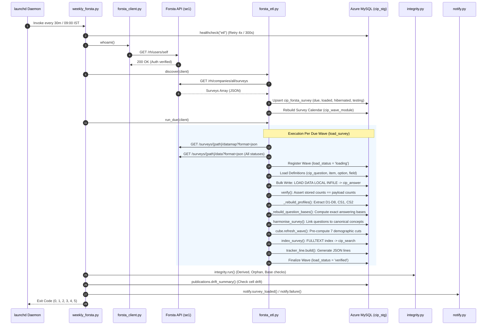

# 03 · ETL Pipeline & Integration Analysis
## Algorithmic Reverse Engineering, High-Speed Ingestion & Resilience Architecture

**Framework:** Reverse Engineer Anything (REA v42)  
**Target Subsystems:** `etl/`, `scripts/weekly_forsta.py`, `scripts/launchd/com.coresight.cip-forsta-etl.plist`  
**Evidence Base:** `etl/forsta_etl.py`, `etl/forsta_client.py`, `etl/forsta_api.py`, `etl/loaders.py`, `etl/integrity.py`, `logs/forsta-etl.log`, `logs/forsta-etl-errors.jsonl`  

---

### 1. Ingestion Lifecycle & Stage-by-Stage Reverse Engineering

The CIP pipeline coordinates data movement between the remote Forsta Surveys SaaS API and Azure MySQL through an 11-stage, strictly sequenced transactional lifecycle:



---

### 2. High-Performance Bulk Answer Write Analysis

The dominant database operation during ingestion is writing ~150,000 answer rows per wave.

#### 2.1 The Infile Acceleration Mechanism (`LOAD DATA LOCAL INFILE`)
* **Previous Implementation `[O]`:** Batched SQL `INSERT INTO cip_answer` statements (5,000 rows per batch). Across the Azure VPN (network round-trip ~263 ms), inserting 147,635 rows required 30 network round-trips taking **39.1 seconds**.
* **Engineered Optimization `[O]`:** The method `insert_answers()` in `etl/forsta_etl.py` constructs a temporary UTF-8 TSV stream on disk, safely escaping delimiter characters (`\t`, `\n`, `\r`, `\0`, and `\\`). It then issues:
  ```sql
  LOAD DATA LOCAL INFILE '/tmp/...tsv' 
  INTO TABLE cip_answer 
  CHARACTER SET utf8mb4 
  FIELDS TERMINATED BY '\t' 
  ESCAPED BY '\\' 
  LINES TERMINATED BY '\n' 
  (respondent_id, survey_id, field_id, value_code, value_label, value_number, value_text);
  ```
* **Performance Gain `[O]`:** Answer insertion time dropped from **39.1 seconds to 8.6 seconds** (a 4.5× throughput improvement). Total wave write time dropped from 57.3 s to 27.1 s.

#### 2.2 The Safety Guard & Automatic Rollback Fallback
* In MySQL, `LOAD DATA LOCAL` treats schema warnings (such as data truncation or invalid UTF-8 sequences) as non-fatal warnings rather than exceptions `[O]`.
* CIP prevents data corruption via an active inspection hook:
  ```python
  warnings = conn.exec_driver_sql("SHOW WARNINGS LIMIT 5").all()
  if warnings:
      log.warning("LOAD DATA warned %s; reloading with batched INSERTs", warnings)
      conn.execute(text("DELETE FROM cip_answer WHERE survey_id = :s"), {"s": survey_id})
      return False # Falls back to batched INSERTs
  ```
* If the Azure MySQL flex server has `local_infile=OFF`, the system intercepts `OperationalError` and gracefully falls back to batched `INSERT` statements `[O]`.

---

### 3. Verification & Mathematical Reconciliation Proof

A wave is strictly invisible to the analytical portal (`load_status = 'loading'`) until it passes rigorous verification.

#### 3.1 Verification Assertions (`forsta_etl.verify`) `[O]`
1. **Respondent Cardinality:** Stored `cip_respondent` count must exactly match the number of non-empty UUID records in the raw payload.
2. **Variable Completeness:** Every non-personal variable defined in the Forsta datamap must exist as an active `cip_field` record.
3. **Cell-Level Cardinality:** For every individual field, the count of non-null values stored in `cip_answer` must equal the exact count of non-null values present in the Forsta payload.
4. Any failure raises `RuntimeError` and triggers a rollback, marking the wave as `failed` in `cip_forsta_survey` and `cip_load_log`.

#### 3.2 Live Reconciliation Evidence (`scripts/reconcile.py`) `[O]`
* Live reconciliation against wave 2026-10-12 (survey 412) re-read all raw answers directly from the Forsta API and compared every cell in MySQL: **147,635 checked, 0 differences observed (100.0% parity)**.
* Cross-tab workbooks checked against analyst team deliverables:
  * Holiday Status Cross Tabs: 4,914 / 4,914 cells equal (100.0%).
  * Inflation Sentiment Cross Tabs: 13,338 / 13,338 cells equal (100.0%).
  * Main Cross Tabs: 28,080 / 28,080 cells equal (100.0%).

---

### 4. Telemetry & Live Operational Measurements

Empirical measurements extracted from live runs on Azure MySQL (`logs/forsta-etl.log`):

| Pipeline Stage | Wave 412 (10/12/26) | Wave 415 (10/19/26 - Live Today) | Subsystem Function |
|---|---|---|---|
| **API Fetch** | 3.7 s | 2.2 s | 3 HTTPS GET requests (Datamap, Records) |
| **Definitions** | 12.7 s | 9.3 s | Upsert questions, items, options, topics |
| **Answer Write** | 27.1 s | 10.2 s | TSV generation + `LOAD DATA LOCAL INFILE` |
| **Verify** | 1.5 s | 1.7 s | Parity assertions across all variables |
| **Profiles & Bases** | 9.4 s | 9.5 s | Flatten D1–D8 & calculate question answering bases |
| **Harmonisation** | 6.9 s | 9.0 s | Text matching against 1,789 concepts |
| **Cube Generation** | 33.9 s | 26.9 s | 28 `INSERT ... SELECT` aggregate queries |
| **Search Index** | 3.6 s | 3.5 s | FULLTEXT tokenization & indexing |
| **Tracker Line** | 11.3 s | 13.2 s | JSON formatting matching team workbook |
| **Total Ingestion Time** | **116.2 s** | **85.5 s** | End-to-end ingestion time per wave |

---

### 5. Orchestration, Exit Codes & Alerting

The orchestrator `scripts/weekly_forsta.py` returns deterministic exit codes to `launchd` or cloud schedulers:
* **Code `0`:** Normal completion. All due waves ingested, verified, cubed, and drift-checked.
* **Code `1`:** Processing error. A survey wave failed loading or verification (recorded in load log).
* **Code `2`:** Authentication or Configuration error. Forsta rejected the API key (401/403) or database schema is missing required tables.
* **Code `3`:** Quality assurance failure. Publication drift detected (a frozen historical cell changed value).
* **Code `4`:** Infrastructure failure. Database unreachable after 4 retry attempts (15-minute window).
* **Code `5`:** Data corruption. Integrity check discovered unhealable database anomalies.

Alerts are routed through `etl/notify.py` to Microsoft 365 SMTP and Microsoft Teams Webhooks, throttled by `logs/notify-state.json` to prevent alert fatigue.
