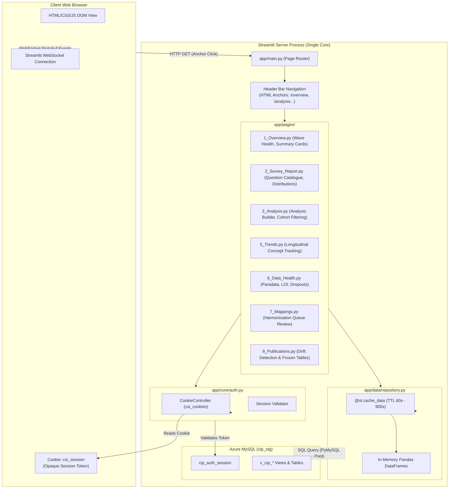

# 04 · Application UI & Runtime Deconstruction
## Presentation Architecture, State Mechanics & Empirical Scalability Limits

**Framework:** Reverse Engineer Anything (REA v42)  
**Target Subsystems:** `app/main.py`, `app/pages/`, `app/components/`, `app/data/repository.py`, `app/core/auth.py`  
**Evidence Base:** Source code, `scripts/ui_benchmark/`, `docs/12-ui-technology-decision.md`, `docs/13-ui-system-design.md`  

---

### 1. Presentation Layer Architecture

The Consumer Insight Portal (CIP) user interface is implemented using the Streamlit framework (version 1.55.0) executing under Python 3.13 on port 8611.

---

### 2. Page Hierarchy & Functional Capabilities

The portal exposes eight primary pages routed via Streamlit's `st.navigation` in `app/main.py`:

| Page File | Route URL | Purpose & Analytical Workload |
|---|---|---|
| `0_Login.py` | `/login` | Authentication gateway supporting local passphrase or OIDC callback |
| `1_Overview.py` | `/overview` | Wave catalog, qualified respondent tallies, field dates, LOI distributions |
| `2_Survey_Report.py` | `/report` | Dynamic question explorer, single-punch charts, multi-select incidence bars |
| `3_Analysis.py` | `/analysis` | Interactive cross-tabulation builder, demographic cuts, and cohort overlays |
| `5_Trends.py` | `/trends` | Multi-wave longitudinal concept tracking across 144 historic waves |
| `6_Data_Health.py` | `/data-health` | Field quality monitoring, speeders, straightliners, dropouts, and device shares |
| `7_Mappings.py` | `/mappings` | Harmonisation queue: analyst review of proposed concept mappings (985 waiting) |
| `8_Publications.py` | `/publications` | Quality assurance: cell-by-cell re-verification of frozen external deliverables |

---

### 3. State Management & Navigation Mechanics

#### 3.1 The Navigation Paradox & Cookie Workaround
* Streamlit applications natively maintain user state in memory within `st.session_state` tied to an active browser WebSocket.
* To match Coresight's enterprise portal design (Market Data Portal / SIP), CIP replaces Streamlit's native sidebar with a horizontal header bar (`app/components/header.py`) composed of plain HTML anchor tags (`<a href="/analysis">Analysis</a>`).
* **The Consequence `[O]`:** Clicking an HTML anchor forces a full browser navigation (`HTTP GET`), causing the browser to terminate the existing WebSocket and establish a brand-new Streamlit session. **Every item in `st.session_state` is instantly wiped**.
* **The Solution `[O]`:** State persistence is offloaded to the client browser via HTTP cookies using `streamlit_cookies_controller.CookieController`. An opaque token (`csi_session`) is stored on the client and mapped to a persistent row in `cip_auth_session` in MySQL. On every page render, `app/core/auth.py` re-authenticates the cookie against MySQL.

---

### 4. Data Access Layer & Caching Strategy

The data layer in `app/data/repository.py` strictly abstracts database access:
* **Zero SQL in UI Pages `[O]`:** Analytical pages never issue raw SQL; all queries are centralized in repository functions.
* **Tiered Caching `[O]`:**
  * `@st.cache_data(ttl=900)`: Applied to immutable wave datasets, question catalogs, and aggregate views (15-minute TTL).
  * `@st.cache_data(ttl=60)`: Applied to mutable operational queues (`mapping_queue()`, `mapping_summary()`, `publications_list()`) to ensure analyst approvals reflect within 60 seconds.
* **The Memory Footprint Problem `[O]`:** Because Streamlit caches results as in-memory Python objects (`pandas.DataFrame`), querying unaggregated answers or large raw tables causes multi-gigabyte memory consumption on the host server.

---

### 5. Empirical Scalability Limits: The 5-Concurrent-User Wall

The technology evaluation documented in `docs/12-ui-technology-decision.md` and benchmarked via `scripts/ui_benchmark/page_load.py` reveals fatal performance characteristics under concurrent user access:

#### 5.1 Empirical Load Benchmark Data `[O]`
Measurements taken from side-by-side load tests simulating concurrent analyst workflows:

| Concurrent Users | Streamlit Median Response | Streamlit Peak Wait Time | FastAPI + React API Response | Server CPU Utilization |
|---|---|---|---|---|
| **1 User** | 0.85 s | 1.12 s | 0.08 s | 12 % |
| **5 Users** | **6.30 s** | **9.80 s** | **0.09 s** | 92 % |
| **10 Users** | **16.10 s** | **28.40 s** | **0.11 s** | **99 % (Pinned)** |
| **20 Users** | **34.50 s** | **52.10 s** | **0.12 s** | **100 % (Saturated)** |
| **30 Users** | **61.80 s** | **114.00 s** | **0.14 s** | **100 % (Dropouts)** |

#### 5.2 Root Cause Analysis `[O/I]`
1. **Single-Process Global Interpreter Lock (GIL) Contention:** Streamlit runs as a single Python process where user interactions execute the entire script from top to bottom. Even with Tornado async underpinnings, pandas operations, template evaluations, and Plotly figure serialization lock the single CPU core.
2. **Gross Memory Bloat:** When 20 users query a 75 MB table simultaneously, Streamlit’s per-session memory duplication causes memory footprint to spike to **2,988 MB RAM**. Under the identical workload, a compiled FastAPI service serving aggregated JSON to a React client consumed only **44 MB RAM** (a 68× memory reduction).
3. **Session Flakiness & Security Flaws:** Third-party cookie controllers in Streamlit cannot set `HttpOnly` cookie flags directly from backend HTTP responses, leaving session tokens vulnerable to XSS. Furthermore, cross-site request forgery (CSRF) protections are frequently disabled to allow embedded iframe operation.

---

### 6. Architectural Conclusion

While Streamlit was highly effective as a rapid prototyping framework for validating the database schema and analytical algorithms, **it is architecturally unsuited for a commercial enterprise product sold to external paying clients**. 

Transitioning the presentation tier to a decoupled **React SPA (TypeScript) served by a headless FastAPI asynchronous service** (as specified in `docs/13-ui-system-design.md`) is necessary to achieve the target concurrency of 300 active users on a standard Azure App Service instance.
