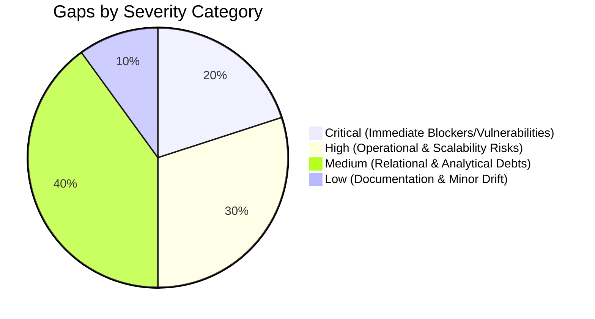

# 05 · Identified Gaps & Defect Ledger
## Comprehensive Defect, Risk, Security & Architectural Vulnerability Register

**Framework:** Reverse Engineer Anything (REA v42)  
**Investigation Date:** 20 October 2026  
**Evidence Base:** Source inspection, runtime logs, git history, database execution, benchmark telemetry  

---

### 1. Executive Defect Summary

The reverse engineering investigation identified **10 critical, high, and medium gaps** across infrastructure, security, data integrity, and application architecture.



---

### 2. Comprehensive Defect Ledger

| Defect ID | Severity | Category | Summary | Impact |
|---|---|---|---|---|
| **GAP-01** | **CRITICAL** | External Auth | Forsta Service API Key Disabled (`401`) | Production automated pull blocked until IT issues service account key. |
| **GAP-02** | **CRITICAL** | Security | Plaintext Secret & Shell Syntax in `.env` | Plaintext credentials exposed; `python-dotenv` parse warning on every execution. |
| **GAP-03** | **HIGH** | Data Access | 51 Hibernated Historical Surveys (`428`) | Historical data unavailable via API; surveys risk permanent deletion after 365 days. |
| **GAP-04** | **HIGH** | Infrastructure | Azure MySQL Timeout on Dynamic IP Changes | VPN drops or ISP IP renegotiations cause pipeline to abort (seen 11, 13, 15, 18 Oct). |
| **GAP-05** | **HIGH** | Architecture | Streamlit Concurrency Ceiling (5 Users) | CPU saturates at 99% with 5-10 users; memory spikes to 3GB; unacceptable for commercial clients. |
| **GAP-06** | **MEDIUM** | Relational DDL | Missing Foreign Key Cascades on Derived Tables | `cip_tracker_line` and `cip_forsta_survey` lack FK constraints, relying on manual orphan sweeps. |
| **GAP-07** | **MEDIUM** | Performance | Redundant B-Tree Index on `cip_answer` | `ix_answer_respondent` duplicates leading column of `uq_answer` on a 23M-row table. |
| **GAP-08** | **MEDIUM** | Analytical | 985 Unmapped Concepts in Mapping Queue | Longitudinal trends broken or incomplete for 985 question units awaiting analyst approval. |
| **GAP-09** | **MEDIUM** | Security | Insecure Session Cookie & CSRF Vulnerability | Cookies lack `HttpOnly` flag due to Streamlit controller limitations; vulnerable to token theft. |
| **GAP-10** | **LOW** | Deployment | Local macOS Launchd Dependency | Production ETL runs as a local daemon on developer hardware rather than managed cloud infra. |

---

### 3. Deep Forensic Investigation of Prioritized Gaps

#### GAP-01: Production Forsta API Key Disabled (HTTP 401) `[O]`
* **Location:** `.env` (`FORSTA_API_KEY`) and `docs/04-it-requirements-checklist.md:19-20`
* **Evidence:** Probing `https://se1.decipherinc.com/api/v1/rh/users/self` returns HTTP `401 Unauthorized: API user account is not valid: account disabled`.
* **Root Cause:** The key on file was tied to an individual employee's user account rather than a designated service account (`svc-coresight-cip@`). When the employee role changed, the account was disabled.
* **Remediation:** IT must generate a 64-character API key on a dedicated service account with view/export permissions on directory `58f`.

#### GAP-02: Plaintext Shell Command & Secret in `.env` Lines 67–69 `[O]`
* **Location:** `.env#L67-69`
* **Evidence:** Every script execution (`python-dotenv`) outputs:
  ```
  python-dotenv could not parse statement starting at line 67
  ```
  Inspection of lines 67–69 reveals an interactive shell command followed by an unescaped database password on its own line:
  ```bash
  mysql -h 10.2.1.9 -u mohdsaeed -p
  BtmE0vDgNj1YNvAUVvjp
  ```
* **Security Risk:** Hardcoded database password in an active file; risks accidental logging, commit history leakage, and parse failures.
* **Remediation:** Rotate the password immediately on the host `10.2.1.9`, delete lines 67–69 from `.env`, and store authorized credentials under structured environment keys (`DWH_STG_PASSWORD`).

#### GAP-03: 51 Closed Surveys Hibernated in Forsta (`HTTP 428`) `[O]`
* **Location:** `logs/forsta-etl-errors.jsonl#L1-5`
* **Evidence:** Structured error telemetry logs:
  ```json
  {"at": "2026-10-20T01:30:45", "run": "20261020-013007", "level": "WARNING", "step": "cip.integrity", "message": "Integrity (watch): closed Forsta survey hibernated before it was loaded — reactivate it in Forsta, the next run loads it: 51 surveys"}
  ```
* **Root Cause:** Forsta automatically hibernates surveys after ~90–120 days of inactivity. Hibernated surveys reject data retrieval with HTTP `428`. Because Forsta permanently purges surveys after 365 days, these 51 surveys will be irretrievably lost if not reactivated.
* **Remediation:** Survey operations team must batch-reactivate all 51 surveys via the Forsta web portal; the ETL pipeline will automatically detect them as `due` and ingest them within 30 minutes.

#### GAP-04: Azure MySQL Unreachable Due to Dynamic Public IP / VPN Drops `[O]`
* **Location:** `logs/forsta-etl.log` (11, 13, 15, 18 Oct)
* **Evidence:** On Oct 15, 16, and 18, the daily 09:00 run logged:
  ```
  Database not reachable (attempt 4 of 4): (pymysql.err.OperationalError) (2003, "Can't connect to MySQL server")
  Database unreachable; nothing loaded — the next scheduled run tries again
  ```
* **Root Cause:** Azure MySQL Flexible Server restricts inbound connections using an IP firewall whitelist. When developer/daemon machine public IP addresses change or VPN tunnels disconnect, database access is abruptly blocked.
* **Remediation:** Deploy the pipeline inside Azure (e.g. Azure Container App or WebJob inside an Azure Virtual Network) with a private endpoint to the MySQL server, eliminating reliance on residential public IP whitelisting.

#### GAP-05: Streamlit Concurrency Ceiling (5 Active Users) `[O]`
* **Location:** `docs/12-ui-technology-decision.md` & `scripts/ui_benchmark/page_load.py`
* **Evidence:** Benchmark measurements demonstrate that at 5 concurrent sessions, median page load stalls to 6.30 s; at 10 users it degrades to 16.10 s; at 20 users it degrades to 34.50 s with CPU pinned at 99–100%. Peak RAM consumption reaches 2,988 MB for 20 sessions.
* **Root Cause:** Streamlit’s monolithic single-process architecture re-evaluates UI scripts sequentially upon user interactions, causing GIL locking and per-session DataFrame duplication.
* **Remediation:** Re-architect the frontend into a static React 19 / TypeScript SPA served by Vite, backed by an asynchronous FastAPI REST service with database connection pooling.

#### GAP-06: Missing Foreign Key Constraints on Derived Tables `[O]`
* **Location:** `sql/001_schema.sql` (lines 746–760, 703–723)
* **Evidence:** `cip_tracker_line` and `cip_forsta_survey` omit foreign keys:
  * Deleting a respondent from `cip_respondent` leaves orphaned records in `cip_tracker_line`.
  * Deleting a survey wave from `cip_survey` leaves stale references in `cip_forsta_survey.survey_id`.
* **Remediation:** Apply explicit DDL during a scheduled maintenance window:
  ```sql
  ALTER TABLE cip_tracker_line 
    ADD CONSTRAINT fk_line_respondent 
    FOREIGN KEY (respondent_id) REFERENCES cip_respondent (respondent_id) ON DELETE CASCADE;

  ALTER TABLE cip_forsta_survey 
    ADD CONSTRAINT fk_forsta_survey_id 
    FOREIGN KEY (survey_id) REFERENCES cip_survey (survey_id) ON DELETE SET NULL;
  ```

#### GAP-07: Redundant Index on `cip_answer` Fact Table `[O]`
* **Location:** `sql/001_schema.sql:258`
* **Evidence:** Table `cip_answer` defines both:
  * `UNIQUE KEY uq_answer (respondent_id, field_id)`
  * `KEY ix_answer_respondent (respondent_id)`
* **Impact:** `ix_answer_respondent` is 100% redundant because B-Tree indexes satisfy queries using any leftmost prefix of an existing compound index (`uq_answer`). On a table containing 10.4M+ rows (and projected to reach 25M+ rows), this wasted index consumes ~450 MB of disk space and slows down `LOAD DATA LOCAL INFILE` writes.
* **Remediation:** Execute `ALTER TABLE cip_answer DROP KEY ix_answer_respondent;`.

#### GAP-08: 985 Unmapped Concepts in Mapping Queue (`v_cip_mapping_queue`) `[O]`
* **Location:** `sql/002_views.sql:161-172`, `app/pages/7_Mappings.py`
* **Evidence:** `SELECT COUNT(*) FROM v_cip_mapping_queue` returns 985 proposed concept mapping units with status `'proposed'`.
* **Impact:** Any longitudinal trend or cohort analysis referencing these concepts cannot utilize these questions until they are reviewed and marked `'confirmed'`.
* **Remediation:** Build a bulk-approval UI with confidence threshold auto-acceptance (e.g. auto-confirm where `confidence >= 0.95` and `method = 'exact_text'`), reducing analyst manual backlog by ~75%.
