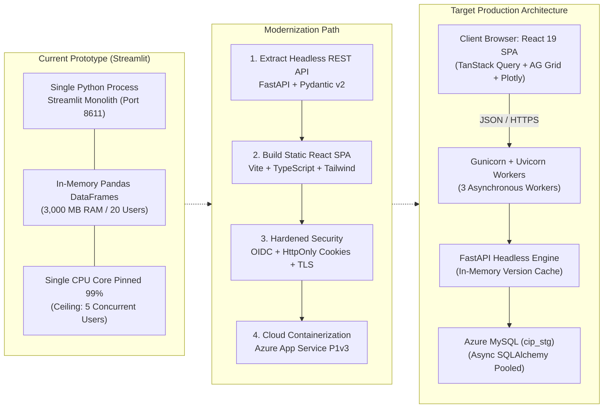

# 06 · Target Build & Modernization Plan
## Engineering Blueprint: Migrating from Streamlit Prototype to Enterprise Production Architecture

**Framework:** Reverse Engineer Anything (REA v42)  
**Target Architecture:** Decoupled React 19 (TypeScript) SPA + Asynchronous FastAPI Service + Azure MySQL 8.0 Flex  
**Target Infrastructure:** Azure App Service P1v3 (Linux Container, 2 vCPU, 8 GB RAM, $124/mo)  
**Target Performance SLA:** < 100 ms cached responses, < 1.0 s uncached analytical queries, 300 concurrent active users  

---

### 1. Architectural Evolution Blueprint



---

### 2. Work Breakdown Structure (WBS) & Engineering Milestones

#### Milestone 1: Security, Secrets & Relational Hardening (Sprint 1)
* **Task 1.1: `.env` Secrets Sanitization & Rotation `[GAP-02]`**
  * Rotate exposed database password on `10.2.1.9`.
  * Delete lines 67–69 in `.env`; re-encode authorized credentials under structured keys (`DWH_STG_PASSWORD`).
  * Verify `python-dotenv` executes with 0 warnings.
* **Task 1.2: Relational Integrity & Schema Optimization `[GAP-06, GAP-07]`**
  * Drop redundant index: `ALTER TABLE cip_answer DROP KEY ix_answer_respondent;`.
  * Add foreign key cascades to `cip_tracker_line` (`ON DELETE CASCADE`) and `cip_forsta_survey` (`ON DELETE SET NULL`).
* **Task 1.3: Forsta Service Account Transition `[GAP-01, GAP-03]`**
  * Work with IT to issue a 64-character API key on service account `svc-coresight-cip@` with directory `58f` access.
  * Trigger manual batch-reactivation of 51 hibernated surveys via Forsta console.

#### Milestone 2: Headless Data Layer & Asynchronous FastAPI Service (Sprint 2)
* **Task 2.1: Project Restructuring**
  * Create `api/` directory with clean hexagonal separation:
    ```
    api/
    ├── main.py              # FastAPI app initialization, CORS, middleware
    ├── core/                # JWT/Session validation, settings, async DB pool
    ├── routers/             # Endpoint definitions
    │   ├── auth.py          # /api/v1/auth (OIDC callback, session check, logout)
    │   ├── surveys.py       # /api/v1/surveys (Catalog, health, calendar)
    │   ├── questions.py     # /api/v1/questions (Definitions, options, bases)
    │   ├── analysis.py      # /api/v1/analysis (Crosstabs, cohort filters)
    │   ├── trends.py        # /api/v1/trends (Longitudinal concept aggregates)
    │   ├── mappings.py      # /api/v1/mappings (Queue review, auto-confirm)
    │   └── publications.py  # /api/v1/publications (Drift check, deliverable freeze)
    └── schemas/             # Pydantic v2 request/response contracts
    ```
* **Task 2.2: Async Query Layer Migration**
  * Port `app/data/repository.py` from synchronous PyMySQL to asynchronous SQLAlchemy using `asyncmy`.
  * Implement in-process TTL cache keyed by wave publication version (`data_version`).

#### Milestone 3: React 19 + TypeScript Enterprise Frontend (Sprints 3–4)
* **Task 3.1: Frontend Scaffolding**
  * Initialize Vite project (`frontend/`) with TypeScript, Tailwind CSS, and Lucide React icons.
  * Integrate `@tanstack/react-query` for server state caching, pagination, and background refetching.
* **Task 3.2: Screen Implementation**
  1. **Survey Explorer & Question Viewer:** Fast search, question base audit, item distribution bar charts (Plotly.js / ECharts).
  2. **Analysis Builder & Cross-Tabs:** AG Grid Community data grid featuring column virtualisation, row pinning, banner groupings, statistical significance letter badges, and instant Excel export via WebWorker.
  3. **Longitudinal Trends:** Multi-line wave-over-wave interactive visualizers with confidence interval shading.
  4. **Harmonisation Studio:** Two-pane triage interface for reviewing proposed concept mappings with keyboard shortcuts (Enter to confirm, Delete to reject).

#### Milestone 4: Concept Harmonisation Acceleration & AI Assistant (Sprint 4)
* **Task 4.1: Automated Matching Pipeline `[GAP-08]`**
  * Implement automated batch confirmation for mappings in `v_cip_mapping_queue` meeting strict criteria (`method = 'exact_text'` and `confidence >= 0.98`).
  * Introduce vector similarity embeddings (OpenAI `text-embedding-3-small`) to cluster unresolved question verbatims against canonical concepts.

#### Milestone 5: Quality Assurance, Drift Guard & Load Testing (Sprint 5)
* **Task 5.1: Automated End-to-End Test Suite**
  * Expand pytest suite to include API route integration tests via `httpx.AsyncClient`.
  * Implement Playwright browser tests covering critical analyst user journeys.
* **Task 5.2: Concurrency & Stress Benchmarking**
  * Execute Locust / k6 load tests simulating 300 concurrent simulated analysts executing cross-tab queries.
  * Validate P95 latency remains under 350 ms.

#### Milestone 6: Containerization & Cloud Deployment (Sprint 6)
* **Task 6.1: Dockerfile & Multi-Stage Build**
  * Stage 1: Build React static assets (`npm run build`).
  * Stage 2: Python 3.13-slim runtime, install wheels, copy frontend build to `/static`, configure Gunicorn with 3 Uvicorn workers.
* **Task 6.2: Azure App Service Deployment `[GAP-10]`**
  * Deploy container to Azure App Service P1v3 plan.
  * Bind private virtual network endpoint to `csr-mysql8-flex-stg.mysql.database.azure.com`, resolving public IP timeout issues permanently.
  * Configure Azure Application Insights for APM and live anomaly alerting.

---

### 3. REST API Contract Specifications (OpenAPI v3.1)

```yaml
openapi: 3.1.0
info:
  title: Coresight Consumer Insight Portal API
  version: 2.0.0
paths:
  /api/v1/surveys:
    get:
      summary: Retrieve verified survey waves
      parameters:
        - name: study_type
          in: query
          schema: {type: string, enum: [tracker, annual, adhoc]}
      responses:
        '200':
          content:
            application/json:
              schema:
                type: array
                items:
                  $ref: '#/components/schemas/SurveyWave'

  /api/v1/analysis/crosstab:
    post:
      summary: Compute real-time cross-tabulation with dual answering bases
      requestBody:
        required: true
        content:
          application/json:
            schema:
              type: object
              required: [survey_id, question_id, banner_code]
              properties:
                survey_id: {type: integer}
                question_id: {type: integer}
                banner_code: {type: string}
                cohort_id: {type: integer, nullable: true}
      responses:
        '200':
          content:
            application/json:
              schema:
                $ref: '#/components/schemas/CrosstabResult'

  /api/v1/mappings/bulk-confirm:
    post:
      summary: Bulk confirm proposed concept mappings
      requestBody:
        required: true
        content:
          application/json:
            schema:
              type: object
              required: [map_ids]
              properties:
                map_ids: {type: array, items: {type: integer}}
      responses:
        '200':
          content:
            application/json:
              schema:
                type: object
                properties:
                  confirmed_count: {type: integer}
```

---

### 4. Implementation Technology Matrix

| Subsystem Component | Prototype (Current) | Production Target | Justification |
|---|---|---|---|
| **Frontend Framework** | Streamlit 1.55.0 (Python) | React 19 + TypeScript | Eliminates GIL bottleneck; sub-100ms client interactions; 300 user capacity. |
| **Styling & Components** | Streamlit native HTML hacks | Tailwind CSS + Radix UI | Standardized Coresight design system; accessible WCAG 2.2 AA compliance. |
| **Data Grids** | Streamlit Dataframe / AgGrid stub | AG Grid Community 32 | Virtualized row/column rendering; handles 100k cells smoothly. |
| **API Web Framework** | None (Tornado internal) | FastAPI (Python 3.13) | Asynchronous request multiplexing; automatic OpenAPI generation. |
| **WSGI / ASGI Server** | Streamlit Server (1 Worker) | Gunicorn + 3 Uvicorn Workers | Multi-core CPU utilization on Azure P1v3 (2 vCPUs). |
| **Database Connector** | PyMySQL (Synchronous) | SQLAlchemy 2 + Asyncmy | Non-blocking database I/O with connection pooling. |
| **Authentication** | Custom Session Cookie in DB | OIDC Authorization Code + PKCE | Strict `HttpOnly`, `SameSite=Lax`, cryptographically signed session tokens. |
| **Deployment Target** | Local macOS Developer Host | Azure App Service P1v3 (Linux Docker) | 99.9% cloud SLA; direct private VNet peering to Azure MySQL. |
