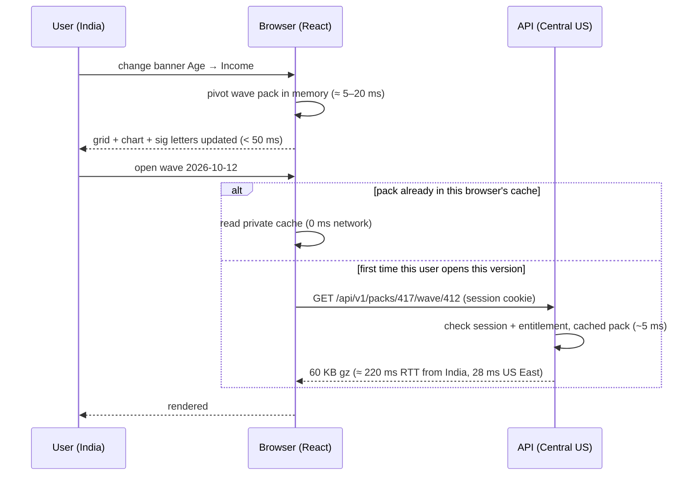

# 05 · How to make the UI respond in milliseconds

## 1. The physics: why the framework decides latency

The server is in Azure **Central US**. Before any code runs, every server round trip costs at least the network round trip, as measured by Azure's backbone P50 (Jul 2026):

| User location | Round trip to Central US |
|---|--:|
| US East coast | **28 ms** |
| India (Central India) | **220 ms** |
| The CIP dev Mac in India, over VPN | 263 ms (measured, docs/14) |
| UK / Europe | not in the retrieved table; expect it between the two |

The public internet adds more on top of these backbone figures.

A UI where **every click goes to the server** can never be faster than that round trip. That is **Streamlit's model**: every widget change sends a message to the server, re-runs the page script, and sends the re-rendered elements back. On top of the network, our benchmark shows the server part growing by about 0.1 s per simultaneous user ([02](02-benchmarks.md)).

**A click can only answer in milliseconds if the answer is already in the browser.** "Millisecond UI" is an architecture, not a faster server.

## 2. The latency budget

| Interaction | Target | How it is met | Possible in Streamlit? |
|---|--:|---|---|
| Sort / filter / page a table, toggle %/n, switch a chart series | **< 16 ms** (one frame) | Data is already in the browser; React re-renders a virtualised grid (AG Grid) or a canvas chart (ECharts) | **No.** It is a server re-run. |
| Change banner or question on an open wave | **< 50 ms** (measured: **20 ms**, [02 §0](02-benchmarks.md)) | The wave pack (all cube cells, **60 KB gz** for wave 415) is pivoted in the browser | **No.** Measured 0.17 s with 1 user, 2.85 s with 40 at once. |
| Significance letters | < 5 ms | Column-proportion z-test in TypeScript over n and base, mirrored by the Python tests | No (server) |
| Open another wave / concept trend | p95 ≤ 300 ms US, ≤ 600 ms India | Versioned pack `/api/v1/packs/{version}/wave/{id}`. The first fetch costs one round trip plus about 5 ms of server time. Repeats come from the **browser's private cache** (0 ms network). | No |
| Ad-hoc cohort cross-tab | 0.1–1 s uncached; ~1 ms + RTT cached | API → cube or raw SQL; cache keyed by (version, definition) | Possible, but serialised behind other users |
| First visit (cold) | < 1.5 s US, < 2.5 s India | 81 KB gz entry JS (measured on a React build) + 60 KB pack; static assets (not data) may be served from a CDN edge | Streamlit's entry script alone is 512 KB gz, plus a websocket handshake and a script run |
| Repeat visit | < 300 ms to usable | Hashed assets served from browser cache; `ETag`/`304` on packs; TanStack Query shows cached data instantly while it revalidates | No (every load re-runs the script) |

## 3. Techniques, in order of payoff

1. **Ship data, not pixels.**
   - Send compact JSON wave packs.
   - Do pivot, sort and filter in the browser.
   - The pack is smaller than one image: 60 KB gz for a whole wave.
2. **Immutable, versioned URLs.**
   - `data_version` changes once a week, so `Cache-Control: immutable` is safe.
   - Packs are cached **privately in each user's browser**. Subscriber data never goes in a shared CDN cache, where anyone with the URL could read it (ChatGPT's correction, adopted).
   - Only the static app files (no data) may use a CDN edge.
3. **Three cache layers.**
   - Browser: TanStack Query plus HTTP cache.
   - Edge: Front Door, for static files only.
   - Server: a version-keyed LRU per worker.
   - MySQL only sees misses.
4. **Pre-compute.** The `cip_agg_cell` cube already holds every standard cut, so the server rarely touches the 23 M-row answer table.
5. **Small bundles.**
   - React 19 + react-dom is about 69 KB gz.
   - ECharts (368 KB gz) instead of Plotly (1.48 MB gz).
   - Lazy-load heavy screens.
   - Serve brotli/gzip. The benchmark sent ECharts uncompressed: 1.1 MB, against 369 KB gzipped.
6. **Optimistic UI.** Update the URL and show the previous result dimmed while new data loads. The screen never goes blank, as it does in Streamlit during a re-run.
7. **Measure in production.** Real-user timings (web-vitals) and API p50/p95 per route go to Application Insights. Alert when p95 > 1 s.

## 4. What it looks like for one click

The same two clicks in Streamlit are two server re-runs. Each costs at least the 220 ms round trip, plus queueing behind every other active user in one Python process.
