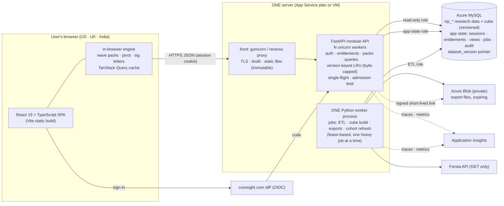
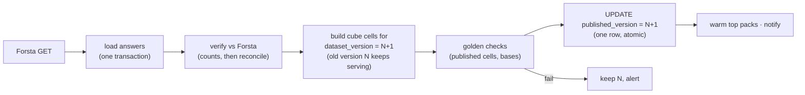

# 06 · Final system design: one server, one MySQL, fastest possible for many users

**Status:** recommended design, 20 Oct 2026. This is the merged "best of both" from:
- this folder (Claude): evidence, benchmarks, data packs, memory budget;
- [`docs/UI-Design-ChatGPT`](../UI-Design-ChatGPT/CIP_Architecture_Review/04-system-design.md): versioned publication, durable jobs, entitlements, cache safety, qualification gates.

The comparison is in [09](09-chatgpt-vs-claude.md).

**Given by IT:** one application server (about 4.5 GB RAM for staging, about 9.88 GB for production) and one Azure MySQL database.

**Goal:** a client product that answers clicks in milliseconds, serves many users and many requests, and is reused by CIQ, MIP and MDB.

Labels:
- **[M]** measured here ([02](02-benchmarks.md))
- **[O]** observed in code, logs or the Azure export
- **[T]** a target to qualify, not yet achieved

## 1. The design in one picture



**Three processes on one server, no extra infrastructure:**
1. **The front.** It serves the static app and terminates TLS.
2. **The API workers.**
3. **One job worker.**

There is no Redis, Kafka, Kubernetes, Node server or second database. Each one would be added only when a measurement demands it.

## 2. Technology choices, with the reason for each

| Layer | Choice | Why (evidence) |
|---|---|---|
| UI language | **TypeScript** | Type errors are caught before release. One language across CIP, CIQ, MIP and MDB front ends. |
| UI framework | **React 19 + Vite**, static files | Largest hiring pool (React 41.5 % in Stack Overflow 2026; 5,653 India postings vs 131 for Streamlit) [W]. Already used in SMS-UI and ems-frontend. **No server rendering**: the app is behind a login, and this avoids the Next.js server CVE class [W]. |
| Charts / tables | Apache ECharts (369 KB gz) / AG Grid Community (MIT) | ECharts is 4× lighter than Plotly (1.48 MB gz) [W]. AG Grid's virtual scrolling keeps big tables smooth. Pivoting is done by our own engine, so AG Grid Enterprise is not needed. |
| Browser data | **Wave packs + in-browser pivot** | A whole wave's cube is **60 KB gz** [M]. A click answered from the pack takes **20 ms** [M]. |
| API | **Python + FastAPI**, sync endpoints on a bounded thread pool (PyMySQL is synchronous), gunicorn + uvicorn workers | Reuses the verified Python data layer. FastAPI and Node gave the **same** user-visible times (click 0.12 vs 0.14 s at 40 users) [M]. A rewrite buys nothing. |
| Jobs | **One worker process**, a `cip_job` table in MySQL with leases (`SELECT … FOR UPDATE SKIP LOCKED`, MySQL 8) | Exports, ETL and cube builds never run inside a web request. Durable, retryable, observable. No message broker. |
| Data | Existing Azure MySQL + **versioned** cube | Already verified: 147,635/147,635 answers equal Forsta [O]. Versioning fixes the delete-then-rebuild gap ([09](09-chatgpt-vs-claude.md)). |
| Sign-in | OIDC authorization code + PKCE (Authlib) in the API; **server-set HttpOnly, Secure, SameSite cookie**; session row in MySQL | The cookie control SIP and MIP could not get from Streamlit [O] |
| Telemetry | OpenTelemetry → Application Insights; browser INP/LCP | Targets are measured in production, not assumed |

## 3. How each click is served: three speeds

| User action | Answered by | Measured | Target [T] |
|---|---|---|---|
| Sort, filter rows, toggle %/n, chart type, page a table, show/hide series | Browser, data already loaded | — (in-memory) | **< 16 ms** (1 frame) |
| Change question or banner (age, gender, income, region…) on an open wave | Browser, **wave pack** (all cube cells) | **20 ms** with 1 user, no network [M] | **< 50 ms** |
| Significance letters | Browser (TypeScript z-test), mirrored by Python tests | — | < 5 ms |
| Open a new wave / concept trend | Pack from the browser cache, or one API call | API click 0.03–0.12 s locally [M], plus the network round trip (28 ms US East, ≈ 220 ms India) [W] | p95 ≤ 300 ms US, ≤ 600 ms India |
| Ad-hoc cohort cross-tab | API → cube or raw SQL, cached by (version, definition) | — | p95 ≤ 1 s, else becomes a job |
| Excel / PowerPoint export | **Job** → worker → Blob → signed link | — | Accepted in ≤ 300 ms; file in seconds |
| First visit | Static app (≈ 81 KB gz entry [M]) + first pack (60 KB gz) | Matched page load 0.09 s with 1 user, 0.77 s with 40 at once [M] | LCP p75 ≤ 2.5 s; INP p75 ≤ 200 ms (web.dev thresholds) |

**For comparison, the same screen and the same click at 40 simultaneous users:**

| Variant | Click → result [M] |
|---|--:|
| Streamlit | **2.85 s** |
| Dash | 0.98 s |
| This design, one API call | **0.12 s** |
| This design, from the pack | **0.07 s** |

## 4. Data publication: versioned, atomic, never half-built

ChatGPT's best contribution, adopted.



**What changes**
- `cip_agg_cell` gets a `dataset_version` column.
- A one-row `cip_published_version` pointer says which version is live.
- Today's `refresh_wave` deletes the old cells before rebuilding, so a failure leaves readers on the slow fallback. That goes away.

**Why it matters**
- Every pack URL and cache key includes the version.
- In-flight requests finish on the version they started with.
- Old cache entries are never asked for again, so no cache invalidation code is needed.

**Keeping old versions**
- Keep N−1 for rollback.
- Prune older versions after 7 days.
- Publications pin their version for reproducibility.

**Cohort refresh** compares a **digest of the membership** (for example SHA-256 of the sorted IDs). It no longer compares count + sum, which can collide ([09](09-chatgpt-vs-claude.md)).

## 5. Packs and caching: fast *and* safe

### Packs

| Pack | URL | Content | Size |
|---|---|---|---|
| **Wave pack** | `GET /api/v1/packs/{version}/wave/{survey_id}` | All cube cells for the wave, plus labels | **60 KB gz** for wave 415 [M] |
| Trend pack | `GET /api/v1/packs/{version}/concept/{id}` | One concept across waves, all standard cuts | — |
| Catalogue | `GET /api/v1/packs/{version}/catalogue` | Waves, questions and concepts for search | — |

### Cache rules

| Content | Cache-Control | Where it is cached |
|---|---|---|
| Static app files (hashed names) | `public, max-age=31536000, immutable` | Browser; optional CDN |
| **Packs and API data** (subscriber data) | `private, max-age=31536000, immutable` (packs, versioned URL) / `private, no-cache` + ETag (API) | **Browser only. Never a public CDN.** |
| Sign-in, `/me`, jobs | `no-store` | Nowhere |

**Correction to the earlier version of this design.** It put packs on a public Front Door edge cache. ChatGPT is right that subscriber data must not sit in a shared CDN cache, where anyone with the URL could read it. Packs are cached privately in each user's browser.

**Why the speed survives the correction.** Each pack is downloaded once per user per version (one round trip). After that, every click on that wave is served from memory.

**Server cache**
- Per worker: an LRU keyed by (version, endpoint, canonical parameters, entitlement scope).
- Byte budget: 300 MB per worker in production, 150 MB in staging.
- **Single-flight:** concurrent identical misses wait for one query.
- Hit rate and evictions are logged.
- **Authorization is checked before every cache read.**

**Admission control**
- At most 2 concurrent *uncached* ad-hoc queries per worker. Others wait up to 2 s, then get a "queued as job" response.
- `MAX_EXECUTION_TIME` 10 s on ad-hoc SQL.
- Per-user and per-IP rate limits.

**Compression.** Brotli/gzip for JSON and assets. The benchmark served ECharts uncompressed (1.1 MB); compressed it is 369 KB [M].

## 6. Identity, entitlements and data protection

**Principals and sessions**
- Principals are keyed by IdP issuer + subject, not by email.
- The session row in MySQL holds:
  - id: random 256-bit
  - user
  - entitlement version
  - expiry
  - revoked flag
- **If MySQL is unreachable, the session check fails closed.** Today it fails open [O].

**Entitlements, default deny.** Access needs all of tenant, product, dataset and action.

| Role | What it may do |
|---|---|
| Limited user | Samples only |
| Product subscriber | Their product(s) only |
| All-data subscriber | All products |
| Analyst | Plus internal editing |
| Admin | Plus publication and roles |

Packs are built per **entitlement scope**, so a locked dataset never reaches the browser.

**CSRF.** SameSite=Lax plus an `X-CSRF-Token` header on all state-changing calls.

**XSS.** React escapes output. CSP `default-src 'self'`. No inline scripts.

**Database roles** (fixes REA G-03 and G-11):

| Role | Grants | Used by |
|---|---|---|
| `cip_read` | SELECT on research tables | API |
| `cip_app` | INSERT/UPDATE on sessions, views, jobs, audit | API |
| `cip_etl` | DDL/DML on `cip_*` | Worker only |

Views use `SQL SECURITY INVOKER`.

**Disclosure controls**
- Small-cell suppression (policy owned by research; the starting point is base < 30), applied in packs **and** exports.
- Suppressed is shown as "suppressed", never as 0.
- Verbatims and respondent-level detail are a separate entitlement.
- Exports escape formula-like text (`= + - @`).

**Secrets**
- App settings with Key Vault references.
- `gitleaks` in CI.
- **A private repo.** The current public repo has leaked `.env`.

## 7. Memory budget on the server IT provides

**Measured process sizes [M]:**

| Process | Memory |
|---|---|
| FastAPI worker | 69–100 MB |
| gunicorn master + 2 workers under load | 306 MB |
| Node | 26 MB |
| Streamlit "done well" | 135–167 MB |
| Streamlit "load the table" | **3,674 MB peak** |

The OS/platform figure (1.0 GB) is an assumption.

### 7.1 CIP alone on the server

| Item | Staging (≈ 4.5 GB, 1 vCPU) | Production (≈ 9.88 GB, 2 vCPU) |
|---|--:|--:|
| OS / platform / proxy | 1.0 | 1.0 |
| API: master + workers | 2 × 0.1 + 0.1 = 0.3 | 4 × 0.1 + 0.1 = 0.5 |
| API caches (byte-capped) | 2 × 0.15 = 0.3 | 4 × 0.3 = 1.2 |
| Job worker (hard cap; one heavy job at a time) | 1.0 | 1.5 |
| **Planned** | **2.6 GB (58 %)** | **4.2 GB (43 %)** |
| Headroom for spikes and deploys | 1.9 GB | 5.7 GB |

### 7.2 CIP, CIQ, MIP and MDB sharing one server

ChatGPT's point, adopted: apps and deployment slots on one App Service plan **share** its memory.

| Item | Staging | Production |
|---|--:|--:|
| OS / platform | 1.0 | 1.0 |
| 4 APIs × (master + 1–2 workers + cache) | 4 × 0.4 = 1.6 | 4 × 0.9 = 3.6 |
| **One shared job worker** for all four (strict queue) | 1.0 | 1.5 |
| **Planned** | **3.6 GB (80 %): tight; 1 worker per app** | **6.1 GB (62 %): fits** |

Four Streamlit apps cannot share this box: SIP alone has peaked at 6.9 GB [O].

**Ask IT to confirm:**
- Is this a VM or an App Service plan, and which SKU / vCPU?
- Is it shared with other apps or slots?
- Is "4.5 / 9.88" in GB or GiB?

## 8. CPU and request capacity

**Supply**
- The real journey ran on **one** API worker: click 0.12 s at 40 simultaneous users, with no errors [M].
- Raw throughput: 7,391 cached requests/s per worker on an M4 [M]. Assume about ⅓ on an Azure vCPU, so **about 2,400 per worker**.

**Demand** (ChatGPT's model, adopted):
- 300 active people × 1 action / 10 s × 2 requests = **60 requests/s**.
- At an 80 % cache hit rate, that is **12 misses/s**, or about **36 database queries/s**.
- With packs, most clicks need **no** request, so real demand is lower.

**Headroom.** Production (2 vCPU, 4 workers) has about 100× headroom on cached paths.

**The real ceilings, in order:**
1. MySQL on uncached ad-hoc queries.
2. The job worker during ETL or exports.
3. Network round trip for India users.

These are what the qualification run must measure ([§11](#11-rollout-and-qualification)). No user count is promised until then.

**Database connections**

| | Connections |
|---|--:|
| Per API worker: pool 5 + overflow 2 | 7 |
| Production, 4 workers | 28 |
| Job worker | 2 |
| **CIP total** | **30** |
| Four products sharing | about 120 |

Compare today's default of 10 + 20 **per engine per process**, which multiplies fast [O].

## 9. What IT must provide on the MySQL side

The current staging server, `csr-mysql8-flex-stg`, is a **Burstable B2s** (2 vCPU / 4 GB). Its CPU averaged 17 % but **peaked at 100 %** over 3 months [O, Azure export]. Burstable tiers are not meant for steady production load.

| Requirement | Why |
|---|---|
| **General Purpose** tier (e.g. D2ds_v4: 2 vCore / 8 GB or larger), same region as the app (Central US) | No CPU-credit cliffs. Buffer pool large enough for the cube and hot indexes. |
| Private endpoint or VNet integration to the app server | Removes the public-IP firewall timeouts that broke 5 of 10 ETL days [O] |
| `max_connections` ≥ 300; `local_infile=ON` for the ETL role | Pools for four products; the fast bulk load |
| Automated backups + **point-in-time restore**, tested quarterly | Recovery. Business to set RPO/RTO (suggested start: 1 h / 4 h). |
| Slow query log on; Query Store / performance_schema | Find the ad-hoc queries that need indexes |

## 10. Reliability and operations

**Health and failure behaviour**

| Item | Behaviour |
|---|---|
| Health | `/health/live` (process) and `/health/ready` (DB reachable + published version present), used by the platform health check |
| ETL / Forsta fails | Keep serving the last published version; show "data as of …" honestly |
| DB slow or down | Fail requests clearly; never serve partial data; never grant access |
| Worker crash | Its lease expires; the job retries (capped); outputs are idempotent |

**Deploys**
- CI: lint, types, pytest (238 today) + reconcile, vitest, Playwright + axe, pip-audit, gitleaks.
- Then staging slot → smoke + numbers check → swap.
- Front-end assets are built in CI, never on the server.

**Alerts**
- p95 > 1 s for 10 min.
- Error rate > 1 %.
- Memory > 75 %.
- No new published version by Tue 09:00 IST after a closing wave.
- Job queue age > 15 min.

**Honest limit.** One server is a single point of failure. A second instance ($1,489/yr) is the first availability upgrade. The design is stateless, so it needs no code change.

## 11. Rollout and qualification

ChatGPT's gating, combined with the REA and Council plan:

| Gate | Work | Proceed when |
|---|---|---|
| 0. Secure | Rotate leaked secrets; private repo; DB roles; fail-closed auth and sessions | REA Claude Phase 0–3 done |
| 1. Testable core | Remove Streamlit caching from `app/data/*`; pure functions; versioned cube; job table | pytest green; reconcile 100 %; versioned publish passes a failure drill |
| 2. **Vertical slice** | Overview + Cross-tab (packs, sig letters, one ad-hoc cohort, export job), real OIDC, on the **real IT server** and MySQL | **Measured on Azure:**<br>• INP p75 ≤ 200 ms<br>• pack click < 50 ms<br>• API p95 ≤ 300 ms (US)<br>• matched against optimized Streamlit<br>• ETL running in parallel |
| 3. Load + soak | k6/Locust at 25 → 50 → 100 → 250 → 500 virtual users, with think time, ETL and exports overlapping, India and US profiles | Safe operating envelope recorded, with headroom |
| 4. Client pilot | Trends, saved views, publications; pilot clients | Council gate review **Tue 1 Dec 2026** |
| 5. Reuse | CIQ / MIP / MDB adopt `@coresight/ui` and `coresight-platform` | Per-product cost/benefit |

**Estimate:** about 11–12 developer-weeks to gate 4, with design support. The data layer and reconciliation already exist.

**Internal pages stay on Streamlit:** Mappings, Data Health and Publications admin. That is the case where Streamlit fits.

## 12. Code layout

```
cip/
  web/                  React + TS (Vite) → dist/ (served by the front)
    src/engine/         pack loader, pivot, sig tests (pure TS, unit-tested vs Python fixtures)
  api/                  FastAPI: auth, entitlements, packs, analysis, views, jobs, health
  core/                 today's app/data/* without Streamlit: repository, cube, cohorts, harmonise, publications
  worker/               job loop (lease), ETL entry (etl/*), cube build, exports
  sql/                  migrations (versioned cube, published pointer, jobs, entitlements, sessions)
  shared/               OpenAPI → generated TS types
```

## 13. Why this is the lowest-latency, lowest-cost option on one server

1. **Most clicks never leave the browser.** Measured at 20 ms. No server design can beat zero round trips.
2. **The clicks that do leave are cheap.** Each is one small cached call: 0.12 s at 40 simultaneous users on one worker [M], against 2.85 s for Streamlit.
3. **Memory stays flat with users.** The planned CIP total is 4.2 GB of 9.88 GB in production. Streamlit's "load the table" pattern used 3.7 GB for one table [M].
4. **No licences.** Hosting is about $1.8–2.7k/yr per product. Every buy option charges per viewer ([04](04-marketplace-buy-vs-build.md), [07](07-cost-model.md)).
5. **Nothing extra to run.** One server, one database, three processes, one shared kit for four products.
