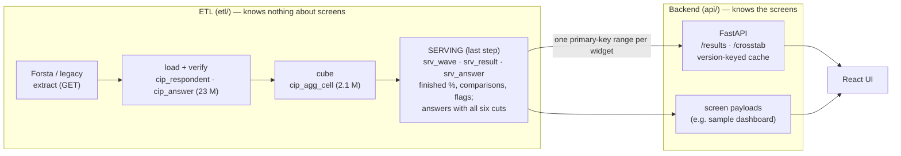

# 10 · Database design: what the ETL leaves behind so every screen loads in milliseconds

**The split, as agreed on 20 Oct 2026:**
- **The ETL** extracts, filters, loads and verifies. It ends at a set of **screen-agnostic serving tables**. It knows nothing about any dashboard.
- **The backend** (FastAPI) reads only those serving tables plus its own caches, and shapes them for whatever screens the UI team designs.
- **The Holiday PDF dashboard** was only a sample. It lives entirely on the backend side ([`api/dashboards.py`](../../api/dashboards.py), [`web/`](../../web/)) and is not part of the ETL.

**Built:**
- DDL: [`sql/005_serving.sql`](../../sql/005_serving.sql)
- ETL step: [`etl/serving.py`](../../etl/serving.py), called inside `etl/forsta_etl.load_survey`
- Tests: [`tests/test_serving.py`](../../tests/test_serving.py)

Both tables exist in `cip_stg` and are backfilled for every verified wave.

## 1. The layers



| Layer | Table(s) | Rows | Written by | Read by users? |
|---|---|--:|---|---|
| Raw | `cip_respondent`, `cip_answer` | 23 M answers | ETL load (verified against Forsta) | **Never** |
| Semantic | `cip_question` / `cip_item` / `cip_option`, `cip_concept*`, **`cip_agg_cell`** (cube) | 2.1 M cells | ETL | **Never** |
| **Serving** | **`srv_wave`, `srv_result`** | about 4,000–6,000 rows per wave | **ETL, last step** | **Yes. The only tables screens read.** |
| **Serving (combined filters)** | **`srv_answer`**: each qualified answer with all six cuts; multi items only when chosen, plus one base row per respondent | about 25,000 per wave (34,960 for 12 Oct); 7.9 M rows, 0.98 GB in all | **ETL, last step**, same transaction | Yes, through `/crosstab` |
| Backend cache | `cip_dash_*` (sample) + in-process memory | tiny | Backend | Yes |

## 2. What "filter it, make it proper" means for the serving rows

`srv_result` holds **one row per wave × question × cut value × answer**, already:

| Property | How |
|---|---|
| **Filtered** | Qualified respondents only (the cube is built on them). Technical and virtual questions removed. Zero-base cells dropped. |
| **Labelled** | `qcode`, `item_label`, `option_code`, `option_label`, `sort_order`. The screen needs no joins to know what a number means. |
| **Calculated** | `n`, `base_n`, `pct` (3 decimals), on the correct base per question (routed questions keep their own base) |
| **Compared** | `prior_pct` / `prior_base_n`: the previous verified wave of the same tracker, at most 14 days back.<br>`ly_pct` / `ly_base_n`: the same calendar week last year, `wave_date − 364 ± 3 days`.<br>Answers are matched on question code + answer + cut. |
| **Flagged** | `small_base` (base < 50).<br>`base_changed_prior` / `base_changed_ly`: the question's base share of qualified respondents moved more than 10 points, i.e. a routing change. Example: Holiday XM1 went from 149/401 to 404/404. |
| **Harmonised** | `concept_option_id` links the same answer across waves, for trend screens |

`srv_wave` holds **one row per verified wave**:
- family and type;
- `qualified_n`;
- which waves it compares with;
- `ly_status`:
  - `loaded`;
  - `not_loaded` (the week exists in Forsta but was never loaded, e.g. hibernated: reported, never substituted);
  - `none`.

**Every standard cut is covered:** total, gender, age band, generation, income band, census region and urbanicity.

## 3. Keys and indexes: why a screen read costs about a millisecond on the database

```sql
PRIMARY KEY (survey_id, qcode, dim, dim_value, item_id, option_id)    -- srv_result, clustered
KEY ix_srv_concept (concept_option_id, dim, dim_value, survey_id)     -- trends across waves
```

- **InnoDB stores rows in primary-key order.** So "wave 412, question XM3, by generation" is **one contiguous range** of about 15 rows on one or two 16 KB pages.
- **No join, no GROUP BY, no arithmetic.**
- **Trends** use the concept index.
- **The hot set is small.** Recent waves' rows stay in the 2 GB buffer pool, so reads don't touch disk.

Measured on Azure staging: **[STRESS-TEST-RESULTS.md](STRESS-TEST-RESULTS.md)**.

## 4. The procedure: how the ETL builds it

Inside `load_survey`, after the cube, search and tracker lines:

```
serving.build_wave(survey_id)          # inside the load: a failure fails the wave (like the cube)
  1. comparison waves: prior week (same family, ≤ 14 days), last year (364 ± 3 days);
     a week that exists in Forsta but isn't loaded is recorded as 'not_loaded', never substituted
  2. one cube read for this wave + its two comparison waves (starting from the waves' own questions)
  3. compute pct, match comparisons on (qcode, item label, option code, cut), set flags
  4. ONE transaction (READ COMMITTED): DELETE this wave's srv rows, INSERT the new ones + srv_wave row
     → readers see the old rows or the new rows, never a mix; deadlocks (parallel builds) are retried
...
_mark(path, 'loaded'); survey_calendar.rebuild()
serving.rebuild_dependants(survey_id)  # after the load: next week / next year's same week now have
                                       # this wave to compare with; failure logged, never fatal
```

**Recovering the hibernated 2025 weeks** (REA G-02) therefore fills every 2026 "vs last year" figure automatically.

**Backfill and repair:**
- `python -m etl.serving --all --jobs 4 --missing` builds the waves not built yet.
- `--wave 412` rebuilds one wave.
- Waves are independent (comparisons read the cube), so they build in parallel.

**Build cost**
- From the laptop over the VPN: about 3 s per wave with 4 jobs in parallel (about 12 s each).
- From a job running in Azure next to the database: expected well under that.

**Two lessons, now fixed in code:**
1. **A missing filter wrecked the query plan.** Without `q.survey_id IN (…)` on the question join, MySQL started from all 8,256 questions and probed the 2.1 M-row cube for each, taking 200+ s. With it, it reads only the wave's ~150 questions (`range` on `uq_question`).
2. **Parallel builds deadlocked on gap locks.** Under the default REPEATABLE READ, InnoDB locks the gaps between keys on `DELETE` of missing rows, and parallel builds hit them. The fix is `READ COMMITTED` plus a retry on error 1213.

## 5. What the backend does with it

| Endpoint | Reads | Cache |
|---|---|---|
| `GET /api/v1/waves/{id}/results?q=XM3,XM1&dim=total,generation` | `srv_result`: one PK range per question | Per worker, keyed by the serving version (`COUNT, MAX(built_at)` of `srv_wave`, polled once a minute). A rebuild changes the version, so stale answers are never served. |
| `GET /api/v1/dashboards/...` (sample only) | Backend-built payloads (`cip_dash_*`), themselves built from `srv_result` | In memory |

| `GET /api/v1/waves/{id}/crosstab?q=XM3&by=generation,gender&weeks=4` | `srv_answer`: one GROUP BY over a PK range (≈ 1 ms), labels from `srv_result` Total rows; pools this wave and up to 3 earlier ones along the `prior_survey_id` chain, matching answers by label and code | Same cache |

A screen that needs something new (another question, another cut, two cuts combined) **needs no ETL change**: every question × cut is already in `srv_result`, and every pair of cuts can be counted from `srv_answer`.

**Two-cut rules** (in `/crosstab`):
- a cell under 30 respondents returns no number, `flags: "suppressed"`;
- under 50 it returns the number with `small_base`;
- respondents with no value for a cut are left out, as in `srv_result`;
- `warnings: ["base_changed_within_pool"]` when a pooled wave's question base moved against a prior week that is also in the pool. Pooling would then mix two populations; Holiday XM1, wave 2 → 3, is the example.

Why this table and not pre-built pairs or raw answers: [STRESS-TEST-RESULTS §11](STRESS-TEST-RESULTS.md#11-two-cuts-combined-eg-gen-z--female).

## 6. Why this design and not another

| Option | Verdict |
|---|---|
| Screens aggregate `cip_answer` (raw) at request time | Slowest by far, and it grows with users ([results](STRESS-TEST-RESULTS.md)) |
| Screens query the cube with joins | Workable, but every request repeats joins and percentages, and comparisons need more joins |
| **Serving table: finished rows, PK range** | **Chosen.** Fastest on the database, flat as users grow, cacheable, screen-agnostic. |
| Screen-specific tables built by the ETL | **Rejected, as you asked.** It couples the ETL to the UI, and every new screen would need an ETL change. |
| Stored procedures / materialised views | MySQL has no materialised views; `srv_result` is the explicit equivalent. Python logic is tested (245 tests) and versioned with the code. |
