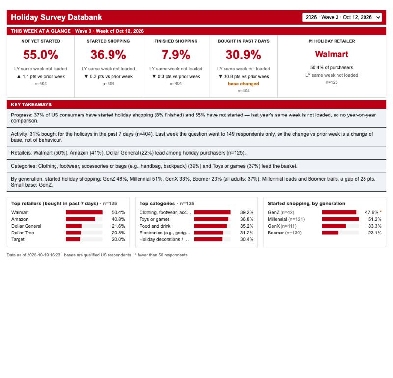

# 12 · The Holiday Survey Databank dashboard: a SAMPLE, backend-only

> **Scope (20 Oct 2026):** this dashboard is only a sample of the kind of screen CIP will have; the real UI will differ. It is **not part of the ETL**. The ETL ends at the serving tables ([10](10-database-serving-design.md)). This sample's backend builder ([`api/dashboards.py`](../../api/dashboards.py)) reads those tables and caches the screen payload.

**Design given:** `Holiday Survey Data- 2026.pdf`, the data team's weekly one-pager ("Updated by Prerana every Tuesday").

**Built:**
- React + TypeScript front end in [`web/`](../../web/src/App.tsx);
- FastAPI service in [`api/main.py`](../../api/main.py);
- numbers from the serving layer ([10](10-database-serving-design.md)).



## 1. What it shows

The same layout as the PDF:

| Area | Content |
|---|---|
| Header | Title and a **wave selector**: every loaded wave of the holiday series, 2025 wave 3 and 2026 waves 1–4 |
| "This week at a glance" | Five tiles:<br>• Not yet started<br>• Started shopping<br>• Finished shopping<br>• Bought in past 7 days<br>• #1 holiday retailer |
| Tile details | Each tile shows the change **vs last year** and **vs prior week**, and its base (n) |
| "Key takeaways" | Five sentences, **written by the builder from the same numbers** |
| Bar panels (added) | Top 5 retailers, top 5 categories, started-shopping by generation, each with bases |
| Footer | Data freshness and the small-base note |

## 2. Verification against the PDF (2026 wave 3, week of 12 Oct)

| PDF | PDF value | Ours | Source in the cube |
|---|--:|--:|---|
| Not yet started | 55.0 % | **55.0 %** | XM3 = 1: 222 / 404 |
| Started shopping | 36.9 % | **36.9 %** | XM3 = 2 or 3: 149 / 404 |
| Finished shopping | 7.9 % | **7.9 %** | XM3 = 3: 32 / 404 |
| Bought in past 7 days | 30.9 % | **30.9 %** | XM1 = 1: 125 / 404 |
| #1 holiday retailer | Walmart 50.4 % | **Walmart 50.4 %** | XM2 Walmart: 63 / 125 |
| Not yet started vs prior week | ▲ 1.1 pts | **▲ 1.1** | wave 2: 216 / 401 |
| Started vs prior week | ▼ 0.3 pts | **▼ 0.3** | wave 2: 149 / 401 |
| Finished vs prior week | ▼ 0.3 pts | **▼ 0.3** | wave 2: 33 / 401 |
| Bought 7 days vs prior week | ▼ 30.8 pts | **▼ 30.8**, flagged "base changed" | wave 2: 92 / **149** |
| Retailers lead | Walmart 50, Amazon 41, Dollar General 22 | **same** | XM2 |
| Categories lead | Clothing… 39, Toys or games 37 | **same** | XM1A |
| By generation, started | Gen Z 48, Millennial 51, Gen X 33, Boomer 23; gap 28 | **same** | XM3 × generation |
| Any "vs LY" figure | ▲ 1.7, ▼ 1.0, ▼ 0.2, LY retailer 45.8 % | **not shown: LY week not loaded** | see §3 |

**Result: every this-week and prior-week number matches the analyst's PDF exactly.**

## 3. Two problems the dashboard exposes, which the PDF hides

1. **"Bought in past 7 days ▼ 30.8 pts vs prior week" is not a real drop.**
   - In wave 2 the question (XM1) went only to people who had started shopping: **149 of 401**.
   - From wave 3 it goes to everyone: **404 of 404**.
   - So 61.7 % → 30.9 % compares two different groups.
   - The builder detects the routing change automatically (`base_changed_prior`). The tile says "base changed", and the takeaway explains it.
2. **The "vs LY" numbers cannot be checked.**
   - The PDF's last-year comparison is most likely the same calendar week of 2025: wave 1, week of 13 Oct 2025, Forsta `selfserve/58f/251000`. This is inferred:
     - its "▲ 1.7 pts vs LY" implies 53.3 % not started last year;
     - the only loaded 2025 wave (wave 3, 27 Oct 2025) has 44.5 %, so the PDF did not use that wave.
   - That survey is **hibernated in Forsta and was never loaded**. It is one of the 51 in REA Claude G-02.
   - The only loaded 2025 holiday wave is wave 3 (27 Oct 2025).
   - Rather than compare against the wrong week, the dashboard says "LY same week not loaded".
   - Once the 2025 waves are recovered, the same build adds the LY figures automatically. **The data gap now has a visible business cost.**

## 4. How fast it is

From [11](11-capacity-staging-production.md):

| Action | Time | Why |
|---|--:|---|
| Open the dashboard (1 user) | **0.07 s** to fully drawn | 71 KB gz app (cached for a year after the first visit) + one 1.3 KB payload |
| Open it, 40 people at the same moment | 0.67 s | Limited by 40 Chrome windows on one laptop; the server stays sub-millisecond |
| Switch wave | **0.01 s** | All waves are prefetched; no server call |
| Server time per request | 0.3–0.6 ms | No SQL, no computation: stored bytes from memory |

## 5. Run it

```bash
# backend job (not the ETL): rebuild the sample's payloads from the serving tables
.venv/bin/python -m api.dashboards --build holiday_tracker
# front end (CI builds this in production)
cd web && npm install && npm run build && cd ..
# API + front end on one port
APP_ENV=LOCAL CIP_SESSION_SECRET=<random> .venv/bin/gunicorn api.main:app -k uvicorn.workers.UvicornWorker -w 1 -b 127.0.0.1:8000
# open http://127.0.0.1:8000/auth/dev-login  (local only; production uses OIDC)
```

## 6. Files

| File | Role |
|---|---|
| `config/dashboards.yml` | Dashboard definition: tiles, ranked lists, segments, small-base threshold |
| `sql/006_dashboards.sql` | Backend cache tables for the sample (`cip_dash_*`) |
| `api/dashboards.py` | Backend builder: reads `srv_result`, stores the screen payload (one transaction) |
| `api/main.py` | Serves published payloads from memory; signed-cookie sessions; static files |
| `web/src/App.tsx`, `styles.css`, `types.ts` | The dashboard |
| `tests/test_dashboards.py` | Comparison rules and flags (3 tests) |
| `scripts/ui_benchmark/rate_test.py`, `journey.py` | Capacity and browser timing |

## 7. Not done yet (deliberately)

| Item | Status |
|---|---|
| ETL coupling | **Removed on purpose.** The ETL builds only the screen-agnostic serving tables. Run `python -m api.dashboards --build holiday_tracker` (or a backend job) to refresh this sample. |
| **Production sign-in** | OIDC with the coresight.com identity provider. The dev login exists only when `APP_ENV=local` is set explicitly. |
| **Entitlement source** | Products are carried in the signed session; they should be filled from the subscription system at sign-in. |
| **Static file compression** | Put the front proxy or a CDN in front for gzip/brotli. Data stays private and is never cached on a shared CDN. |
