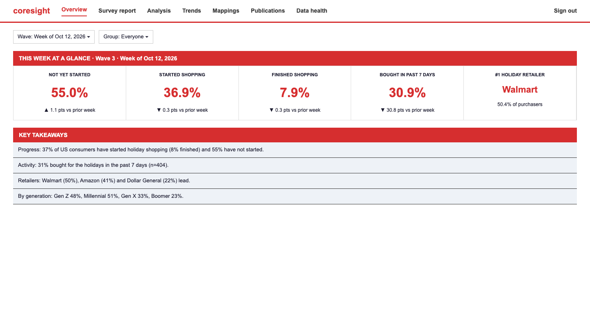
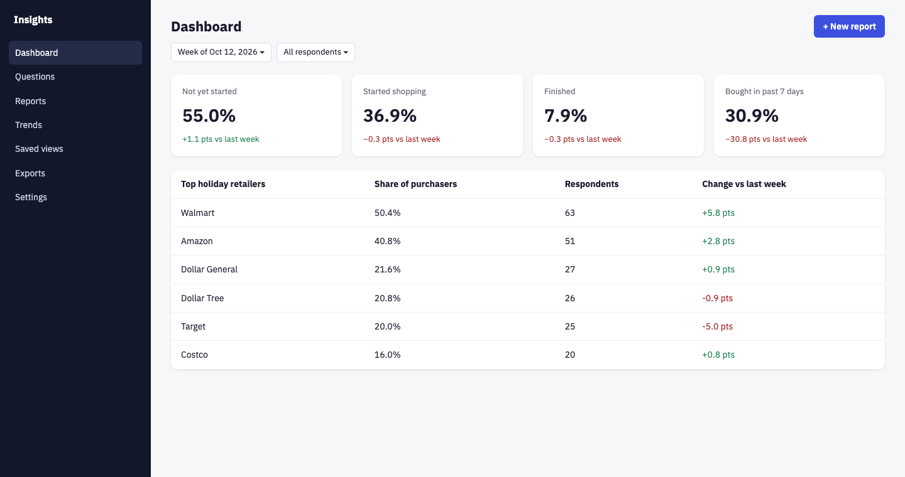
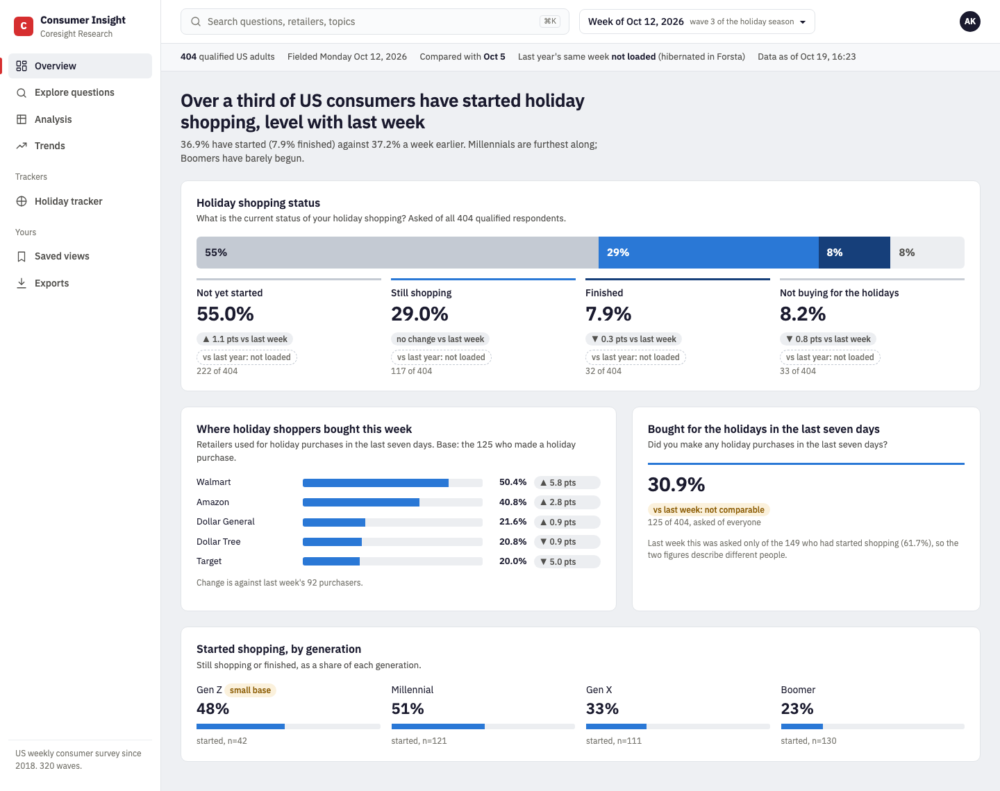
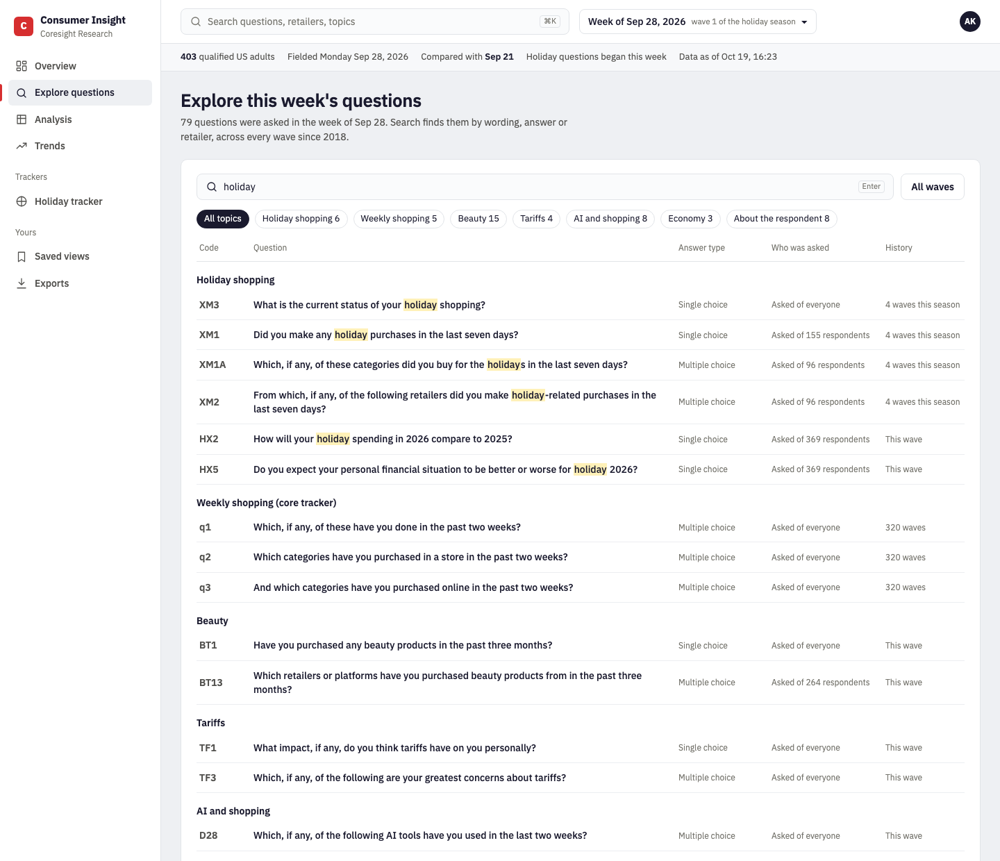
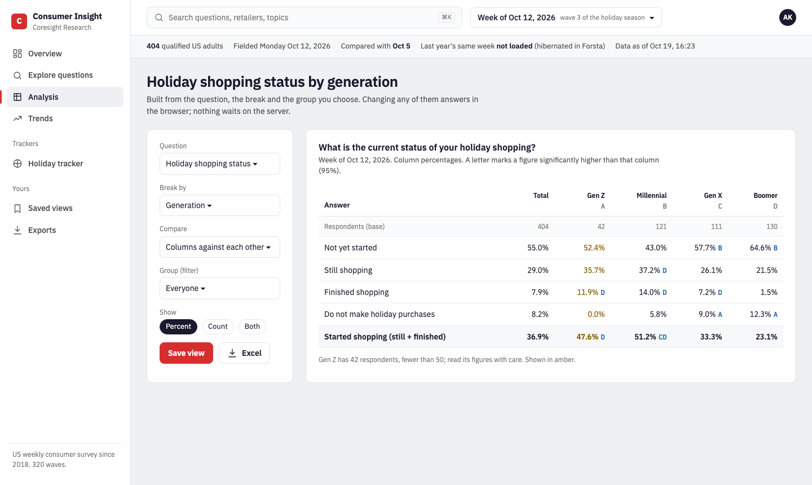
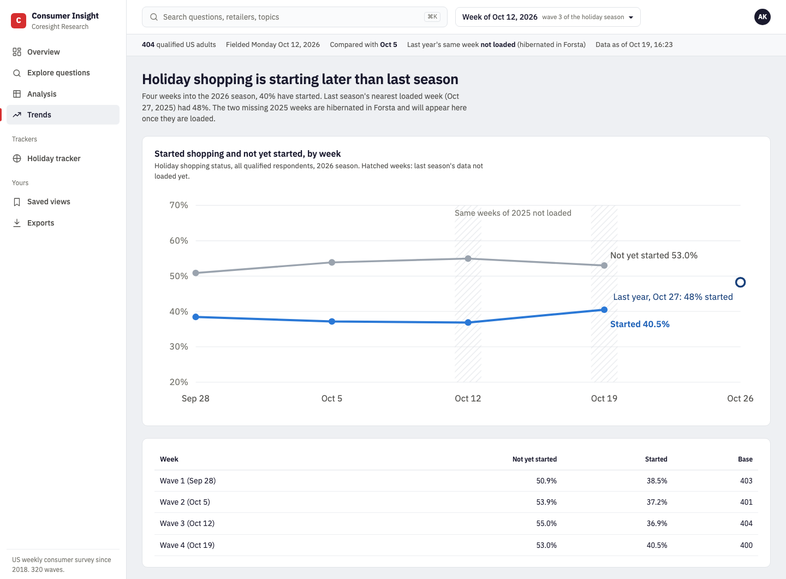
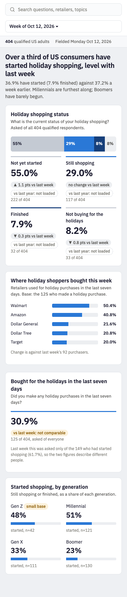

# 13 · UI design: which direction, the screens, and the frontend handoff

**Status:** recommended design for the CIP client UI, 20 Oct 2026. It is ready for the frontend team to start while the backend is prepared.

**Images:** [`ui/images/`](ui/images/).

**Clickable static HTML:** [`ui/mockups/`](ui/mockups/).

**Data:** every mockup uses **real CIP numbers**:
- the 2026 Holiday tracker, waves 1–4;
- 2025 wave 3;
- the real question catalogue.

Significance letters are real z-tests. Regenerate everything with `python docs/Ui-Design-Claude/ui/make_mockups.py`.

## 1. The decision: three directions, one recommendation

The same week of data (Oct 12, 2026) in each direction:

| | A. Today's Coresight portal | B. Billing-console style (Chargebee-like) | **C. Research desk (recommended)** |
|---|---|---|---|
| Picture |  |  |  |
| Where it comes from | SIP / MIP / MDP; the analysts' Holiday PDF; ChatGPT's wireframe ([07](../UI-Design-ChatGPT/CIP_Architecture_Review/07-ui-specification.md)) | Chargebee and similar SaaS consoles: dark side rail, KPI cards, tables | This folder. It keeps the best of A and B and adds what survey data needs. |
| Navigation | Top bar of 7 links: already full, with no room for CIQ / MIP / MDB or saved work | Side rail: scales to many sections and products | Side rail (light, brand-red marker). Scales to products, trackers and saved work. |
| How numbers are shown | Big red numbers, no base | Identical KPI cards, no base | **Every number carries its base**, and the question it answers is printed above it |
| Changes | Arrow only; significance unknown | Green for up, red for down, **whether significant or not** | **Grey unless statistically significant.** "Base changed" and "not loaded" are explicit states. |
| The Holiday XM1 trap (−30.8 pts from a routing change) | Shown as a −30.8 pt drop | Shown in red as a collapse | **"Not comparable"**, with a one-line reason |
| Last year missing (hibernated weeks) | Silent | Silent | Stated in the context line and on every tile |
| Brand | Strong, but red everywhere competes with data | Generic; the brand is lost | Coresight red used only for brand, active nav and the primary action |
| Effort for the team | Lowest (familiar) | Low (many kits) | Low: standard React + shadcn/ui-style components, plus 4 custom data components (§4) |

**Recommendation: C.**

**Why not B (Chargebee-like).** Its navigation pattern is right, and C keeps it. But its KPI-card-and-table body is built for billing objects (subscriptions, invoices), where a number is a fact. In survey data a number is an **estimate from a sample**. Clients need its base, whether a change is real, and when two figures can't be compared. Option B's screenshot makes the risk visible: it paints a routing change as a 30-point collapse, and paints a 5.8-pt move that is not significant as good news.

**Why not A.** It is familiar to the business and keeps the brand. But the top bar can't grow past seven links. Its red banners and red numbers make every figure look like an alert. And it hides the base, the significance and the missing weeks, the same gaps the Holiday PDF has ([12 §3](12-holiday-dashboard.md)).

**What C keeps from each:**
- **From A:** the Coresight look, the headline-first reading order, and the key-takeaway sentences, now written as the page headline.
- **From B:** the side rail and the clean table discipline.
- **From ChatGPT's spec:** the context line (wave, base, freshness, comparisons) and the explicit empty, suppressed and not-loaded states.

## 2. The design system

### 2.1 Colour

The screen is mostly ink on white; colour carries meaning.

| Token | Hex | Use |
|---|---|---|
| `ink` | `#1a1a2e` | Text, primary icons (Coresight's own ink) |
| `ink-2` / `ink-3` | `#52514e` / `#77766f` | Secondary text / bases, notes |
| `desk` | `#eef0f3` | App background (cool grey) |
| `paper` | `#ffffff` | Content blocks, rail, top bar |
| `line` / `line-2` | `#e1e4e8` / `#eceef1` | Borders / row dividers |
| `red` | `#d62e2f` | **Brand only:** logo, active-nav marker, primary button (*Save view*) |
| `up` / `down` | `#166b41` / `#a61f20` | **Only for statistically significant changes** (5.7:1 and 6.3:1 on their chip tints) |
| `warn` | `#8a5a00` on `#fbf1dc` | Small base, base changed, not comparable |
| `blue` / `blue-ink` | `#2a78d6` / `#1f62b8` | The data series (bars, lines) / blue **text** such as significance letters (6.0:1 on white) |
| Status scale | `#c4cad3` → `#2a78d6` → `#163f7a` | Not started → still shopping → finished (a progression, light to dark) |

### 2.2 Type

- **IBM Plex Sans** (400 / 500 / 600) for the interface and prose.
- **IBM Plex Sans Condensed** for cross-tab tables, so 10+ banner columns fit without scrolling.
- Tabular figures everywhere numbers line up.

| Element | Size |
|---|---|
| Page headline | 26 px / 600 |
| Block title | 16 px / 600 |
| Body | 14 px |
| Bases and notes | 12 px |
| Large figures | 28 px / 600 |

All copy is sentence case. There are no all-caps labels, and line length stays under 80 characters.

### 2.3 Shape and space

- **Spacing:** an 8-px grid.
- **Radius:** 10 px on content blocks, 6–8 px on controls, 999 px on chips.
- **Borders:** 1 px borders separate blocks; there are no drop shadows, so the hierarchy comes from layout, not elevation.

### 2.4 Data rules: the part that makes it a research product

1. **Every number shows its base.** Examples: "222 of 404", "Base: the 125 who made a holiday purchase".
2. **The question is printed above its numbers,** in the respondent's words.
3. **Colour a change only when it is significant** (two-proportion z-test, 95 %). Otherwise use a grey chip with an arrow and the size.
4. **Four explicit states that are never shown as zero:**
   - **not comparable:** the base changed (`flags` contains `base_changed_*`);
   - **not loaded:** last year's week exists but isn't in the warehouse (`srv_wave.ly_status = 'not_loaded'`);
   - **small base:** fewer than 50 respondents, shown in amber;
   - **suppressed:** for client plans with disclosure rules.
5. **Parts of a whole are drawn as one whole.** This is the *status strip*: shopping status is one 100 % bar, not four separate cards.

## 3. Screens

### 3.1 Overview: "what changed this week"


**Order on the page:**
1. A headline sentence, written from the numbers.
2. The status strip, with its four figures, changes and bases.
3. Where shoppers bought, plus the purchase-incidence block, side by side.
4. The generation breakdown.

**Data:** `GET /api/v1/waves/{id}/results?q=XM3,XM1,XM2&dim=total,generation` (one request). `srv_wave` supplies the context line.

### 3.2 Explore questions



**What it does:**
- Search by wording, answer or retailer, with the matches highlighted.
- Topic facets with counts.
- Each question shows its answer type, **who was asked** and **how much history it has**, so a client knows before clicking whether a trend exists.

**Data:** a catalogue endpoint built from `srv_result` qcodes plus `cip_question` text. The backend serves it once per version, and the browser filters it locally.

### 3.3 Analysis: cross-tab builder



**Layout:**
- **Left panel:** question, break, comparison, group, percent/count, *Save view*, *Excel*.
- **Table:** the base row first; letters A–D on the columns, with a letter next to a figure meaning "significantly higher than that column"; a net row ("Started shopping"); amber for small bases.

**Changing the break or the display** re-pivots in the browser (< 50 ms, [05](05-millisecond-ui.md)). A new question is one cached request.

**A group filter combined with the break** (e.g. Gen Z × gender) is one `/crosstab` request, about 1 ms on the database. At about 400 respondents a week, most two-cut cells are small. The panel therefore offers **Pool: this week | last 4 weeks**:
- cells under 30 show “too few respondents” (`suppressed`);
- cells under 50 are amber;
- a `base_changed_within_pool` warning shows a banner instead of silently mixing populations.

### 3.4 Trends



**What it shows:**
- Weekly lines with direct labels instead of a legend.
- Last year as an open marker.
- **Hatched bands where last year's same week isn't loaded.**
- The table below the chart is the accessible equivalent and the export source.

**Data:** `srv_result` by `concept_option_id` across waves (index `ix_srv_concept`).

### 3.5 Phone



**Changes from desktop:**
- The rail collapses.
- Search becomes full width.
- The context line keeps its two essentials.
- Blocks stack.
- Figures go two per row.

The same HTML and CSS power desktop and phone.

### 3.6 Holiday tracker (and any other tracker)

The analysts' PDF one-pager becomes a **tracker page** in the rail (*Trackers → Holiday tracker*). It uses the same components as Overview, scoped to one series, with its wave selector. The sample built earlier ([12](12-holiday-dashboard.md)) shows the content. Its layout should follow §3.1, not the PDF's tiles.

## 4. Component inventory for the frontend

Stack, per [06](06-system-design.md): React 19 + TypeScript + Vite, TanStack Query, AG Grid Community for long tables, ECharts for charts. Generic controls come from a shadcn/ui-style kit, the same kit EMS uses.

| Component | Props (TypeScript) | Notes |
|---|---|---|
| `AppShell` | `rail`, `topBar`, `context` | Light rail with a 3 px red active marker; collapses below 700 px |
| `QuestionSearch` | `onSelect(qcode)` | ⌘K; searches the cached catalogue locally |
| `WavePicker` | `waves`, `value`, `onChange` | Shows week, wave number and season |
| `ContextLine` | `wave: SrvWave` | Qualified n, fielded date, the comparison week, last-year status, data freshness |
| **`StatusStrip`** | `segments: {label, n, base, color}[]` | The signature component; one 100 % bar with in-bar values |
| **`ChangeChip`** | `delta`, `significant`, `state?: 'not_loaded'\|'base_changed'\|'none'` | Grey unless significant. A state replaces the number. |
| `BaseNote` | `n`, `base`, `askedOf?` | "222 of 404", "asked of everyone" |
| `BarList` | `rows: {label, pct, base, change}[]`, `max` | Ranked answers (retailers, categories) |
| **`CrosstabTable`** | `columns: {label, letter, base}[]`, `rows: {label, cells: {pct, n, higherThan: string[]}[], net?}` | Condensed font, base row first, small-base amber, sig letters |
| **`TrendChart`** | `series`, `lastYear`, `missingWeeks` | Direct labels; hatched missing weeks; the table fallback |
| `FacetChips` | `options`, `value` | Topics, display mode |
| `FilterPanel` | question / break / compare / group | Writes to the URL, so views are shareable |
| `EmptyState`, `ErrorState` | `title`, `action` | "No respondents match these filters; clear the group", never a blank chart |

The four **bold** components are custom; everything else is standard kit.

**Significance in the browser.** `n` and `base` are in every `srv_result` row, so the z-test is computed client-side (≈ 30 lines of TypeScript), mirrored by a Python test with a shared fixture. The mockup generator's `sig()` is the reference implementation.

## 5. Data contract the frontend can code against now

All of this exists today (see [10](10-database-serving-design.md)), so the frontend can mock it from JSON fixtures until the API is deployed.

```ts
// GET /api/v1/waves/{survey_id}/results?q=XM3,XM1&dim=total,generation
type Results = {
  survey_id: number;
  columns: ["qcode","dim","dim_value","item_label","option_code","option_label","n","base_n",
            "pct","prior_pct","prior_base_n","ly_pct","ly_base_n","flags"];
  rows: (string | number | null)[][];
};
// flags: "" | "small_base" | "base_changed_prior" | "base_changed_ly", comma-separated
// srv_wave (context line): { survey_id, wave_date, qualified_n, prior_survey_id, ly_survey_id,
//                            ly_status: "loaded" | "not_loaded" | "none" }

// GET /api/v1/waves/{survey_id}/crosstab?q=XM3&by=generation,gender&weeks=1..4
type Crosstab = {
  survey_id: number; qcode: string; by: [string, string];
  weeks: number;                                   // waves actually pooled (fewer if the chain is shorter)
  waves: { survey_id: number; wave_date: string }[];
  warnings: ("base_changed_within_pool")[];
  columns: ["v1","v2","item_label","option_code","option_label","n","base_n","pct","flags"];
  rows: (string | number | null)[][];              // n and pct are null when flags = "suppressed"
};
// flags: "" | "small_base" (base < 50) | "suppressed" (base < 30)
// by: two of gender, age_band, generation, income_band, census_region, urbanicity
```

**For the Lovable dashboard (built 20 Oct):**

```ts
// GET /api/v1/waves  →  the survey picker, newest first
type Wave = { survey_id: number; title: string; wave_label: string; wave_date: string; survey_family: string;
              study_type: string; qualified_n: number; prior_survey_id: number | null; ly_survey_id: number | null;
              ly_status: "loaded" | "not_loaded" | "none" };

// GET /api/v1/waves/{survey_id}/book  →  everything the four Lovable screens read, for ANY wave
// (the same shape as the Lovable app's built-in data object, plus the extra fields marked +)
type Book = {
  wave: Wave;                                                  // +
  columns: ["Total","Male","Female","Gen Z","Millennial","Gen X","Boomer"];
  n: Record<Column, number>;                                   // qualified respondents per column
  questions: {
    id: string; text: string;
    short: string | null; type: "single"|"multi"|"grid_single"|"grid_multi";   // +
    section: string; base_desc: string | null;                 // + (section = cip_topic name)
    groups: {                                                  // one per grid row; one unnamed group otherwise
      label: string; base: number; bases: Record<Column, number>;   // + bases
      rows: ({ label: string; code: number | null; prior: number | null; flags: string }   // + code, prior, flags
             & Partial<Record<Column, number>>)[];             // % per column, 1 decimal
    }[];
  }[];
};
```

**Checked against Lovable's own numbers (wave 412):** all 7 columns of Q1, the column bases (404 / 200 / 200 / 42 / 121 / 111 / 130), Q6 and D7 match exactly.
- Size: 57 questions, 122 KB raw, **23 KB gzipped**, cached per serving version.
- Numeric and open-text questions are left out, because they have no percentages.
- Questions whose topic is "Unclassified" in `cip_topic` show their qcode prefix (HI, DNM, BD, F) as the section until the topic mapping is fixed.

**Still to add on the backend** (small):
- `GET /api/v1/concepts/{id}/trend`: from `ix_srv_concept`.
- OIDC sign-in and entitlements ([06 §6](06-system-design.md)).

## 6. Accessibility and quality floor

**Contrast and colour**
- Contrast, measured:
  - ink on white 17.1:1;
  - secondary text 7.9:1;
  - bases and notes 4.6:1, on white only (not on the grey desk, where they would fall to 4.0:1);
  - brand red on white 4.9:1.
- Brand red is used only on large or bold text and buttons.
- Change is never colour alone: there is always an arrow and words ("▲ 1.1 pts vs last week", "not comparable").

**Keyboard**
- Every control is reachable, and focus is visible (2 px ink ring).
- ⌘K opens search.

**Charts**
- Every chart has a table equivalent, and the SVG carries `role="img"` and a label.
- Motion is limited to user-triggered transitions, and `prefers-reduced-motion` turns them off.

**Targets** (from [05](05-millisecond-ui.md) and ChatGPT's spec): INP p75 ≤ 200 ms, LCP p75 ≤ 2.5 s, in-browser re-pivot < 50 ms.

## 7. How the frontend team starts while the backend is prepared

| Week | Frontend | Backend (in parallel) |
|---|---|---|
| 1 | Vite + React + TS project; design tokens (§2) as CSS variables; `AppShell`, `ContextLine`, `WavePicker`; JSON fixtures copied from a real `results` response | `GET /api/v1/waves`, `/catalogue`; OIDC sign-in |
| 2 | `StatusStrip`, `ChangeChip`, `BaseNote`, `BarList` → **Overview** on fixtures | Entitlements; the CIP App Service from IT |
| 3 | `CrosstabTable` + client sig test (+ shared fixture test) → **Analysis**; `QuestionSearch` → **Explore** | `/concepts/{id}/trend`; deploy the API to staging |
| 4 | `TrendChart` → **Trends**; tracker page; phone layout; accessibility pass | Swap fixtures for the live API; load test from inside Azure |
| 5 | Usability check with two analysts and one client; polish | Vertical-slice gate ([06 §11](06-system-design.md)) |

## 8. Files

| Path | What it is |
|---|---|
| `ui/images/option-a-coresight-portal.png`, `option-b-billing-console.png`, `option-c-research-desk.png` | The three directions, same data |
| `ui/images/c-explore.png`, `c-analysis.png`, `c-trends.png`, `c-overview-mobile.png` | The recommended screens |
| `ui/mockups/*.html` | The same screens as static HTML; open them in a browser and reuse the CSS tokens |
| `ui/make_mockups.py` | Rebuilds every HTML file and image from the embedded real data (`sig()` = reference z-test) |
