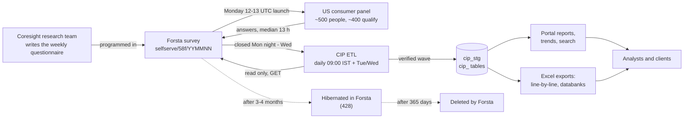
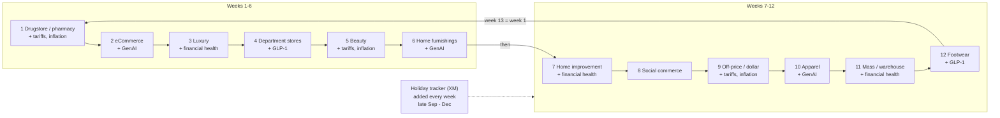
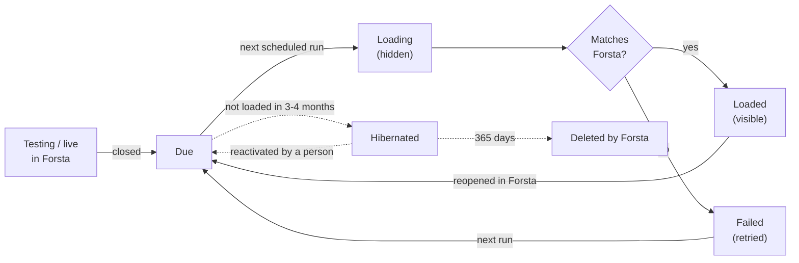
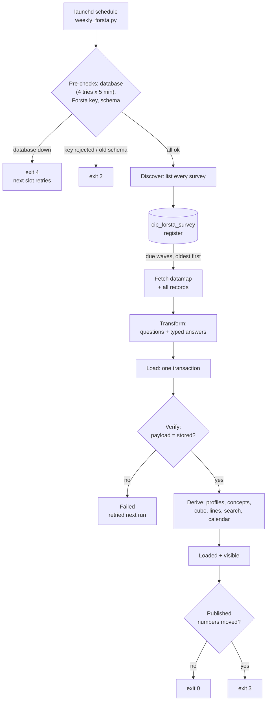

# Consumer Insight Portal — Business Description

**How Coresight's consumer survey data is collected, checked, stored and made ready for analysis.**

Version 1.0 · 13 October 2026 · Owner: Data Automation (Coresight Research)

---

# 1. Summary

Coresight Research runs a **weekly survey of about 400 US consumers** on the Forsta Surveys platform (formerly
Decipher), plus a handful of **annual studies** (Holiday, Amazon apparel, Online grocery, Back-to-school) and
**client projects**. Until now the data team downloaded each week's results as Excel files, cleaned them by hand and
pasted them into master workbooks.

The **Consumer Insight Portal (CIP)** replaces that manual work with an automated pipeline:

* Every survey is **read straight from Forsta** through its API (read only — nothing in Forsta is ever changed).
* Each weekly wave is **loaded within hours of closing**, checked answer by answer against Forsta, and only then
  made visible.
* The same cleaning the data team did by hand — qualified respondents only, labelled answers, age bands,
  generations, month — is **done automatically**, and proven equal to the team's own file.
* Everything is stored in the company data warehouse (database `cip_stg`, tables starting `cip_`), together with
  **history back to 2018** (SurveyMonkey 2018–2022, Qualtrics 2022–2025, Forsta 2025 onwards).
* All counting and percentage work is done **before** anyone opens a report, so reports and exports are instant.

| Today (13 Oct 2026) | |
|---|---|
| Survey waves stored and verified | **318** — Forsta 31 · Qualtrics 142 · SurveyMonkey 145 |
| Respondents | **≈166,000** |
| Individual answers | **≈23 million** |
| Forsta waves checked against Forsta | **31 of 31 identical** — 4,476,153 answers, 0 differences |
| Data team's line-by-line file reproduced | **16 weeks identical** (3 errors found in the manual file) |
| Pipeline schedule | daily 09:00 IST, plus Tuesday and Wednesday 14:00 and 23:30 IST |

---

# 2. Where the survey data comes from

| Platform | Years | How CIP receives it |
|---|---|---|
| **Forsta Surveys** (Decipher) | June 2025 → today | Directly from the Forsta API, automatically |
| **Qualtrics** | Aug 2022 → May 2025 | From the warehouse's existing `dwh_sm*` tables (and one Excel export for May 2025) |
| **SurveyMonkey** | 2018 → July 2022 | From the same `dwh_sm*` tables |

From October 2026 Forsta is the **only** live source. The old Excel route (download, clean, paste) is retired.

**Important Forsta behaviours the business should know**

* **One survey per week.** Each weekly wave is a new Forsta survey, named `selfserve/58f/YYMMNN`
  (e.g. `260907` = the wave of 28 September 2026).
* **Hibernation.** About 3–4 months after a survey closes, Forsta puts it to sleep ("hibernated"). Its data can
  no longer be read until someone **reactivates it by hand in Forsta**. 51 surveys are hibernated today.
* **Deletion.** Forsta deletes every survey **365 days** after it was created. After that, the warehouse is the only
  copy. This is why CIP loads every wave within hours of closing.

---

# 3. How Coresight's surveys are conducted — the patterns we identified

All findings below were measured from the 90 surveys Forsta holds (July 2025 – October 2026), not assumed.

## 3.1 The weekly consumer survey ("Shopping and Spending")

| Feature | Pattern |
|---|---|
| Frequency | **Every week** |
| Launch | **Monday, 12:00–13:00 UTC** (≈ 17:30–18:30 IST) — 56 of 66 launches |
| Fielding | Closes between **Monday 20:00 and Wednesday 23:00 IST**; half close within **13 hours** |
| Sample | US adults 18+ from panel source 114; **~400 qualified** of ~500–800 who start |
| Title | `Shopping and Spending - inc <lead sector> + <topics> + <events>` |
| Wave label | The **Monday** of the first fielding day (e.g. 2026-10-05) |

## 3.2 The 12-week sector rotation

Every weekly survey "leads" with one retail sector, and the sectors **rotate in a fixed order**. Each sector comes back
**exactly every 12 weeks** (measured: Drugstore, eCommerce, Dept stores, Beauty — 12, 12, 12, 12, 12 weeks apart).
This is why Beauty, Home furnishings and the other sectors appear to be "separate surveys": they are the same weekly
survey taking turns.

| # | Lead sector | Usual add-on topic | Recent waves |
|---|---|---|---|
| 1 | Drugstore / pharmacy | Tariffs + inflation | Jun 8, Aug 31 2026 |
| 2 | eCommerce | GenAI | Jun 15, Sep 7 |
| 3 | Luxury | Financial health | Jun 22, Sep 14 |
| 4 | Department stores | GLP-1 | Jun 29, Sep 21 |
| 5 | Beauty | Tariffs + inflation | Jul 6, Sep 28 |
| 6 | Home furnishings | GenAI | Jul 13, Oct 5 |
| 7 | Home improvement / DIY | Financial health | Jul 20, **Oct 12** |
| 8 | Social commerce | — | Jul 27, Oct 19 (expected) |
| 9 | Off-price / dollar stores | Tariffs + inflation | Aug 3, Oct 26 (expected) |
| 10 | Apparel | GenAI | Aug 10, Nov 2 (expected) |
| 11 | Mass merchants / warehouse clubs | Financial health | Aug 17, Nov 9 (expected) |
| 12 | Footwear | GLP-1 | Aug 24, Nov 16 (expected) |

**How to apply it:** the next lead sector can be predicted (the Oct 12 wave is Home improvement, exactly as the
rotation said); a sector's trend is read every 12 weeks; a Beauty analysis stacks the Beauty waves
(Jul 2025, Oct 2025, Jan, Apr, Jul, Sep 2026).

## 3.3 Seasonal, event and topical modules

| Kind | What it is | Pattern |
|---|---|---|
| **Holiday tracker** | Weekly holiday-shopping status, purchases, retailers (questions XM1–XM3) | Every week through the season: **2025 Oct 13 → Dec 22** (9 waves); **2026 from Sep 28** (wave 1), Oct 5 (wave 2) |
| Holiday outlook | Spending plans vs last year, inflation, bipolar preferences (HX1–HX6) | With Beauty and Footwear waves |
| Recurring topics | Tariffs (TF), inflation (IN), GLP-1 (GP), GenAI (G, GU), financial health (F), MidEast gas price shock (Apr–Aug 2026) | Paired with the sectors above |
| Events | Prime Day, Big Deal Days, Labor Day, Halloween, Black Friday, Easter, July 4th, Father's Day, Super Bowl, FIFA World Cup … | One-off "retro" or "plans" modules near the date |

Holiday tracker waves are **numbered within the season**, so this year's wave 2 is compared with last year's wave 2.

## 3.4 Annual and client studies

| Study | When | Size |
|---|---|---|
| Holiday shopping (annual) | September (2025: Sep 30; 2026: Sep 10) | ≈2,000 qualified |
| Amazon apparel (annual) | April | ≈2,000 |
| Online grocery (annual) | May | ≈2,000 |
| Back-to-school | June | ≈500 |
| Client studies (T-Mobile, Zebra, APTOS, Rokbot, Simbe, ARC, Board) | ad hoc | 100–300 each |

## 3.5 Survey status and lifecycle

---

# 4. What each survey collects

## 4.1 The core questions — asked every week

| Code | Question (Forsta wording) | Answer type |
|---|---|---|
| q1 | Which, if any, of these have you done in the past two weeks? | Tick all that apply — 13–15 activities (met friends, restaurant, mall, gym, bar, trip …) |
| q2 | Which, if any, of these categories have you purchased IN A STORE in the past two weeks? | Tick all — 18 categories |
| q3 | And which, if any, of these categories have you purchased ONLINE in the past two weeks? | Tick all — 18 categories |
| q4 | Which, if any, of these retailers have you bought any FOOD products from in the past two weeks? | Tick all — 16 retailers (Walmart, Amazon, Costco, Kroger group, Aldi …) |
| q5 | Which, if any, of these retailers have you bought any NONFOOD products from in the past two weeks? | Tick all — 14 retailers (Amazon, Walmart, Target, TJX group, Temu …) |
| CS1 | Considering your discretionary income …, do you think your household situation will be better or worse? | Much worse … Much better, Don't know |
| CS2 | And thinking about the economy overall over the next 12 months, do you think things will be better or worse? | Same scale |
| D1 | What is your gender? | Male, Female, Non-binary / third gender, Prefer not to say |
| D2 | What is your age? | Single years 18–69, "70 or more", "Under 18" (age **bands** until Oct 2025) |
| D3 | What is your relationship status? | Single, new relationship, long-term relationship, prefer not to say |
| D4 | With which ethnicity do you most closely identify? | 5 groups + prefer not to say |
| D5 | What was your total household income last year? | 6 bands from under $25,000 to $200,000+ |
| D6 | Area of primary residence | Urban, Suburban, Rural |
| D7 | Political philosophy | 5 statements (Republican … Democratic) |
| D8 | State of primary residence | 50 states + DC (2-letter codes) |

## 4.2 Module questions (examples)

| Module | Codes | Example question |
|---|---|---|
| Beauty | BT1–BT15 | Have you purchased any beauty products (whether for men or women) in the past three months? |
| Holiday tracker | XM1–XM3 | What is the current status of your holiday shopping? |
| Holiday outlook | HX1–HX6 | Looking back, how did your spending for the 2025 holiday season compare to 2024? |
| Tariffs | TF | What impact, if any, do you think tariffs have on you personally? |
| Inflation | IN | Have you noticed any recent price changes in retail? |
| GLP-1 | GP | Are you currently using a GLP-1 drug like Ozempic? |
| GenAI | G, GU | Which, if any, of the following AI tools have you used in the last two weeks? |
| Apparel | AP, DNM, R | Have you purchased any clothing or apparel accessories in the past three months? |
| Home furnishings / improvement | HF, HI | Have you purchased any home-furnishing/décor products in the past three months? |
| Department stores / Luxury / Footwear | DP, LX, FW | Have you purchased any luxury products in the past three months? |
| Social commerce / eCommerce | SC, EC | Have you used social media as part of the overall shopping process …? |
| Off-price / Dollar / Mass | O, DS, M | Have you purchased from a dollar store retailer in the past three months? |
| Financial health | F | How long could you cover all of your bills and expenses using just your savings? |
| Events | APR, PDR, BD, BF, LDR, HW, E, ID, FDR … | Did you browse/purchase on Amazon.com during Prime Day? |

A typical weekly wave carries **50–80 analysis questions** and ~400 data columns.

## 4.3 What else Forsta records per respondent

| Field | Meaning | Kept? |
|---|---|---|
| status | 1 terminated · 2 over quota · 3 **qualified** · 4 partial | Kept (all statuses loaded; reports use qualified) |
| date, start_date | Completion and start time | Kept |
| qtime | Interview length (seconds) | Kept |
| device, OS, browser (vmobiledevice, vos, vbrowser) | How they took it | Kept (as technical fields) |
| RID (panel id) | Identifies the panelist | **Only as an irreversible code (sha256)** |
| userAgent, url, session, dcua, IP | Browser string, link, session, fingerprint | **Never stored** |

---

# 5. How the pipeline works (business view)

1. **Connect** — the pipeline signs in to Forsta with the company's API key (kept in a protected settings file).
2. **Discover** — it lists every survey Forsta holds and decides what is new: closed and not yet loaded = *due*.
3. **Extract** — for each due wave it downloads the questionnaire definition and every respondent's answers.
4. **Transform** — it turns codes into a clean, consistent shape, removes personal data, and recognises each
   question type (tick-all lists, grids, statements, numbers, open text).
5. **Load** — it writes the wave into the warehouse in one step, hidden from reports while it is being written.
6. **Verify** — it proves every respondent and every answer equals what Forsta sent. Only then is the wave shown.
7. **Prepare** — it pre-computes everything reports need: demographic bands, links to the same question in other
   waves, counts by gender / age / generation / income / region, the line-by-line table, search, and the calendar.

**When it runs:** daily at 09:00 IST, plus Tuesday and Wednesday at 14:00 and 23:30 IST — so a wave closing on
Monday night or Tuesday is in the warehouse the same day. If the network is down, it retries for 15 minutes and
then waits for the next slot.

---

# 6. What is stored

| Business object | What it holds | Table |
|---|---|---|
| Survey register | Every Forsta survey and what the pipeline did with it | `cip_forsta_survey` |
| Survey calendar | Each survey's lead sector, topics, seasonal tracker and wave number | `cip_wave_module` |
| Wave | One week's survey | `cip_survey` |
| Questions, answers lists, codes | The questionnaire of each wave | `cip_question`, `cip_item`, `cip_option`, `cip_field` |
| Respondent | One interview (status, time, device) | `cip_respondent` |
| Profile | Gender, age band, generation, income, region … | `cip_profile` |
| Answers | Every answer of every respondent | `cip_answer` |
| Concepts | "The same question" across waves and platforms | `cip_concept`, `cip_concept_map` |
| Pre-computed counts | Every answer × demographic cut × segment | `cip_agg_cell` |
| Line-by-line | The data team's weekly file, rebuilt automatically | `cip_tracker_line` |
| Audit | Every load, its counts and errors | `cip_load_log` |

---

# 7. Replicating the data team's manual work

The data team's cleaned file ("Weekly Line-By-Line Survey Data", 36 weeks Feb–Sep 2026) is now produced by the
pipeline with the same rules:

| Team rule | Automated |
|---|---|
| Qualified respondents only (~400 / week) | ✓ |
| One column per tick-all item, label when chosen, blank when not | ✓ |
| Headers "Activities:", "Purchased In-store:", "Purchased Online:", "Food:", "Non-food:" | ✓ |
| Month = first day of the wave's month | ✓ |
| Age Range 18-29 / 30-44 / 45-60 / over 60 | ✓ |
| Generation GenZ 18-28, Millennial 29-44, GenX 45-60, Boomer 61+ | ✓ |
| State as 2-letter code | ✓ |
| Panel session id | Not carried (personal data) |

Compared on the 16 weeks both hold (≈6,400 respondents × ≈90 columns): **identical**, apart from three errors in the
manual file — July rows dated "2026-07-26", "Under 18" respondents placed in "over 60 / Boomer", and two activities
(cinema, live performance) missing for 10 weeks. Those go back to the data team.

---

# 8. Quality, privacy and governance

* **Read only.** The pipeline never changes, reactivates or deletes anything in Forsta.
* **Proof before display.** A wave is visible only after it matches Forsta exactly. All 31 Forsta waves were
  re-checked on 8 Oct 2026: 4,476,153 answers, 0 differences.
* **Personal data.** Browser strings, links, sessions, device fingerprints and IP addresses are never stored; the
  panel id only as an irreversible code.
* **Small bases** (fewer than 50 people) are flagged in outputs; every percentage carries its own base.
* **Audit trail.** Every load is logged with counts and errors (`cip_load_log`).

**What still needs a person**

| Task | Who |
|---|---|
| Close each weekly survey in Forsta | Research / Forsta owner |
| Reactivate hibernated surveys when history is needed (e.g. the 2025 holiday tracker for "vs last year") | Forsta owner |
| Review uncertain question matches on the Mappings page | Data team |

---

# 9. Glossary

| Term | Meaning |
|---|---|
| Wave | One fielding of a survey — for the tracker, one week |
| Lead sector | The retail sector a weekly wave focuses on (12 rotate) |
| Module | A block of questions on one topic (BT = beauty, XM = holiday tracker …) |
| Qualified | A respondent who completed and passed the screener (status 3) |
| Base | The number of people a percentage is calculated on |
| Hibernated | A Forsta survey put to sleep; unreadable until reactivated |
| Concept | The same question recognised across waves and platforms, even when its code changes |
| Cube | Pre-computed counts so reports never re-count raw answers |
| ETL | Extract, Transform, Load — the automated pipeline |

---

# 10. Diagrams

| Diagram | Editable (Excalidraw) | Interactive (Archify) |
|---|---|---|
| Business process | `docs/diagrams/01-business-process.excalidraw` | — |
| ETL end to end | `docs/diagrams/02-etl-end-to-end.excalidraw` | `.archify/architecture-forsta-etl-20261008/forsta-etl.html` |
| One scheduled run | — | `.archify/sequence-scheduled-run-20261013/scheduled-run.html` |
| Survey lifecycle | — | `.archify/lifecycle-forsta-wave-20261008/forsta-wave.html` |
| Database design | `docs/diagrams/06-data-model.excalidraw` | `.archify/architecture-cip-database-20261008/cip-database.html` |
| Data sources | `docs/diagrams/07-data-sources.excalidraw` | — |
| Survey cadence | `docs/diagrams/08-survey-cadence.excalidraw` | — |

Open `.excalidraw` files at excalidraw.com (File → Open) to edit; open `.html` files in any browser.
