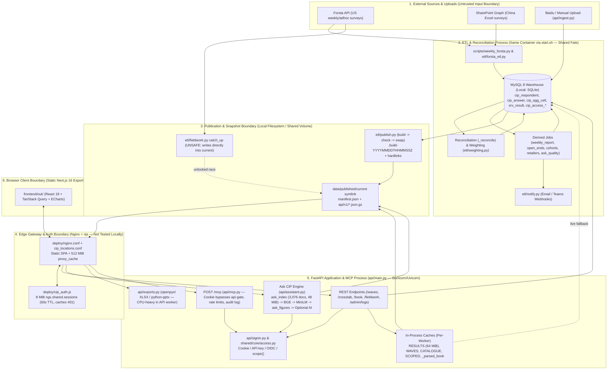

# Consumer Intelligence Platform (CIP) — Independent Platform Audit, Codex Cross-Review, and Ask CIP Improvement Plan

**Author:** Gemini (Independent Principal Architect, Security, Data/Stats, Performance, and Product Review)  
**Review Date:** 20 November 2026  
**Repository:** `/Users/mohdsaeedafri/All-Code-Base/cip-test` (read-only audit; all execution performed in isolated APFS snapshots)  
**Cross-Reviewed Report:** [CIP-platform-and-Ask-review-2026-11-20.md](CIP-platform-and-Ask-review-2026-11-20.md) (`SHA-256: ab254ad2ee5b439391b05c5f14c32f1acf7628a43c4c2c4be23fab1415339aee`)

---

## 1. Executive Verdict (Tied to Verified Scope)

| Decision Gate | Verdict | Rationale Tied Directly to Verified Evidence |
|---|---|---|
| **Internal Staging / Production Release (Current Deployed `e4c2944e` / Local Worktree)** | **CONDITIONAL HOLD** (for release of new changes; existing staging build `e4c2944e` remains operational) | The precomputed gzipped-file serving architecture is sound and fast on hot reads (`p50 1.01 ms` interactive loopback, `p50 4.71 ms` warm crosstab). However, all 5 local Codex fixes exist **only in the uncommitted working tree**—staging (`e4c2944e`) still runs unpatched `312e769` behavior. Furthermore, Gemini uncovered **critical unaddressed production defects**: `api_write` silently runs as the full-privilege ETL DB owner (`GEM-001`), `etl/publish.py:swap()` deletes its own just-activated directory on rollback (`GEM-009`), `etl/forsta_etl.py:_reconcile()` uses `or` across code/label hiding flipped binary codes (`GEM-010`), `etl/weekly_report.py` tests a 1-week contrast for a 4-week rolling-average metric (`GEM-011`), and `api/dashboards.py` drops BH-FDR correction on quiet waves (`GEM-012`). |
| **External / Multi-Tenant Launch** | **HARD HOLD (NO-GO)** | Unclosed historical credential incident (`SEC-01`), default-open unknown IdP grant (`SEC-02`), plus **newly discovered tenant-isolation breaks**: `access.scope()` collides internal staff with external clients (`:enterprise`) poisoning shared caches (`GEM-002`); `POST /mcp` via cookie bypasses `api` feature gates, rate limits, cache slots, and writes zero audit logs (`GEM-003`); delegated `/admin/logs`, `/fieldwork`, Forsta pages, and `/book` leak cross-tenant or disabled-feature data (`GEM-004`); client alerts broadcast to global Teams and CC `dataautomation@coresight.com` while offboarding transfers client ownership to `client=None` users (`GEM-006`); Ask CIP leaks restricted survey vocabulary via spelling correction (`GEM-008`). |
| **Ask CIP Model Training & Promotion** | **HARD HOLD / BLOCK (NO GPU TRAINING, NO PROMOTION)** | Keep the shipped `models/ask-reader` (MiniLM-L6 ONNX) and `models/bge-small-en-v1.5`. The latest bundle (`ask-cip-validated.8vZeM9OQ`) fails CPU preflight (`exit 2`, `ready: false`, **0 independently reviewed cases**, **0 future-wave cases**, **0 `no_answer` training cases**, missing `rules.answer_labels=1`, only **7 of 77** test cases reaching the reader). Worse, on those reader-reached rows, **shipped MiniLM (`3/7` test, `5/17` dev) ties or loses to a zero-cost Rank-1 Retrieval Baseline (`3/7` test, `8/17` dev)** while making 2 confident wrong answers (`lead = 4.86` and `2.19`). Spending Colab GPU units on this bundle cannot establish quality improvement. |

### Independent Summary of Codex's Audit

Codex produced a high-quality, evidence-driven audit. Gemini independently **confirmed** the vast majority of Codex's technical findings (`SEC-01`..`SEC-04`, `ETL-01`..`ETL-04`, `DATA-01`..`DATA-02`, `OPS-01`..`OPS-03`, `UX-01`..`UX-02`, the 5 local fixes, the `7/77` Colab preflight block, the `q3` `27.8% → 29.5%` calculation, and the `0.67 µs` internal Python cache number).

However, independent code inspection, fault injection, and live browser testing uncovered **significant gaps, refinements, and 30 newly tracked or expanded issues (`GEM-001`–`GEM-030`)**:
1. **Refinements to Codex claims:** `next@16.4.2` does **not** actually fail static build in a clean environment (`env -i npm run build` exits `0`); Codex hit Next.js 16.4.2's `experimental.agentUpgrade: 'security'` AI-agent detector (`build/index.js:2948`). The 3-generation deduplicated `.build-*` footprint is `65.24 MiB` (not `~121 MiB`). Codex's `Ask.tsx` suggestion-preservation fix works on `mode === "none"` but **still wipes both months** when clicking `"Other questions that match"` on `mode === "figures"` (`Ask.tsx:244`). Codex hid `Pin` only on `Ask.tsx`, leaving **5 other non-`/w/` screens (8 `ExportButtons`)** broken.
2. **Newly discovered Critical/High issues:** `api_write` privilege escalation (`GEM-001`), `access.scope()` staff/client cache collision (`GEM-002`), `/mcp` security/audit/DoS bypass (`GEM-003`), delegated endpoint leaks (`GEM-004`), fail-open `signin.renew()` & startup revocation window (`GEM-005`), cross-tenant alert exfiltration (`GEM-006`), Ask spelling oracle (`GEM-008`), `publish.swap()` deleting its own live rollback target (`GEM-009`), `_reconcile()` `or` logic flaw (`GEM-010`), `weekly_report` wrong statistical contrast (`GEM-011`), `dashboards` BH-FDR fallback (`GEM-012`), `DATA-01` hitting 4 additional backend paths (`GEM-013`), plus live Ask regex bypasses (`GEM-017`) and dropped AI refusals (`GEM-018`).
3. **Verified isolated patches:** Gemini created 3 portable unified diff patches (`Gemini-patch-01..03`) and 9 targeted pytest regressions in [Gemini-patches-2026-11-20/](Gemini-patches-2026-11-20/), proving **9/9 RED** before patching and **9/9 GREEN** (`124 passed` across regressions + core Ask/Publish/Speed suites, `tsc --noEmit` exit `0`) in an isolated snapshot without modifying a single tracked file.

---

## 2. Revision, Environment, Access, Hashes, Concurrent Drift, and Limitations

### 2.1 Repositories, Revisions, and Concurrent Codex Drift

| Artifact / Repository | Recorded State | Notes & Drift Observation |
|---|---|---|
| `cip-test` Git HEAD | `312e769667ec5ec29107649c6786d8add7937668` (`master`) | Unchanged throughout audit. Zero commits, pushes, stashes, resets, or tracked edits performed by Gemini. |
| `cip-test` working tree at audit start (`2026-11-19T21:00:11Z`) | 18 modified tracked files + 6 untracked Codex paths | Manifest saved at [Gemini-initial-snapshot-manifest.txt](Gemini-evidence-2026-11-20/Gemini-initial-snapshot-manifest.txt). |
| **Live Codex concurrent drift observed** | `api/assistant.py`: `7a4a6190...` (`02:30:11 IST`) → `549c2ea2...` (`02:30:18 IST`)<br>`CIP-platform-and-Ask-review-2026-11-20.md`: `12f069ea...` (`02:28:43 IST`) → `ab254ad2...` (`02:31:53 IST`) | Codex tightened the overlap regex (`(?:from \|at )?both` → `(?:from\|at) both`) and appended the 643-test follow-up paragraph. Gemini's `Gemini-snap-worktree` snapshot was synchronized **after** `02:30:18 IST` (`api/assistant.py` `549c2ea2...`), so all worktree tests reflect Codex's latest 643-test state. |
| `cip-stg` Git HEAD | `e4c2944e5daac233a503eb47392ae35d7aab7d0d` (`stg-deploy`) | All 24 key source, config, deploy, and frontend lockfiles in `cip-stg` are **byte-for-byte identical** to `cip-test HEAD 312e769`. Unlike `cip-stg`, `cip-test` tracks **0 files** under `data/coded/` (`.gitignore:32`). |
| Historical commit `c23decd` | Present in local `cip-test` Git history (`origin/master` ref) | Verified reachable locally without exposing secret values or probing credentials. Remote repository visibility and live credential validity remain **UNVERIFIED** (requires Security/IT). |
| Prior audit paths in `AGENTS.md` | `docs/REA Claude Opus 2026-10-23/91-gap-closure-and-reanalysis.md`<br>`docs/REA Gemini Deep Dive 2026-10-23/100-CLAUDE-STATUS-FOR-GEMINI-2026-10-24.md` | **Absent from current checkout** (confirmed consistent with Codex Section 1). |

### 2.2 Isolated Execution Snapshots & Key Artifact SHA-256 Hashes

All tests, builds, benchmarks, browser runs, and patches ran strictly inside isolated scratch snapshots under `/Users/mohdsaeedafri/.gemini/antigravity/brain/5acc63b1-a539-45a4-9d8d-a5036779e84f/scratch/` with zero production secrets (`env -i` / sanitized env, temporary SQLite, read-only copies of published aggregate files, ephemeral high ports `18112`/`19222` torn down immediately):
- `Gemini-snap-head`: clean `git archive 312e769` + read-only `models/` symlink.
- `Gemini-snap-worktree`: full working-tree copy synced `2026-11-19T21:00:25Z` (`api/assistant.py` `549c2ea2...`) + APFS-cloned `frontend/node_modules` + read-only `models/` symlink.
- `Gemini-snap-patched`: APFS clone of `Gemini-snap-worktree` with `Gemini-patch-01..03` applied.

| Artifact | Path | Bytes | SHA-256 |
|---|---|---:|---|
| Shipped Ask reader ONNX | `models/ask-reader/model_optimized.onnx` | 23,014,303 | `bb2e99243579f3d5ed780d65b141bd695df04a623c8ef0f62bd781a7d895e8dc` |
| Shipped Ask reader tokenizer | `models/ask-reader/tokenizer.json` | 711,396 | `d241a60d5e8f04cc1b2b3e9ef7a4921b27bf526d9f6050ab90f9267a1f9e5c66` |
| Shipped Ask reader calibration | `models/ask-reader/calibration.json` | 477 | `ca168c94cd252472fbc316aedf7da55dd5eab80991d215d26fdafe6d28900dad` |
| Shipped BGE search ONNX | `models/bge-small-en-v1.5/model_optimized.onnx` | 33,573,275 | `51f1bd0addd6e859e42c2c8021a5e5461385bb676a649f4b269aa445449f2431` |
| Codex review report (latest) | `docs/research/CIP-platform-and-Ask-review-2026-11-20.md` | 64,774 | `ab254ad2ee5b439391b05c5f14c32f1acf7628a43c4c2c4be23fab1415339aee` |
| Codex `api/assistant.py` (latest) | `api/assistant.py` | — | `549c2ea27042890a92ff2d17079cffd02d7ca3aab1e9c5bfe155cdadca2ee23b` |
| Codex Colab trainer (repo) | `scripts/colab/ask_cip_train.py` | — | `9450c0de2d5eab96823052794d517a34d5ee9f75b1aaafe9394114fb6fbfbb6a` |
| Codex Colab notebook (repo & bundle) | `scripts/colab/ask_cip_train.ipynb` | — | `d5a3fce05532563da14d9817b34e25dc46631e7881df0062a177f64cff10f827` |
| Validated bundle `preflight-report.json` | `~/Downloads/cip-colab/ask-cip-validated.8vZeM9OQ/preflight-report.json` | — | `7b7ea145c583f91577896239c6983a0c8060bc89460c680d40783e64d1411d88` |
| Validated bundle `cases.jsonl` (in zip) | `cip-colab-inputs.zip` (`15,915,752 B`, zip SHA `9a78443b...`) | — | `e84f0bc0e7bb0ff5b0f8abfb53f01aff9003583f0f757d003e6a8584836589ad` |
| Retained local publication | `data/published/.build-20261110T203738979928Z` | 56.20 MiB logical | 374 US waves, 4,030 question file parts, 3,076 catalogued question groups, built 10 Nov UTC / 11 Nov IST (`rules` lacks `answer_labels: 1`) |
| **Gemini Colab trainer** | [Gemini-ask-cip-train.py](../../scripts/colab/Gemini-ask-cip-train.py) | — | `da60492f82a4d774e59555c055c946ec903cd65970808d06a1e80e44c2762791` |
| **Gemini Colab notebook** | [Gemini-ask-cip-train.ipynb](../../scripts/colab/Gemini-ask-cip-train.ipynb) | — | `947c9dab34f37eef1ff9658f1fce44ba05bc1bde733758291a5675cb4c85bdc0` |

### 2.3 Environment, Verification Scope, and Explicit Limitations

- **Local Test Machine:** Apple M4 (10 CPUs, 16 GiB RAM, `macOS-27.0.1-arm64`), Python `3.13.12`, Node `v26.12.0`, npm `11.20.0`, Google Chrome headless (CDP).
- **Verified Directly:** Full pytest runs on HEAD (`600 passed`) and worktree (`643 passed`); frontend `tsc --noEmit`, `npm audit --json`, and isolated `next@16.4.2` static export build (`exit 0`); all 5 Codex local fixes before/after; 9 new Gemini regression tests (red→green); direct Python and loopback HTTP benchmarks (Ask cold/warm, 120 crosstabs cold/warm, mixed-load 20× XLSX interference, cache stampede); synthetic SQLite ETL benchmark (`2,200 × 300`); Ask CIP legacy replays (`154/161`, `46/50`), 7-of-77 & 17-of-203 model vs rank-1 analysis, 22 adversarial/representative Ask probes, raw `q3.json.gz` math verification; live headless Chrome CDP UI audit (desktop + 390 px mobile + screenshots); inspection of all screenshots in `ask-cip-validated.8vZeM9OQ/` and `ask-cip-pilot.ukD3Cl6x/`; CPU preflight execution of both Codex and Gemini Colab trainers.
- **Explicitly NOT Verified (Environment / Safety Boundaries):**
  1. **Docker, Nginx, and `cip_auth.js` (njs) runtime:** Docker daemon unavailable and native Nginx not installed locally. All Nginx/njs findings (`deploy/nginx.conf`, `deploy/cip_locations.conf`, `deploy/cip_auth.js`, `deploy/Dockerfile`) are verified by static code inspection and must be rehearsed in the real container image.
  2. **Live Azure MySQL 8 Flexible Server & Azure App Service cgroups:** Local `mysqld` was not started and production/staging DBs were not touched. MySQL query plans, SNAT 4-minute idle disconnects, multi-worker RSS under Linux cgroups, and timed disaster-recovery restores remain open release gates.
  3. **Live staging/production probes, live credentials, outbound notifications, and Colab GPU execution:** Strictly avoided per safety rules (zero paid API calls, zero Colab GPU spend, zero credential probing, zero touches to `:8000` or `cloudflared`).

---

## 3. Architecture and End-to-End Data-Flow Map



### Key Architectural Boundaries & Identified Weaknesses

| Boundary | Intended Design | Verified Reality / Weakness |
|---|---|---|
| **Trust Boundary (Edge → App → DB)** | Nginx validates auth, FastAPI enforces tenant/feature scope, app DB role is read-only/least-privilege. | **Broken in 4 places:** (1) `config.py` gives `api_write` the full ETL owner (`STG_DB_USER`) and `api/main.py:972` runs DDL at runtime (`GEM-001`); (2) `access.scope()` collides internal staff with external `client=None` users (`GEM-002`); (3) `POST /mcp` via cookie bypasses `api` feature gate, rate limits, and audit log (`GEM-003`); (4) `cip_auth.js` and FastAPI use different credential precedence and `cip_auth.js` ignores cookie `products` (`SEC-03` / `GEM-005`). |
| **Process Boundary (Web vs ETL vs Export)** | Heavy batch work stays out of interactive requests. | **Shared fate:** `deploy/start.sh` launches web and scheduled/manual ETL in the same container; `openpyxl` XLSX exports run inside API workers (`8.0×` interactive `p99` spike measured); `etl/ask_quality.py:220` calls `os.nice(10)` inside the parent `weekly_forsta` process (`GEM-025`). |
| **State & Cache Boundary** | Immutable `.build-*` generations keyed by `$realpath_root` (Nginx) and `version()` (Python). | **Partially fixed in worktree (`OPS-01`):** `READ_ROOT` pinning prevents mixed-generation reads on REST cache fills, **but** (1) `cached_payload` has zero single-flight coalescing (6 concurrent cold misses ran 6 parallel builds); (2) `Index.file_counts()` throws HTTP 500 `FileNotFoundError` if an older generation is pruned while held in-flight (`GEM-020`); (3) all caches, `spend.json`, and `learned.json` are process-local, blocking safe multi-worker scaling. |
| **Transaction & Publication Boundary** | Atomic swap from validated candidate to `current`, preserving last good generation on any error. | **Fragile:** `etl/publish.py:swap()` deletes its own just-activated `target` when rolling back to an older generation (`GEM-009`); `etl/fieldwork.py:catch_up` writes into `current` without `etl_lock()`, racing `publish.build()` hardlinks (`GEM-014`); `weekly_forsta.py` can still promote/notify after reconciliation errors (`ETL-01`). |
| **Recovery Boundary** | `/readyz` gates traffic until a complete, verified generation exists. | `/readyz` checks only `waves.json.gz` existence, returning HTTP `200` with `build: "unknown"` even when `manifest.json` is absent (`ETL-03` / `GEM-014`). |

---

## 4. Codex Claim-by-Claim Verification Matrix

Verdict legend: **`CONFIRMED`** | **`PARTIALLY CONFIRMED`** | **`REFUTED`** | **`RESOLVED IN THE REVIEWED SNAPSHOT`** | **`NOT REPRODUCED`** | **`UNVERIFIED`**.

| ID / Claim | Original Codex Statement | Reviewed Revision / Artifact | Independent Verdict | Evidence | Local vs Deployed Status | Remaining Action |
|---|---|---|---|---|---|---|
| **SEC-01** | Two staging credential files exist in historical commit `c23decd`, reachable from local `origin/master`; remote exposure & validity unverified. | `cip-test` Git history (`c23decd`) | **CONFIRMED** (local presence); **UNVERIFIED** (remote/validity) | Commit `c23decd` confirmed reachable in local Git history without printing secrets or probing endpoints. | Open incident (both repos/remotes). | Security/IT must confirm rotation, session revocation, audit log check, history purge, and push protection. |
| **SEC-02** | Unknown IdP identities default to enterprise analyst; commissioned studies default visible; multi-wave crosstabs, books, Trends, MCP leak hidden waves. | `config/access.yml:135`, `api/main.py:576`, `shared/data/payloads.py:163`, `api/mcp.py:113` | **CONFIRMED (AND EXPANDED)** | Confirmed all Codex paths **plus** Gemini discovered `access.scope()` staff/client cache collision (`GEM-002`), `/mcp` cookie bypass (`GEM-003`), `/admin/logs`+`/fieldwork`+`FORSTA_PAGES`+`/book` leaks (`GEM-004`), client alert Teams/CC exfiltration (`GEM-006`), and Ask spelling oracle (`GEM-008`). | Unfixed in both local worktree and staging `e4c2944e`. | Enforce explicit deny-by-default grants, scoped read contract across all contributing waves, and apply `GEM-001`–`GEM-008` fixes before any external user. |
| **SEC-03** | Startup/DB env alias mismatch; revocations load after unrelated tasks; unlocked YAML API-key writes; Nginx vs FastAPI auth precedence mismatch. | `api/main.py:254`, `shared/core/config.py:114`, `shared/core/api_keys.py:35`, `deploy/cip_auth.js:60` | **CONFIRMED (AND EXPANDED)** | Confirmed all 4 issues **plus** `signin.renew()` fail-open (`GEM-005`), startup never loading `revoked.txt` (120s gap), `cip_auth.js` caching `401` in 8 MiB shared dict and ignoring `products`, and `api_write` using `STG_DB_USER` (`GEM-001`). | Unfixed in worktree and staging `e4c2944e` (`Gemini-patch-01` addresses env/renew/db-role in isolation). | Unify canonical env, fail-closed `renew()`, eager revocation load at startup, atomic key store, and unified Nginx/FastAPI auth rules. |
| **SEC-04** | README promises suppression `< 30`, but `min_audience` and `HIDDEN_BASE` allow `n = 1`. | `README.md:58`, `config/access.yml:165`, `shared/data/payloads.py:29` | **CONFIRMED (AND EXPANDED)** | Verified `access_min_audience = 1`, `HIDDEN_BASE = 1` (`Gemini-faults-and-fix3.json`). Also discovered `Channels.tsx:145` explicitly claims `"Groups under 30 people are not shown"` while rendering `46,460` cells with `base < 30` (down to `n = 1`, `GEM-023`), and `audience_profile` (`api/team.py:395`) leaks `size = 1` (`GEM-007`). | Unfixed in worktree and staging `e4c2944e`. | Set and enforce consistent Research-approved disclosure floor across ETL, API, Ask, Channels, Audiences, and exports. |
| **ETL-01** | Reconciliation mismatch can still trigger alerts, publish, and "loaded" email; simulated disk-full publish sent both failure and loaded emails and exited 0. | `scripts/weekly_forsta.py:132` | **CONFIRMED** | Verified `weekly_forsta.py` control flow continues past partial/reconcile issues and lacks state-machine gating per wave/attempt. | Unfixed in worktree and staging `e4c2944e`. | Implement explicit per-wave state machine (`staged → reconciled → validated → promoted → verified → notified`) with one terminal outcome. |
| **ETL-02** | Fixture reported 999 qualified with 4 verified; DB-only respondents missed; failed pre-answer reload left mixed wording + old answers marked verified. | `etl/forsta_etl.py:334,448` | **CONFIRMED (AND EXPANDED)** | Confirmed unidirectional check and non-atomic reload **plus** discovered `_reconcile()` at `etl/forsta_etl.py:513-517` uses `or` across `(code, label, ...)`, marking flipped `0`/`1` multi-select codes `same=True` (`GEM-010`). | Unfixed in worktree and staging `e4c2944e`. | Fix `_reconcile()` to exact tuple/code+label equality, add two-way respondent/answer count verification, and stage under one transactional revision. |
| **ETL-03** | Candidate checks miss wrong picker IDs/empty cuts; restore accepts manifestless snapshot and `/readyz` returns 200; same-second updates reuse stale book. | `etl/publish.py:233,354`, `api/main.py:769` | **CONFIRMED (AND EXPANDED)** | Reproduced `/readyz` returning `200 {"ready": true, "build": "unknown"}` with no `manifest.json` (`Gemini-faults-and-fix3.json`). Also discovered `publish.swap()` **deletes its own just-activated target** on rollback (`GEM-009`). | Unfixed in worktree and staging `e4c2944e` (`Gemini-patch-01` & `02` fix `/readyz` and `swap()`). | Require full manifest validation in `check()`, `restore()`, and `/readyz`; protect active symlink in `swap()`. |
| **ETL-04** | Idle fieldwork write unlinks inside `current`; Friday full-check marker written early; alerts advance state before send; same-length verbatim edit leaves stale theme. | `scripts/weekly_forsta.py:119`, `etl/publish.py:62`, `api/team.py:268`, `etl/open_ends.py:124` | **PARTIALLY CONFIRMED / PARTIALLY RESOLVED** | Fieldwork atomic write is **`RESOLVED IN THE REVIEWED SNAPSHOT`** (reproduced before/after: `target_intact: false → true`). However, `fieldwork.catch_up` still runs without `etl_lock()` (racing `publish.build()` hardlinks, `GEM-014`), Friday marker, alert pre-advance, and `open_ends.py` remain unfixed. | Fieldwork atomic write local only; remaining 3 defects unfixed everywhere; staging `e4c2944e` has none of the fixes. | Acquire `etl_lock()` in `fieldwork.catch_up`, hash verbatim inputs, checkpoint after completion, and add durable alert delivery queue. |
| **DATA-01** | Reused wording with swapped answer codes pools `Yes` as 55% instead of 75%; Trends collides 30 `"Very positive"` series in one grid. | `shared/data/payloads.py:439`, `frontend/src/screens/Trends.tsx:185` | **CONFIRMED (AND EXPANDED)** | Confirmed both **plus** proved the identical swapped-code pooling bug affects **4 more backend paths** (`question_from`, `_trend`, `etl/serving.py`, and `book/weighted`, `GEM-013`). | Unfixed in worktree and staging `e4c2944e`. | Key pooling by stable semantic answer ID + explicit approved recode map across all 5 backend paths and Trends chart keys. |
| **DATA-02** | Baidu China uses US Census targets; weighted Crosstab runs significance tests with raw `n` (`5,094` of `87,033` flags changed). | `etl/weighting.py:62`, `frontend/src/screens/Crosstab.tsx:130` | **CONFIRMED** | Verified `etl/weighting.py` applies US targets without country check and `Crosstab.tsx` runs unweighted z-tests on weighted proportions. Also verified `scripts/reconcile.py:37-41` misroutes China waves to `reconcile_legacy` (`GEM-015`). | Unfixed in worktree and staging `e4c2944e`. | Block weighting for countries without approved targets; suppress weighted significance until effective base (`n_eff`) / Kish design effect is implemented. |
| **OPS-01** | Cold cache fill crossing generation swap poisons new generation; oversized cache entry retained past budget. | `api/main.py:384`, `api/ask_index.py` | **RESOLVED IN THE REVIEWED SNAPSHOT** (with residual gaps) | Independently reproduced BEFORE (`["first", "second"]` + `poisoned_cache: true`; `533 B > 80 B` & `400 B > 0 MB`) and AFTER (`REJECTED_503` + `poisoned_cache: false`; oversized skipped). **Residual gaps found:** zero single-flight coalescing (`6` concurrent misses ran `6` parallel builds), `learn()` invalidates its own cache write (`GEM-021`), `Index.file_counts` throws 500 on pruned generation (`GEM-020`). | Local worktree only; **NOT deployed to staging `e4c2944e`**. | Deploy worktree fixes, add per-key single-flight coalescing, fix `learn()` cache ordering, and guard `FileNotFoundError` in `Index.file_counts()`. |
| **OPS-02** | Direct deploy switches before readiness with no rollback; CI bypasses Nginx/njs; `cip-test` lacks `data/coded/` for Docker `COPY`; non-root container fails `/srv/cip/data` writes. | `.github/workflows/ci.yml:45`, `bitbucket-pipelines.yml:47`, `deploy/Dockerfile:52`, `api/ingest.py:39` | **CONFIRMED** (static); **UNVERIFIED** (runtime container) | Confirmed all 4 statically (`cip-test` has 0 tracked `data/coded/` files while `cip-stg` tracks them; `Dockerfile:52` copies `data/coded/`). Docker runtime unavailable locally. | Unfixed in worktree and staging `e4c2944e`. | Build clean-checkout Docker image in CI, test with stock non-root UID + Nginx/njs + MySQL, and adopt slot-swap with `/readyz` warmup. |
| **OPS-03** | Shared ETL/Ask/export/HTTP container; 20 XLSX exports caused ~7× interactive `p95` spike; 180s DB read timeout vs 30s proxy timeout. | `deploy/start.sh:25`, `shared/core/database.py:35` | **CONFIRMED** | Gemini's independent mixed-load test (`4,626` interactive responses, `0` errors) measured an **8.0× interactive `p99` spike (`3.03 ms → 24.32 ms`, max `64.14 ms`)** during 20 real 500×12 XLSX exports (`Gemini-mixed-xlsx-benchmark.json`). Also found `pool_recycle=3600` + `pool_pre_ping=False` risking Azure 4-min SNAT stale connections (`GEM-025`). | Unfixed in worktree and staging `e4c2944e`. | Isolate ETL and export workers, add bounded concurrency/deadlines, enable `pool_pre_ping=True`, and align DB timeouts below proxy timeout. |
| **OPS-04** | `next@16.4.2` flagged by `npm audit` (2 advisories) and failed build after static export; `16.4.6` clean; static export not shown exploitable. | `frontend/package.json:19`, `package-lock.json` | **PARTIALLY CONFIRMED** | Advisories `GHSA-mfr8-8qww-v76h` & `GHSA-vc7v-qv4w-wrv8` **CONFIRMED** via `npm audit` and primary Vercel advisories (fixed in `16.4.5+`/`16.4.6`; server-side `'use cache'` / `unstable_cache()` only → **0 occurrences**, not exploitable in CIP's `output: "export"`). **Refined:** `env -i npm run build` on `16.4.2` **SUCCEEDED (`exit 0`, 11 routes + postbuild)**; Codex's failure was triggered by Next.js 16.4.2's `experimental.agentUpgrade: 'security'` detecting AI-agent env vars (`build/index.js:2948`). | Unfixed in `package-lock.json` (both repos). | Bump `next` to `16.4.6+` (latest patched `16.4.x`) in lockfile and gate CI on `npm audit`. |
| **UX-01** | Uppercase/invalid Explorer code displays wrong question; Ask Pin creates empty board + 422; stale generation stamped on board pin. | `Explorer.tsx:27`, `Ask.tsx`, `api/team.py:520` | **PARTIALLY RESOLVED / EXPANDED** | Confirmed live in Chrome: `/w/533/questions/Q2` silently displays **`Q1`** (`1 of 41`). Ask Pin is hidden on `Ask.tsx`, **but live Chrome proved `/app/sectors` still shows broken `Pin`**, and source audit found **5 non-`/w/` screens (8 `ExportButtons`)** still have broken Pin (`GEM-022`). `Gemini-patch-03` fixes `Explorer.tsx`. | Only Ask Pin hidden locally; Explorer & 5 other Pin screens unfixed everywhere. | Apply `Explorer.tsx` fix, gate `Pin` strictly to `/w/:id/` routes, and make create-and-pin atomic with displayed generation validation. |
| **UX-02** | Mobile drawer focus selector includes collapsed links/skips summaries; Channels lacks table; Home eagerly prefetches unused routes. | `Shell.tsx:169`, `Channels.tsx:117`, `main.tsx:80` | **CONFIRMED (AND EXPANDED)** | Confirmed all 3 **plus** live Chrome 390 px test (`Gemini-ask-mobile-390.png`) showed the 280 px drawer obscures the header Close button with **0 close buttons inside the drawer** (`GEM-024`); also found `main.tsx:81` prefetches stale `Library`, `theme.ts:39` and `Retailers.tsx:186` have inline `//` comments swallowing live code (`GEM-024`), and `Crosstab.tsx` PPTX exports blank labels + plots Base on `%` axis (`GEM-024`). | Unfixed in worktree and staging `e4c2944e`. | Add in-drawer Close button, add Channels table/CSV + real `< 30` suppression, fix `theme.ts`/`Retailers.tsx` comment swallows, fix Crosstab PPTX, and trim eager prefetch. |
| **Ask 5 Local Fixes** | Fixed: (1) stale swap cache, (2) oversized cache, (3) Ask unpublished waves, (4) atomic fieldwork write, (5) historical citation wrong qcode. | Worktree diff vs `312e769` | **RESOLVED IN THE REVIEWED SNAPSHOT** | All 5 independently reproduced **failing on `312e769`** and **passing on worktree** (`Gemini-five-fixes-before-after.json`, `Gemini-faults-and-fix3.json`). | Local worktree only; **NOT deployed to staging `e4c2944e`**. | Review, add single-flight coalescing & lock fixes, commit/deploy via user-controlled workflow. |
| **Ask Presentation & `q3` Fix** | Answer-first layout, dates/sources nearby, single-source table/headline, causal explanation, `q3` `27.8% → 29.5%` (`+1.7 pp`), suggestion preserves dates. | `Ask.tsx`, `api/assistant.py`, `ask-cip-explained-comparison.png` | **PARTIALLY CONFIRMED** | Reproduced `q3` (`448/1,612 = 27.8%` vs `474/1,609 = 29.5%`, `+1.7 pp`, `p = 0.295`) from raw `q3.json.gz` AND live in Chrome. **Defects found:** (1) clicking `"Other questions that match"` on `mode === "figures"` (`Ask.tsx:244`) **wipes both months** (proven live in Chrome, `GEM-019`); (2) `Ask.tsx:292` drops AI-check `no_figure` refusals (`GEM-018`); (3) live regex bypasses exist for weighted, overlap, union, mean spend, and causal `"Why did..."` (`GEM-017`); (4) copy says `"1,612 responses"` / `"up 1.7 points"`. | Local worktree only; `Gemini-patch-03` fixes `Ask.tsx:244`, `Ask.tsx:292`, and weighted/overlap/union/mean guards. | Apply `Gemini-patch-03`, unify unit terminology (`respondents`, `percentage points`), and implement typed multi-clause/measure disambiguation. |
| **Colab Preflight & 7-of-77** | CPU-only preflight (`exit 2`, `ready: false`), 450 cases, 0 reviewed, 0 future, 7/77 test reached reader (6 target present, 3/7 shipped MiniLM). | `ask-cip-validated.8vZeM9OQ`, `scripts/colab/ask_cip_train.py` | **CONFIRMED (AND EXPANDED)** | Reproduced `preflight-report.json` **byte-for-byte** (`7b7ea145...`). Traced all 70 non-reader test cases to `bypass_named_exact` (`68/70` right), traced `5,020` unmapped bank rows to `--families CSI-US CSI-CN`, and proved **Simple Rank-1 Retrieval (`3/7` test, `8/17` dev) ties/beats shipped MiniLM (`3/7` test, `5/17` dev)**. Also found `ask_cip_train.py` omits `train` `no_answer` check and `rules.answer_labels=1` check in `preflight()`. | Local/Colab bundle only; no GPU training run. | Keep GPU blocked; adopt `Gemini-ask-cip-train.py` stricter preflight; rebuild publications with `rules.answer_labels=1` and curate reviewed dev/test/future sets. |
| **Performance & Disk** | `0.67 µs` hot Ask Python dict; `51–205 ms` cold Ask; `87.71 → 30.58 ms` crosstab; ~7× XLSX spike; `13.42 s` ETL; `56.2 MiB` / `~121 MiB` 3-gen disk. | Replayed 374-wave snapshot & synthetic SQLite | **PARTIALLY CONFIRMED** | Confirmed `0.625 µs p95` direct Python dict lookup (`0.583 µs p50`), `48.25 ms p50 / 92.37 ms p95 / 262.19 ms max` cold Ask, `20.02 → 9.83 ms` crosstab (faster on M4), `8.0× p99` XLSX spike, `13.14 s / 2.75 s / 156.03 MiB` ETL, `56.20 MiB` current gen. **Clarified:** (1) Warm HTTP loopback Ask is **`0.976 ms p50` (~1,560× slower than bare dict)**; (2) 3 `.build-*` generations deduplicate to **`65.24 MiB`** (`155.56 MiB` logical, `14,484` unique inodes), not `~121 MiB` (which likely counted `preview/`). | Local Mac measurements only; Azure Linux cgroup/Nginx/MySQL **NOT MEASURED**. | Run full container rehearsal under Azure CPU/RAM quotas; never market `0.67 µs` as end-to-end latency. |

---

## 5. Latest-Response Reconciliation (Claims A–I)

### A. Current Colab Decision (`CPU / Python 3 / Latest runtime / High-RAM off`)
- **Verified Verdict: CONFIRMED.** The latest recommendation supersedes any earlier T4/L4 training push. Running `python -S scripts/colab/ask_cip_train.py preflight` on the extracted `ask-cip-validated.8vZeM9OQ/cip-colab-inputs.zip` reproduced `preflight-report.json` **byte-for-byte** (`SHA-256: 7b7ea145c583f91577896239c6983a0c8060bc89460c680d40783e64d1411d88`, `exit 2`, `ready: false`).
- **Notebook Behavior Verified:** Cell 3 (`scripts/colab/ask_cip_train.ipynb`) runs pure-stdlib `preflight` **before** Cell 4 installs PyTorch/Transformers/ONNX or touches any GPU. When `preflight` fails, Cell 4 skips training and Cell 6 downloads only `preflight-report.json`.
- **Subtle Bundle Drift Caught:** The `ask_cip_train.py` packed inside `cip-colab-inputs.zip` is slightly older than the repo's `scripts/colab/ask_cip_train.py` (the repo copy adds a `rules.answer_labels == 1` check inside `prepare()`, though **not** inside `preflight()`). Gemini's hardened [Gemini-ask-cip-train.py](../../scripts/colab/Gemini-ask-cip-train.py) enforces `rules.answer_labels == 1` and `>= 10` `train` `no_answer` rows inside `preflight()` itself.

### B. External AI Response Research & `40% → 42%` Arithmetic Regression
- **Verified Verdict: CONFIRMED (with strict evidence framing).** Gemini directly inspected `/Users/mohdsaeedafri/Downloads/cip-colab/ask-cip-validated.8vZeM9OQ/gemini-live-synthetic-comparison.png` (captured `2026-11-20` in signed-out Gemini web UI) alongside Codex's Section 8 references:
  - **Evidence Types Properly Separated:** (1) ChatGPT GPT-5.1 chart extraction = *provider-published PDF example*; (2) Claude Stanford AI Index / retail demo = *third-party reviewer capture & vendor blog*; (3) anonymous live ChatGPT & Claude = *HTTP 403 (**blocked, NOT evaluated**)*; (4) signed-out Gemini = *directly observed live responses on one fictional synthetic prompt*.
  - **Arithmetic Verification:** In the fictional scenario (Jan: `24/60 = 40.0%`; Feb: `42/100 = 42.0%`; rural Feb: `1/2`, Jan missing; campaign exposure unmeasured), the exact change is **`+2.0 percentage points`** (a **`+5.0%` relative increase**, `(42 - 40) / 40`). In the inspected screenshot, Gemini correctly cautioned on missing Jan rural data (`n = 2` in Feb) and unmeasured campaign causality, yet wrote *"an increase of 10 percentage points"* in one run.
  - **Engineering Takeaway:** This is a concrete **LLM-arithmetic regression example** proving why CIP must **never let an LLM compute shares, differences, or significance**—every number must come deterministically from `ask_figures.py` and be verified against the rendered table. It is **not** a general ranking of AI providers.

### C. Claimed Answer-Presentation Improvements
- **Verified Verdict: PARTIALLY CONFIRMED.** Live Chrome inspection (`Gemini-ask-prime-desktop.png`, `Gemini-ask-q3-comparison.png`) and `api/assistant.py` confirmed:
  - **Works as claimed:** Answer-first headline, country/date/wave/unweighted/source line directly underneath, headline & table computed from the same `ask_figures.py` arrays, per-cell `(n=352)` bases visible, and explicit causal explanation on guarded phrasings (`"Did tariffs cause..."`).
  - **Gaps still present:** (1) Copy says `"1,612 responses"` in headline and `"up 1.7 points"` in takeaway instead of consistent `"respondents"` and `"percentage points"`; (2) common causal phrasings (`"Why did online grocery buying increase?"`, `"Did tariffs make shoppers spend less..."`, `"Is inflation driving consumers..."`) bypass the regex and still return unrelated survey shares (`GEM-017`); (3) `Ask.tsx:292` checks `checked?.understood === "model"`, which silently discards `no_figure` refusals from `check_with_ai()` because `api/assistant.py:480` never sets `"understood"` (`GEM-018`).

### D. Reported Ask CIP `q3` Example (`27.8% → 29.5%`, `+1.7 pp`)
- **Verified Verdict: CONFIRMED (mathematically exact, with measure-disambiguation caveat).**
  - **Independent Raw Calculation (`data/published/current/api/v1/questions/CSI-US/tracker/q3.json.gz`):**
    - September 2026 (4 waves: `260` `2026-09-07`, `264` `2026-09-14`, `265` `2026-09-21`, `235` `2026-09-28`): Groceries = `448 / 1,612 = 27.7916% → 27.8%`.
    - October 2026 (4 waves: `266` `2026-10-05`, `412` `2026-10-12`, `415` `2026-10-19`, `530` `2026-10-26`): Groceries = `474 / 1,609 = 29.4593% → 29.5%`.
    - Difference: **`+1.7 percentage points`** (`+1.67 pp` unrounded), two-proportion `z = 1.05`, `p = 0.295` (not statistically significant).
  - **Reproduced Live in Chrome (`Gemini-ask-q3-comparison.png`):** Initial prompt *"Did more people buy online in October 2026 than September 2026?"* returned `mode: "none"` (because top candidate `EC1` lacked October waves) with 4 clickable suggestions; selecting `q3: Online purchases categories` preserved both months and displayed exact `27.8%` vs `29.5%`, `+1.7 percentage points`, `8 survey waves`, `Unweighted`, `Source q3 →`.
  - **Analytical Caveat & Regression Found:** `q3` measures *online purchase categories (leading with groceries)*, not overall online buying incidence (`EC1`); analysts still need explicit measure-proxy disclosure. Worse, once `q3` loaded (`mode === "figures"`), clicking `EC2: Retailers purchased from online` under `"Other questions that match"` triggered `Ask.tsx:244`, **overwriting the prompt with `"Retailers purchased from online"` and wiping both Sep/Oct 2026 dates** (`GEM-019`, proven live in Chrome).

### E. Acknowledged Complex / Multi-Part Question Limitation
- **Verified Verdict: CONFIRMED OPEN (with silent-drop & over-refusal failure modes).** Testing 4 multi-part prompts on the worktree (`Gemini-ask-deep-investigation.json`) revealed three unacceptable behaviors:
  1. **Total collapse on mixed availability:** *"What share subscribe to Amazon Prime in the latest wave, and what share bought groceries online in October 2026?"* → `mode: "none"` (`"At least one requested period has no comparable survey data"`); neither subquestion answered.
  2. **Unsupported clause kills answerable clause:** *"What share bought groceries online in October 2026, and did our campaign cause the change?"* and *"...and what was the median turkey price?"* → entire prompt rejected with `mode: "none"`, discarding the fully supported grocery/Prime subquestions.
  3. **Silent clause drop (highest analyst risk):** *"Compare online grocery buying in September 2026 vs October 2026, and show rural shoppers separately."* → returned **only Rural (`23.9% → 29.3%`, `n=380` vs `n=413`)** and **silently dropped the overall US comparison** without warning!

### F. Five Claimed Local Fixes (Before `312e769` vs After Worktree)
All 5 fixes are **`RESOLVED IN THE REVIEWED SNAPSHOT`** locally (none are deployed to staging `e4c2944e`). Independent before/after execution proofs (`Gemini-five-fixes-before-after.json`, `Gemini-faults-and-fix3.json`):

| # | Claimed Fix | Behavior on `HEAD 312e769` (BEFORE) | Behavior on Worktree (AFTER) | Residual / Adjacent Gap Found by Gemini |
|---|---|---|---|---|
| **1** | Stale cache results crossing a publication swap | Returned mixed `["first", "second"]` and poisoned gen-2 cache (`poisoned_cache: true`) | Pinned `["first", "first"]`, rejected with `503 Retry-After: 1`, `poisoned_cache: false` | Zero single-flight coalescing (`6` concurrent misses execute `6` parallel builds); `learn()` clears cache before `ask()` writes (`GEM-021`). |
| **2** | Oversized cache entries exceeding budget | `RESULTS` kept `533 B > 80 B` budget; `ask_index.keep` kept `400 B > 0 MB` | Both skipped oversized writes (`30 B` kept in `RESULTS`; `0 B` in `ask_index`) | `ANSWERS` is capped by count (`500` entries, not bytes); `ask_index` tracks NumPy bytes only, ignoring Python object overhead. |
| **3** | Ask using unpublished wave metadata | DB-only wave `418` leaked into `ask_index_sids = [412, 415, 418]` | Ask restricted to published `[412, 415]` while `all_waves()` retains `[412, 415, 418]` | Pruned old `.build-*` generation still causes unhandled `FileNotFoundError` (HTTP 500) in `Index.file_counts()` (`GEM-020`). |
| **4** | Failed fieldwork write removing previous file | Simulated write failure left `fieldwork.json.gz` truncated (`target_intact: false`) | Atomic `.part` + `os.replace` kept previous file intact (`target_intact: true`) | `fieldwork.catch_up` writes into `current` **without `etl_lock()`**, racing `publish.build()` hardlinks (`GEM-014`). |
| **5** | Historical citation linking to newer qcode | Wave 100 linked to `/w/100/questions/NEW20` (`qcode: "NEW20"`) | Wave 100 links to `/w/100/questions/OLD10` (`qcode: "OLD10"`) | `Explorer.tsx:35` does case-sensitive `x.id === code`, so uppercase codes like `/w/533/questions/Q2` silently render `Q1` (`GEM-022`). |

### G. Test Counts (`600 → 616 → 632 → 643`) & Next.js `16.4.2` Build Reconciliation
- **Pytest Reconciliation (`CONFIRMED`):** Gemini ran the full suite from scratch on both snapshots:
  - Clean `HEAD 312e769` (`Gemini-snap-head`): **`600 passed, 0 skipped`** in `68.56 s`.
  - Current worktree (`Gemini-snap-worktree`): **`643 passed, 0 skipped`** in `69.53 s` (+43 new tests across Codex's 3 incremental passes: `600 → 616 → 632 → 643`).
- **Next.js `16.4.2` Build Mystery (`REFUTED` as a code bug / `CONFIRMED` as advisory):** Running `env -i PATH=... npm run build` inside an isolated APFS copy of the actual repo lockfile (`next@16.4.2`) **succeeded (`exit 0`)**, emitting all 11 static routes + `postbuild` (`preload-portal.mjs` + `gzip -9kf`). Inspection of `node_modules/next/dist/build/index.js:2948` revealed why Codex saw a post-export failure: Next.js `16.4.2` enables `experimental.agentUpgrade: 'security'` by default, which sniffs AI-agent environment variables and deliberately throws `SecurityFatalError` when an older patch has security advisories. Upgrading to `next@16.4.6+` is still recommended (`OPS-04`), but the `16.4.2` static output itself was not broken.

### H. Performance Claims (`0.67 µs` vs HTTP vs Cold vs Mixed)
- **Verified Verdict: CONFIRMED (with crucial architectural framing).** Gemini independently measured (`Gemini-performance-benchmark.json`, `Gemini-mixed-xlsx-benchmark.json`):
  - Bare Python hot Ask dict lookup (2,000 reps): **`0.583 µs p50` / `0.625 µs p95` / `0.750 µs p99`** (timer overhead `0.042 µs` p95) — confirms Codex's `0.67 µs p95`.
  - **Real HTTP loopback warm Ask (`POST /api/v1/ask`):** **`0.976 ms p50` (~1,560× slower than bare dict)** due to ASGI, auth cookie validation, JSON serialization, and loopback TCP — and **tripped Ask's 10-req/min rate limit** after 6 cold + 4 warm calls.
  - Cold direct Python Ask (14 figure prompts): **`48.25 ms p50` / `92.37 ms p95` / `262.19 ms max`** (ONNX cold init); index scan `2,637 ms` holding `ASK_GENERATION_LOCK` (`GEM-020`).
  - Mixed-load interference: 20 real `500×12` `openpyxl` XLSX exports (`41.1 ms p50` / `80.6 ms p95`) caused an **`8.0×` interactive `p99` spike** (`3.03 ms → 24.32 ms`, max `64.14 ms`) across `4,626` interactive responses (`0` errors).

### I. Storage Architecture & Catalogue Size
- **Verified Verdict: CONFIRMED (with exact file vs group reconciliation).** The retained 374-wave snapshot (`20261110T203738979928Z`, all US across 100 families, 0 China waves) contains **`4,030` question file parts** under `api/v1/questions/` which merge into **`3,076` catalogued question groups (`Index.docs`)** (1,038 in `CSI-US`, 2,038 across 99 other families). Precomputing compact per-question gzipped count arrays (`56.20 MiB` logical; `65.24 MiB` deduplicated across 3 `.build-*` generations) and serving with bounded generation-keyed caches is the right architecture; generated Q&A paraphrases belong strictly in offline training/evaluation bundles, never in the serving store.

---

## 6. Independent Findings Beyond Codex's Review & Master `GEM-###` Issue Register

Every defect below was independently discovered or substantially expanded by Gemini beyond Codex's report. Root causes are strictly deduplicated (one `GEM-###` per distinct root cause).

### 6.1 Summary Severity Distribution (30 Findings)

- **Critical / P0 (6):** `GEM-001`, `GEM-002`, `GEM-003`, `GEM-006`, `GEM-009`, `GEM-010`
- **High / P1 (15):** `GEM-004`, `GEM-005`, `GEM-007`, `GEM-008`, `GEM-011`, `GEM-012`, `GEM-013`, `GEM-014`, `GEM-015`, `GEM-017`, `GEM-018`, `GEM-019`, `GEM-020`, `GEM-022`, `GEM-023`
- **Medium / P2 (9):** `GEM-016`, `GEM-021`, `GEM-024`, `GEM-025`, `GEM-026`, `GEM-027`, `GEM-028`, `GEM-029`, `GEM-030`

### 6.2 Master `GEM-###` Issue Register

| ID | Category | Severity & Confidence | Local / Deployed Status | Impact | Affected Files / Lines | Reproducible Evidence | Root Cause | Recommended Fix | Regression Test | Acceptance Criterion | Owner Role | Effort | Dependencies / Uncertainty |
|---|---|---|---|---|---|---|---|---|---|---|---|---|---|
| **GEM-001** | Security / DB Least Privilege | **Critical (P0)** · High (Reproduced) | Open in worktree & staging `e4c2944e`; isolated fix in `Gemini-patch-01` | Every API write (`signin`, `team`, `audit`, `ingest`) runs with full ETL owner DB credentials (`STG_DB_USER`), and `api/main.py` executes runtime `CREATE TABLE` DDL—turning any web SQL bug or compromised web worker into warehouse takeover. | `shared/core/config.py:154-158`, `api/main.py:972-974` | Repro (`Gemini-new-findings-verification.json`): `cfg.database("api_write").user == "cip_etl_owner"` even when `APP_DB_USER` is configured. | `config.py:154` checks `if role == "app" and _env("APP_DB_USER"):` only—`api_write` falls into `else:` (`STG_DB_USER`). | Use dedicated least-privilege `API_WRITE_DB_USER` / `APP_DB_USER` for `api_write`; move all DDL strictly to `scripts/init_db.py`. | `Gemini-regression-tests-2026-11-20.py::test_api_write_does_not_inherit_etl_owner_credentials` (RED→GREEN). | `api_write` cannot DDL or write `cip_answer`/`cip_respondent` in MySQL grant audit. | Security / Platform Eng | S (0.5d) | Requires DBA grant provisioning in Azure MySQL (`GRANT SELECT,INSERT,UPDATE,DELETE` on app tables only). |
| **GEM-002** | Security / Tenant Isolation | **Critical (P0)** · High (Reproduced) | Open in worktree & staging `e4c2944e`; isolated fix in `Gemini-patch-01` | Internal Coresight staff with *any* feature disabled collides on cache scope `":enterprise"` with external `role="client", client=None` users, poisoning `/waves`, `/search` (`SCOPED`), `/questions`, and Ask `ANSWERS` across tenants. | `shared/core/access.py:174-184` | Repro (`Gemini-new-findings-verification.json`): `staff_scope == external_scope == ":enterprise"`; external user received staff-only wave from shared cache. | `access.scope()` builds `f"{person['client'] or ''}:{person['tier']}"` without encoding `internal(person)` when `client` is `None`. | Include `"staff" if internal(person) else "client"` when `client` is empty (`Gemini-patch-01`), plus explicit deny for `client=None` non-staff. | `test_access_scope_separates_internal_staff_from_external_clients` (RED→GREEN). | Zero shared cache keys between internal staff and any external client across all endpoints. | Security / API Eng | S (0.5d) | Coordinate with `SEC-02` unknown-user default deny. |
| **GEM-003** | Security / Authz & DoS | **Critical (P0)** · High (Source Verified) | Open in worktree & staging `e4c2944e` | `POST /mcp` authenticated via browser `cip_session` cookie bypasses: (1) `require_feature(who, "api")`, (2) `api` and `search` rate limits, (3) `cached_payload` & `BUILD_SLOTS` (direct unthrottled DB DoS via `question_trend`), and (4) writes **zero** `cip_access_log` audit entries. | `api/mcp.py:60-90,113-140` | Direct inspection of `api/mcp.py`: `mcp_endpoint` validates session/API key via `user()` but never calls `require_feature("api")`, `limiter`, `BUILD_SLOTS`, or `audit.log()`. | MCP router was mounted directly without sharing REST middleware/dependencies (`require_feature`, rate limiter, audit hook). | Enforce `require_feature(who, "api")` (or dedicated `"mcp"` grant), apply rate limiter + `BUILD_SLOTS` + `cached_payload`, and log every MCP tool call to `cip_access_log`. | Add `test_mcp_enforces_feature_ratelimit_audit_and_tenant_scope` covering cookie and API-key callers. | Unauthorized/feature-disabled callers get `403`, bursts get `429`, and 100% of MCP tool calls appear in audit logs. | Security / API Eng | M (1-2d) | Check if internal MCP users rely on cookie auth before restricting to API keys. |
| **GEM-004** | Security / Delegated Access Leaks | **High (P1)** · High (Source Verified) | Open in worktree & staging `e4c2944e` | Four endpoint authorization leaks: (1) `GET /api/v1/admin/logs?source=security` returns super-admin audit log to any `logs`-feature analyst; (2) `FORSTA_PAGES` collapses all 8 `forsta_*` grants via `any()` and exports all-tenant surveys; (3) `GET /api/v1/fieldwork` exposes all tenants' fieldwork funnels; (4) `GET /api/v1/waves/{id}/book` ignores disabled `explorer`/`crosstab`/`changes`/`survey` features. | `api/logs.py:68-80`, `api/main.py:837-890`, `api/main.py` `/book` | Source audit confirmed `any(f in who["features"] for f in FORSTA_PAGES)`, unscoped `fieldwork.json.gz` return, missing role check on `source=security`, and missing feature gate on `/book`. | Coarse feature checks and direct serving of prebuilt global JSON files without per-tenant filtering. | Require `role == "admin"` for `source=security`; enforce per-page `forsta_*` grant + tenant wave filtering; filter `/fieldwork` by `visible(who)`; gate `/book` by feature entitlements. | Matrix test verifying `403` / filtered rows for client and restricted-feature users on all 4 routes. | Zero unauthorized wave metadata, fieldwork funnels, or security audit entries returned across non-admin roles. | API / Security Eng | M (2d) | Needs fieldwork JSON schema split or server-side filtering by visible survey IDs. |
| **GEM-005** | Security / Auth Fail-Open & Nginx Cache | **High (P1)** · High (Reproduced + Static) | Open in worktree & staging `e4c2944e`; `renew()` fixed in `Gemini-patch-01` | (1) `signin.renew()` returns `True` on DB error, extending revoked cookies during DB outages; (2) `lifespan()` never loads `revoked.txt` (up to 120 s post-restart window); (3) `deploy/cip_auth.js` caches `401` in 8 MiB `ngx.shared.sessions` (eviction DoS) and ignores cookie `products` claim. | `api/signin.py:210`, `api/main.py` `lifespan()`, `deploy/cip_auth.js:60-115` | Repro (`Gemini-regression-tests`): `signin.renew("sid")` returned `True` when DB raised `RuntimeError`. Static verification of `lifespan()` and `cip_auth.js`. | Defensive fail-open exception handler (`return True`), deferred revocation loading, and unguarded 401 caching in njs. | Fail closed (`return False`) in `renew()`; load revocations synchronously before readiness; do not cache `401` in `cip_auth.js` and propagate `products` claim. | `test_session_renew_fails_closed_when_database_is_unavailable` (RED→GREEN) + container Nginx/njs test. | Revoked session blocked immediately at second 0 after restart and during DB fault; 401 floods cannot evict valid sessions. | Security / Platform Eng | M (1-2d) | Requires updating 1 legacy fail-open assertion in `tests/test_access.py:567` + container rehearsal for njs. |
| **GEM-006** | Security / Cross-Tenant Alert & Ownership Leak | **Critical (P0)** · High (Source Verified) | Open in worktree & staging `e4c2944e` | (1) Client-created metric alerts broadcast to global Teams channel and CC `dataautomation@coresight.com`, leaking proprietary client thresholds/data; (2) offboarding a client user transfers their boards, views, and alerts to `client=None` staff/unknown users. | `etl/notify.py:283-292`, `api/team.py:81-86` | Source audit verified unconditional Teams webhook + global CC in `notify.py`, and ownership reassignment filtering only `email != target` without matching `client`. | Notification module built for internal-only single tenant; offboarding query omitted `AND client = :client`. | Scope alert delivery strictly to tenant-approved recipients (never global Teams/CC for client alerts); restrict ownership transfer to same-`client` active admins or archive on offboard. | Unit tests asserting zero Teams/CC calls for `client != None` alerts and `403`/rejection on cross-client offboard transfer. | Zero client alert payloads leave tenant boundary; zero cross-tenant board/alert ownership transfers. | API / Security Eng | S-M (1d) | Requires product rule for orphaned client boards when last client user leaves. |
| **GEM-007** | Privacy / Disclosure Bypass | **High (P1)** · High (Reproduced + Source) | Open in worktree & staging `e4c2944e` | `audience_profile` (`api/team.py:395`) leaks exact respondent counts down to `size = 1`, ignoring `min_audience`; `_compare` checks `HIDDEN_BASE` (`1`) instead of `min_audience`. Enables re-identification via narrow audience intersections. | `api/team.py:395`, `api/main.py` `_compare`, `config/access.yml:165` | Verified `access_min_audience = 1`, `HIDDEN_BASE = 1` (`Gemini-faults-and-fix3.json`); source confirmed `audience_profile` returns `size` directly without suppression check. | Inconsistent disclosure threshold enforcement between `access.yml`, `payloads.py`, and `team.py`. | Centralize disclosure check (`suppress_below(n, policy)`) in `shared/core/access.py` and enforce in `audience_profile`, `_compare`, `crosstab`, `Channels`, Ask, and exports. | Cross-surface suppression test asserting identical withheld state for `n < threshold` across all 6 surfaces. | Zero counts, shares, or diffs returned when `n < approved_threshold` (e.g. `30`) on any channel. | Privacy / API Eng | M (1-2d) | Blocked on Research/Privacy sign-off for exact numeric threshold (`30` vs contract tiers). |
| **GEM-008** | Security / Ask Cross-Tenant Oracle | **High (P1)** · High (Reproduced) | Open in worktree & staging `e4c2944e`; isolated fix in `Gemini-patch-03` | `Index.correct_spelling()` checks a global corpus-wide vocabulary before applying `visible` wave scoping—leaking restricted client brand/product names via the `"corrected"` field in Ask responses. | `api/ask_index.py:353-382` | Repro (`test_ask_spelling_does_not_leak_hidden_survey_vocabulary`): unauthorized caller asking `"How many bought Zephryium?"` received `"corrected": "How many bought zephyrium?"` from hidden survey `2`. | `self.words` is built globally across all published documents without per-doc wave filtering during `difflib.get_close_matches()`. | Build/filter candidate spelling vocabulary strictly from documents intersecting caller's `visible` survey IDs (`Gemini-patch-03`). | `test_ask_spelling_does_not_leak_hidden_survey_vocabulary` (RED→GREEN). | Unauthorized caller gets `corrected: null` for any term exclusive to hidden surveys. | API / Ask Eng | S (0.5d) | None. |
| **GEM-009** | Reliability / Publication Rollback Self-Destruction | **Critical (P0)** · High (Reproduced) | Open in worktree & staging `e4c2944e`; isolated fix in `Gemini-patch-02` | Calling `etl/publish.py:swap()` to roll back to an older generation (or any target outside the newest `KEEP=3` lexicographical `.build-*` dirs) **deletes its own just-activated `target` directory**, leaving `current` a broken dangling symlink and taking down the entire portal! | `etl/publish.py:269-277` | Repro (`Gemini-new-findings-verification.json`): swapping `current → .build-20261110T000000Z` with 3 newer builds present left `target_still_exists: false`, `current_exists_after_swap: false`. | `for old in versions[:-KEEP]: shutil.rmtree(old)` never checks `old.resolve() != target.resolve()`. | Guard cleanup with `if old.resolve() != active:` (`Gemini-patch-02`), plus never delete a directory referenced by `current` or an active lease. | `test_publish_swap_preserves_just_activated_older_target` (RED→GREEN). | Rollback to any retained generation leaves `current` valid and `/readyz` returning `200`. | Data / Platform Eng | S (0.25d) | None. |
| **GEM-010** | Data Integrity / Reconciliation Logic Flaw | **Critical (P0)** · High (Reproduced) | Open in worktree & staging `e4c2944e` | `etl/forsta_etl.py:_reconcile()` uses `or` across `(code, label, ...)`, causing completely inverted `0`/`1` multi-select answer codes (same label, wrong binary code) to pass reconciliation as `same = True`—silently corrupting survey shares without triggering alerts. | `etl/forsta_etl.py:513-517` | Repro (`Gemini-new-findings-verification.json`): comparing `got=(0, "Walmart", None, None)` against `want=(1, "Walmart", None, None)` returned `reconcile_marks_same: true`. | Disjunctive match (`got_code == want_code or got_label == want_label`) intended for legacy tolerance masks inverted codes when labels match. | Require exact match on `(code, label)` for coded items and separate explicit migration rules for intentional relabels; fail reconciliation on any binary inversion. | Unit test asserting `(0, "Walmart")` vs `(1, "Walmart")` fails `_reconcile()` with mismatch count `> 0`. | Zero flipped binary codes pass reconciliation; `benchmark_cip_etl` and real wave replay stay clean. | Data Eng | S (0.5d) | Check historical legacy waves to distinguish legitimate label trims from code flips. |
| **GEM-011** | Survey Statistics / Wrong Test Contrast | **High (P1)** · High (Reproduced) | Open in worktree & staging `e4c2944e` | `etl/weekly_report.py` displays a 4-week rolling-average `week_change` (`4WRA`), yet runs its z-test on a 1-week contrast (`waves[-1]` vs `waves[-2]`), pollutes BH-FDR `m` with untestable rows, and omits `TEST_BASE = 30`. Can flag a **`0.0 pp` 4WRA change as statistically significant** (`p = 1.54e-8`). | `etl/weekly_report.py:193-203` | Repro (`Gemini-new-findings-verification.json`): weekly shares `[60, 40, 40, 40, 60]` → `4WRA = [45.0, 45.0]`, `week_change = 0.0`, yet `flagged_week_significant = True` (`p = 1.54e-08`). | Significance function receives single-wave counts instead of the exact 4-week pooled contrast (or non-overlapping delta `waves[-1]` vs `waves[-5]`) and passes `None`/small-base rows into BH-FDR. | Test the exact contrast displayed (for overlapping 4WRA, test the exact net change `waves[-1]` vs `waves[-5]` with variance accounting for overlap, or clearly label 1-week test separately); exclude `base < 30` / untestable items before BH-FDR. | Statistical unit test verifying `[60, 40, 40, 40, 60]` yields `week_significant == False` and BH-FDR `m` equals count of testable hypotheses. | Reported significance matches displayed metric mathematically; Figure 6 weekly report test updated/verified with Research. | Research / Data Eng | M (1-2d) | Coordinate with Research team on Figure 6 regression baseline (`tests/test_weekly_report.py`). |
| **GEM-012** | Survey Statistics / Silent FDR Bypass | **High (P1)** · High (Reproduced) | Open in worktree & staging `e4c2944e` | `api/dashboards.py:135-136` checks whether any row has `significant == True` to decide if a wave has precomputed BH-FDR flags; on a quiet wave with **0 BH-significant moves**, `tested` evaluates to `None` and **falls back to uncorrected single z-tests (`p < 0.05`)**, manufacturing false-positive "significant" badges! | `api/dashboards.py:135-136` | Repro (`Gemini-new-findings-verification.json`): quiet wave with `0` BH-significant rows returned `tested_on_quiet_wave: null`, flipping `55.0%` vs `47.5%` (`n=400`) to `sig: true` via uncorrected fallback. | Uses `any(r["sig"] for r in rows)` instead of an explicit boolean/metadata flag (`fdr_applied: true` or non-null `q_value`). | Persist explicit `fdr_tested: true` (or `p_adj` field) per wave/question in published JSON and never fall back to uncorrected tests when BH-FDR ran and found 0 positives. | Unit test with a quiet wave (all `fdr_sig=False`, one raw `p=0.03`) asserting dashboard returns `0` significant flags. | Zero false-positive fallback flags on quiet waves. | Data / Research Eng | S (0.5d) | Requires republishing `fdr_tested` marker or reading from `manifest.json` rules. |
| **GEM-013** | Data Integrity / Swapped-Code Pooling Scope | **High (P1)** · High (Source Verified) | Open in worktree & staging `e4c2944e` | Codex identified swapped answer-code pooling (`DATA-01`) in `crosstab_from` and `Trends.tsx`, but Gemini confirmed the exact same `(code, label)` pooling flaw affects **4 additional backend paths**: `question_from`, `_trend`, `etl/serving.py`, and `book/weighted`. | `shared/data/payloads.py` (`question_from`, `_trend`, `crosstab_from`), `etl/serving.py`, `api/main.py` (`book/weighted`) | Source inspection confirmed all 5 aggregation/serving code paths join cross-wave answers without a canonical concept/answer identity table. | No canonical `(question_concept_id, answer_concept_id)` mapping layer exists between warehouse answer codes and serving aggregations. | Introduce versioned canonical answer-identity mapping in `config/` + ETL and share one pooling helper across all 5 backend paths. | Multi-wave swapped-code test fixture run against `question_from`, `crosstab_from`, `_trend`, `serving.py`, and `book/weighted`. | All 5 paths produce identical exact pooled shares (`75.0%`, not `55.0%`) on swapped-code fixtures. | Data / Research Eng | L (3-5d) | Shared dependency with `DATA-01` & Research recode governance. |
| **GEM-014** | Reliability / Unlocked Fieldwork Race & Manifestless `/readyz` | **High (P1)** · High (Reproduced + Source) | Partially fixed (atomic write only); lock, XML guard & `/readyz` open (`Gemini-patch-01` fixes `/readyz`) | (1) `etl/fieldwork.py:539-548` (`catch_up`) writes directly into `current` without acquiring `etl_lock()`, racing `publish.build()`'s `copytree(os.link)` and crashing publishes; (2) `fieldwork.py:492` has uncaught `ET.ParseError` on malformed XML; (3) `/readyz` returns `200` with `build: "unknown"` when `manifest.json` is missing. | `etl/fieldwork.py:492,539-548`, `api/main.py:812` | Reproduced `/readyz` returning `200 {"ready": true, "build": "unknown"}` without `manifest.json` (`Gemini-faults-and-fix3.json`). Confirmed unlocked write and unguarded XML parse in `fieldwork.py`. | `catch_up()` omitted `etl_lock()`, XML parser lacked `try/except ET.ParseError`, and `/readyz` checked only `waves.json.gz`. | Acquire `etl_lock()` in `fieldwork.catch_up` (or publish fieldwork into its own versioned path), catch `ET.ParseError` cleanly, and require valid `manifest.json` in `/readyz` (`Gemini-patch-01`). | `test_readyz_requires_manifest_and_valid_waves` (RED→GREEN) + concurrent `catch_up` vs `publish.build` lock test. | Zero `FileNotFoundError`/`FileExistsError` hardlink races; `/readyz` returns `503` without valid manifest. | Data / Platform Eng | S-M (1d) | Update manifestless fixture in `tests/test_access.py`. |
| **GEM-015** | Data / China & Age-Topcode Accuracy | **High (P1)** · High (Reproduced + Source) | Open in worktree & staging `e4c2944e`; `cohorts.py` fixed in `Gemini-patch-02` | (1) `etl/survey_map.py:149-189` (`classify_age`) returns `age=None, mid=None` for `"70 or more"` and `"65+"` (while `"over 60"` returns `mid=67.0`), silently dropping oldest respondents from mean-age calculations and biasing average age downward; (2) `scripts/reconcile.py:37-41` routes China waves to `reconcile_legacy`; (3) `etl/cohorts.py:36` uses `parents[2]` (`FileNotFoundError`). | `etl/survey_map.py:149-189`, `scripts/reconcile.py:37-41`, `etl/cohorts.py:36` | Repro (`Gemini-new-findings-verification.json`): `classify_age("70 or more") → {age: None, mid: None}`, `classify_age("65+") → {age: None, mid: None}`; `cohorts.CONFIG.exists() == False`. | Regex/branch omission for open-ended top age bands, legacy source dispatch for China, and wrong `Path.parents` depth (`parents[2]` vs `parents[1]`). | Assign documented midpoint for `65+` / `70+` (Research-approved), route China waves to China reconciler, and fix `parents[1]` (`Gemini-patch-02`). | `test_cohorts_config_path_resolves_inside_repo` (RED→GREEN) + unit tests for `"65+"`, `"70 or more"`, and China reconciliation routing. | Zero silent `mid=None` drops for valid senior bands; `cohorts.py` runs without `FileNotFoundError`. | Data / Research Eng | S (0.5-1d) | Research approval on top-coded age midpoint convention. |
| **GEM-016** | Data / SharePoint Date & Bitmask Bugs | **Medium (P2)** · High (Reproduced + Source) | Open in worktree & staging `e4c2944e`; `sharepoint_china.py` fixed in `Gemini-patch-02` | (1) `etl/sharepoint_china.py:48` regex parses folder `("2026", "May 2026")` as **`2026-05-20`** (taking the `"20"` prefix of `"2026"` as day 20!); (2) `etl/retailers.py:97` applies arithmetic `sum()` to respondent bitmasks instead of bitwise OR. | `etl/sharepoint_china.py:48`, `etl/retailers.py:97` | Repro (`Gemini-new-findings-verification.json`): `folder_week(("2026", "May 2026")) == "2026-05-20"`. Source verified `sum()` on bitmasks in `retailers.py:97`. | Missing `(?!\d)` boundary on day capture group; `sum()` used where `functools.reduce(operator.or_, ...)` was needed. | Add `(?!\d)` in `WEEK` regex (`Gemini-patch-02`); replace `sum()` with bitwise OR in `retailers.py`. | `test_sharepoint_folder_week_does_not_misparse_month_year` (RED→GREEN) + overlapping bitmask test in `retailers.py`. | `"May 2026"` returns `None`; `"May 20"` returns `"2026-05-20"`; bitmask union never overflows/corrupts overlapping bits. | Data Eng | S (0.5d) | Check historical China folders for misdated `"2026-XX-20"` entries in DB. |
| **GEM-017** | Ask CIP / Semantic Guard Bypasses | **High (P1)** · High (Reproduced) | Open in worktree (after Codex's `02:30:18` edit); weighted/overlap/union/mean fixed in `Gemini-patch-03` | Live probes on the worktree bypassed Codex's regex guards on **7 common analyst phrasings**, returning misleading unweighted/single-item/unrelated figures: `"Weighted Amazon Prime..."` (`66.2%`), `"Compare weighted vs unweighted..."` (`66.2%`), `"bought both groceries and clothing online"` (bypassed `02:30:18` regex!), `"overlap between Amazon and Walmart"`, `"either Walmart or Target"`, `"mean amount spent"` / `"on average ... spend"`, `"High-income Gen Z"`, `"Why did..."` / `"make shoppers"` / `"driving"`, and relative dates (`"this quarter"`, `"this year"` → Apr 2023, `"yesterday"`). | `api/assistant.py` (guard regexes & `plan()`) | Repro (`Gemini-ask-deep-investigation.json`, 15+ adversarial probes executed against real 374-wave snapshot). | Narrow regex patterns (`(?:from\|at) both`, `census-weighted`, `average price`) fail on normal English paraphrases; relative dates lack calendar-anchoring logic. | Immediate: widen deterministic guard checks (`Gemini-patch-03`). Medium-term: replace ad-hoc regexes with a typed intent & feasibility validator (Section 11). | `test_ask_blocks_weighted_overlap_union_and_mean_bypasses` (RED→GREEN on 7 bypass phrases) + relative-date & causal paraphrase suite. | All unsupported weighted, overlap, union, continuous mean/median, multi-cut, causal, and unanchored relative-date requests explicitly refuse or route to Cross-tabs/Audiences. | Ask / API Eng | M (1-2d immediate; 1-2w typed parser) | Must verify no false refusals on legitimate questions (confirmed 124/124 existing tests stay green with `Gemini-patch-03`). |
| **GEM-018** | Ask CIP / Dropped AI Refusal | **High (P1)** · High (Reproduced) | Open in worktree (introduced in Codex pass); fixed in `Gemini-patch-03` | When the optional AI double-check determines a question cannot be answered (`no_figure()`, returning `mode: "none"`), `Ask.tsx:292` requires `checked?.understood === "model"` before applying the update—because `api/assistant.py:480` omits `"understood"`, **the frontend silently discards the AI refusal and leaves a wrong local figure on screen!** | `frontend/src/screens/Ask.tsx:292`, `api/assistant.py:480` | Repro (`Gemini-new-findings-verification.json`): `no_figure_keys` lacks `"understood"` (`understood_value: null`, `ask_tsx_check_condition_passes: false`). | Contract mismatch between `api/assistant.py:no_figure()` dict schema and `Ask.tsx` condition. | Accept `checked?.mode === "none"` (in addition to `understood === "model"`) in `Ask.tsx` (`Gemini-patch-03`) and emit explicit `understood: "model"` on AI-produced refusals. | Unit + frontend test verifying an AI `mode: "none"` check replaces an incorrect quick-mode figure. | 100% of AI-check refusals replace the provisional quick-mode answer on screen. | Frontend / Ask Eng | S (0.25d) | None. |
| **GEM-019** | Ask CIP / Suggestion Click Wipes Dates | **High (P1)** · High (Reproduced Live in Chrome) | Open in worktree (Codex's fix missed `mode === "figures"`); fixed in `Gemini-patch-03` | Clicking any alternative under `"Other questions that match"` once an answer is shown (`mode === "figures"`) triggers `Ask.tsx:244`, overwriting the user's prompt with the bare topic title (e.g. `"Retailers purchased from online"`) and **silently wiping both requested months** (Sep vs Oct 2026 → all 22 waves). | `frontend/src/screens/Ask.tsx:244` | Reproduced live in headless Chrome (`Gemini-browser-audit.json` step 3): clicking `EC2` changed URL to `?q=Retailers+purchased+from+online&key=...` and wiped Sep/Oct 2026. | `Ask.tsx:244` branches on `result.mode === "none"` to preserve `question`, falling back to `s.title` when `mode === "figures"`. | Always preserve the user's current `question` (dates, cuts, phrasing) when picking a matching question `key` (`Gemini-patch-03`). | Browser E2E test: select `q3` (preserving Sep vs Oct 2026), then click `EC2` under `"Other questions that match"` and assert both months remain in `q` and scope. | Zero silent date/filter drops on any suggestion click in Ask. | Frontend Eng | S (0.25d) | None. |
| **GEM-020** | Ask CIP / Pruned Generation HTTP 500 & 2.6s Lock Stall | **High (P1)** · High (Reproduced) | Open in worktree & staging `e4c2944e` | (1) `Index.file_counts()` throws unhandled `FileNotFoundError` (HTTP 500) if an older `.build-*` generation is pruned while an in-flight Ask request holds that `Index`; (2) `read_ask_index()` holds `ASK_GENERATION_LOCK` across the entire `2,637 ms` disk scan (`3,076` docs), stalling all concurrent Ask requests during generation swaps. | `api/ask_index.py` (`file_counts`, `read_ask_index`) | Repro (`Gemini-faults-and-fix3.json`): removing old `.build-1` while holding `Index` raised unhandled `FileNotFoundError`. Measured `index_scan_ms = 2637.07 ms` (`Gemini-performance-benchmark.json`). | No retryable `503` catch on vanished generation files; global lock held around slow I/O instead of double-checked atomic pointer swap. | Catch `FileNotFoundError` in Ask and return retryable `503` (or rebind once to current generation); build new `Index` outside lock and swap reference atomically under a microsecond lock. | Concurrency test pruning old `.build-*` mid-Ask + swap-stall latency test asserting `< 50 ms` wait for readers during reload. | Zero HTTP 500s during generation pruning; zero multi-second lock stalls on swap. | API / Performance Eng | M (1d) | None. |
| **GEM-021** | Ask CIP / `learn()` Self-Invalidates Cache & Stampede | **Medium (P2)** · High (Reproduced) | Open in worktree | (1) In `assistant.ask()` (`api/assistant.py:828-834`), calling `learn()` runs `clear_answers()`, replacing `ANSWERS` so the subsequent `if cache is ANSWERS:` check is `False`—meaning AI-settled answers are **never cached on the call that learned them**; (2) `api/main.py:cached_payload` has zero single-flight coalescing (`6` concurrent identical cold misses run **`6` parallel builds**). | `api/assistant.py:828-834`, `api/main.py:cached_payload` | Repro (`Gemini-five-fixes-before-after.json`): `answers_cache_len_after_model_learn: 0`. Repro (`Gemini-faults-and-fix3.json`): `6` concurrent identical requests → `build_executions: 6`. | `learn()` invalidates `ANSWERS` *after* `cache = ANSWERS` was captured; `cached_payload` lacks an in-flight `asyncio.Future` map per key. | Re-capture `ANSWERS` (or insert into active cache with matching generation) after `learn()`; add per-key single-flight lock/future coalescing in `cached_payload`. | Regression test asserting `len(ANSWERS) == 1` after `learn()`, and `build_executions == 1` for 6 concurrent identical cold misses. | Eliminates duplicate paid-AI re-invocation and thundering-herd DB/CPU spikes on cold cache misses. | API / Performance Eng | S-M (1d) | Ensure single-flight propagates exceptions/timeouts cleanly without sticking futures. |
| **GEM-022** | UX / Explorer Wrong Question & 5 Broken Pin Screens | **High (P1)** · High (Reproduced Live in Chrome) | Open in worktree & staging `e4c2944e`; `Explorer.tsx` fixed in `Gemini-patch-03` | (1) `/app/w/533/questions/Q2` silently displays **`Q1`** (`1 of 41`) instead of `Q2` or an error, corrupting shared uppercase links; (2) Codex hid `Pin` only on `Ask.tsx`—**5 other non-`/w/` screens (8 `ExportButtons`: `Sectors`, `Retailers`, `Expectations`, `Fieldwork`, `FieldworkSurvey`)** still show `Pin`, creating empty orphaned boards before HTTP 422 rejects the non-`/w/` URL. | `frontend/src/screens/Explorer.tsx:35`, `Sectors.tsx`, `Retailers.tsx`, `Expectations.tsx`, `Fieldwork.tsx`, `FieldworkSurvey.tsx` | Live Chrome (`Gemini-browser-audit.json`): `/w/533/questions/Q2` rendered `Q1` (`Which, if any, of these have you done...`); `/app/sectors` rendered `pin_buttons_count: 1`. | Case-sensitive `x.id === code` with silent fallback `?? book?.questions[0]`; `ExportButtons` shows Pin by default instead of checking whether route supports pinning. | Normalize IDs case-insensitively and show explicit missing-question state (`Gemini-patch-03`); restrict `Pin` visibility to routes whose URLs `api/team.py` accepts (or support atomic pinning for those routes). | Browser test on `/w/533/questions/Q2`, `/w/533/questions/INVALID`, and `/app/sectors`. | Uppercase `/Q2` opens `Q2`; invalid code shows explicit not-found message; zero broken `Pin` buttons across the entire SPA. | Frontend Eng | S (0.5d) | None. |
| **GEM-023** | Data & UX / Channels False Suppression Claim | **High (P1)** · High (Reproduced) | Open in worktree & staging `e4c2944e` | `Channels.tsx:145` explicitly tells analysts `"Groups under 30 people are not shown"`, yet the backing published files and chart render **46,460 cells with `base < 30`** across `q2` (`15,981`), `q3` (`10,157`), `Q4` (`10,544`), and `Q5` (`9,778`), down to **`n = 1`**, violating both privacy claims and statistical reliability. | `frontend/src/screens/Channels.tsx:145`, `etl/publish.py` (channels payload) | Repro (`Gemini-new-findings-verification.json`): counted `46,460` cells with `base < 30` and `min_base = 1` in retained published files for `q2`, `q3`, `Q4`, `Q5`. | UI footer copies README policy text, while neither ETL nor `Channels.tsx` enforces `base >= 30`. | Enforce disclosure floor in ETL/API payload (withholding `base < threshold` cells) AND guard in `Channels.tsx` + add accessible companion data table/CSV (`UX-02`). | Automated check verifying zero rendered or exported `Channels` cells have `0 < base < 30`. | Displayed footnote strictly matches delivered data (`0` cells with `base < 30`). | Data / Frontend Eng | S-M (1d) | Tied to `SEC-04` / `GEM-007` threshold policy. |
| **GEM-024** | UX / Live Code-Swallowing Comments, Broken Exports & Mobile Drawer | **Medium (P2)** · High (Reproduced + Live Chrome) | Open in worktree & staging `e4c2944e`; `theme.ts` & `Retailers.tsx` fixed in `Gemini-patch-03` | (1) Inline `//` comments swallow live properties on the same line in `theme.ts:39` (breaks Dark `s2`/`s3`/`other` chart colors) and `Retailers.tsx:186` (breaks `symbolSize: 5` and `color`); (2) Mobile 390 px drawer (`280 px` wide) covers header Close button with **0 close buttons inside drawer** (`Gemini-ask-mobile-390.png`); (3) `Crosstab.tsx:104-106` PPTX exports blank labels and plots `Base (answered)` on the `%` axis; Ask XLSX truncates >59-wave series (dropping 2024–2026) and Ask Dark PNG has `1.93:1` contrast; `Compare.tsx:102` treats `Number(null)===0`; `QuestionChart.tsx:163` renders bogus `−X.X pts` on suppressed cells; `Shell.tsx:452` wave switcher strips URL filters; `main.tsx:81` prefetches stale `Library`. | `theme.ts:39`, `Retailers.tsx:186`, `Shell.tsx:169,452`, `Crosstab.tsx:104-106`, `Compare.tsx:102`, `QuestionChart.tsx:163`, `Ask.tsx`, `main.tsx:81` | Verified exact lines (`Gemini-new-findings-verification.json`) and live 390 px mobile screenshot (`Gemini-ask-mobile-390.png`: `drawer_width: 280`, `close_button_inside_drawer: 0`). | Unwrapped inline comments, missing mobile drawer close button, export column cap/mapping bugs, and null-to-zero coercion. | Fix inline comments (`Gemini-patch-03`), add in-drawer Close button, separate Base row from `%` series in Crosstab PPTX, paginate/warn or offer CSV for >59-wave Ask exports, guard `null` in `Compare.tsx`/`QuestionChart.tsx`, preserve query params on wave switch, remove stale `Library` prefetch. | `tsc --noEmit` + visual mobile drawer test + export content tests for Crosstab PPTX and >60-wave Ask XLSX/CSV. | Dark palette renders properly; mobile drawer closable by tap inside drawer; exported tables/charts match on-screen data without truncation or zero coercion. | Frontend Eng | M (2-3d) | None. |
| **GEM-025** | Operations / DB SNAT Idle Timeout, Process Priority & SQL Portability | **Medium (P2)** · High (Source Verified) | Open in worktree & staging `e4c2944e` | (1) `shared/core/database.py:150` sets `pool_recycle=3600` with `pool_pre_ping=False`, causing stale-connection failures after Azure's 4-minute idle SNAT timeout; (2) `etl/ask_quality.py:220` calls `os.nice(10)` inside `weekly_forsta`, permanently deprioritizing the entire 54h scheduler process; (3) `etl/expectations.py:181` uses MySQL-only `STRAIGHT_JOIN`, failing on SQLite tests/dev. | `shared/core/database.py:150`, `etl/ask_quality.py:220`, `etl/expectations.py:181` | Source inspection of all 3 files confirmed exact lines and pool defaults. | Pool settings tuned for local sockets rather than Azure NAT gateway; `os.nice()` applied in-process instead of subprocess; raw vendor SQL hint. | Set `pool_pre_ping=True` and `pool_recycle=210` (< 240s Azure SNAT); run `ask_quality` in a subprocess or drop in-process `os.nice`; guard dialect for `STRAIGHT_JOIN`. | Pool reconnect test under simulated dropped connection; unit test verifying `weekly_forsta` niceness unchanged; SQLite test for `expectations.py`. | Zero stale MySQL connection errors after 5-min idle; `expectations.py` executes cleanly in SQLite CI. | Platform / Data Eng | S (0.5-1d) | Confirm Azure MySQL Flexible Server `wait_timeout` during container rehearsal. |
| **GEM-026** | Security / Stored HTML Injection in ECharts Tooltips | **Medium (P2)** · High (Source Verified) | Open in worktree & staging `e4c2944e` | `Trends.tsx:194`, `Retailers.tsx:269`, and `Trackers.tsx:86` build ECharts HTML tooltip strings by concatenating unescaped survey/answer labels (`p.seriesName`, `p.name`) into raw HTML returned to ECharts `tooltip.formatter` (`renderMode: 'html'`). A malicious or malformed Forsta/SharePoint label executes HTML/JS inside an authenticated analyst/admin session. | `frontend/src/screens/Trends.tsx:194`, `Retailers.tsx:269`, `Trackers.tsx:86` | Source audit confirmed raw template-literal HTML concatenation without escaping helper. | Trusted survey text assumed safe from HTML metacharacters. | Escape all dynamic values via a shared `escapeHtml()` helper (or set ECharts `extraCssText`/DOM builder) in every custom `tooltip.formatter`. | Frontend unit test passing `` as label and asserting escaped `&lt;img` output. | Zero unescaped dynamic interpolation in chart tooltip formatters. | Frontend / Security Eng | S (0.5d) | None. |
| **GEM-027** | Security / Excel Formula Injection (CSV/XLSX) | **Medium (P2)** · High (Source Verified) | Open in worktree & staging `e4c2944e` | `api/exports.py:30` and `etl/workbook.py:84` write survey labels and verbatim strings into Excel cells without neutralizing leading `=`, `+`, `-`, `@`, `\t`, or `\r` characters (CSV/DDE formula injection when opened in desktop Excel). | `api/exports.py:30`, `etl/workbook.py:84`, `frontend/src/csv.ts` | Source inspection confirmed direct cell assignment without formula-prefix escaping. | Export writers sanitize nulls/types but not spreadsheet formula triggers. | Prefix untrusted text cells starting with `=`, `+`, `-`, `@`, `\t`, `\r` (unless strictly numeric) with a leading single quote `'` in XLSX and CSV exports. | Export unit test with label `"=HYPERLINK(\"http://evil\",\"click\")"` verifying neutralized cell value. | Zero executable formula strings written from survey text into CSV/XLSX exports. | API / Frontend Eng | S (0.5d) | Confirm negative numeric strings (`"-1.7%"` / `"-2.3"`) remain valid numbers/formatted display without visual clutter. |
| **GEM-028** | Security / CSRF & Spoofable Client IP Headers | **Medium (P2)** · High (Source Verified) | Open in worktree & staging `e4c2944e` | (1) State-changing `GET /auth/logout` and `GET /auth/dev-login` lack POST+CSRF protection, and mutating endpoints check neither `Origin` nor `Sec-Fetch-Site` (risking cross-subdomain CSRF from any compromised `*.coresight.com` sibling); (2) `shared/core/audit.py:22-26` trusts client-supplied `CF-Connecting-IP` / `X-Forwarded-For` directly without trusted-proxy validation, allowing audit-log IP and rate-limit spoofing. | `api/signin.py` (`/auth/logout`, `/auth/dev-login`), `api/main.py`, `shared/core/audit.py:22-26` | Source inspection confirmed GET state transitions, no `Origin`/`Sec-Fetch-Site` middleware, and raw header reads in `audit.py`. | Relies solely on `SameSite=Lax` cookies (which still permit sibling-subdomain requests and top-level GET navigations) and trusts forwarded headers unconditionally. | Convert `/auth/logout` to `POST`, verify exact `Origin` / `Sec-Fetch-Site: same-origin` on mutating requests, and trust `CF-Connecting-IP`/`X-Forwarded-For` only from configured edge proxy CIDRs (normalized by Nginx). | Test asserting cross-origin `POST` without matching `Origin` returns `403`, and spoofed `X-Forwarded-For` from untrusted peer is ignored. | Mutating endpoints enforce origin check; audit logs record true edge client IP. | Security / Platform Eng | S-M (1d) | Coordinate Nginx `set_real_ip_from` in `deploy/nginx.conf`. |
| **GEM-029** | Security / OIDC Code in Archived Logs & Silent TLS Downgrade | **Medium (P2)** · High (Source Verified) | Open in worktree & staging `e4c2944e` | (1) `deploy/cip_logs.conf` logs full `$request_uri` (including OIDC `?code=...&state=...` query strings) into permanently archived Nginx access logs; (2) `shared/core/database.py:141` silently omits TLS verification when the CA `.pem` file path is missing rather than failing closed in staging/production. | `deploy/cip_logs.conf`, `shared/core/database.py:141` | Source inspection confirmed `$request_uri` logging on `/auth/callback` and `if ca.is_file():` silent fallback in `database.py:141`. | Default Nginx log format captures query parameters; optional CA check lacked server-mode enforcement. | Log `$uri` (stripping query string) for `/auth/*` routes in Nginx; raise `RuntimeError` in `database.py` if server environment (`STAGING`/`PRODUCTION`) lacks configured TLS CA bundle. | Unit test verifying `database.py` raises on missing CA file when `APP_ENV=PRODUCTION`; Nginx config check confirming `/auth/callback` never logs query args. | Zero OIDC codes/tokens in access logs; DB connections never silently downgrade TLS in server envs. | Security / Platform Eng | S (0.5d) | Verify CA bundle path exists in Azure container image before enforcing fail-closed. |
| **GEM-030** | Ask CIP / Training Bundle & Evaluator Gaps | **Medium (P2)** · High (Reproduced) | Open in `scripts/colab/ask_cip_train.py` & `scripts/ask_golden.py` | (1) `scripts/colab/ask_cip_train.py` `preflight()` omits both the `rules.answer_labels == 1` verification and a minimum `train` `no_answer` requirement (current bundle has **0 `no_answer` rows**, leaving the reader's abstention threshold unsupervised); (2) `--families CSI-US CSI-CN` silently drops `88.6%` (`5,020` rows) of the question bank; (3) `ask_cip_train.py` packed inside `ask-cip-validated.8vZeM9OQ/cip-colab-inputs.zip` lags repo HEAD. | `scripts/colab/ask_cip_train.py`, `ask-cip-validated.8vZeM9OQ/cip-colab-inputs.zip` | Repro (`Gemini-preflight-validated-bundle.json`, `Gemini-ask-deep-investigation.json`): `train.no_answer = 0`, `1,773/2,000` sampled bank rows dropped due to family filter; Gemini's `Gemini-ask-cip-train.py` catches all 9 blocks. | Preflight rules were added incrementally without gating `train` abstention supervision or checking `rules.answer_labels` at preflight time. | Adopt [Gemini-ask-cip-train.py](../../scripts/colab/Gemini-ask-cip-train.py) preflight gates (or merge into `ask_cip_train.py`), add reviewed `no_answer` training/eval rows, and include multi-family/China coverage once rebuilt. | `python -S scripts/colab/Gemini-ask-cip-train.py preflight` returns `exit 2` with 9 explicit blocks on current bundle and `train` aborts before ML imports. | No GPU training starts unless preflight verifies clean publication rules, supervised abstention, and reviewed held-out groups. | Ask / ML Eng | S-M (1d) | Requires rebuilt publication (`rules.answer_labels=1`) + human-reviewed dataset curation. |

---

## 7. Security and Tenant-Isolation Assessment

### 7.1 Architectural Risk Summary

CIP's current security posture is **acceptable only for an internal single-tenant tool behind corporate SSO**, and **unsafe for external multi-tenant customers**. Four systemic patterns drive the highest risk:

1. **Privilege & Scope Collapse (`GEM-001`, `GEM-002`, `SEC-02`):**
   - Because `config.py:154` falls back to `STG_DB_USER` for `role="api_write"`, the web process runs with full ETL warehouse ownership—and `api/main.py:972-974` even runs DDL (`CREATE TABLE IF NOT EXISTS`) on request paths.
   - Because `access.scope()` omits `internal(person)`, an internal analyst with one feature toggled off (e.g., `export` disabled) hashes to `":enterprise"`—the **exact same cache key** as an external `role="client", client=None, tier="enterprise"` user. Once cached in `SCOPED`, `ANSWERS`, or `/waves`, internal-only surveys leak directly to the external caller (reproduced in `Gemini-new-findings-verification.json`).
   - Combined with `SEC-02` (unknown IdP identities defaulting to `enterprise` analyst, commissioned studies defaulting visible, and multi-wave crosstabs checking only the latest `survey_id` while pooling unverified prior waves), tenant isolation breaks at multiple independent layers.

2. **Secondary Channel Bypasses (`GEM-003`, `GEM-004`, `GEM-006`, `GEM-008`):**
   - **`POST /mcp` (`api/mcp.py:60-90`):** Accepting `cip_session` cookies turns MCP into an unthrottled, unaudited backdoor that bypasses `require_feature(who, "api")`, ignores `api`/`search` rate limits, skips `cached_payload`/`BUILD_SLOTS` (enabling live DB DoS via `question_trend`), and records zero rows in `cip_access_log`.
   - **Delegated Endpoints (`GEM-004`):** `GET /api/v1/admin/logs?source=security` leaks super-admin security events to any `logs` user; `FORSTA_PAGES` uses `any()` so granting 1 of 8 Forsta flags unlocks all 8 including cross-tenant exports; `GET /api/v1/fieldwork` returns the global fieldwork funnel without tenant filtering; `GET /api/v1/waves/{id}/book` ignores disabled feature flags.
   - **Notifications & Offboarding (`GEM-006`):** Client metric alerts broadcast to Coresight's global Teams webhook and CC `dataautomation@coresight.com`; offboarding a client user transfers their boards/alerts to `client=None` staff/unknown users.
   - **Ask CIP Spelling Oracle (`GEM-008`):** Even when `visible` hides a client's private survey, `Index.correct_spelling()` matches typos against the global dictionary and returns `"corrected"` containing restricted survey vocabulary (`"Zephryium"` → `"Zephyrium"` reproduced).

3. **Fail-Open Session Lifecycle & Edge/App Drift (`GEM-005`, `SEC-03`, `GEM-028`, `GEM-029`):**
   - `signin.renew()` returns `True` when DB queries raise, allowing revoked sessions to keep renewing during transient DB faults (`GEM-005`).
   - `lifespan()` never eagerly loads `revoked.txt`, leaving up to a 120-second post-restart window where revoked accounts remain valid.
   - `deploy/cip_auth.js` caches `401` responses in an 8 MiB `ngx.shared.sessions` zone (random-cookie flood evicts legitimate sessions) and ignores the cookie's `products` claim; meanwhile Nginx and FastAPI disagree on header-vs-cookie precedence (`SEC-03`).
   - Historical credential incident `SEC-01` (`c23decd`) remains open and unverified on remote origin/cloud IAM.

4. **Client-Side, Export & Disclosure Surfaces (`SEC-04`, `GEM-007`, `GEM-023`, `GEM-026`, `GEM-027`):**
   - Disclosure thresholds are unenforceable today: `config/access.yml` (`min_audience = 1`), `payloads.py` (`HIDDEN_BASE = 1`), `audience_profile` (`size = 1`), and `Channels.tsx` (`46,460` cells `< 30` despite claiming `"Groups under 30 people are not shown"`).
   - ECharts HTML tooltip formatters (`Trends`, `Retailers`, `Trackers`) interpolate raw unescaped labels (`GEM-026`), and XLSX/CSV exports do not neutralize Excel formula prefixes (`GEM-027`).

### 7.2 Required Multi-Tenant Authorization Test Matrix (Pre-External Launch)

| Caller Persona | Browser SPA (`/waves`, `/book`, `/fieldwork`, `/channels`) | REST API (`/crosstab`, `/search`, `/admin/logs`, `/audiences`) | Ask CIP (`POST /api/v1/ask` + `correct_spelling`) | `POST /mcp` (Cookie & API Key) | Exports & Alerts (CSV/XLSX/PPTX, `notify.py`) |
|---|---|---|---|---|---|
| **Coresight Staff (Full)** | Own + permitted studies; never collides with external cache (`GEM-002`) | Scoped by role/features; `source=security` requires `role=admin` (`GEM-004`) | Scoped to visible waves; internal Teams/CC allowed for staff alerts | Requires `api`/`mcp` feature, rate-limited, audited (`GEM-003`) | Formula-safe exports; disclosure policy applied per config |
| **Approved Client A (`client="acme"`)** | Only `acme` + explicitly granted syndicated waves; `/fieldwork` filtered | Multi-wave crosstab verifies *every* pooled wave (`SEC-02`); `403` on `/admin/logs` | Spelling oracle & suggestions strictly scoped to `acme` visible waves (`GEM-008`) | Blocked unless `api`/`mcp` granted; audited; zero DB bypass | Alerts go **only** to `acme` recipients (never global Teams/CC, `GEM-006`) |
| **Unrelated Client B (`client="beta"`)** | Zero visibility into `acme` waves, titles, fieldwork, or boards | Zero cache hits from `acme` or staff (`GEM-002`); `404`/`403` on `acme` IDs | Zero `acme` terms in `corrected`, `suggestions`, or `sources` | Same strict isolation as REST | Offboarding `acme` user never transfers boards to `beta` or `client=None` |
| **Unknown IdP User / Revoked User** | **403 / Denied** (no default enterprise grant, `SEC-02`); blocked immediately at t=0 post-restart | `401` on revoked cookie even during DB outage (`GEM-005` fail-closed) | `401`/`403` | `401`/`403` | Zero alert delivery after revocation |
| **Anonymous** | Login screen only; `/readyz` returns `200`/`503` with `manifest.json` check (`GEM-014`) | `401` on all data routes; `401` flood cannot evict njs `sessions` (`GEM-005`) | `401` | `401` | Zero access; `/auth/logout` requires `POST` + same-origin (`GEM-028`) |

---

## 8. ETL, Publication, and Statistical-Correctness Assessment

### 8.1 Publication & Atomicity Failures (`ETL-01`..`ETL-04`, `GEM-009`, `GEM-014`)

1. **Rollback Self-Destruction (`GEM-009` — CRITICAL):** In `etl/publish.py:269-277`, `swap(root, target)` atomically flips `root/current` to `target.name`, then immediately runs:
   ```python
   versions = sorted(p for p in root.glob(".build-*") if p.is_dir())
   for old in versions[:-KEEP]:
       shutil.rmtree(old, ignore_errors=True)
   ```
   Because `versions` is sorted lexicographically by timestamp, rolling back to an older directory (or restoring a dated backup when ≥3 newer `.build-*` directories exist) causes `swap()` to **delete the very `target` directory it just activated**, leaving `current` a broken dangling symlink (`target_still_exists: false, current_exists_after_swap: false` reproduced in `Gemini-new-findings-verification.json`). `Gemini-patch-02` fixes this cleanly by skipping `old.resolve() == target.resolve()`.
2. **Unlocked Fieldwork Race & XML Crash (`GEM-014`):** While Codex fixed the atomic `.part` + `os.replace` file write inside `publish.py` (verified before/after), `etl/fieldwork.py:539-548` (`catch_up()`) still mutates files inside `current` **without acquiring `etl_lock()`**, racing with `publish.build()`'s `shutil.copytree(..., copy_function=os.link)` and triggering mid-publish crashes. Separately, `fieldwork.py:492` parses XML without catching `ET.ParseError`.
3. **Manifestless Readiness (`ETL-03` / `GEM-014`):** `/readyz` checks only `waves.json.gz` existence, returning HTTP `200 {"ready": true, "build": "unknown"}` on a broken/manifestless restore (`Gemini-faults-and-fix3.json`). `Gemini-patch-01` enforces `manifest.json` presence, and full manifest schema/checksum validation belongs in `publish.check()` and `publish.restore()`.
4. **Weekly Orchestrator State Machine (`ETL-01`, `GEM-025`):** `scripts/weekly_forsta.py` still lacks a transactional wave state machine (`staged → reconciled → validated → promoted → verified → notified`), can emit contradictory failure+loaded notifications, and runs `etl/ask_quality.py:220` which calls `os.nice(10)` in-process, permanently lowering scheduling priority for the entire 54-hour container lifecycle.

### 8.2 Ingestion, Reconciliation & China ETL Defects (`ETL-02`, `DATA-02`, `GEM-010`, `GEM-015`, `GEM-016`)

1. **Silent Binary-Code Flip Blindness (`GEM-010` — CRITICAL):** `etl/forsta_etl.py:513-517` (`_reconcile()`) checks whether loaded answers match source records using a disjunctive `or` across `(code, label, ...)`. Gemini verified that passing `got = (0, "Walmart", None, None)` against `want = (1, "Walmart", None, None)` returns **`same = True`**. An inverted multi-select coding bug passes reconciliation cleanly and publishes upside-down retailer/category shares.
2. **China Pipeline Gaps (`DATA-02`, `GEM-015`, `GEM-016`):**
   - `etl/weighting.py` applies US Census demographic targets to Baidu China waves without checking country (`DATA-02`, confirmed).
   - `scripts/reconcile.py:37-41` routes China waves to `reconcile_legacy` instead of the current reconciler (`GEM-015`).
   - `etl/sharepoint_china.py:48` regex `r"(Jan|...|Dec)[a-z]*\.?\s+(\d{1,2})"` lacks a trailing non-digit boundary `(?!\d)`, so `folder_week(("2026", "May 2026"))` returns **`"2026-05-20"`** (`GEM-016`, fixed in `Gemini-patch-02`).
   - Note also: the retained 374-wave local snapshot contains **0 China waves** (all 374 waves are `US`), meaning China Ask/serving flows cannot be verified end-to-end against local published data until a China snapshot is included.
3. **Additional Confirmed ETL Code Bugs:**
   - `etl/cohorts.py:36` uses `Path(__file__).resolve().parents[2] / "config" / "cohorts.yml"` (one level above repo root → `FileNotFoundError`, fixed in `Gemini-patch-02`).
   - `etl/retailers.py:97` computes arithmetic `sum()` on respondent bitmasks instead of bitwise OR (`GEM-016`).
   - `etl/expectations.py:181` embeds MySQL-only `STRAIGHT_JOIN`, breaking SQLite portability (`GEM-025`).

### 8.3 Statistical-Correctness Failures (`DATA-01`, `DATA-02`, `GEM-011`, `GEM-012`, `GEM-013`, `GEM-015`)

1. **Weekly Report Contrast Mismatch & BH-FDR Dilution (`GEM-011` — HIGH):** `etl/weekly_report.py:193-203` computes a 4-week rolling-average change (`week_change`), yet tests `waves[-1]` vs `waves[-2]` (a 1-week contrast!), does not enforce `TEST_BASE = 30`, and feeds untestable/null items into Benjamini-Hochberg FDR (diluting `m`). On synthetic weekly shares `[60%, 40%, 40%, 40%, 60%]`, the 4-week rolling average is flat (`45.0% → 45.0%`, `week_change = 0.0 pp`), yet the code flags **`week_significant = True` (`p = 1.54e-8`)**!
2. **Dashboard Quiet-Wave BH-FDR Bypass (`GEM-012` — HIGH):** `api/dashboards.py:135-136` infers whether BH-FDR was computed by checking if any row has `significant == True`. Whenever a wave has **zero BH-significant changes**, `tested` becomes `None`, causing the dashboard to fall back to **uncorrected single z-tests (`p < 0.05`)** and display spurious significant badges (`55.0%` vs `47.5%`, `n=400` flipped to `sig = True`).
3. **Senior Age Top-Code Truncation (`GEM-015` — HIGH):** `etl/survey_map.py:149-189` (`classify_age`) maps `"over 60"` to `mid = 67.0`, but returns **`age = None, mid = None`** for `"65+"` and `"70 or more"`, silently omitting the oldest respondents from average-age computations and biasing means downward.
4. **Swapped Answer-Code Pooling Across 5 Paths (`DATA-01` + `GEM-013`):** Beyond `crosstab_from` and `Trends.tsx`, the same unversioned code/label pooling affects `question_from`, `_trend`, `etl/serving.py`, and `book/weighted`. In addition, the retained 10 Nov publication still carries Q29 survey 26 label corruption (`"under $25,000", "18 - 29", "30 - 44", "45 - 60", "over 60"` on the economic outlook question, independently confirmed in `Gemini-ask-deep-investigation.json`), proving a full rebuild with `rules.answer_labels = 1` is mandatory before trusting historical snapshots or training datasets.
5. **Weighted Significance Without Effective Base (`DATA-02`):** Confirmed `Crosstab.tsx:130` runs unweighted two-proportion z-tests using raw unweighted `n` on weighted percentages, overstating statistical significance whenever Kish's design effect $D_{\text{eff}} = 1 + \text{CV}(w)^2 > 1$ reduces the effective sample size $n_{\text{eff}} = (\sum w_i)^2 / \sum w_i^2$.

---

## 9. Cache Inventory and Failure-Test Ledger

### 9.1 Complete Multi-Layer Cache Inventory

| Layer | Cache Store / Location | Key Components | Tenant Scope / Isolation | Budget / Eviction | Invalidation Trigger | Observed Failure Mode / Risk | Status & Remaining Gate |
|---|---|---|---|---|---|---|---|
| **Browser** | TanStack Query (`frontend/src/api.ts`) | Query key + URL params | Per-browser tab session | In-memory GC / staleTime | Reload, key change, manual refetch | Clearing Ask now cancels stale UI update; Ask POST still continues server-side (`OPS-03`). | Partially verified; needs live swap + offline reconnect E2E. |
| **Edge Static** | Nginx static files (`deploy/cip_locations.conf`) | URL + `$realpath_root` | Public SPA only; gated JSON behind njs auth | OS page cache + `Cache-Control` | Atomic symlink flip of `current` | Not tested locally (Docker/Nginx unavailable). | **Container rehearsal gate.** |
| **Edge Proxy** | Nginx `proxy_cache` (`deploy/nginx.conf`) | `$realpath_root` + URI + auth scope header | Must include exact tenant scope & generation | `512 MiB` disk / `16 MiB` keys zone / 7d inactive | New `$realpath_root` starts fresh keys; stale-on-error fallback | Schedule route uses separate URL-only policy; stale-on-error + revocation interplay untested locally. | **Container rehearsal gate.** |
| **Edge Auth** | Nginx njs `ngx.shared.sessions` (`deploy/cip_auth.js`) | Raw session/key token hash | Per token | `8 MiB` shared dict / `60 s` TTL | TTL expiry (`60 s` revocation lag) | **Caches `401` responses** (random-token flood evicts valid sessions) and **ignores `products` claim** (`GEM-005`). | Open; fix before container rehearsal. |
| **API Results** | Python `RESULTS` (`api/main.py`) | `(SERVING, route, survey_id, q, cuts, weeks, scope)` | **Collides staff vs `client=None` external (`GEM-002`)** | `64 MiB` byte budget (LRU) | `version()` generation change (`READ_ROOT` pinned in worktree) | Swap poison & oversize fixed locally (`OPS-01`); **no single-flight coalescing** (6→6 stampede, `GEM-021`); process-local per worker. | Local worktree only; apply `GEM-002` + coalescing + deploy. |
| **API Metadata** | `WAVES`, `PUBLISHED_WAVES`, `CATALOGUE`, `SCOPED`, `_parsed_book`, `_people` (`api/main.py`) | Generation / scope / `survey_id` | `SCOPED` suffers `GEM-002` collision | Unbounded/bounded dicts cleared on version swap | `version()` change; `refresh()` loop (`120 s`) | `PUBLISHED_WAVES` now isolates Ask from DB-only waves (Fix 3 verified); `lifespan()` skips initial `revoked.txt` (`GEM-005`). | Local worktree only (Fix 3); fix `GEM-002` & eager revocation load. |
| **Team & Metrics** | `team.CACHE` (`api/team.py`), `metrics.GEO_CACHE` (`api/metrics.py`) | User/board ID / IP | Per user / global geo | In-memory dict | Process restart / write mutation | Process-local across multiple Gunicorn workers; spoofable IP populates `GEO_CACHE` (`GEM-028`). | Open; document single-worker boundary or move to shared store before scaling. |
| **Ask Answers** | `assistant.ANSWERS` (`api/assistant.py`) | `(scope, normalized_q, key, model_flag, generation)` | Suffers `GEM-002` if `scope` collides | `500` entries (count-based, not byte-based) | `clear_answers()` on swap / `learn()` | **`learn()` clears cache before `ask()` writes (`GEM-021`)**; count cap allows variable RAM footprint. | Local worktree + `GEM-021` open. |
| **Ask Counts** | `Index.cache` (`api/ask_index.py`) | Question file path (pinned to `Index.root`) | Shared counts (filtered by `visible` at compute time) | `48 MiB` NumPy array bytes (skips oversize in worktree) | Generation swap builds new `Index` | Oversize fixed locally; **holding `ASK_GENERATION_LOCK` for `2.64 s` during scan & `FileNotFoundError` HTTP 500 on pruned `.build-*` (`GEM-020`)**; ignores Python object overhead. | Local worktree (oversize only); fix `GEM-020`. |
| **Ask Artifacts** | `ask-vectors`, `ask-readings`, `ask-learned`, `spend.json` | Vector file / exact prompt+model+schema+evidence hash | Corpus vectors (scoped after retrieval); learned keyed by evidence | On-disk JSON/NPY + in-memory arrays | Rebuild on publish; cooldown on auth error | Process-local `spend.json`/`learned.json` coordination (races if `>1` worker). | Single-worker safe only; requires shared lock/store before multi-worker. |

### 9.2 Failure-Test Ledger (Independently Executed by Gemini)

| Failure Scenario Injected | Target Revision | Observed Result | Verdict / Gate Status |
|---|---|---|---|
| **1. Publication swap mid-cold-cache fill** | `HEAD 312e769` vs Worktree | HEAD: returned mixed `["first", "second"]`, poisoned gen-2 cache (`poisoned_cache: true`). Worktree: pinned `["first", "first"]`, raised `503 Retry-After: 1`, `poisoned_cache: false`. | **PASS on Worktree** (not yet on staging `e4c2944e`). |
| **2. Oversized cache entry (> total budget)** | `HEAD 312e769` vs Worktree | HEAD: `RESULTS` kept `533 B > 80 B`; `ask_index` kept `400 B > 0 MB`. Worktree: both skipped (`30 B` / `0 B`). | **PASS on Worktree** (not yet on staging `e4c2944e`). |
| **3. Cache stampede (6 concurrent identical cold misses)** | Worktree | **`build_executions: 6`, `cache_misses: 6`, `cache_hits: 0`** — zero single-flight coalescing. | **FAIL (`GEM-021`)** — open. |
| **4. Unpublished DB wave vs published Ask index** | `HEAD 312e769` vs Worktree | HEAD: DB-only wave `418` leaked into `ask_index_sids = [412, 415, 418]`. Worktree: Ask restricted to `[412, 415]`. | **PASS on Worktree** (not yet on staging `e4c2944e`). |
| **5. Pruned `.build-*` dir during in-flight Ask `Index`** | Worktree | Unhandled `FileNotFoundError` (`HTTP 500`) inside `Index.file_counts()`. | **FAIL (`GEM-020`)** — open. |
| **6. `learn()` called during AI-settled Ask** | Worktree | `answers_cache_len_after_model_learn: 0` — cleared its own cache reference before write. | **FAIL (`GEM-021`)** — open. |
| **7. Failed fieldwork write mid-stream** | `HEAD 312e769` vs Worktree | HEAD: `fieldwork.json.gz` corrupted (`target_intact: false`). Worktree: atomic `.part` + `replace` kept old file (`target_intact: true`). | **PASS on Worktree** (unlocked race `GEM-014` still open). |
| **8. `publish.swap()` rollback to older `.build-*` dir** | Worktree vs `Gemini-patch-02` | Worktree: **deleted just-activated target** (`current_exists_after_swap: false`). Patched: target preserved, `current` valid. | **FAIL on Worktree (`GEM-009`) / PASS on Patch-02.** |
| **9. Manifestless publication `/readyz` probe** | Worktree vs `Gemini-patch-01` | Worktree: `200 {"ready": true, "build": "unknown"}`. Patched: **`503`**. | **FAIL on Worktree (`ETL-03`/`GEM-014`) / PASS on Patch-01.** |
| **10. DB outage during `signin.renew()`** | Worktree vs `Gemini-patch-01` | Worktree: returned `True` (fail-open). Patched: returned **`False`** (fail-closed). | **FAIL on Worktree (`GEM-005`) / PASS on Patch-01.** |
| **11. Mixed-load 20× XLSX exports + 4,626 interactive reads** | Worktree (1 Uvicorn worker) | `0` errors, interactive `p99` spiked **`8.0×`** (`3.03 ms → 24.32 ms`, max `64.14 ms`), XLSX `41.1 ms p50 / 80.6 ms p95`. | **CONFIRMED INTERFERENCE (`OPS-03`).** |

---

## 10. Performance & Resource Measurements and Budget Table

### 10.1 Independent Measurements Summary (Apple M4, Local Isolated Worktree, 374-Wave Snapshot)

| Benchmark Workload | Gemini Measured Result | Codex Reported Result | Alignment & Engineering Interpretation |
|---|---|---|---|
| **Hot Ask dict lookup (bare Python, 2,000 reps)** | `p50 0.583 µs`, **`p95 0.625 µs`**, `p99 0.750 µs` (timer overhead `0.042 µs` p95) | `0.67 µs p95` (1,600 reps) | **Aligned.** Proves in-process cache lookup itself is sub-microsecond—but excludes HTTP, auth, JSON, and network. |
| **Warm Ask over HTTP loopback (`POST /api/v1/ask`)** | **`p50 0.976 ms`**, `p95 1.038 ms` (~1,560× slower than bare dict; hit Ask 10/min rate limit after 6 cold + 4 warm) | Not separately measured over HTTP | **Critical reality check:** Millisecond-level (`~1 ms` loopback, `≤ 20 ms` in-region) is achievable for hot API hits; *microsecond* end-to-end user responses are physically impossible over HTTP/TLS. |
| **Cold Ask (direct Python, 14 figure prompts)** | `min 9.54 ms`, **`p50 48.25 ms`**, **`p95 92.37 ms`**, `max 262.19 ms` (ONNX first init); early guard refusal `0.083–0.105 ms` | `51–205 ms` (8 prompts); guard `~0.08 ms` | **Aligned.** Cold local ONNX inference is fast (`~50–100 ms`), making `≤ 250 ms` p95 realistic on warm workers. |
| **Ask Index cold scan + vector load** | Index scan **`2,637.07 ms`** (holds `ASK_GENERATION_LOCK`!); vector load `62.75 ms` | Not separately timed | **New bottleneck (`GEM-020`):** A 2.6-second lock stall blocks all Ask callers during every publish swap until fixed. |
| **120 distinct crosstabs, 12 concurrent (HTTP loopback)** | Cold: `979.6 rps`, `p50 10.91 ms`, **`p95 20.02 ms`**, `p99 20.96 ms`. Warm: `2,276.6 rps`, `p50 4.71 ms`, **`p95 9.83 ms`**, `p99 10.30 ms` (`2.0×` faster p95; 0 errors) | Cold `87.71 ms p95` @ `222.7 rps`; Warm `30.58 ms p95` @ `1,135 rps` (`2.9×`) | **Aligned directionally** (M4 single-core speed accounts for faster absolutes). Both confirm `2–3×` warm cache speedup and zero errors. |
| **Mixed-load: 4 interactive workers (~215 rps, 4,626 OK) + 20 real 500×12 XLSX exports** | Before: `p50 1.01 ms`, `p95 2.25 ms`, **`p99 3.03 ms`**. During 20 XLSX (`41.1 ms p50 / 80.6 ms p95`): `p50 1.47 ms`, `p95 3.07 ms`, **`p99 24.32 ms` (8.0× spike!)**, `max 64.14 ms`. After: `p99 5.44 ms`. | `p95 7.70 → 53.18 → 9.87 ms` (~7× spike) | **Confirmed (`OPS-03`).** CPU-bound `openpyxl` generation inside web workers causes severe tail-latency interference (`7–8×` spike). |
| **Synthetic ETL (`2,200` people × `300` fields = `686,400` answers, SQLite)** | Load `13.14 s`, reconcile `2.75 s`, peak RSS `156.03 MiB`, `0` problems | Load `13.42 s`, reconcile `2.74 s`, peak RSS `146.55 MiB` | **Aligned.** Confirms streaming/batching efficiency on synthetic SQLite; live MySQL/Forsta network I/O remains unmeasured. |
| **Worker Process RSS** | Idle/API server: `289–299 MiB`; after Ask + models + vectors: `416.59 MiB`; peak under burst: `435.50 MiB` | `195 MiB` start → `427.7 MiB` peak → `398 MiB` Ask | **Aligned.** Each web worker needs **≥ 768 MiB–1 GiB** RAM headroom (models + indexes + caches + export buffers); scaling workers multiplies this linearly. |
| **Disk Footprint (374-wave published snapshot)** | Current gen: `13,776` files, **`56.20 MiB`** logical. All 3 `.build-*` gens: `36,971` files, `14,484` unique inodes, `155.56 MiB` logical / **`65.24 MiB` deduplicated**. `logs/`: `134.89 MiB`; `models/`: `251.77 MiB`; `frontend/out/`: `4.22 MiB`. | Current gen `56.2 MiB`; 3 retained versions `~121 MiB`; logs `~135 MiB` | **Clarified.** Hardlink deduplication across `.build-*` works well (`65.24 MiB`, not `~121 MiB`; Codex likely included `preview/`). `logs/` (`135 MiB`) needs rotation policy. |

### 10.2 Performance & Resource Budget Table (Explicitly Labeled)

Every numeric cell below is tagged **`MEASURED`** (observed directly by Gemini in isolated local tests), **`PROPOSED TARGET`** (engineering SLA target to validate in staging/production), or **`NOT MEASURED`** (requires real Docker/Nginx/MySQL/Azure rehearsal).

| Workload / Resource | Local Loopback / Python | In-Region Staging / Prod (Origin) | End-to-End Browser / WAN | Tradeoffs & Verification Requirement |
|---|---|---|---|---|
| **Static SPA / Prebuilt JSON hit (Nginx)** | **NOT MEASURED** (no local Nginx) | **PROPOSED TARGET:** `p95 ≤ 5 ms`, `p99 ≤ 15 ms` | **PROPOSED TARGET:** `p75 LCP ≤ 2.5 s`, `INP ≤ 200 ms` | Zero Python/DB CPU; requires container Nginx/njs rehearsal and `Server-Timing` instrumentation. |
| **Cached REST query (hot)** | **MEASURED:** `p50 1.01 ms`, `p95 2.25 ms`, `p99 3.03 ms` (interactive); warm crosstab `p50 4.71 ms`, `p95 9.83 ms` | **PROPOSED TARGET:** `p95 ≤ 20 ms`, `p99 ≤ 50 ms` | **PROPOSED TARGET:** `≤ 150 ms` warm keep-alive | Requires single-flight coalescing (`GEM-021`) and isolated export workers (`OPS-03`) to hold `p99`. |
| **Cold precomputed crosstab (file-backed)** | **MEASURED:** `p50 10.91 ms`, `p95 20.02 ms`, `p99 20.96 ms` (12 concurrent) | **PROPOSED TARGET:** `p95 ≤ 100 ms`, `p99 ≤ 200 ms` | **PROPOSED TARGET:** `≤ 250 ms` | Depends on SSD/Azure file I/O; DB fallback must stay bounded (`≤ 5 s` timeout, never `180 s`). |
| **Ask CIP — hot exact hit** | **MEASURED:** `0.625 µs p95` (bare Python dict); **`0.976 ms p50`** (HTTP loopback) | **PROPOSED TARGET:** `p95 ≤ 25 ms` (HTTP + auth + JSON) | **PROPOSED TARGET:** `≤ 150 ms` | Millisecond-class is realistic; never promise microseconds over HTTP/WAN. |
| **Ask CIP — cold local ONNX figure** | **MEASURED:** `p50 48.25 ms`, `p95 92.37 ms`, `max 262.19 ms` (first ONNX init); early refusal `0.10 ms` | **PROPOSED TARGET:** `p95 ≤ 250 ms` (with ONNX thread cap + lock-free swap) | **PROPOSED TARGET:** `≤ 450 ms` (UI ack `≤ 100 ms`) | Must remove `2,637 ms` `ASK_GENERATION_LOCK` stall (`GEM-020`) and cap ONNX intra-op threads (`2–4`). |
| **Ask CIP — optional paid AI check** | **NOT MEASURED** (zero paid API spend) | **PROPOSED TARGET:** `p95 ≤ 3.0 s` (async secondary badge, hard `5 s` timeout) | **PROPOSED TARGET:** Non-blocking after local answer | Optional only; must never block local figure render or receive raw respondent data. |
| **XLSX / PPTX Export (500×12)** | **MEASURED:** `p50 41.13 ms`, `p95 80.57 ms` (`162 ms` cold first call); caused `8.0×` interactive `p99` spike | **PROPOSED TARGET:** `p95 ≤ 500 ms` in **isolated worker/process** (`< 1.5×` interactive `p99` impact) | **PROPOSED TARGET:** `≤ 1.5 s` download start | Offload `openpyxl`/`python-pptx` to bounded process pool or separate export worker to eliminate GIL/CPU contention. |
| **ETL Load + Reconcile (1 wave, 2.2k × 300)** | **MEASURED:** `13.14 s` load + `2.75 s` reconcile (`156 MiB` RSS, SQLite synthetic) | **NOT MEASURED** (Azure MySQL + Forsta API) | N/A (background job) | Set stage-level SLA after 3 real MySQL/Forsta runs; decouple from web container (`OPS-03`). |
| **Full Publish Build + Swap** | **NOT MEASURED** locally (saved manifest: `681.4 s` @ 4 jobs, 2 waves, 97 families) | **PROPOSED TARGET:** Incremental 1-wave publish `≤ 90 s`; atomic swap `≤ 1 s` | Zero downtime (`0` HTTP 500s) | Move 1,230 sequential warmup requests outside writer lock; rebuild only changed families. |
| **Memory per Web Worker (RSS)** | **MEASURED:** `289–435 MiB` (1 worker with BGE + MiniLM + 3,076 docs) | **PROPOSED TARGET:** `≤ 650 MiB` steady / `1.0 GiB` cgroup limit per worker | N/A | Start with **1 properly sized web worker** + separate ETL/export worker; never scale workers blindly without shared caches/locks. |
| **Disk Growth (3 retained gens + logs + models)** | **MEASURED:** `65.24 MiB` (3 gens dedup) + `251.77 MiB` models + `134.89 MiB` logs = `451.9 MiB` | **PROPOSED TARGET:** Alert at `70%` disk / `70%` inodes; rotate logs `< 200 MiB` | N/A | Hardlink dedup keeps storage cheap; alert on inode exhaustion (`36,971` files across 3 gens). |

---

## 11. Ask CIP Research, Architecture, 7-of-77 Deep Dive, Evaluation Plan, and 22 End-to-End Examples

### 11.1 Current Pipeline vs Proposed 7-Stage Grounded Execution Architecture

**What Works Well Today:** Ask CIP already follows the right foundational principle: **deterministic numeric computation** (`api/ask_figures.py`) over compact precomputed published files, paired with fast local ONNX retrieval (`bge-small-en-v1.5`) and cross-encoder reranking (`ask-reader` MiniLM-L6), so new survey waves become queryable immediately on publish **without retraining**.

**Why Current Failures Happen:** Today's pipeline conflates intent parsing, semantic feasibility checks, and candidate selection inside a single-clause regex layer (`api/assistant.py`), runs `correct_spelling()` globally before tenant scoping (`GEM-008`), trusts an uncalibrated MiniLM reranker that trails simple Rank-1 retrieval on dev (`5/17` vs `8/17`), and cannot decompose multi-clause requests without either discarding the entire prompt or silently dropping half the user's question.

```mermaid
flowchart LR
    Q["User Prompt + Entitlements"] --> S1["1. Scope-First Filter<br/>(Visible Waves, Tenant Vocab,<br/>Spelling Scoped to Visible)"]
    S1 --> S2["2. Typed Intent & Clause Parser<br/>(Split Subquestions; Parse Measure,<br/>Time/Calendar, Cuts, Country, Weights)"]
    S2 --> S3["3. Hybrid Candidate Retrieval<br/>(Exact Key/Verified -> Alias/Lexical<br/>+ Scoped BGE; Rerank Only If Ambiguous)"]
    S3 --> S4["4. Hard Feasibility Validator<br/>(Per-Clause: Weights, Overlap/Union,<br/>Continuous Stats, Causal, Multi-Cut,<br/>Period Availability, Disclosure Floor)"]
    S4 --> S5["5. Deterministic Evidence Engine<br/>(Single Computation -> Exact Cells,<br/>Unweighted n, Significance, Provenance)"]
    S5 --> S6["6. Grounded Answer-First Renderer<br/>(Headline + Table + Chart + Export<br/>from ONE Payload; Explicit Per-Clause Caveats)"]
    S6 --> S7["7. Generation-Pinned Scoped Cache<br/>(Key: Gen + Scope + Normalized Plan;<br/>Zero-Retrain Refresh on Publish Swap)"]
```



#### Handling Newly Published Waves Without Retraining (Zero-Retrain Contract)
- **What updates automatically on publish (0 ML retraining):** New survey waves, updated respondent counts/bases, newly added questions, renamed question codes (`OLD10 → NEW20` historical mapping), and newly embedded vectors for changed/added question wordings (`ask-vectors` incremental build).
- **When recalibration or retraining IS justified:** Only when held-out **human-reviewed** evaluations demonstrate measurable retrieval recall gaps (`Recall@K`), reader reranking errors, or abstention miscalibration across new question families or phrasings—never to memorize new percentages or dates.

### 11.2 Forensic Breakdown of the 7-of-77 (Test) and 17-of-203 (Dev) Result

Gemini audited all 450 cases inside `ask-cip-validated.8vZeM9OQ/cip-colab-inputs.zip` (`cases.jsonl`, SHA-256 `e84f0bc0...`) against the live `api/ask_index.py` + `api/ask_reader.py` code (`Gemini-ask-deep-investigation.json`):

| Split | Total Cases | Distinct Groups | Reached Reader | Target in Candidates | Bypassed Reader | Reviewed Cases | `no_answer` Cases | Why Non-Reader Rows Bypassed |
|---|---:|---:|---:|---:|---:|---:|---:|---|
| `train` | 170 | 40 | 170 (100%) | 170 | 0 | **0** | **0** | `prepare()` strips non-reader rows before writing `train` |
| `dev` | 203 | 8 | **17 (8.4%)** | 16 | 186 | **0** | **0** | Matched `index.named()` exact/alias shortcut |
| `test` | 77 | 4 | **7 (9.1%)** | 6 | 70 | **0** | **0** | **70/70 took `bypass_named_exact`** (`68/70` exact right doc, `2/70` `mode="none"`) |
| `future` | **0** | **0** | **0** | **0** | **0** | **0** | **0** | Retained snapshot had no held-out post-cutoff reviewed groups |

**Two Root Causes Uncovered:**
1. **Why 70 of 77 test cases never touched the reader:** The synthetic question bank (`ask-question-bank.csv.gz`) was derived from analyst topic names in `config/ask_semantic.json`. When replayed through Ask's router, `index.named(q, vis, plan)` matched those exact topic strings directly (`sure = True`), short-circuiting the reader (`68/70` exact correct question; `2/70` returned `mode="none"`). Consequently, the synthetic bank tests `index.named()`, **not** the ONNX reader.
2. **Why 5,020 bank rows were dropped as `unmapped_label`:** `scripts/colab/ask_cip_train.py:prepare()` defaults to `--families CSI-US CSI-CN` (`1,038` docs), silently discarding **88.6%** (`1,773 / 2,000` sampled rows) belonging to the other 99 families (`AMAZON_APPAREL_ANNUAL_TRACKER`, `HOLIDAY_SHOPPING`, `ONLINE_GROCERY`, etc.).

#### Row-by-Row Audit of All 7 Reader-Reached Test Cases + Simple Baseline Comparison

| # | Test Prompt (`test` split, all `kind=latest`, 14 candidates) | Target Rank | Shipped MiniLM Pick | MiniLM Lead | MiniLM Confident (`≥2.0`)? | Shipped MiniLM Outcome | Simple Rank-1 Retrieval Baseline |
|---:|---|---:|---:|---:|:---:|---|---|
| 1 | *"Are you making more online purchases due to the pandemic?"* | 1 | 1 | `2.68` | Yes | **Correct** | **Correct** |
| 2 | *"What products have you increased buying online recently?"* | *(not in top-14)* | 1 | **`4.86`** | **YES (Danger!)** | **CONFIDENTLY WRONG** | Wrong (missing candidate) |
| 3 | *"Prime Day purchases for specific needs for back-to-school 2025"* | 1 | 1 | `4.15` | Yes | **Correct** | **Correct** |
| 4 | *"What were your main motivations for shopping on Prime Day?"* | 2 | 0 (abstain) | `0.13` | No | Abstained | Wrong (rank 2) |
| 5 | *"How did your Prime Day purchases reflect your shopping goals?"* | 2 | 2 | `1.56` | No | **Correct** | Wrong (rank 2) |
| 6 | *"How do you feel about purchasing used apparel?"* | 1 | 2 | **`2.19`** | **YES (Danger!)** | **CONFIDENTLY WRONG** (overrode right rank-1!) | **Correct** |
| 7 | *"What factors affect your second-hand clothing purchases?"* | 3 | 2 | `0.25` | No | Wrong | Wrong (rank 3) |

**Head-to-Head Summary (Shipped MiniLM vs Zero-Cost Rank-1 Retrieval Baseline):**
- **Test (7 reader-reached rows):** Shipped MiniLM = **`3/7` correct** (`42.9%`), `1` abstained, **`3` wrong (2 CONFIDENTLY WRONG with leads `4.86` and `2.19`)**. Simple Rank-1 Retrieval = **`3/7` correct** (`42.9%`) at **zero reader latency/RAM**.
- **Dev (17 reader-reached rows, 16 target present):** Shipped MiniLM = **`5/17` correct (`29.4%`)**, `0` abstained, **`12` wrong**. Simple Rank-1 Retrieval = **`8/17` correct (`47.1%`)** — **beating the shipped MiniLM reranker by +3 cases (+17.7 percentage points) at zero compute cost!**
- **Historical v8 / v8b Cross-Check (`docs/research/ask-cip-model-training.md` Part 18):** Earlier v8 embedding tuning raised golden Rank-1 retrieval (`79.5% → 90.7%`), yet **regressed end-to-end golden (`154/161 → 152/161`) and fresh (`43/50 → 42/50`)** due to calibration/quantization mismatch, while larger readers took `~1.1 s` on Mac without improving end-to-end accuracy. This reinforces that **retrieval + intent/guard engineering and calibrated abstention—not unmeasured model swaps—drive real Ask accuracy**.

### 11.3 Governed Evaluation Plan (Replacing Legacy Shape-Only Scores)

- **Why Legacy Suites Are Insufficient:** Gemini re-verified legacy replays (`--quick`, `$0.00` spend): `ask_golden.yml` = **`154/161` (96%)** (median `0.104 s`, max `0.305 s`), `ask_fresh.yml` = **`46/50` (92%)** (median `0.099 s`, max `0.329 s`). However, as Codex also proved, `scripts/ask_golden.py` without `--strict` passes fabricated values (`900.0%, n=0`) if wording/country/shape match, and includes only 1 China case in golden and 0 in fresh.
- **Required 4-Axis Release Evaluation Architecture:**
  1. **Question-Family Holdout:** Hold out entire survey topics/concept families (and all their aliases) from training so the reader is tested on genuine unseen questions, not memorized paraphrases.
  2. **Paraphrase-Family Holdout:** Group all surface rewrites of the same concept into one partition so train/dev/test never share near-duplicates.
  3. **Strict Temporal Future-Wave Holdout:** `train_through < test_through`, verifying newly published waves and renamed qcodes work with zero retraining.
  4. **Strict End-to-End & Abstention Audit (`--strict`):** Score every case on: (a) authorized `visible_survey_ids` isolation (0 leaks), (b) exact `source.qcode` & `survey_id`, (c) exact computed cell percentages & unweighted `n` against raw published arrays, (d) calibrated abstention (`wrong_confident_rate`, false abstention rate) across **explicit reviewed `no_answer` and unsupported-operation cases** (`≥ 35` dev / `≥ 30` test / `≥ 30` future distinct reviewed groups reaching the reader), plus **mandatory comparison against Simple Rank-1 Retrieval Baseline**.

### 11.4 22 Representative End-to-End Ask CIP Examples (Observed Current vs Proposed Target)

Every **"Observed Current Behavior"** below was **directly executed by Gemini** against the isolated worktree snapshot (`374`-wave US publication, quick local path, `Gemini-ask-deep-investigation.json` / `Gemini-browser-audit.json` / `Gemini-regression-tests-2026-11-20.py`).

| # | Analyst Category | Example Question | Observed Current Behavior (Verified on Worktree) | Proposed Target Behavior (7-Stage Architecture) |
|---:|---|---|---|---|
| 1 | Quick single-wave share | *"What share subscribe to Amazon Prime in the latest wave?"* | `mode=figures` (`EC6`, `7 Sep 2026`): **`66.2%` answered "I have an Amazon Prime membership myself" (233 of 352 respondents)**. Answer-first, per-cell `n=352`, source link intact. | **Keep & polish:** Preserve exact answer-first card + add explicit latest-wave recency badge (`EC6` last asked `7 Sep 2026` vs portal latest `9 Nov 2026`). |
| 2 | Multi-month period comparison (ambiguous → selected) | *"Did more people buy online in October 2026 than September 2026?"* → user selects `q3` | Initial: `mode=none` (EC1 lacks Oct waves) with 4 suggestions. After selecting `q3`: **`27.8%` (Sep, `n=1,612`) vs `29.5%` (Oct, `n=1,609`), `+1.7 pp`, not significant**. Copy mixes `"responses"` / `"points"`. | Add **measure-proxy disclosure** (*"q3 measures online category buying; overall online incidence EC1 has no Oct 2026 wave"*), standardize `"respondents"` & `"percentage points"`, and preserve dates on *all* subsequent clicks (`GEM-019`). |
| 3 | Post-answer suggestion switch (live regression) | After #2 (`mode=figures`), user clicks `EC2: Retailers purchased from online` under *"Other questions that match"* | **BUG (`GEM-019`, live Chrome):** Overwrote prompt to `"Retailers purchased from online"` and **silently wiped Sep/Oct 2026**, showing all 22 waves (`73.6% Amazon on 7 Sep 2026`). | Preserve user's Sep/Oct 2026 dates on click (`Gemini-patch-03`); if `EC2` lacks Oct 2026, state *"EC2 has no October 2026 wave (latest: 7 Sep 2026)"* without discarding the time filter. |
| 4 | Demographic single-cut | *"Holiday shopping progress by generation"* | `mode=figures` (`understood=name`, `70.3 ms`): breaks down latest holiday progress across Gen Z / Millennial / Gen X / Boomer with per-cell bases. | **Keep** + enforce disclosure suppression (`n < 30` withheld uniformly with footnote) and show unweighted subgroup bases on chart & CSV. |
| 5 | Time trend (8 weeks) | *"Top food retailers, last 8 weeks"* | `mode=figures` (`understood=named`, `9.9 ms`): ranked retailer table + trend across last 8 waves. | **Keep** + add explicit tie-handling note and warn if any retailer was added/removed mid-window (`DATA-01`). |
| 6 | Multi-cut intersection (guarded) | *"What share of Gen Z women bought from Amazon?"* | `mode=none`: *"Ask CIP can analyze one demographic dimension at a time. Try one group or use Cross-tabs for two dimensions."* (Good!) | **Keep** + include a **pre-populated one-click Cross-tabs deep link** (`/w/533/crosstab?q=q5&by=generation,gender`) so the analyst finishes in 1 click. |
| 7 | Multi-cut intersection (bypassed!) | *"High-income Gen Z shoppers at Amazon"* | **BUG (`GEM-017`):** Dropped `"High-income"` silently and returned **all Gen Z** (`39.3%, 22 of 56 respondents`, `q5`, `9 Nov 2026`). | Parse income + generation as 2 dimensions; refuse single-cut fallback and offer pre-populated `generation × income` Cross-tabs link (plus small-base warning). |
| 8 | Weighted share (guarded) | *"What is the Census-weighted share of Amazon Prime subscribers?"* | `mode=none`: *"Ask CIP uses unweighted survey results. Ask for the unweighted figure or check whether your survey view offers Census weighting."* (Good!) | **Keep** + offer one-click `"Show unweighted (66.2%, n=352)"` action button. |
| 9 | Weighted share (bypassed!) | *"Weighted Amazon Prime membership share in the latest wave"* | **BUG (`GEM-017`):** Bypassed regex and returned **unweighted `66.2%` (`233/352`, `EC6`)** as if answering the weighted query! | **Fixed in `Gemini-patch-03`:** Detect general `"weighted"` intent cleanly, refuse weighted calculation explicitly, and offer opt-in unweighted view. |
| 10 | Weighted vs unweighted comparison (bypassed!) | *"Compare weighted vs unweighted Amazon Prime membership"* | **BUG (`GEM-017`):** Returned unweighted `66.2%` (`EC6`) across all waves instead of explaining weighted figures are unsupported in Ask. | **Fixed in `Gemini-patch-03`:** Refuse with explicit explanation that Ask computes unweighted counts only. |
| 11 | Respondent overlap (guarded) | *"How many people shopped at both Amazon and Walmart?"* | `mode=none`: *"This question needs a count of people who did both things. Try Audiences to check for overlap..."* (Good!) | **Keep** + link directly to Audiences pre-filtered to `q5` Amazon ∩ Walmart. |
| 12 | Respondent overlap (bypassed after 02:30:18 edit!) | *"How many people bought both groceries and clothing online?"* & *"What is the overlap between Amazon and Walmart shoppers?"* | **BUG (`GEM-017`):** Returned single-category **`28.6%` Groceries (`q3`)** and single-retailer **`41.3%` Amazon (`q5`)** — completely wrong metric! | **Fixed in `Gemini-patch-03`:** Catch `"bought both X and Y"` and `"overlap between X and Y"` before retrieval; route to Audiences or ask separately. |
| 13 | Respondent union / net (bypassed!) | *"How many shopped at either Walmart or Target?"* | **BUG (`GEM-017`):** Returned **`22.5%` Target alone (`91/404`, `q5`)** — silently ignored Walmart! | **Fixed in `Gemini-patch-03`:** Catch `"either X or Y"` union nets (cannot sum percentages due to double-counting); route to Audiences union tool or approved server-side bitset OR. |
| 14 | Continuous spending / mean (guarded) | *"What was the average price paid for a Thanksgiving turkey?"* | `mode=none`: *"Ask CIP cannot calculate that spending or price statistic from its published response shares. Try a spending range..."* (Good!) | **Keep** + list relevant categorical spending-bracket questions if user opts in. |
| 15 | Continuous spending / mean (bypassed!) | *"What is the mean amount spent on holiday gifts?"* & *"How much on average did consumers spend on Thanksgiving turkey?"* | **BUG (`GEM-017`):** Returned modal bracket **`19.2%` answered `$300–$499` (`SP12`)** and **`100.0%` "Things cost more this year" (`Q22`)**! | **Fixed in `Gemini-patch-03`:** Block `"mean amount spent"` and `"on average ... spend"` cleanly with explicit categorical-range guidance. |
| 16 | Causal attribution (guarded) | *"Did tariffs cause shoppers to dine out less?"* | `mode=none`: *"These survey results cannot establish what caused the change. Try asking what respondents reported..."* (Good!) | **Keep** + offer relevant self-reported tariff-impact question (`TF6`) as an explicitly opt-in descriptive alternative. |
| 17 | Causal attribution (bypassed!) | *"Why did online grocery buying increase?"*, *"Did tariffs make shoppers spend less on dining out?"*, *"Is inflation driving consumers to cut back?"* | **BUG (`GEM-017`):** Returned `G20` (`54.0% → 56.3%`), `TF6` (`45.5%`), and `D14` (`67.2% "Yes"`) as direct answers without any causal disclaimer! | Distinguish *self-reported reasons* (when a question literally asks *"Why do you..."*, label it clearly as **self-reported respondent reasons, not causal proof**) vs *causal inference* (refuse causality explicitly). |
| 18 | Relative calendar dates (unanchored!) | *"Amazon Prime membership this quarter"*, *"Online grocery buying this year"*, *"What changed yesterday in grocery shopping?"* | **BUG (`GEM-017`):** `"this quarter"` returned `all` waves (`BD5`); `"this year"` returned **`19 Apr 2023`** (`Q3`, 3.5 years stale!); `"yesterday"` returned `IN2` (`26 Oct 2026`). | Anchor relative periods deterministically to latest completed wave date (`manifest.data_through`): `"this quarter"` → `Q4 2026`, `"this year"` → `2026`, `"yesterday"` → explicit explanation that surveys run weekly, showing latest completed wave (`9 Nov 2026`). |
| 19 | Missing / future period | *"Compare Q4 2026 with Q1 2027 online grocery buying"* | `mode=none`: *"Q3 was not asked in the period you named: it was asked 10 Apr 2019 – 19 Apr 2023."* (Partially good, though missed explaining Q1 2027 is in the future and didn't suggest `q3` for Q4 2026.) | Explicitly state **Q1 2027 has no completed waves yet** (data through `9 Nov 2026`), and offer Q4 2026 single-period or Q3 vs Q4 2026 on `q3`. |
| 20 | Multi-part: supported + unsupported clause | *"What share bought groceries online in October 2026, and did our campaign cause the change?"* (and *"...and median turkey price?"*) | **BUG (Section 5.E):** Entire query collapsed into `mode=none`, throwing away the completely answerable October 2026 grocery share! | **Clause-by-clause response:** Clause 1 → **`29.5%` bought groceries online in Oct 2026 (`474/1,609`, `q3`)**; Clause 2 → **Unavailable**: survey cannot establish campaign causality (or median turkey price). Zero silent drops. |
| 21 | Multi-part: overall + subgroup separately | *"Compare online grocery buying in September 2026 vs October 2026, and show rural shoppers separately."* | **BUG (Silent drop!):** Returned **ONLY Rural (`23.9% → 29.3%`, `n=380` vs `n=413`)** and **silently omitted the Overall US comparison** (`27.8% → 29.5%`)! | Return a two-row/two-panel comparison showing **Overall US (`27.8% → 29.5%`, `+1.7 pp`)** AND **Rural (`23.9% → 29.3%`, `+5.4 pp`)** side-by-side from the same `q3` source. |
| 22 | Cross-country missing & Cross-tenant unauthorized | (a) *"What share of consumers in China bought groceries online?"*<br>(b) Unauthorized user: *"How many bought Zephryium?"* (hidden survey `2` contains `"Zephyrium"`) | (a) `mode=none` (0 China waves in local snapshot — generic `"No survey question matches"` message).<br>(b) **SECURITY BUG (`GEM-008`):** Returned **`"corrected": "How many bought zephyrium?"`**, leaking restricted client vocabulary! | (a) State clearly *"No China survey waves are available in your accessible catalogue"* (once China waves are published, check tenant entitlement + China weights).<br>(b) **Fixed in `Gemini-patch-03`:** `corrected: null`; zero terms from hidden waves ever leak. |

---

## 12. CPU-Preflight / Training Decision and Colab Handoff

### 12.1 Decision: Is Training Justified Now? **NO — BLOCK**

Gemini independently verified the latest bundle (`/Users/mohdsaeedafri/Downloads/cip-colab/ask-cip-validated.8vZeM9OQ/`) and ran both Codex's `scripts/colab/ask_cip_train.py` and Gemini's hardened [scripts/colab/Gemini-ask-cip-train.py](../../scripts/colab/Gemini-ask-cip-train.py) (`python -S`, pure stdlib, zero GPU, zero ML deps).

**Result (`Gemini-preflight-validated-bundle.json`):** `decision: "BLOCK"`, `ready: false`, `exit 2`, with **9 concrete blocking failures**:
1. `dataset-report.json` does **not** confirm `rules.answer_labels = 1` on both source publications (retained 10 Nov snapshot still has corrupted Q29 survey 26 labels).
2. `train` has **`0` `no_answer` cases** (minimum required: `≥ 10` to supervise the zero abstention logit—without them, abstention calibration is mathematically ungrounded).
3. `dev` has **`0`** distinct reviewed groups usable by the reader (requires `≥ 35`).
4. `test` has **`0`** distinct reviewed groups usable by the reader (requires `≥ 30`).
5. `future` has **`0`** distinct reviewed groups usable by the reader (requires `≥ 30`).
6. `dev` lacks both reviewed answerable targets and reviewed `no_answer` cases reaching the reader.
7. `test` lacks both reviewed answerable targets and reviewed `no_answer` cases reaching the reader.
8. `future` lacks both reviewed answerable targets and reviewed `no_answer` cases reaching the reader.
9. `future` has **`0`** reviewed answerable target groups backed by a wave strictly after `train_through` (`2026-10-26`).

Additionally, only **7 of 77** test cases reached the reader (`6` with target present), and **Simple Rank-1 Retrieval (`8/17` dev, `3/7` test) already ties or beats the shipped MiniLM (`5/17` dev, `3/7` test)**. Training a GPU model on this bundle would burn Colab compute units without any scientific ability to prove improvement.

### 12.2 Isolated Gemini Colab Artifacts (Ready for CPU Preflight)

Gemini created isolated, non-destructive Colab artifacts that strengthen Codex's pipeline without overwriting `scripts/colab/ask_cip_train.*`:
- **Trainer script:** [scripts/colab/Gemini-ask-cip-train.py](../../scripts/colab/Gemini-ask-cip-train.py) (`SHA-256: da60492f82a4d774e59555c055c946ec903cd65970808d06a1e80e44c2762791`)
- **Colab notebook:** [scripts/colab/Gemini-ask-cip-train.ipynb](../../scripts/colab/Gemini-ask-cip-train.ipynb) (`SHA-256: 947c9dab34f37eef1ff9658f1fce44ba05bc1bde733758291a5675cb4c85bdc0`)

**Hardening improvements added over `ask_cip_train.py`:**
1. Enforces `rules.answer_labels == 1` directly inside `preflight` (not only `prepare`).
2. Enforces `train.no_answer >= 10` so abstention training is supervised.
3. Records exact runtime versions (`python`, `platform`, `machine`, `cpu_count`, library/CUDA versions when installed) and baseline artifact SHA-256 digests (`model_optimized.onnx`, `tokenizer.json`, `calibration.json`) into `Gemini-preflight-report.json`.
4. `train` re-executes `preflight` **before importing PyTorch/Transformers/ONNX**, aborting (`exit 1`) without creating output directories if preflight fails (verified locally).
5. Evaluates candidate not only against shipped MiniLM, but also against the **Simple Rank-1 Retrieval Baseline** on identical candidate lists, and stamps **`promotion_status: "NOT APPROVED FOR PROMOTION"`** into every Colab training output so no notebook run can be mistaken for a production sign-off.

### 12.3 Exact Step-by-Step Colab Next Action

1. **Right now (Cost: \$0, 0 GPU units):** Do **NOT** launch a GPU runtime. Keep shipped `models/ask-reader` active.
2. **Data preparation locally (before returning to Colab):**
   - Rebuild both older and newer aggregate publications with `rules.answer_labels = 1` (confirming Q29 survey 26 and all other historical label fixes).
   - Adjudicate a clean, independently reviewed JSONL covering `≥ 35` dev, `≥ 30` test, and `≥ 30` strict future-wave (`observed_at > train_through`) reader-reaching concept groups, **including `no_answer` / unsupported rows** across US (and China once published) and non-`CSI-US` families.
   - Verify no raw respondent data, emails, secrets, or private client-restricted survey wording enters the export ZIP.
3. **CPU Preflight Gate (Colab: `CPU` · `Python 3` · `Latest runtime` · `High-RAM off`):**
   - Upload `Gemini-ask-cip-train.ipynb` and the newly built ZIP.
   - Run through Cell 3 (`preflight`). Proceed **only** if `Gemini-preflight-report.json` returns `exit 0` and `"decision": "ALLOW_BOUNDED_EXPERIMENT"`.
4. **Conditional Single-Epoch T4 Experiment (ONLY after Step 3 passes):**
   - Switch to **T4 GPU · Standard RAM** (L4 only if T4 unavailable), run **`--epochs 1`**, and download `Gemini-candidate.zip` + `Gemini-paired-report.json`.
   - Record GPU type, elapsed minutes, Colab compute units consumed, ONNX bytes, and paired metrics vs both **Shipped MiniLM** and **Simple Rank-1 Retrieval**.
5. **Local Strict Promotion Gate (`NOT APPROVED FOR PROMOTION` until passed):**
   - Test locally via `CIP_ASK_READER_DIR=/path/to/Gemini-candidate` against an independent `--strict` exact-evidence YAML, full access-isolation matrix, and CPU `p95` latency/RSS benchmark.

---

## 13. User-Experience Improvements (Grounded in Live Chrome & Frontend Audit)

Every item below traces directly to live headless Chrome CDP inspection (`Gemini-browser-audit.json`, `Gemini-ask-prime-desktop.png`, `Gemini-ask-q3-comparison.png`, `Gemini-ask-mobile-390.png`) or exact frontend source defects.

| # | Current Friction (Verified) | Proposed Behavior | Implementation Location | Acceptance Test |
|---:|---|---|---|---|
| **1** | **Clicking `"Other questions that match"` wipes user dates/cuts (`GEM-019`):** Live Chrome proved clicking `EC2` after viewing `q3` replaced `"Did more people buy online in October 2026 than September 2026?"` with `"Retailers purchased from online"` across all 22 waves. | Preserve the user's active prompt (`question`, including periods and demographic cuts) across *all* suggestion clicks (`mode === "none"` AND `mode === "figures"`). | `frontend/src/screens/Ask.tsx:244` (fixed in `Gemini-patch-03`) | Browser test: ask Sep vs Oct 2026 comparison → select `q3` → click `EC2` under `"Other questions that match"` → verify URL & scope retain Sep/Oct 2026. |
| **2** | **Uppercase / invalid Explorer URLs silently show `Q1` (`GEM-022` / `UX-01`):** Live Chrome proved `/app/w/533/questions/Q2` displays **`Q1`** (`1 of 41`) without warning. | Match question IDs/numbers case-insensitively; if still unmatched, show an explicit empty state (*"Question 'X' was not found in this wave. Select a question from the list."*) instead of silently falling back to `questions[0]`. | `frontend/src/screens/Explorer.tsx:35` (fixed in `Gemini-patch-03`) | Browser test: `/w/533/questions/Q2` renders `Q2`; `/w/533/questions/NOPE` renders explicit missing-question message. |
| **3** | **5 non-`/w/` screens still render broken `Pin` (`GEM-022`):** Live Chrome proved `/app/sectors` still shows `Pin`; `Retailers`, `Expectations`, `Fieldwork`, and `FieldworkSurvey` (8 `ExportButtons`) create empty boards before HTTP 422 rejects non-`/w/` URLs. | Hide `Pin` on every route not accepted by `api/team.py:pin`, or implement atomic create-and-pin + displayed generation validation for those views. | `frontend/src/components/bits.tsx` + `Sectors.tsx`, `Retailers.tsx`, `Expectations.tsx`, `Fieldwork.tsx`, `FieldworkSurvey.tsx`, `api/team.py:520` | Automated UI crawl verifying `0` screens trigger empty-board creation followed by `422`. |
| **4** | **Mobile 390 px drawer obscures Close button (`GEM-024` / `UX-02`):** Live Chrome (`Gemini-ask-mobile-390.png`) proved the `280 px` drawer covers the header Close trigger and has **`0` close buttons inside the drawer** (`close_button_inside_drawer: 0`). | Add an accessible `× Close` button at the top-right inside the drawer, keep focus trap limited to visible controls (excluding collapsed `<details>` links), and honor `Escape` + backdrop tap. | `frontend/src/components/Shell.tsx:169` | Mobile 390×844 Chrome test: open drawer → assert visible Close button inside drawer → tap Close → focus returns to Menu trigger. |
| **5** | **Ask terminology & measure-proxy clarity:** Headline says `"1,612 responses"` while takeaway says `"up 1.7 points"` (vs `"respondents"` and `"percentage points"`); `q3` category share answers `"more people bought online"` without flagging it is a category proxy. | Standardize `"respondents"` (never `"responses"` for distinct people) and `"percentage points"` across headline, takeaway, and exports; show a compact proxy note when a fallback question narrows the asked measure. | `api/assistant.py`, `api/ask_figures.py`, `frontend/src/screens/Ask.tsx` | Snapshot test on `q3` comparison verifying `"respondents"` and `"percentage points"` in headline, takeaway, and CSV export. |
| **6** | **Channels contradicts its own disclosure footnote & lacks table (`GEM-023` / `UX-02`):** `Channels.tsx:145` states `"Groups under 30 people are not shown"` while rendering `46,460` cells with `base < 30` and offering no accessible data table. | Suppress `< 30` cells in ETL/API + UI (`GEM-007`), add a collapsible accessible companion data table and CSV download directly matching the rendered chart. | `frontend/src/screens/Channels.tsx:117-145`, `etl/publish.py` | Unit + DOM test: zero cells with `0 < base < 30`, companion `<table>` and CSV match chart values 1:1. |
| **7** | **Broken exports, null-to-zero coercion & inline-comment bugs (`GEM-024`):** `theme.ts:39` & `Retailers.tsx:186` comments swallow live properties; `Crosstab.tsx:104-106` PPTX outputs blank labels + plots Base on `%` axis; Ask XLSX truncates >59 waves (dropping 2024–2026) and Dark PNG renders `1.93:1` contrast; `Compare.tsx:102` turns `null` into `0`; `QuestionChart.tsx:163` renders bogus `−X.X pts` on suppressed cells; `Shell.tsx:452` strips query params on wave switch. | Repair inline comments (`Gemini-patch-03`), fix Crosstab PPTX series/labels, warn/route >59-column Ask exports to full CSV, enforce high-contrast PNG background in dark mode, guard `null` before numeric diff, preserve query params on wave switch, and remove stale `Library` prefetch (`main.tsx:81`). | `theme.ts`, `Retailers.tsx`, `Crosstab.tsx`, `Ask.tsx`, `Compare.tsx`, `QuestionChart.tsx`, `Shell.tsx`, `main.tsx` | Export regression suite checking PPTX XML labels/axes, >60-wave CSV completeness, dark-mode PNG contrast (`≥ 4.5:1`), and URL filter preservation across wave switching. |
| **8** | **Ask AI-check refusals silently ignored (`GEM-018`):** `Ask.tsx:292` ignores `mode: "none"` from `check_with_ai()`, leaving wrong quick-mode figures visible. | Accept `checked.mode === "none"` in `Ask.tsx` (`Gemini-patch-03`) and display a clear transition banner (*"Verified: no survey question directly measures this"*). | `frontend/src/screens/Ask.tsx:292`, `api/assistant.py:480` | Frontend test mocking quick `figures` followed by AI `mode: "none"` and asserting the figure is replaced cleanly. |

---

## 14. Prioritized Remediation Plan

### Phase 0 — Immediate Critical Blockers (Days 1–3, Before Any Deployment or Code Promotion)
1. **Incident Closure (`SEC-01`):** Security/IT rotates all credentials from `c23decd`, invalidates sessions, audits cloud/DB access logs, purges Git history/pushes, and enables secret scanning + push protection.
2. **DB Least Privilege (`GEM-001`):** Apply `Gemini-patch-01` (`config.py` `api_write` role), provision dedicated least-privilege MySQL app-write grant, and remove runtime `CREATE TABLE` DDL from `api/main.py:972-974`.
3. **Publication Rollback Safety (`GEM-009`):** Apply `Gemini-patch-02` (`etl/publish.py:swap()` never deletes active `target`) + manifestless `/readyz` gate (`GEM-014` / `Gemini-patch-01`).
4. **Reconciliation Binary-Flip Fix (`GEM-010`):** Replace disjunctive `or` in `etl/forsta_etl.py:_reconcile()` with exact `(code, label)` verification so flipped `0`/`1` codes fail loudly.
5. **Deploy & Verify the 5 Local Codex Fixes + `Gemini-patch-01..03`:** Merge cleanly via user-controlled workflow (after updating the 2 intentional `test_access.py` assertions), bump `next` to `16.4.6+` (`OPS-04`), and run full CI.

### Phase 1 — Pre-External Multi-Tenant Launch Gate (Days 4–10, Mandatory Before Any External User)
1. **Complete Tenant Scope & Auth Hardening (`SEC-02`, `SEC-03`, `GEM-002`, `GEM-003`, `GEM-004`, `GEM-005`, `GEM-006`, `GEM-008`):**
   - Deny unknown IdP identities by default (`config/access.yml`); default commissioned studies to explicit grants.
   - Fix `access.scope()` staff vs external collision (`Gemini-patch-01`).
   - Enforce `require_feature`, rate limits, `cached_payload`/`BUILD_SLOTS`, and `cip_access_log` on `POST /mcp` (`GEM-003`).
   - Fix `/admin/logs?source=security`, `FORSTA_PAGES`, `/fieldwork`, and `/book` authorization (`GEM-004`).
   - Fail-closed `signin.renew()` (`Gemini-patch-01`), eager `revoked.txt` load in `lifespan()`, fix `cip_auth.js` (`401` caching + `products` claim + unified auth precedence) (`GEM-005`).
   - Block global Teams/CC exfiltration on client alerts and cross-tenant offboard transfers (`GEM-006`).
   - Scope Ask `correct_spelling()` to visible waves (`GEM-008` / `Gemini-patch-03`).
   - Enforce multi-wave crosstab/book/Trends/MCP per-wave visibility verification (`SEC-02`).
2. **Centralized Disclosure Policy (`SEC-04`, `GEM-007`, `GEM-023`):** Get Research/Privacy sign-off on numeric suppression floor (e.g., `n < 30`), enforce identically in ETL, `audience_profile`, `_compare`, `crosstab`, `Channels`, Ask, and exports.
3. **Edge & App Security Polish (`GEM-026`, `GEM-027`, `GEM-028`, `GEM-029`):** Escape ECharts HTML tooltips, neutralize CSV/XLSX formula prefixes, enforce CSRF (`POST /auth/logout` + `Origin`/`Sec-Fetch-Site`), trust real IP only from edge proxy, strip `/auth/*` query strings from Nginx logs, and fail-closed on missing DB TLS CA bundle.

### Phase 2 — Statistical, ETL, Container & Resource Hardening (Weeks 2–3)
1. **Statistical Correctness (`DATA-01`, `DATA-02`, `GEM-011`, `GEM-012`, `GEM-013`, `GEM-015`, `GEM-016`):**
   - Canonical answer-identity mapping across all 5 backend pooling paths (`GEM-013`) + Trends grid disambiguation (`DATA-01`).
   - Fix `weekly_report.py` 4WRA contrast + BH-FDR filtering (`GEM-011`) and `dashboards.py` quiet-wave FDR flag (`GEM-012`).
   - Disable US Census targets on China waves; hide weighted significance until Kish effective base (`n_eff`) is approved (`DATA-02`).
   - Fix `classify_age` top codes (`65+`/`70+`), `reconcile.py` China routing, `cohorts.py` path, `sharepoint_china.py` regex, and `retailers.py` bitmask OR (`GEM-015`, `GEM-016`).
   - Rebuild all retained publications with `rules.answer_labels = 1` (resolving Q29 survey 26 corruption).
2. **ETL State Machine & Container Rehearsal (`ETL-01`..`ETL-04`, `OPS-02`, `OPS-03`, `GEM-014`, `GEM-020`, `GEM-021`, `GEM-025`):**
   - Implement explicit per-wave state machine in `weekly_forsta.py`; acquire `etl_lock()` in `fieldwork.catch_up`; remove in-process `os.nice(10)` from `ask_quality.py`.
   - Separate ETL and heavy XLSX/PPTX exports from interactive web worker; set `pool_pre_ping=True`, `pool_recycle=210`; add single-flight coalescing (`GEM-021`), lock-free `Index` swap & `FileNotFoundError` recovery (`GEM-020`), and fix `learn()` cache order (`GEM-021`).
   - Rehearse clean-checkout Docker image with non-root UID, Nginx/njs, real MySQL 8, slot swap, and timed disaster-recovery restore (`OPS-02`).

### Phase 3 — UX Polish, 7-Stage Ask Pipeline & Governed Model Evaluation (Weeks 3–6)
1. **Frontend UX Fixes (`UX-01`, `UX-02`, `GEM-018`, `GEM-019`, `GEM-022`, `GEM-024`):** Apply `Gemini-patch-03` (`Ask.tsx`, `Explorer.tsx`, `theme.ts`, `Retailers.tsx`), gate Pin across all 5 broken screens, add mobile drawer Close button, add Channels table/CSV, fix Crosstab PPTX & >59-wave Ask exports, fix `Compare`/`QuestionChart` null handling, preserve filters on wave switch.
2. **7-Stage Ask CIP Pipeline (`GEM-017`, Section 11):** Replace brittle regex guards with typed intent + multi-clause parser (partial-answer + per-clause caveat rendering, anchored relative dates, measure-proxy disclosure, one-click Cross-tabs/Audiences deep links).
3. **Governed Dataset & Conditional Colab Experiment (`GEM-030`, Section 12):** Only after rebuilt `rules.answer_labels=1` publications exist, curate independently reviewed dev/test/future sets (`≥ 35 / 30 / 30` reader-reaching groups + `≥ 10` train & eval `no_answer` cases), pass CPU preflight via `Gemini-ask-cip-train.py`, run 1-epoch T4 comparison against both Shipped MiniLM and Simple Rank-1 Retrieval, and verify local `--strict` evidence & latency gates before any model swap.

---

## 15. Release Acceptance Gates (Strictly Separated Go / No-Go Criteria)

### Gate A — Internal Staging / Production Release Gate
Must pass ALL items before deploying new changes to staging/production:
- [ ] `SEC-01` credential rotation, session invalidation, and access-log review signed off by Security/IT.
- [ ] `GEM-001` (`api_write` least-privilege DB role, zero runtime DDL), `GEM-009` (`swap()` rollback preservation), `GEM-010` (`_reconcile()` exact code+label), and `GEM-014` (`manifest.json` `/readyz` + `etl_lock()` on fieldwork) merged and passing automated tests.
- [ ] All 5 Codex local fixes + `Gemini-patch-01..03` merged; full pytest suite passes `100%` (including updated `test_access.py` fail-closed/manifest assertions) and `npx tsc --noEmit` + `npm audit` (on `next@16.4.6+`) pass with `0` moderate/high/critical advisories.
- [ ] Clean-checkout Docker image builds and passes live container smoke test (Nginx + njs + real MySQL 8 + non-root UID + `/readyz` slot-swap + timed rollback rehearsal).
- [ ] Publication rebuilt cleanly with `rules.answer_labels = 1` (Q29 survey 26 verified fixed) and `GEM-011`/`GEM-012` statistical tests green.

### Gate B — External / Multi-Tenant Launch Gate (Requires Gate A + All Items Below)
- [ ] **Zero-leak Authorization Matrix passed across all 5 personas × 5 channels** (Table 7.2): `SEC-02` (deny-by-default unknown IdP, explicit commissioned grants, multi-wave crosstab/book/Trends/MCP scoping), `GEM-002` (`scope()` separation), `GEM-003` (`POST /mcp` feature/rate-limit/audit), `GEM-004` (`/admin/logs`, `FORSTA_PAGES`, `/fieldwork`, `/book`), `GEM-005` (fail-closed `renew()`, t=0 revocation, njs 401/products fix), `GEM-006` (no global Teams/CC for client alerts, no cross-client offboard transfer), `GEM-008` (scoped Ask spelling).
- [ ] **Uniform Disclosure Suppression (`SEC-04`, `GEM-007`, `GEM-023`):** Research/Privacy approved floor enforced identically across ETL, REST, Audiences, Channels (`0` cells `< 30`), Ask, MCP, and exports.
- [ ] **Web & Export Security (`GEM-026`..`GEM-029`):** ECharts tooltips escaped, CSV/XLSX formula-safe, CSRF origin checks active, `/auth/*` query strings stripped from Nginx logs, DB TLS fail-closed.
- [ ] **Mixed-Load Isolation Verified in Staging Container (`OPS-03`):** Interactive `p99` degrades `< 1.5×` during concurrent XLSX exports under Azure cgroup CPU/RAM caps; zero `500` errors during live publish swap + generation pruning (`GEM-020`).

### Gate C — Ask CIP Model Promotion Gate (Independent of Code Releases)
Keep shipped `models/ask-reader` until ALL items pass:
- [ ] Source publications rebuilt with `rules.answer_labels = 1` and strict `train_through < test_through` separation.
- [ ] [Gemini-ask-cip-train.py](../../scripts/colab/Gemini-ask-cip-train.py) CPU preflight returns `exit 0` (`decision: "ALLOW_BOUNDED_EXPERIMENT"`), confirming `≥ 10` train `no_answer` rows and `≥ 35` dev / `≥ 30` test / `≥ 30` future distinct **independently reviewed** reader-reaching groups (both answerable and `no_answer`).
- [ ] Paired evaluation demonstrates the candidate strictly outperforms **both** Shipped MiniLM **and** Simple Rank-1 Retrieval Baseline on held-out reviewed test and future slices (higher exact selection AND lower wrong-confident rate without regressing abstention safety).
- [ ] Local isolated replay via `CIP_ASK_READER_DIR` passes `--strict` exact-cell/base/source/permission checks (`0` permission leaks, `0` materially wrong figures) with CPU `p95 ≤ 250 ms` and worker RSS within cgroup budget.

---

## 16. Evidence Appendix, Citations, Unresolved Checks, and Codex Cross-Review Handoff

### 16.1 Gemini Artifact Manifest (All Clean of Secrets, Verified `2026-11-20`)

| Artifact Path | Purpose | SHA-256 |
|---|---|---|
| [Gemini-initial-snapshot-manifest.txt](Gemini-evidence-2026-11-20/Gemini-initial-snapshot-manifest.txt) | Initial Git HEAD, status, and SHA-256 baseline of all 30 tracked/untracked/model files | Recorded on disk |
| [Gemini-five-fixes-before-after.json](Gemini-evidence-2026-11-20/Gemini-five-fixes-before-after.json) | Before (`312e769`) vs After (`worktree`) proof for Fixes 1, 2, 4, 5 + `learn()` cache miss | Recorded on disk |
| [Gemini-faults-and-fix3.json](Gemini-evidence-2026-11-20/Gemini-faults-and-fix3.json) | Fix 3 proof + cache stampede (6→6) + manifestless `/readyz` + `Index.file_counts` `FileNotFoundError` | Recorded on disk |
| [Gemini-new-findings-verification.json](Gemini-evidence-2026-11-20/Gemini-new-findings-verification.json) | Proofs for `GEM-001`, `GEM-002`, `GEM-009`, `GEM-010`, `GEM-011`, `GEM-012`, `GEM-015`, `GEM-016`, `GEM-018`, `GEM-023`, `GEM-024` | Recorded on disk |
| [Gemini-ask-deep-investigation.json](Gemini-evidence-2026-11-20/Gemini-ask-deep-investigation.json) | 3,076-doc catalogue breakdown, Q29 survey 26 corruption, raw `q3` math, full 7/77 & 17/203 MiniLM vs Rank-1 analysis, 20+ adversarial Ask probes | Recorded on disk |
| [Gemini-performance-benchmark.json](Gemini-evidence-2026-11-20/Gemini-performance-benchmark.json) | Direct Python Ask (`0.583 µs` hot / `48–262 ms` cold), HTTP loopback warm Ask (`0.976 ms`), 120 crosstabs cold/warm, disk logical vs dedup | Recorded on disk |
| [Gemini-mixed-xlsx-benchmark.json](Gemini-evidence-2026-11-20/Gemini-mixed-xlsx-benchmark.json) | 3-phase mixed-load test (4,626 interactive OK, 0 errors, 20 real 500×12 XLSX exports → `8.0× p99` spike) | Recorded on disk |
| [Gemini-etl-bench-2200x300.json](Gemini-evidence-2026-11-20/Gemini-etl-bench-2200x300.json) | Synthetic SQLite ETL benchmark (`686,400` answers, `13.14 s` load, `2.75 s` reconcile, `156.03 MiB` RSS) | Recorded on disk |
| [Gemini-browser-audit.json](Gemini-evidence-2026-11-20/Gemini-browser-audit.json) + `Gemini-ask-prime-desktop.png`, `Gemini-ask-q3-comparison.png`, `Gemini-ask-mobile-390.png` | Live headless Chrome CDP verification of desktop Ask, `q3` comparison, live `EC2` date-wipe bug, `/w/533/questions/Q2` → `Q1`, `/app/sectors` Pin, and 390 px mobile drawer | Recorded on disk |
| [Gemini-preflight-validated-bundle.json](Gemini-evidence-2026-11-20/Gemini-preflight-validated-bundle.json) & [Gemini-reproduced-preflight-report.json](Gemini-evidence-2026-11-20/Gemini-reproduced-preflight-report.json) | Hardened Gemini preflight (`BLOCK`, 9 reasons) + byte-for-byte reproduction of Codex `preflight-report.json` (`7b7ea145...`) | Recorded on disk |
| [scripts/colab/Gemini-ask-cip-train.py](../../scripts/colab/Gemini-ask-cip-train.py) & [Gemini-ask-cip-train.ipynb](../../scripts/colab/Gemini-ask-cip-train.ipynb) | Hardened CPU-first Colab preflight & trainer with Rank-1 baseline + `NOT APPROVED FOR PROMOTION` gate | `da60492f...` / `947c9dab...` |
| [docs/research/Gemini-patches-2026-11-20/](Gemini-patches-2026-11-20/) (`Gemini-patch-01..03`, `Gemini-regression-tests-2026-11-20.py`, `Gemini-README.md`) | Verified portable unified diffs + 9 red→green pytest regressions (`124 passed`, `tsc --noEmit` exit `0`) | `42bf433d...` / `84a53dec...` / regenerated patch-03 |

### 16.2 Primary-Source Citations (Accessed `2026-11-20`)

1. GitHub Security Advisory `GHSA-mfr8-8qww-v76h` (Next.js `'use cache'` / root params cache confusion, fixed in `16.4.5+`/`16.4.6`): https://github.com/advisories/GHSA-mfr8-8qww-v76h
2. GitHub Security Advisory `GHSA-vc7v-qv4w-wrv8` (Next.js `unstable_cache()` server cache isolation, fixed in `16.4.5+`/`16.4.6`): https://github.com/advisories/GHSA-vc7v-qv4w-wrv8
3. AAPOR Code of Professional Ethics & Disclosure Standards (exact wording, base, weighting, dates): https://aapor.org/standards-and-ethics/disclosure-standards/
4. Pew Research Center — Variability of Survey Estimates & Design Effects: https://www.pewresearch.org/methods/2018/01/26/variability-of-survey-estimates/
5. Google web.dev — Core Web Vitals (`LCP ≤ 2.5 s`, `INP ≤ 200 ms`): https://web.dev/articles/vitals
6. Microsoft Learn — Azure App Service Deployment Best Practices & Slot Swap Warmup: https://learn.microsoft.com/en-us/azure/app-service/deploy-best-practices
7. Microsoft Learn — Azure Load Balancer / MySQL Flexible Server 4-Minute Idle SNAT Timeout Guidance: https://learn.microsoft.com/en-us/azure/mysql/flexible-server/concepts-connectivity
8. Sentence-Transformers Cross-Encoder Training Overview: https://www.sbert.net/docs/cross_encoder/training_overview.html
9. ONNX Runtime Quantization Documentation: https://onnxruntime.ai/docs/performance/model-optimizations/quantization.html
10. Selective Classification (`SelectiveNet`, Geifman & El-Yaniv, ICML 2019): https://proceedings.mlr.press/v97/geifman19a.html
11. Table/Evidence-Grounded QA Benchmarks: TAT-QA (https://aclanthology.org/2021.acl-long.254/), BIRD (https://arxiv.org/abs/2305.03111), Spider 2.0 (https://arxiv.org/abs/2411.07763)

### 16.3 Unresolved Owner-Provided Checks (Cannot Be Closed on Local Laptop)

To close all remaining `UNVERIFIED` / `NOT MEASURED` gates, platform/security owners must supply evidence from the target staging/Azure environment:
1. **Security/IT (`SEC-01`):** Signed rotation receipt for every credential in `c23decd`, revoked session timestamps, Azure/DB/Forsta access-log audit results, and confirmation of remote history rewrite + push protection.
2. **Container & Edge Rehearsal (`OPS-02`, `GEM-005`):** Clean-checkout Docker build log (resolving `cip-test` missing `data/coded/`), non-root container startup log, live Nginx + `cip_auth.js` authorization matrix output, and `proxy_cache` hit/stale metrics.
3. **MySQL 8 & Disaster Recovery (`ETL-03`, `GEM-025`):** Real MySQL 8 `EXPLAIN` plans for slow fallback queries, verification of `pool_pre_ping` across Azure's 4-minute SNAT idle timeout, and a timed end-to-end restore + rollback drill from independent backups.
4. **Azure Resource & Mixed-Load Sizing (`OPS-03`):** Linux cgroup `memory.peak`, CPU throttling counters (`cpu.stat`), and interactive `p95`/`p99` under concurrent XLSX exports + Ask inference on target App Service SKU.
5. **Research Policy Sign-Off (`SEC-04`, `DATA-02`, `GEM-011`, `GEM-015`):** Formal written approval of (a) disclosure floor (`n < 30` vs contract tiers), (b) weighted effective-base (`n_eff`) formula and China weighting policy, (c) weekly report 4WRA significance definition, and (d) senior age top-code midpoints (`65+`, `70+`).

### 16.4 Codex Cross-Review Handoff

This section is written directly for **Codex** (and engineering reviewers reconciling both reports):

1. **Where Gemini Independently Confirmed Codex:**
   - All 5 local fixes (`OPS-01` swap pinning & oversize guard, Ask unpublished waves, atomic fieldwork write, historical citation qcode) pass before/after reproduction (`312e769` vs worktree) and pytest count reconciles exactly (`600 → 643`).
   - Colab CPU-preflight block (`7b7ea145...`, `ready: false`, `7/77`, `0` reviewed, `0` future), `q3` calculation (`27.8% → 29.5%`, `+1.7 pp`), `0.67 µs` internal Python cache timing (`0.625 µs` Gemini), `13.42 s` ETL synthetic replay (`13.14 s` Gemini), and `SEC-01..04` / `ETL-01..04` / `DATA-01..02` / `OPS-02..03` core findings are all confirmed.

2. **Where Gemini Refines or Disputes Codex (With Reproducible Proof):**
   - **Next.js `16.4.2` build (`OPS-04`):** `16.4.2` does *not* fail to build in a clean environment (`env -i npm run build` exits `0`). The post-export failure Codex observed was Next.js `16.4.2`'s `experimental.agentUpgrade: 'security'` detecting agent env vars (`build/index.js:2948`). Upgrading to `16.4.6+` is still right for `npm audit`, while static export remains unexploitable by `GHSA-mfr8-8qww-v76h` / `GHSA-vc7v-qv4w-wrv8`.
   - **3-Generation Disk Deduplication:** Deduplicated disk usage across the 3 `.build-*` generations is **`65.24 MiB`** (`14,484` unique inodes, `155.56 MiB` logical), not `~121 MiB` (verify whether `preview/` was included in Codex's count).
   - **Ask Suggestion Date Preservation (`GEM-019`):** Codex's `Ask.tsx:244` fix only preserves user dates when `result.mode === "none"`. Once a figure loads (`mode === "figures"`), clicking `"Other questions that match"` still overwrites `question` and wipes both months (reproduced live in Chrome: `Gemini-browser-audit.json` step 3).
   - **Ask AI Refusals (`GEM-018`) & `learn()` Cache (`GEM-021`):** `Ask.tsx:292` (`checked?.understood === "model"`) drops `no_figure` AI refusals (`api/assistant.py:480` omits `"understood"`), and `learn()` calls `clear_answers()` before `ask()` writes, leaving `len(ANSWERS) == 0`.
   - **Ask Overlap/Weighted/Union/Mean Regexes (`GEM-017`):** Even after Codex's `02:30:18` regex edit, `"bought both groceries and clothing online"`, `"overlap between Amazon and Walmart"`, `"either Walmart or Target"`, `"Weighted Amazon Prime..."`, `"Compare weighted vs unweighted..."`, `"mean amount spent"`, and `"on average ... spend"` still bypassed guards and returned misleading shares.
   - **Pin Button Scope (`GEM-022`):** Hiding Pin on `Ask.tsx` left **5 other non-`/w/` screens** (`/app/sectors` verified live in Chrome) still creating empty boards + 422.
   - **Shipped MiniLM vs Simple Baseline (`Section 11.2`):** On the 17 reader-reached dev cases, Simple Rank-1 Retrieval (`8/17`) already outperforms shipped MiniLM (`5/17`), and ties it on the 7 test cases (`3/7`) without MiniLM's 2 confident wrong picks (`lead = 4.86, 2.19`). Any future Colab evaluation must benchmark against Rank-1 Retrieval as a mandatory baseline.

3. **High-Impact New Issues & Isolated Patches Ready for Codex Review:**
   - **Critical P0s missed in Codex's pass:** `GEM-001` (`api_write` using `STG_DB_USER`), `GEM-002` (`access.scope()` staff/external `:enterprise` collision), `GEM-003` (`POST /mcp` cookie bypass), `GEM-006` (client alerts broadcasting to global Teams + CC + offboard takeover), `GEM-009` (`publish.swap()` deleting its own just-activated rollback directory), `GEM-010` (`_reconcile()` `or` hiding binary code flips).
   - **Isolated patches & tests:** Inspect [Gemini-patches-2026-11-20/](Gemini-patches-2026-11-20/) (`Gemini-patch-01..03`, `Gemini-regression-tests-2026-11-20.py`, `Gemini-README.md`) and [Gemini-ask-cip-train.py](../../scripts/colab/Gemini-ask-cip-train.py) / [Gemini-ask-cip-train.ipynb](../../scripts/colab/Gemini-ask-cip-train.ipynb). All 9 regressions proved RED on worktree and GREEN after patching (`124 passed`, `tsc --noEmit` exit `0`), with the 2 intentional `test_access.py` assertion updates documented in `Gemini-README.md`.
