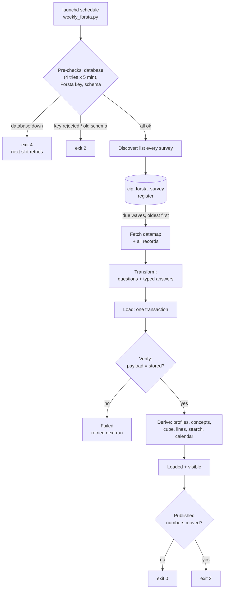

# 0. Overview

**Consumer Insight Portal (CIP) — Technical Specification.** How survey data is retrieved from Forsta, transformed,
loaded into `cip_stg`, verified and prepared for reporting. Version 1.0 · 13 October 2026.

## 0.1 Scope

| In scope | Out of scope (for now) |
|---|---|
| Forsta API extraction, every survey the key can see | Reactivating hibernated surveys (manual in Forsta) |
| Transformation, loading, verification, derived tables | The new portal UI (designs only) |
| History from Qualtrics and SurveyMonkey (`dwh_sm*`) | Azure Blob archive of raw payloads (deferred) |
| Scheduling, monitoring, reconciliation | Weighting (columns reserved; waves are unweighted) |

## 0.2 Document map

| Section | Content |
|---|---|
| 1 | Connection and API: endpoints, authentication, responses, status codes, configuration |
| 2 | Extract: discovery, due selection, fetching, wave identity, legacy sources |
| 3 | Transform: question shapes, labels, bipolar grids, other-specify, flags, personal data, profiles, concepts |
| 4 | Load and verify: write order, transactions, verification, visibility, idempotency, reconciliation |
| 5 | Derived data, storage design, indexes, partitioning, performance |
| 6 | Data dictionary: every table, view and column |
| 7 | Survey patterns: cadence, rotation, modules, codes, how to apply |
| 8 | Operations runbook: schedule, exit codes, commands, monitoring, incidents, security |

## 0.3 Architecture

{page=landscape}

{page=landscape}

{page=landscape}

{page=landscape}

## 0.4 Components

| Component | File | Responsibility |
|---|---|---|
| Scheduled run | `scripts/weekly_forsta.py` | health, key and schema checks; discover; load due; drift; exit code |
| Forsta client | `etl/forsta_client.py` | authenticated GET with retries |
| Datamap adapter | `etl/forsta_api.py` | Forsta JSON → questions (shapes, labels, bipolar, other-specify, flags, personal-field denylist) |
| Pipeline | `etl/forsta_etl.py` | register, load, verify, reconcile, reindex |
| Loaders | `etl/loaders.py` | survey and definition upserts, load log, search index |
| Shared loader steps | `etl/run_pipeline.py` | profiles, question bases, wave label |
| Demographics | `etl/survey_map.py` + `config/survey_map.yml` | topics, profile mapping, age/income bands, regions |
| Harmoniser | `app/data/harmonise.py` | concepts across waves and platforms |
| Cohorts and cube | `app/data/cohorts.py`, `app/data/cube.py` | segment membership, pre-computed cells |
| Line-by-line | `etl/tracker_line.py` + `config/tracker_line.yml` | the data team's weekly table |
| Survey calendar | `etl/survey_calendar.py` + `config/survey_calendar.yml` | cadence, modules, season wave numbers |
| History | `etl/legacy_dwh.py`, `etl/qualtrics_export.py` | Qualtrics and SurveyMonkey |
| Schema | `sql/001_schema.sql`, `sql/002_views.sql`, `app/core/schema_upgrade.py`, `scripts/init_db.py` | DDL, views, upgrades |
| Checks | `scripts/reconcile.py`, `scripts/perf_check.py`, `tests/` | correctness, speed, 227 tests |
