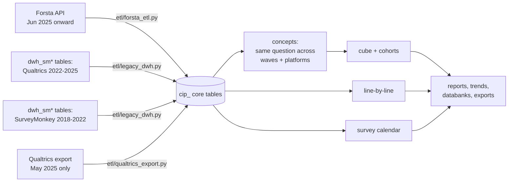

# 1. Connection and API

## 1.1 Systems involved



| System | Role | Access |
|---|---|---|
| Forsta Surveys (Decipher) `se1.decipherinc.com` | Live survey source | HTTPS REST API v1, **GET only** |
| Azure Database for MySQL 8.0 `csr-mysql8-flex-stg.mysql.database.azure.com`, schema `cip_stg` (all `cip_` tables and views) | Warehouse | TLS 1.2+, PyMySQL via SQLAlchemy 2 |
| `dwh_sm*` tables in `dwh_stg` | Qualtrics + SurveyMonkey history (read) | same server; read through `dwh_sm*` views in `cip_stg` |
| macOS launchd (`com.coresight.cip-forsta-etl`) | Scheduler | user agent on the ETL host |

## 1.2 Forsta API

| Setting | Value |
|---|---|
| Base URL | `https://se1.decipherinc.com/api/v1/` |
| Authentication | header `x-apikey: <64-character key>`; key in `.env` as `FORSTA_API_KEY` (never logged or printed) |
| Other headers | `Accept: application/json`, `User-Agent: coresight-cip/1.0` |
| Account | user 879, company 86, directory "Coresight Research" (`58f`) |
| Timeout | 120 s per request (`FORSTA_TIMEOUT_SECONDS`) |
| Retries | up to 4 attempts, exponential back-off 2 → 60 s, on connection errors, timeouts, **429** and **5xx** |
| Usage header | `x-usage-today` logged at debug level |
| Client | `etl/forsta_client.py` (`ForstaClient`) |

### Endpoints used (all GET)

| Endpoint | Purpose | Called |
|---|---|---|
| `rh/users/self` | Proves the key works | Start of every scheduled run |
| `rh/companies/all/surveys` | Every survey the key can see: `path`, `title`, `state`, `hibernated`, `tags`, `createdOn`, `dateLaunched`, `closedDate`, `qualified`, `total`, `sampleSources` | Once per run (discovery) and reused for the run's loads |
| `surveys/{path}/datamap?format=json` | Questionnaire definition | Once per wave loaded |
| `surveys/{path}/data?format=json` | Every respondent record; **no `cond` filter**, so terminates, over-quota and partials are included | Once per wave loaded and per reconciliation |

Nothing else is called. `data/edit`, reactivation, survey edits and datafeed acknowledgements are not used; the
client has no POST/PUT/DELETE method.

### Response shapes

**Survey list item**

```json
{"path": "selfserve/58f/260908", "title": "Shopping and Spending - inc Home Furnishings + Holiday Tracker + GenAI",
 "state": "closed", "hibernated": false, "tags": ["Coresight Research", "Weekly consumer tracker"],
 "createdOn": "2026-09-22T15:57:00Z", "dateLaunched": "2026-10-05T12:22:25Z", "closedDate": "2026-10-06T14:19:55Z",
 "qualified": 401, "total": 823, "sampleSources": ["114"]}
```

**Datamap** — `questions[]`, each with `qlabel`, `qtitle`, `type` (single / multiple / float / number / text),
`grouping` (rows / cols), optional `flags` (`t` technical, `v` virtual), `values[]` (`value`, `title`) on the
question *or* on each variable, and `variables[]` (`label`, `row`, `rowTitle`, `colTitle`, `type`, `values`).

**Data** — a JSON array, one object per respondent, **every value a string**: `"status": "3"`,
checkbox `"0"`/`"1"`, single choice `"1"`…`"n"`, numbers as text, verbatims as text,
`"date": "09/28/2026 10:56"`, plus `record`, `uuid`, `RID`, `markers`, `userAgent`, `url`, `session`, `dcua`.

### Status codes and what the pipeline does

| Code | Meaning | Handling |
|---|---|---|
| 200 | OK | continue |
| 401 | Key missing, wrong, revoked or user disabled | run stops, exit 2 |
| 403 | Key valid, no rights on the survey | wave fails, recorded |
| 428 | Survey hibernated | never loaded; reconciliation skips it with a warning |
| 429 / 5xx | Busy / server error | retried (4 attempts) then the wave fails and is retried next run |

## 1.3 Warehouse connection

| Setting | Value |
|---|---|
| Driver | `mysql+pymysql`, SQLAlchemy 2 engine, pooled (`DB_POOL_SIZE`, `DB_MAX_OVERFLOW`) |
| ETL account | `STG_DB_USER` (`mohdsaeedafri`) — ALL PRIVILEGES on `cip_stg`, SELECT on `dwh_stg` |
| Portal account | read-only grants (`sql/004_grants.sql`, applied by the DBA) |
| TLS | required; CA bundle `STG_DB_SSL_CA` (DigiCert Global Root G2) |
| Latency | ≈250 ms round trip from the India office — every loader step is batched to a constant number of statements per wave |
| Health check | `SELECT VERSION()`; the scheduled run tries 4 times, 5 minutes apart, before exiting 4 |

## 1.4 Configuration (`.env`)

| Variable | Use |
|---|---|
| `APP_ENV` | `LOCAL` / `STAGING` / `PRODUCTION` |
| `STG_DB_HOST`, `STG_DB_PORT`, `STG_DB_NAME`, `STG_DB_USER`, `STG_DB_PASSWORD`, `STG_DB_SSL_CA` | Warehouse |
| `FORSTA_HOST` (default `se1.decipherinc.com`), `FORSTA_API_KEY` | Forsta |
| `FORSTA_TIMEOUT_SECONDS` (120), `FORSTA_MAX_RETRIES` (4) | Client |
| `LOCAL_SQLITE_PATH` | Offline SQLite copy for development |
