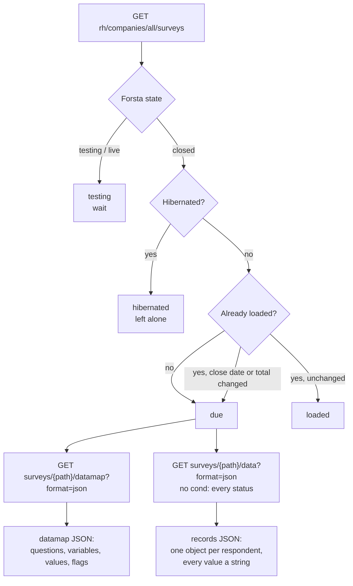

# 2. Extract

Code: `etl/forsta_etl.py` (`discover`, `run_due`, `load_survey`), `etl/forsta_client.py`.

## 2.1 Discovery (every run)

`discover(client)` calls `rh/companies/all/surveys` once and upserts one row per survey into `cip_forsta_survey`
(key `forsta_path`). The **load state** is decided as follows:

| Condition (in order) | `load_state` |
|---|---|
| previously `loaded` and neither `closedDate` nor `total` changed | `loaded` |
| Forsta `state` ≠ `closed` (testing, live) | `testing` |
| closed and `hibernated = true` | `hibernated` |
| closed, readable, previously `failed` | `failed` (retried) |
| closed, readable, otherwise | `due` |

A loaded survey whose close date or total respondents changed (reopened in Forsta) becomes `due` again.
The same transaction rebuilds the survey calendar (`cip_wave_module`, section 5.6).

Columns written: `title`, `state`, `hibernated`, `tags` (comma list), `study_type`
(`tracker` if tagged "Weekly consumer tracker" or titled "Shopping and spending…", `annual` if tagged
"annual tracker", else `adhoc`), `created_on`, `launched_at`, `closed_at`, `qualified_n`, `total_n`,
`last_seen` (UTC), `load_state`.

## 2.2 Choosing what to load

`run_due(client)` selects `load_state IN ('due','failed')` ordered by `closed_at, forsta_path` (oldest first) and
loads them one at a time. The survey list from discovery is reused, so a run makes **one** list call however many
waves it loads. A failure is recorded (`load_state = failed`, `last_error`) and the run continues with the next
wave.

## 2.3 Fetching a wave

For each due survey:

1. `GET surveys/{path}/datamap?format=json` — the questionnaire (≈0.5 MB).
2. `GET surveys/{path}/data?format=json` — all records (≈2 MB for 500 respondents), **without** `cond`, so every
   status is present: 1 terminated · 2 over quota · 3 qualified · 4 partial.
3. Records without a `uuid` are discarded (Forsta system rows).

## 2.4 Wave identity

| Field | Rule |
|---|---|
| Forsta path | `selfserve/58f/YYMMNN` — one survey = one wave |
| `wave_label` / `wave_date` | Monday of the earliest completion date among **qualified** records (all records if none qualified) |
| Reload | A survey already loaded by this pipeline (load log `source_ref = forsta:{path}`) keeps its wave label and `survey_id`, even if its first date moves |
| Family | `CSI-US` for the weekly tracker; for other studies the title without the year, upper-cased (`HOLIDAY_SHOPPING`) |

## 2.5 Legacy extraction (history)

| Source | Module | Notes |
|---|---|---|
| Qualtrics 2022–2025 in `dwh_sm*` | `python -m etl.legacy_dwh --all` | 142 waves, completes only, matched to the original responses |
| SurveyMonkey 2018–2022 in `dwh_sm*` | `python -m etl.legacy_dwh --all --era surveymonkey` | 145 waves; matrix questions as grids; SurveyMonkey Audience demographics fill profiles |
| Qualtrics Excel export, May 2025 | `python -m etl.qualtrics_export --wave 2025-05-12 --file …` | The only wave missing from `dwh_sm*` |
