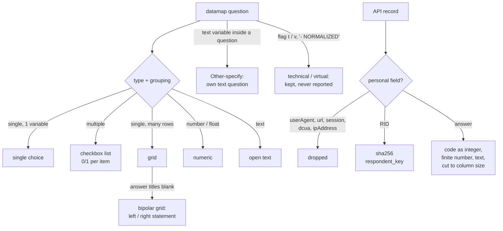

# 3. Transform

Code: `etl/forsta_api.py` (`questions_from_datamap`), `etl/forsta_etl.py` (`_answer`, `_respondent`),
`etl/records.py` (`ParsedQuestion`, `clean_text`), `etl/survey_map.py` (profiles), `etl/loaders.py`
(topics, short labels).

## 3.1 Datamap → questions (one `ParsedQuestion` per Forsta question)

| Forsta shape | Measured frequency (1,416 questions) | Stored as `qtype` | Fields created |
|---|---|---|---|
| `single`, 1 variable | 693 | `single` | one field = the question code |
| `multiple`, many variables | 491 | `multi` (0/1 per item) | one field per item (`q1r1`, `q1r2` …) |
| `single`, `rows`, many variables | 73 | `grid_single` | one field per row |
| `single`, `cols`, + a text variable | 53 | `single` + separate `text` question for the "Other (specify)" variable | |
| `single`, `rows`, 1 variable | 43 | `single` (or `grid_single` when the variable is named apart) | |
| `float` / `number` | 32 | `numeric` | |
| `text` / `textarea` | 23 | `text` | |
| `date` | — | `datetime` | |

Rules, in order:

1. **Text** — titles are HTML-unescaped and whitespace-normalised (`clean_text`); `qtext_short` is a ≤ 80-character
   label.
2. **Answer labels** — taken from the question's `values[]`; when empty (about a third of datamaps) from the first
   variable that has `values[]`. Only integer codes are kept.
3. **Grid** — a single-choice question whose variables are "named apart" (more than one row, or the one row's code
   differs from the question code). Row label = `rowTitle — colTitle`.
4. **Bipolar grid** — a grid whose answer titles are all blank (e.g. HX6): options become
   `1 = Left statement`, `2 = Right statement`; each row stores its left statement (its own title) and its right
   statement (the `{question}_norm{row}_r` variable of Forsta's NORMALIZED copy) in `cip_item.left_label /
   right_label`.
5. **Other (specify)** — a `text` variable inside a non-text question becomes its own `text` question, code = the
   variable label (`vosr15oe`, `q1r2oe`), wording "<question> — <row> (please specify)".
6. **Flags** — `t` → `is_technical = 1` (conditions, qtime, start_date, status…); `v` → `is_virtual = 1`
   (vlist, vos, vbrowser…); a title ending "- NORMALIZED" is virtual. Technical and virtual questions are stored
   but never reported, harmonised or cubed.
7. **Personal variables** — `RID`, `userAgent`, `url`, `session`, `dcua`, `ipAddress` never become questions or
   fields, even if a datamap lists them.
8. **Topic** — each question is placed in an editorial topic (`cip_topic`) from its code and wording
   (`config/survey_map.yml`); technical topics also set `is_technical`.
9. **Answer attributes** — an option whose label contains "don't know", "not sure" or "prefer not to say" is
   `is_nonresponse`; an item starting "None of these" is `is_exclusive`; an item code ending `oe` is `is_other`.

## 3.2 Records → respondent rows

| Column | Source | Rule |
|---|---|---|
| `record_no` | `record` | integer |
| `forsta_uuid` | `uuid` | ≤ 64 chars, the upsert key with `survey_id` |
| `status_code` / `status_label` | `status` | 1 Terminated · 2 Overquota · 3 Qualified · 4 Partial |
| `is_qualified` | | `status = 3` |
| `completed_at` | `date` | `MM/DD/YYYY HH:MM` → datetime |
| `interview_secs` | `qtime` | integer seconds |
| `markers` | `markers` | ≤ 1,000 chars |
| `device`, `os`, `browser`, `dropout_qcode` | `vmobiledevice`, `vos`, `vbrowser`, `vdropout` | ≤ 50 chars |
| `panel_source` | `vlist` / `list` | ≤ 100 chars |
| `respondent_key` | `RID` | **sha256 hex** — the panel id itself is never stored |
| `sample_rid` | | always NULL |

## 3.3 Records → answer rows

Each `(record, field)` with a non-empty value becomes one `cip_answer` row:

| Field kind | Stored |
|---|---|
| `code` (single, grid row, checkbox item) | `value_code` integer (`"3"`, `"3.0"` → 3); `value_label` = the option label (single/grid) or the item label (checkbox) |
| `code` but not a whole number | `value_label` = the raw text, no code invented |
| `numeric` | `value_number`, only if finite and \|x\| < 10¹⁴ (column is DECIMAL(18,4)); otherwise not stored |
| `text` | `value_text` verbatim |

Empty strings and nulls are not stored, so "no answer" is the absence of a row. Checkbox `0` **is** stored (item
shown, not chosen), which gives every multi-select question its "answered" base.

## 3.4 Derived transformations (after load)

| Output | Rule | Code |
|---|---|---|
| Profile per respondent (`cip_profile`) | Demographic questions found per wave from `config/survey_map.yml` (CSI-US: D1 gender, D2 age, D3 relationship, D4 ethnicity, D5 income, D6 urbanicity, D7 political, D8 state, CS1/CS2 outlook) or by wording; mapping recorded in `cip_profile_map` | `run_pipeline._rebuild_profiles` |
| Age band | 18-29 · 30-44 · 45-60 · Over 60 (from a single year, or a band that fits one band); "Under 18" unbanded | `survey_map.classify_age` |
| Generation | GenZ 18-28 · Millennial 29-44 · GenX 45-60 · Boomer 61+ | same |
| Age midpoint | the year itself; bands: the analysts' midpoints (over 60 = 67) | same |
| Income midpoint ($000) | under $25k = 13 · $25-49.9k = 37.4995 · $50-99.9k = 74.9995 · $100-149.9k = 124.9995 · $150-199.9k = 174.9995 · $200k+ = 225 | `survey_map.income_mid_k` |
| Census region | State → Northeast / Midwest / South / West (SurveyMonkey: Census division → region) | `survey_map.census_region` |
| Question base | qualified respondents who reached the question | `_rebuild_question_bases` |
| Concepts | exact (same normalised wording and options) → confirmed; changed options → proposed; wording ≥ 0.85 similar → proposed; else new concept | `app/data/harmonise.py` |
| Line-by-line row | the data team's format, see 5.4 | `etl/tracker_line.py` |
| Calendar | lead sector, topics, seasonal tracker, events; season wave numbers | `etl/survey_calendar.py` |
