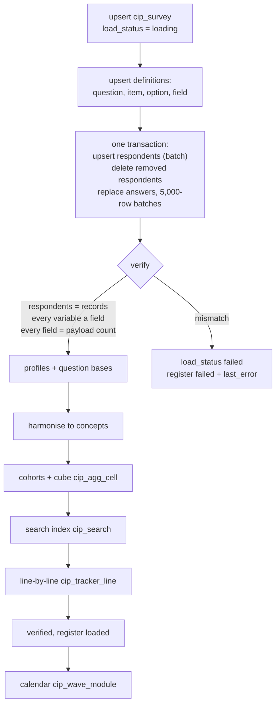

# 4. Load and verify

Code: `etl/forsta_etl.py` (`load_survey`, `_write`, `verify`), `etl/loaders.py` (`upsert_survey`,
`load_definitions`, `start_run`, `finish_run`).

## 4.1 Order of writes

| Step | Table(s) | Statement | Transaction |
|---|---|---|---|
| 1 | `cip_survey` | `INSERT … ON DUPLICATE KEY UPDATE` keyed `(platform, source_ref, wave_label)`; then `load_status = 'loading'`, `sample_source`, `total_n`, `tags`, `field_start`, `field_end` | own |
| 2 | `cip_load_log` | new run row: `source_type = api`, `object_type = data`, `source_ref = forsta:{path}` | own |
| 3 | `cip_topic`, `cip_question`, `cip_option`, `cip_item`, `cip_field` | batched upserts (one statement per table), `INSERT IGNORE` for fields | own |
| 4 | `cip_respondent` | one batched upsert keyed `(survey_id, record_no)` | **A** |
| 4b | `cip_answer`, `cip_respondent_cohort`, `cip_profile`, `cip_respondent` | respondents no longer in Forsta's payload are deleted | **A** |
| 4c | `cip_answer` | `DELETE … WHERE survey_id`, then inserts in batches of 5,000 rows (all placeholders, so PyMySQL batches them) | **A** |
| 5 | — | verify (reads only) | |
| 6 | `cip_profile_map`, `cip_profile` | profiles rebuilt | own |
| 7 | `cip_question.base_n` | question bases | own |
| 8 | `cip_concept*`, `cip_concept_map` | harmonise | own |
| 9 | `cip_respondent_cohort`, `cip_agg_cell` | cohorts derived, cube rebuilt (old cells removed first) | own |
| 10 | `cip_search` | the wave's survey + question rows; concept rows | own |
| 11 | `cip_tracker_line` | the wave's lines (tracker family only) | own |
| 12 | `cip_load_log` | run finished: rows read / loaded, status | own |
| 13 | `cip_survey`, `cip_forsta_survey` | `load_status = 'verified'`; register `loaded`, `survey_id`, `loaded_at` | own |
| 14 | `cip_wave_module` | calendar rebuilt (questions now known) | own |

Transaction **A** is all-or-nothing: if it fails, the previous answers are untouched.

## 4.2 Verification (before anything is visible)

`verify(survey_id, datamap, records)` must return no problems:

1. **Respondents** — stored respondents for the wave = records sent.
2. **Fields** — every datamap variable (except personal ones) has a `cip_field`.
3. **Answers** — for every field, stored answer count = the number of records with a non-empty value.

Any mismatch raises `"{path} does not match its payload"`, the wave is marked `failed`, and its error is kept in
`cip_load_log.error_text` and `cip_forsta_survey.last_error`.

## 4.3 Visibility and status

| `cip_survey.load_status` | Meaning | Visible in reports |
|---|---|---|
| `loading` | being written | no |
| `verified` | proven equal to Forsta and derived | **yes** |
| `failed` | did not match, or a later step failed | no |

If a reload fails **before** transaction A commits, a previously verified wave keeps `verified` (its data did not
change). If it fails after, the wave becomes `failed` and the next run retries it.

## 4.4 Idempotency

* Every write is an upsert or a replace keyed on Forsta's own identifiers (`forsta_path`, `uuid`, `record`,
  variable label), so re-running a load never duplicates anything.
* A reload of the same Forsta survey reuses its `survey_id` and wave label — but only a wave that this pipeline
  loaded from the API (load log `forsta:{path}`); a wave loaded another way on the same path is never overwritten.

## 4.5 Reconciliation (independent check)

`python scripts/reconcile.py` (or `python -m etl.forsta_etl --reconcile`) re-reads every loaded wave from Forsta
and compares **every stored answer**: codes exactly, numbers at the stored 4-decimal precision, texts exactly.
Hibernated surveys are skipped with a warning. Last run (8 Oct 2026): **31 waves, 4,476,153 answers, 0
differences**. Legacy waves are compared with their `dwh_sm*` source the same way.
