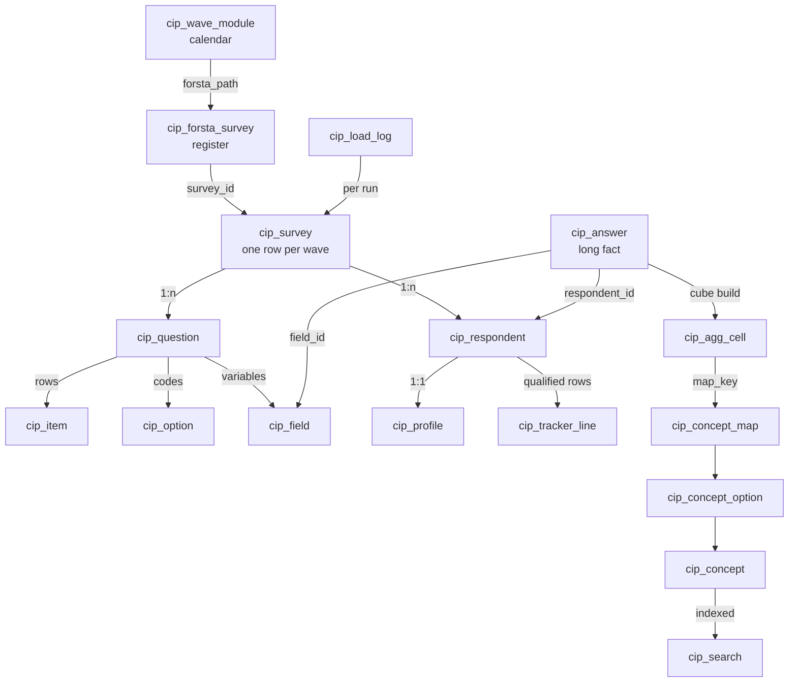

# 5. Derived data, storage design and performance

Everything a report needs is computed in the warehouse when a wave loads, so the portal and exports only read
pre-computed rows.

## 5.1 Design principles

* **Long, not wide.** `cip_answer` holds one row per respondent × variable, so the schema never changes when weekly
  modules rotate. (A wide table — one column per variable — would break every week.)
* **Definitions per wave.** Forsta codes are not stable (`D2`, `BT14`, `DS1`–`DS7` changed meaning across waves),
  so questions are linked across waves by wording through **concepts**, never by code.
* **Conformed dimensions.** Concept + concept option are the shared "question" dimension across Forsta, Qualtrics
  and SurveyMonkey.
* **Pre-aggregated cube.** `cip_agg_cell` counts every answer once per standard cut and cohort.
* **Prefix `cip_`** (views `v_cip_`) so nothing collides with other `dwh_stg` tables.

## 5.2 Cube — `cip_agg_cell`

| Aspect | Rule |
|---|---|
| Rows | every answer of every reportable question (single, grid row, checkbox item) × cut × cohort, **qualified respondents only** |
| Cuts (`dim`) | total, gender, age_band, generation, income_band, census_region, urbanicity |
| Cohorts | everyone (`cohort_id NULL`) and each current cohort (`config/cohorts.yml`, e.g. Beauty shoppers) |
| Measures | `n`, `base_n`, `sum_age_mid`, `n_age_mid`, `sum_income_mid_k`, `n_income_mid` (averages without raw rows) |
| Bases | single/grid: who answered that row; checkbox: everyone who answered the question ("Total answering") |
| Concept link | `map_key = question:item:option`, joined to `cip_concept_map` at read time, so confirming a mapping needs no rebuild |
| Build | answers read once into a temporary table with every cut; each cut × cohort is an aggregate over it |

## 5.3 Search — `cip_search`

One row per wave (title, family, tags, path), per non-technical question (wording, code) and per concept (name,
code, number of waves). MySQL FULLTEXT on `(title, body)`; queries use boolean mode with required, prefix-matched
words, skipping InnoDB stop-words; LIKE fallback for words under 3 characters (e.g. "D5"). Only verified waves are
returned.

## 5.4 Line-by-line — `cip_tracker_line`

The data team's "Weekly Line-By-Line Survey Data" rebuilt per tracker wave (`config/tracker_line.yml`): one JSON
row per **qualified** respondent, keys in the team's column order.

| Column(s) | Rule |
|---|---|
| Month | first day of the wave's month |
| date | completion `MM/DD/YYYY HH:MM` |
| Activities: … / Purchased In-store: … / Purchased Online: … / Food: … / Non-food: … | q1–q5, one column per item: the label when chosen, blank when not |
| Household Situation, Economic Situation | CS1, CS2 |
| Gender, Age, Relationship Status, Ethnicity, Household Income, Primary Residence, State | D1–D6, D8 (Age a number when a single year) |
| start_date | survey start time |
| Age Range, Generation | profile bands in the team's spelling ("over 60", "Millenial") |

Not carried: D7 (the team omits it) and the panel `session` id (personal data). Check against the team's file:
`python -m etl.tracker_line --compare "Weekly Line-By-Line Survey Data.xlsx"`.

## 5.5 Concepts — harmonisation

| Decision | Condition | Status |
|---|---|---|
| exact | same normalised wording and type; every answer already a concept option | confirmed |
| changed | same wording, new answers | proposed |
| similar | wording ≥ 0.85 alike (the highest unrelated pair measured 0.796) | proposed |
| new | nothing close | new concept, confirmed |

A grid is harmonised row by row. Proposals wait on the Mappings page; answers trend only once confirmed.

## 5.6 Survey calendar — `cip_wave_module`

Rebuilt after every discovery and load from `config/survey_calendar.yml`: each Forsta survey × module with
`kind` (sector · topic · seasonal · event · annual · adhoc), `is_lead`, `launched_on`, `season` (July–June),
`series_wave_no`, `detected_by` (title or questions). A seasonal tracker is detected from its own question (XM3
"current status of your holiday shopping") once loaded. `python -m etl.survey_calendar` prints the calendar and the
next 12 expected lead sectors.

## 5.7 Indexes

| Index | Serves |
|---|---|
| `cip_answer (survey_id, field_id, value_code, respondent_id)` covering | item incidence, cube build |
| `cip_answer (respondent_id, field_id)` unique | upserts, cohort rules |
| `cip_agg_cell (survey_id, map_key, cohort_id, dim)`, `(survey_id, question_id, dim)` | concept trends, standard views |
| `cip_survey (load_status, study_type, wave_date)` | wave pickers |
| `cip_forsta_survey (load_state, closed_at)` | the due list |
| `cip_search` FULLTEXT `(title, body)` | search |
| `cip_wave_module (module_code, season, series_wave_no)` | "wave N vs last year's wave N" |
| `cip_tracker_line (wave_date, survey_id)` | line-by-line exports |

## 5.8 Partitioning decision

Measured 8 Oct 2026: `cip_answer` 14.3 M rows, 1.3 GB data + 2.9 GB index (≈23 M rows after the SurveyMonkey
reload). It is **not** physically partitioned:

* InnoDB cannot partition a table that has foreign keys or a FULLTEXT index; `cip_answer` has both
  (referential integrity and verbatim search).
* Every hot read already starts with `survey_id` on a covering index; reports read the cube, not raw answers.

Applied instead: **logical partitioning by wave** — `survey_id` leads every hot index, a wave loads, verifies and
is replaced as one unit, and reads go to the pre-computed cube and line tables. Trigger to revisit: `cip_answer`
above 100 M rows → `PARTITION BY HASH(survey_id)` with integrity moved to the loader's verify step and verbatim
search to `cip_search`.

## 5.9 Measured performance (over the VPN, P95)

| Read | P95 |
|---|---|
| Search (FULLTEXT) | 0.26 s |
| Whole wave report (catalogue + cube + numbers + verbatims) | 1.05 s |
| Standard view (cube, one cut) | 0.25 s |
| Ad-hoc cohort, one wave | 0.76 s |
| Five-wave pooled concept | 0.27 s |

Load time: 1.5–3 minutes per weekly wave (dominated by ~250 ms round trips; every step is batched).
