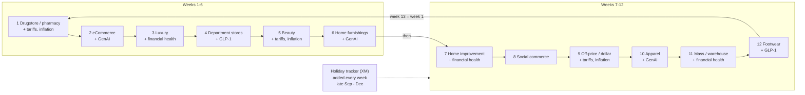

# 7. Survey patterns — measured, stored and applied

Source of every number below: the 90 surveys in `cip_forsta_survey` (Jul 2025 – Oct 2026) and the 23 loaded
weekly waves. Rules live in `config/survey_calendar.yml`; results in `cip_wave_module`.

## 7.1 Cadence

| Measure | Value |
|---|---|
| Tracker launches (UTC) | Monday 12–13 in 56 of 66 waves; Monday 14–16 in 7; Friday 2; Tuesday 1 |
| Close (IST) | Monday 20:00 → Wednesday 23:00 |
| Fielding time | median 13.1 h, 90th percentile 49 h, range 2.4 h – 6 days |
| Qualified | 400–414 per tracker wave (fixed quota ≈400) |
| Total started | 403 – 887 |
| Gender quota | exactly balanced (7,000 / 7,000 in the team's Feb–Sep file) |
| Hibernation | ≈3–4 months after close (`428`); deletion 365 days after creation |

## 7.2 Title grammar

`Shopping and Spending - inc <part> + <part> + …` — the first part is the **lead sector**; each further part is a
recurring topic, a seasonal tracker, or a one-off event. Matching (case-insensitive regex, first part only for the
lead):

| Kind | Codes (config) |
|---|---|
| sector | DRUGSTORE, ECOMMERCE, LUXURY, DEPT_STORES, BEAUTY, HOME_FURNISHINGS, HOME_IMPROVEMENT, SOCIAL_COMMERCE, OFF_PRICE, APPAREL, MASS_WAREHOUSE, FOOTWEAR |
| topic | TARIFFS_INFLATION, GLP1, GENAI, FINANCIAL_HEALTH, MIDEAST_GAS |
| seasonal | HOLIDAY_TRACKER (title "holiday track…" or question "current status of your holiday shopping") |
| event | any other part, slugged (PRIME_DAY, LABOR_DAY, BLACK_FRIDAY …) |
| annual | HOLIDAY_SHOPPING, AMAZON_APPAREL, ONLINE_GROCERY, BACK_TO_SCHOOL (not "inc" titles) |
| adhoc | everything else, slug of the title |

## 7.3 Rotation evidence (weeks between appearances of each lead sector)

| Sector | Gaps (weeks) |
|---|---|
| Drugstore | 12, 12, 12, 12, 12 |
| eCommerce | 12, 12, 12, 12, 12 |
| Luxury | 12, 12, 11, 12, 12 |
| Department stores | 12, 12, 12, 12, 12 |
| Beauty | 12, 12, 12, 12, 12 |
| Home furnishings | 13, 11, 12, 12, 12 |
| Home improvement | 13, 11, 12, 12 |
| Social commerce | 24 (replaced by a Holiday week, Nov 3 2025), 12, 12 |
| Off-price / dollar, Apparel, Mass / warehouse, Footwear | 12, 12, 12, 12 |

Prediction check: after Home furnishings (Oct 5 2026) the rotation gives Home improvement for Oct 12 — the Forsta
survey `261000` is "Home Improvement/DIY + Holiday Tracker + …".

## 7.4 Module question codes

| Prefix | Module | Example |
|---|---|---|
| q1–q5, CS1–CS2, D1–D8 | Core (every wave) | see the business description, section 4.1 |
| CS3+, D9+ , q6+ | Topical extensions of the core (tax filing, government shutdown, expenses) | CS3 "Have you filed your 2026 income tax return, yet?" |
| BT | Beauty | BT1 "Have you purchased any beauty products … in the past three months?" |
| XM | Holiday tracker | XM3 status · XM1 bought in last 7 days · XM1A categories · XM2 retailers |
| HX | Holiday outlook | HX1 spend vs last year · HX6 bipolar preferences |
| TF / T | Tariffs | TF1 "What impact, if any, do you think tariffs have on you personally?" |
| IN | Inflation | IN1 "Have you noticed any recent price changes in retail?" |
| GP | GLP-1 | GP1 "Are you currently using a GLP-1 drug like Ozempic?" |
| G, GU | GenAI | GU1 "Which, if any, of the following AI tools have you used …?" |
| F | Financial health | F1 "How long could you cover all of your bills … using just your personal savings?" |
| AP, DNM, R | Apparel, denim, returns | |
| HF, HI | Home furnishings, home improvement | |
| DP, LX, FW, EC, SC, O, DS, M | Dept stores, luxury, footwear, eCommerce, social commerce, off-price, dollar stores, mass | |
| PB, BF, APR, PDR, BD, JP, SD | Holiday purchases, Black Friday, Prime Day, Big Deal Days, Singles Day | |
| E, ID/IDR, FDR, LDR, HW, FWC/FWCR | Easter, July 4th, Father's Day, Labor Day, Halloween, FIFA World Cup | |
| EAT, CPG, SHRNK, BN, DJ, BST, EH, PF | Restaurants, packaged goods, shrink, BNPL, diamonds, store tech, experience, preferences | |

Codes are **not** stable across waves (the same code can carry different wording), which is why the harmoniser
matches on wording.

## 7.5 Known scheme changes

| Change | Effect | Handling |
|---|---|---|
| D2 age: bands (to Oct 2025) → single years (2026) | Age band / generation derivation differs | `classify_age` derives bands from either |
| XM1 (bought in last 7 days): asked of everyone in 2025, only of those who started shopping in 2026 | Not comparable year on year | flagged in outputs |
| HX6 bipolar grid: blank answer titles | Excel route lost ~3,300 answers | API route stores left/right statements |

## 7.6 Applying the patterns

* **Expect the next wave** — `python -m etl.survey_calendar` lists the next 12 lead sectors.
* **Trend a sector** — read waves where `cip_wave_module.module_code = 'BEAUTY' AND is_lead = 1` (every 12 weeks).
* **Year-on-year holiday** — join this season's `HOLIDAY_TRACKER` wave N to last season's wave N on
  `series_wave_no`.
* **New module or sector** — add a line to `config/survey_calendar.yml`; the next run re-labels every survey.
