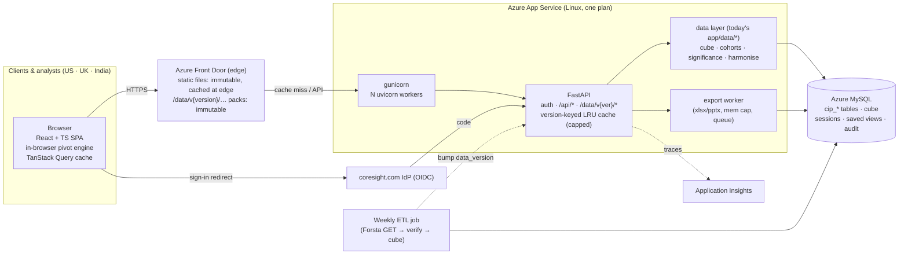
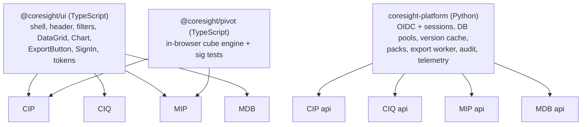

# 06 · System design: the CIP platform

This is the blueprint for CIP, built so that CIQ, MIP and MDB can reuse it. It supersedes the outline in [`docs/13-ui-system-design.md`](../13-ui-system-design.md) and keeps its sound parts: the static SPA, FastAPI, the cube-first read path and server-side sessions. It adds:

- the RAM budget for the real servers;
- the in-browser data engine that makes clicks take milliseconds;
- a CDN in front of the static files;
- versioned data packs;
- an export worker;
- the shared-server case.

Evidence for every choice: benchmarks in [02](02-benchmarks.md), SIP/MIP history in [01](01-evidence-from-sip-and-mip.md), latency in [05](05-millisecond-ui.md), cost in [07](07-cost-model.md).

## 1. Decision in one line

The CIP stack:
- **TypeScript + React** in the browser;
- **Python + FastAPI** on the server;
- **MySQL** with the pre-computed cube as the data source;
- **no Streamlit and no Node server** in the client product.

Node.js is used only at build time, by Vite, to compile the TypeScript. It never runs on the server.

| Layer | Technology | Why this one (evidence) |
|---|---|---|
| Browser UI | React 19 + TypeScript, built by Vite as static files | Flat 0.20 s at 40 users vs 4.35 s for good Streamlit (02 §2). Entry bundle 81 KB gz (MIP-FAST-React) vs Streamlit's 512 KB gz (02 §7). Largest hiring pool. Already used on SMS-UI, ems-frontend and MIP-FAST-React. |
| In-browser data | Wave "packs" (compact JSON, about 60 KB gz per wave) + TanStack Query cache | Pivot, sort, filter and chart toggles run in the browser in < 16 ms, with no network trip (05) |
| Tables / charts | AG Grid Community (MIT) / Apache ECharts (Apache-2.0) | Free. Virtual scrolling. Canvas charts with PNG export. |
| API | FastAPI (Python 3.13), gunicorn + uvicorn workers | Reuses CIP's verified Python data layer unchanged. 7,391 req/s per worker, about 100× the need (02 §2). |
| Data | Azure MySQL `cip_*` with the `cip_agg_cell` cube | Already built and verified: 147,635/147,635 answers equal to Forsta |
| Sign-in | OIDC (coresight.com IdP) handled by the API; session id in an HttpOnly, Secure, SameSite cookie; session row in MySQL | The cookie control Streamlit cannot give, which cost SIP 295 sign-in commits (01) |
| Static delivery | Azure Front Door Standard ($35/month base) in front of the App Service, or Static Web Apps ($9/month) | Static files are served from an edge near the user, so first paint doesn't pay the full trip to Central US (05) |
| Exports | One separate export worker process, with a memory cap and a queue | Keeps Excel builds out of the web workers. SIP's Excel build reached 2.3 GB inside the web process. |
| Weekly data | ETL job (Azure Container Apps job, or the App Service process with `GET_LOCK`) | It already exists. It bumps `data_version` after each load. |

## 2. Architecture



### How a click is served (the three speeds)

| User action | Where it is answered | Expected time |
|---|---|---|
| Sort, filter, toggle a series, change percentage/count, switch chart type, page a table | **In the browser**, on data already loaded | **< 16 ms** (one frame) |
| A standard cross-tab on a wave already opened (any question × any banner: age, gender, income, region…) | **In the browser**, from the wave pack (all cube cells of that wave, about 60 KB gz) | < 50 ms |
| Open a new wave or concept trend | Wave pack or trend pack from the **edge cache**. Immutable URL, so repeat visitors and colleagues hit the edge. | About 30–120 ms in US/UK from the edge; first fetch from origin is one round trip plus about 5 ms of server time |
| Ad-hoc cohort (a custom group of respondents) | **API**: SQL on the cube or raw answers, cached by (version, definition hash) | 0.1–1 s uncached, about 1 ms cached plus the network |
| Excel / PowerPoint export | **Export worker**; download when ready | Seconds; it never blocks the web workers |

The Streamlit equivalent of *every* row above is the same thing: a websocket message, then a full re-run of the page script on one shared Python process, then the re-rendered page sent back. That is why its time grows with every extra user (02 §3).

## 3. Data packs: what makes it fast

- **Wave pack** `GET /data/v{data_version}/wave/{survey_id}.json`
  - Every cube cell of the wave: question, item, option, cohort, dim, dim value, n, base.
  - The question/option labels are sent once per wave.
  - **Measured on wave 415: 12,425 cells, 674 KB JSON, 60 KB gzipped.**
- **Trend pack** `GET /data/v{data_version}/concept/{concept_id}.json`
  - The series across waves for one harmonised concept, all standard cuts included.
- **Catalogue** `GET /data/v{data_version}/catalogue.json`
  - Waves, questions and concepts for search. Searched in the browser.
- **Immutable URLs.**
  - The URL contains `data_version`, so `Cache-Control: public, max-age=31536000, immutable` is safe.
  - A new weekly load changes the version, so new URLs appear and old ones age out.
  - Front Door serves repeats from the edge, and the App Service sees each pack once per version.
- **Entitlement filtering.** Packs are built per client plan when plans differ, using `plan` in the URL. The edge cache key includes the session-checked plan, or packs go through the API with `private` caching for restricted plans.
- **Significance letters.**
  - Computed in the browser from n and base: a column-proportion z-test, about 30 lines of TypeScript.
  - Mirrored by the Python implementation and checked with a shared test fixture.
  - Weighted tests (effective base) are added when weighting is turned on.

## 4. Service design

```
api/
  main.py            FastAPI app, middleware, static mount (fallback if no CDN)
  auth.py            OIDC login/callback/logout (Authlib), session dependency, CSRF header check
  packs.py           /data/v{ver}/wave|concept|catalogue — built from the cube, cached per version
  routers/
    analysis.py      POST /api/analysis (ad-hoc cohort cross-tab)
    views.py         GET/POST/DELETE /api/views (saved views, per user)
    exports.py       POST /api/exports → job id; GET /api/exports/{id}
    me.py            GET /api/me (user, plan, roles)
  cache.py           version-keyed LRU with a byte cap per worker
  worker_export.py   separate process: builds xlsx/pptx from the data layer
```

- **Reuse.** The data layer is today's `app/data/` (`repository.py`, `cube.py`, `cohorts.py`, `harmonise.py`, `publications.py`), unchanged. The only edit is swapping `@st.cache_data` for the service cache.
- **Statelessness.** No user state lives in a worker. The session row is in MySQL and the view state is in the URL. Any worker can answer any request, so memory does not grow with users, and a second instance later needs no code change.
- **Database accounts.** `cip_app_ro` has SELECT only. `cip_app_rw` is limited to sessions, saved views and audit. This fixes REA G-03 and G-11.
- **Guards.** `MAX_EXECUTION_TIME` of 10 s on ad-hoc SQL. Per-user and per-IP rate limits. Small-cell suppression (n < 30) in packs and exports.

## 5. Memory budget on the real servers

These figures come from the benchmark runs in 02: about 82–100 MB per FastAPI worker at idle, and 306 MB for a master plus 2 workers under load. The OS and App Service overhead is an assumption, about 1 GB.

### 5.1 One product per server (the intended set-up)

| Item | Staging (~4.5 GB, 1 vCPU) | Production (~9.88 GB, 2 vCPU) |
|---|--:|--:|
| OS + App Service sandbox (assumed) | 1.0 GB | 1.0 GB |
| gunicorn master + workers | 2 workers ≈ 0.3 GB | 4 workers ≈ 0.6 GB |
| Pack/result cache (capped per worker) | 2 × 200 MB = 0.4 GB | 4 × 300 MB = 1.2 GB |
| Export worker (hard cap) | 0.5 GB | 1.0 GB |
| **Planned total** | **2.2 GB (49%)** | **3.8 GB (38%)** |
| Headroom | 2.3 GB | 6.1 GB |

Compare the SIP/MIP pattern:
- A single Streamlit process doing "load the table" peaked at **3.67 GB for one 75 MB table** (02).
- SIP production peaked at **6.9 GB of 8 GB**; MIP production at **3.2 GB of 4 GB** (Azure export, 01).

### 5.2 If CIP, CIQ, MIP and MDB must share one server

| Item | Staging | Production |
|---|--:|--:|
| OS (assumed) | 1.0 GB | 1.0 GB |
| 4 products × (master + workers + cache) | 4 × 0.5 GB (1 worker, 200 MB cache) = 2.0 GB | 4 × 1.2 GB (2 workers, 300 MB caches) = 4.8 GB |
| One shared export worker | 0.5 GB | 1.0 GB |
| **Total** | **3.5 GB (78%): tight, but it fits** | **6.8 GB (69%): fits** |

Four Streamlit apps on one box **do not fit**. One of them alone has already reached 6.9 GB.

### 5.3 CPU, which binds before memory does

- **Cached JSON:** 7,391 req/s per worker on M4; assume about ⅓ of that on an Azure vCPU, so **about 2,400 req/s per worker**.
- **Demand:** 300 people active at once, clicking every 5–10 s, with most clicks answered in the browser, gives about 10–60 API requests per second.
- **Headroom:** production with 2 vCPU has roughly **50–100× headroom** on cached paths. The real limit is uncached ad-hoc SQL in MySQL, which the cube and the cache keep rare.

## 6. Security (by design, not by workaround)

| Threat | Control |
|---|---|
| Session theft | HttpOnly + Secure + SameSite=Lax cookie. Random 256-bit id. Server-side session row. Tokens never reach JavaScript. |
| Login attacks | OIDC state + nonce + PKCE S256. Rate limits on `/auth/*`. |
| CSRF | SameSite cookie, plus an `X-CSRF-Token` header on every state-changing call |
| XSS | React escapes output. No `dangerouslySetInnerHTML`. CSP `default-src 'self'`. |
| Formula injection in exports | Prefix cells that start with `= + - @` (REA G-15) |
| SQL injection | Bound parameters and allow-listed identifiers (already true in CIP) |
| Data overreach | Plan and role checked in a FastAPI dependency on every route. Packs built per plan. Exports audited. |
| Re-identification | Small-cell suppression (n < 30) everywhere |
| Secrets | App Service settings with Key Vault references. `gitleaks` in CI. Nothing in the repo (see the REA findings on the public repo). |
| Supply chain | Lock files (`uv.lock`, `pnpm-lock.yaml`). `pip-audit`, `pnpm audit`, Dependabot. |

## 7. Extensibility: one kit, four products



- **Configurable.** Banners, cuts, plans, suppression thresholds and branding live in YAML or database config, as `config/*.yml` already does for CIP. Adding a cut is a configuration change: the cube builder and the pack pick it up.
- **Extensible.**
  - A new screen is a new React route over existing endpoints.
  - A new product imports the two shared packages.
  - A future AI assistant or data feed calls the same API.
- **Scalable.**
  - Stateless workers, so scaling means a bigger SKU or a second instance, with ARR affinity off.
  - The edge cache absorbs repeat pack traffic.
  - MySQL only sees cache misses.

## 8. Operations

| Item | Setting |
|---|---|
| Startup | `gunicorn api.main:app -k uvicorn.workers.UvicornWorker -w 4 --max-requests 2000 --max-requests-jitter 200 --timeout 60` (`-w 2` on staging) |
| Health | `/healthz` (DB reachable, data_version), used by the App Service health check |
| Telemetry | OpenTelemetry → Application Insights: p50/p95 per route, cache hit rate, DB time, export queue length |
| Alerts | p95 > 1 s for 10 min · error rate > 1 % · memory > 75 % · no new data_version by Tue 09:00 IST after a closing wave |
| Deploy | CI (lint, types, pytest + reconcile, vitest, Playwright + axe, audits) → staging slot → smoke + numbers check → slot swap |

## 9. Migration plan (estimates, one developer + design support)

| Phase | Weeks | Output | Gate |
|---|--:|---|---|
| 0. Prerequisites | 1 | The REA Claude Phase 0–3 fixes: secrets, least-privilege DB accounts, views filtered to verified waves | REA plan items done |
| 1. Design | 2 | Figma for Overview, Cross-tab, Trends; analyst review | Business sign-off |
| 2. Foundation | 3 | `api/` around `app/data`, OIDC + sessions, packs, UI kit, CI, staging slot, Front Door | Security review |
| 3. First release | 4 | Five screens, Excel export, saved views; analyst beta next to the Streamlit portal | Pen test, 300-user k6 run, reconcile 100 % |
| 4. Client launch | 2 | Pilot clients, production swap | Gate review (see LLM Council Claude) |

The internal pages (Mappings, Data Health, Publications) stay on Streamlit. They have a handful of staff users, which is the case Streamlit handles well.
